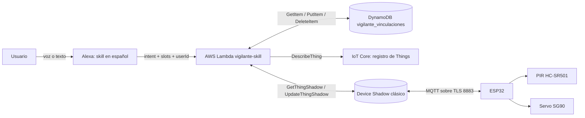
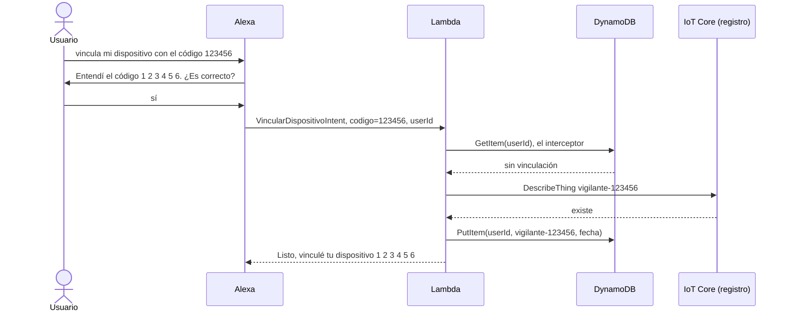
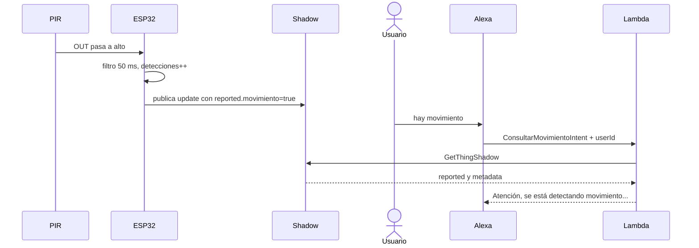
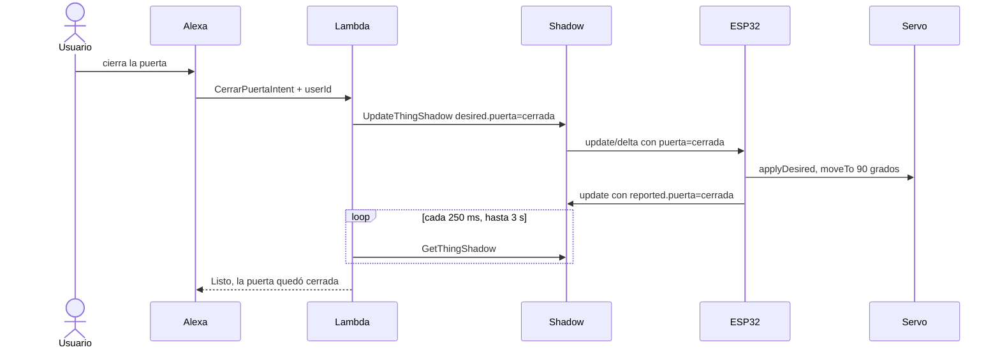

# Guía de estudio — Vigilante Inteligente (Práctica 3, SIS-234)

Guía para preparar la **defensa individual**. Explica cada carpeta, cada clase y función, qué parámetros recibe, cómo funciona, cómo se comunican las partes y qué arquitectura se usó. Al final hay preguntas probables con su respuesta.

> La rúbrica de la defensa pide poder explicar **cualquier** parte: código, circuito, AWS (Shadow, políticas, Lambda, DynamoDB), vinculación y skill. Esta guía cubre las tres capas, no solo la propia.

---

## Índice

1. [El sistema en una página](#1-el-sistema-en-una-página)
2. [Arquitectura](#2-arquitectura)
3. [Estructura del repositorio](#3-estructura-del-repositorio)
4. [Hardware: circuito y componentes](#4-hardware-circuito-y-componentes)
5. [Firmware del ESP32](#5-firmware-del-esp32-src-include-platformioini)
6. [El Device Shadow y MQTT](#6-el-device-shadow-y-mqtt)
7. [Función Lambda (backend de la skill)](#7-función-lambda-backend-de-la-skill-lambda)
8. [Skill de Alexa](#8-skill-de-alexa-alexa)
9. [Configuración de AWS](#9-configuración-de-aws-aws)
10. [Flujos completos paso a paso](#10-flujos-completos-paso-a-paso)
11. [Pruebas e integración continua](#11-pruebas-e-integración-continua)
12. [Tiempos y números clave](#12-tiempos-y-números-clave)
13. [Preguntas probables de la defensa](#13-preguntas-probables-de-la-defensa)

---

## 1. El sistema en una página

**Caso de uso.** Un objeto valioso debe estar vigilado. Un **PIR HC-SR501** detecta presencia junto al objeto y un **servo SG90** hace de pestillo de la puerta. Desde Alexa, el dueño pregunta *"¿hay movimiento?"* y ordena *"cierra la puerta"*. Cada dueño vincula **su** dispositivo diciendo un código de 6 dígitos.

**Las tres capas:**

| Capa | Dónde corre | Qué hace | Responsable |
|---|---|---|---|
| Objeto inteligente | ESP32 DOIT DevKit V1 | Lee el PIR, mueve el servo, sincroniza con el Shadow por MQTT/TLS | Ruben (hardware) y Luciana (comunicación) |
| Nube | AWS IoT Core, Lambda, DynamoDB | Guarda el estado (Shadow), resuelve qué Thing es de cada usuario, ejecuta la lógica de la skill | Alejandro |
| Voz | Alexa Developer Console (simulador) | Entiende la frase y llama a la Lambda | Alejandro |

**Regla de oro:** Alexa **nunca** habla con el ESP32. Todo pasa por el **Device Shadow**:

- La Lambda escribe la **orden** en `desired`.
- El ESP32 escribe el **estado real** en `reported`.
- AWS calcula la diferencia (`delta`) y se la entrega al ESP32.

**El PIR no mueve el servo.** La práctica pide que el actuador responda solo a comandos de voz. El PIR solo se **reporta** para consultarlo desde Alexa.

---

## 2. Arquitectura

### 2.1 Diagrama de bloques



### 2.2 Estilos y patrones usados

| Concepto | Dónde | Para qué sirve |
|---|---|---|
| **Gemelo digital (Device Shadow)** | AWS IoT Core | El Shadow guarda el estado aunque el ESP32 esté apagado. Una orden dada con el dispositivo desconectado queda en `desired` y se aplica al reconectar (RNF5). |
| **Publicación/suscripción (MQTT)** | ESP32 ↔ IoT Core | El ESP32 no recibe conexiones entrantes: se suscribe a tópicos y AWS le empuja los mensajes. |
| **Arquitectura en capas** | Firmware | Hardware (`sensors/`, `actuators/`) → aplicación (`app/SmartObject`) → transporte (`ShadowPort` y `net/`). Cada capa conoce solo a la de abajo mediante interfaces. |
| **Interfaces / polimorfismo** | `Sensor`, `Actuator`, `ShadowPort` | `SmartObject` trabaja con interfaces, no con clases concretas. Agregar el láser KY-008 o el buzzer es crear una clase nueva. |
| **Principio abierto/cerrado** | `SmartObject::addSensor/addActuator` | El sistema se extiende sin modificar el código que ya existe. |
| **Inversión de dependencias / adaptador** | `ShadowPort`, `AwsShadowPort`, `LocalShadowPort` | El mismo firmware corre conectado a AWS o en modo local por USB, solo cambiando el adaptador. |
| **Inyección de dependencias** | `build_skill(repository, gateway, settings, now)` | La Lambda recibe sus clientes de AWS desde afuera, así que las pruebas usan dobles en memoria sin cuenta de AWS. |
| **Repository** | `LinkRepository` | Encapsula DynamoDB: los manejadores piden "el Thing de este usuario" sin saber que hay una base de datos. |
| **Gateway** | `DeviceGateway` | Encapsula IoT Core (registro y Shadow). |
| **Método plantilla** | `LinkedDeviceHandler.handle` → `handle_linked` | La lógica común (¿está vinculado?, manejo de errores de AWS) está una sola vez; cada intent implementa solo su parte. |
| **Interceptor** | `LinkedThingInterceptor` | Antes de cada solicitud resuelve el Thing del usuario (RF8). |
| **Código no bloqueante** | Todo el firmware | Nada usa `delay()` en el `loop()`; se compara `millis()` para que MQTT nunca se quede sin atender. |

### 2.3 ¿Por qué este diseño?

- **El Shadow como intermediario** desacopla a Alexa del dispositivo. Alexa responde aunque el ESP32 esté apagado, y la orden no se pierde.
- **Las interfaces en el firmware** cumplen el pedido de la guía: *"poder extenderse con más sensores y actuadores sin rediseñar su arquitectura"*.
- **La inyección de dependencias en la Lambda** permite 61 pruebas automáticas sin AWS ni red.

---

## 3. Estructura del repositorio

```
Practica_3_IOT/
├── platformio.ini            Configuración de compilación del firmware (2 entornos)
├── include/
│   ├── config.h              Pines, ángulos, tiempos y claves del Shadow (se sube)
│   ├── secrets.example.h     Plantilla de WiFi, endpoint, Thing y certificados (se sube, sin valores)
│   └── secrets.h             Valores reales (NO se sube: .gitignore)
├── src/                      Firmware del ESP32
│   ├── main.cpp              Arma los objetos y elige transporte (local o AWS)
│   ├── core/                 Interfaces: Sensor, Actuator, ShadowPort
│   ├── sensors/              PirSensor (RF1)
│   ├── actuators/            DoorLock (RF3)
│   ├── app/                  SmartObject: orquestador (RF2, RF3)
│   └── net/                  WifiConnection, ShadowClient (MQTT/TLS), TimeSync (NTP)
├── test/
│   ├── luciana/              Prueba C++ en la PC de PirSensor + DoorLock + SmartObject (con stubs)
│   └── ruben/                Prueba C++ del filtro del PIR y de la calibración del servo
├── tools/prueba_hardware/    Banco de pruebas en la placa: PIR + servo sin WiFi ni AWS
├── lambda/                   Backend de la skill (Python 3.13)
│   ├── lambda_function.py    Punto de entrada de AWS Lambda
│   ├── vigilante/            Paquete: config, skill, handlers, gateway, repository, state, speech
│   ├── events/               9 eventos JSON para probar en la consola de Lambda
│   ├── tests/                pytest: 20 de la skill + 4 del guion + 37 de contrato = 61
│   ├── build.sh / build.ps1  Arman el .zip para subir a Lambda
│   └── requirements*.txt     Dependencias (ask-sdk-core; pytest para las pruebas)
├── alexa/
│   └── interaction-model.es-US.json   Modelo de interacción (invocación, intents, slots, diálogo)
├── aws/
│   ├── iot-policy.json       Política del certificado del ESP32
│   ├── lambda-role-policy.json        Permisos mínimos del rol de la Lambda
│   ├── dynamodb-table.json   Definición de la tabla de vinculaciones
│   └── README.md             Dónde se usa cada archivo
├── docs/
│   ├── INFORME.md            Informe técnico (entregable)
│   └── anexos/               Capturas, circuito, foto, CSV de pruebas y procedimientos
├── .github/workflows/pruebas.yml   Integración continua (GitHub Actions)
├── .gitignore                Excluye secretos, certificados, builds
└── README.md                 Presentación del repositorio
```

---

## 4. Hardware: circuito y componentes

### 4.1 Componentes

| Componente | Función | Dato técnico clave |
|---|---|---|
| ESP32 DOIT DevKit V1 | Microcontrolador con WiFi | Lógica de 3,3 V; se alimenta por USB desde la computadora |
| PIR HC-SR501 | Sensor de presencia (infrarrojo pasivo) | Alimentación de 4,5 a 20 V; salida **digital de 3,3 V**; alcance ajustable hasta ~7 m |
| Servo SG90 (180°) | Pestillo de la puerta | De 4,8 a 6 V; posición según el ancho del pulso PWM a 50 Hz |
| Porta pilas 4 × AA | Fuente de potencia | 6 V para el servo y el PIR |

### 4.2 Conexiones

| Componente | Pin | Va a |
|---|---|---|
| Porta pilas | + (6 V) | Riel + de la protoboard |
| Porta pilas | − | Riel − (GND común) |
| ESP32 | GND | Riel − (**une las tierras**) |
| PIR | VCC / OUT / GND | Riel + / **GPIO 27** / riel − |
| Servo | Rojo / naranja / marrón | Riel + / **GPIO 25** / riel − |

### 4.3 Justificación de cada decisión

- **El OUT del PIR va directo al GPIO, sin divisor.** El HC-SR501 tiene un regulador interno y su salida es de 3,3 V, el mismo nivel lógico del ESP32.
- **El servo y el PIR van con pilas y no con el VIN del ESP32.** Los picos de corriente del servo (cientos de mA al arrancar) sumados a los del WiFi hacen caer la tensión del USB y pueden reiniciar el ESP32 (*Brownout detector was triggered*). Con pilas, esa corriente no pasa por la placa.
- **Tierra común.** Sin unir el negativo de las pilas con el GND del ESP32, el pulso PWM del GPIO 25 no tendría referencia y el servo no lo entendería.
- **El positivo de las pilas no toca el ESP32.** Dos fuentes separadas que solo comparten la tierra.
- **GPIO 27 y 25.** No son pines de arranque (0, 2, 12, 15) ni de la flash (6–11). El 25 admite PWM (LEDC). Se usó el 13 al principio y se movió al 25 durante el diagnóstico de un falso contacto.
- **El servo era de 360°.** Durante las pruebas, "cierra" y "abre" giraban en el mismo sentido. Eso solo pasa en un servo de **rotación continua**, que interpreta el pulso como velocidad. Se cambió por uno de **180°** (de posición).

### 4.4 Ajustes del PIR

| Ajuste | Valor | Efecto |
|---|---|---|
| Jumper | **L** (disparo único, de fábrica) | Con movimiento continuo: pulso de ~1,2 s, bloqueo de ~5 s y vuelve a disparar. Una presencia larga cuenta varias detecciones. En **H** (redisparo) seguiría en alto mientras haya movimiento. |
| Tx | Mínimo | El pulso dura ~1,2 s, así `movimiento` vuelve a `false` rápido |
| Sx | De fábrica | Alcance suficiente hasta 3 m (95–100 % de detección) |
| Calentamiento | 60 s | Tras encenderse, el módulo da pulsos falsos; el firmware no cuenta nada en ese tiempo |

---

## 5. Firmware del ESP32 (`src/`, `include/`, `platformio.ini`)

### 5.1 `platformio.ini`: dos entornos

| Entorno | Bandera | Qué compila | Para qué |
|---|---|---|---|
| `esp32dev-aws` (**predeterminado**) | `FIRMWARE_LOCAL_TEST=0` | Todo, incluido `net/`, y agrega **PubSubClient 2.8** | La demo con AWS |
| `esp32dev` | `FIRMWARE_LOCAL_TEST=1` | Todo **menos** `net/` | Diagnóstico local por USB, sin WiFi |

Librerías comunes: **ArduinoJson 7.4.3** (JSON) y **ESP32Servo 1.2.1** (PWM del servo). Plataforma `espressif32@7.0.1`, placa `esp32dev`, monitor a 115200 baudios.

### 5.2 `include/config.h`: configuración no secreta

| Constante | Valor | Uso |
|---|---|---|
| `PIR_PIN` | 27 | Entrada del PIR |
| `SERVO_PIN` | 25 | Salida PWM del servo |
| `PIR_WARMUP_MS` | 60000 | Calentamiento del PIR |
| `SERVO_ANGLE_CLOSED` / `SERVO_ANGLE_OPEN` | 90 / 0 | Ángulos del pestillo |
| `SERVO_SETTLE_MS` | 700 | Tiempo con PWM antes de soltar el servo |
| `MQTT_PORT` | 8883 | MQTT sobre TLS |
| `MQTT_BUFFER_SIZE` | 2048 | El documento de `get/accepted` supera los 256 B que trae PubSubClient por defecto |
| `THING_PREFIX` | `"vigilante-"` | Prefijo de los Things |
| `KEY_DOOR`, `KEY_MOTION`, `KEY_DETECTIONS`, `KEY_LAST_DETECTION`, `KEY_SENSOR_READY`, `KEY_UPTIME`, `KEY_RSSI` | `"puerta"`, `"movimiento"`, … | Nombres de los atributos del Shadow (**deben ser iguales en la Lambda**; una prueba lo verifica) |
| `DOOR_OPEN` / `DOOR_CLOSED` | `"abierta"` / `"cerrada"` | Valores válidos de la puerta |
| `REPORT_MIN_GAP_MS` | 500 | Separación mínima entre reportes por evento |
| `REPORT_PERIOD_MS` | 60000 | Latido (reporte periódico) |
| `WIFI_RETRY_MS` / `MQTT_RETRY_MS` | 5000 | Espera entre reintentos de conexión |
| `NTP_SERVER_1` / `_2` | pool.ntp.org / time.google.com | Hora UTC |
| `SERIAL_BAUD` | 115200 | Monitor serie |

### 5.3 `include/secrets.h` y `secrets.example.h`

`secrets.h` define `WIFI_SSID`, `WIFI_PASSWORD`, `AWS_IOT_ENDPOINT`, `THING_NAME`, `AWS_ROOT_CA`, `AWS_DEVICE_CERT` y `AWS_PRIVATE_KEY`. **Nunca se sube**: `.gitignore` excluye `secrets.h`, `*.pem`, `*.key` y `*.crt`. En el repositorio va solo `secrets.example.h`, con marcadores (`PEGUE AQUÍ…`) en vez de valores. La integración continua copia la plantilla a `secrets.h` para poder compilar la demo sin secretos.

### 5.4 Interfaces (`src/core/`)

#### `Sensor` ([`core/Sensor.h`](src/core/Sensor.h))

| Método | Parámetros | Devuelve | Qué debe hacer |
|---|---|---|---|
| `begin()` | — | — | Configurar pines y estado inicial (una vez, en `setup`) |
| `update(nowMs)` | `unsigned long nowMs`: hora actual en ms (`millis()`) | `bool` | Leer el sensor. **`true` si hubo un cambio que hay que reportar ya** (reporte por evento) |
| `report(reported)` | `JsonObject reported`: el objeto `state.reported` que se está armando | — | Escribir sus atributos en el JSON |

#### `Actuator` ([`core/Actuator.h`](src/core/Actuator.h))

| Método | Parámetros | Devuelve | Qué debe hacer |
|---|---|---|---|
| `key()` | — | `const char*` | Nombre del atributo del Shadow que controla (`"puerta"`) |
| `begin()` | — | — | Configurar el hardware y llevarlo a su **estado seguro** |
| `loop(nowMs)` | `unsigned long nowMs` | — | Tareas no bloqueantes (soltar el servo) |
| `applyDesired(value)` | `JsonVariantConst value`: el valor deseado que llegó en el delta | `bool` | Aplicar la orden. `false` si el valor es inválido (se ignora) |
| `report(reported)` | `JsonObject reported` | — | Escribir su estado actual |

#### `ShadowPort` ([`core/ShadowPort.h`](src/core/ShadowPort.h))

Es el **contrato del transporte**. `SmartObject` no sabe si habla con AWS o con el monitor serie.

| Método | Parámetros | Devuelve |
|---|---|---|
| `connected()` | — | `bool`: ¿hay sesión activa? |
| `publishReported(reported)` | `JsonObjectConst`: el estado a publicar | `bool`: ¿se publicó? |
| `onDelta(handler)` | `std::function<void(JsonObjectConst)>`: función a llamar con cada delta | — |
| `onConnected(handler)` | `std::function<void()>`: función a llamar al (re)conectar | — |

### 5.5 `PirSensor` ([`sensors/PirSensor.h`](src/sensors/PirSensor.h) / [`.cpp`](src/sensors/PirSensor.cpp)) — RF1

**Constructor:** `PirSensor(uint8_t pin, unsigned long warmupMs, unsigned long debounceMs = 50)`

| Parámetro | En la demo | Significado |
|---|---|---|
| `pin` | `PIR_PIN` = 27 | GPIO conectado a OUT |
| `warmupMs` | `PIR_WARMUP_MS` = 60000 | Tiempo de calentamiento tras `begin()` |
| `debounceMs` | 50 (por defecto) | Tiempo que un nivel debe mantenerse estable para aceptarse. `0` desactiva el filtro (lo usa la prueba de Luciana) |

**Atributos internos:** `ready_`, `motion_` (estado filtrado), `rawLevel_` y `rawSinceMs_` (para el filtro), `detections_`, `lastDetectionEpoch_`.

**`begin()`**
1. `pinMode(pin, INPUT_PULLDOWN)`: el *pull-down* interno evita falsos positivos si el cable de OUT se suelta (sin él, la entrada quedaría "flotando"). En la PC, donde no existe `INPUT_PULLDOWN`, usa `INPUT`.
2. Guarda `startedMs_ = millis()` y reinicia contadores.

**`update(nowMs)`, paso a paso**
1. **Calentamiento:** si `nowMs - startedMs_ < warmupMs_`, devuelve `false` sin leer el pin. Al terminar, marca `ready_ = true` e imprime `[PIR] Calentamiento terminado` (devolverá `true` para publicar `sensor_listo: true`).
2. **Filtro de 50 ms:** lee el pin. Si cambió respecto de la última lectura cruda, reinicia el cronómetro (`rawSinceMs_ = nowMs`). Solo acepta el nivel nuevo si se mantuvo `debounceMs_`. Así un pico de ruido de 10–20 ms (por ejemplo, del servo) no cuenta.
3. **Flanco de subida** (de sin movimiento a movimiento): `detections_++` y guarda la hora con `time(nullptr)`. Si la hora es anterior a 2024 (NTP aún no sincronizó), guarda `0`.
4. Devuelve `true` en cada cambio aceptado.

> Todas las restas son `ahora - inicio` sin signo, así siguen funcionando cuando `millis()` se desborda (cada ~49 días).

**`report(reported)`** escribe `movimiento`, `detecciones`, `ultima_deteccion` y `sensor_listo`.

### 5.6 `DoorLock` ([`actuators/DoorLock.h`](src/actuators/DoorLock.h) / [`.cpp`](src/actuators/DoorLock.cpp)) — RF3

**Constructor:** `DoorLock(uint8_t pin, int closedAngle, int openAngle, unsigned long settleMs)`

| Parámetro | En la demo | Significado |
|---|---|---|
| `pin` | `SERVO_PIN` = 25 | Señal PWM |
| `closedAngle` | 90 | Pestillo trabando la puerta |
| `openAngle` | 0 | Pestillo liberado |
| `settleMs` | 700 | Tiempo con PWM antes de soltar el servo |

| Método | Qué hace |
|---|---|
| `key()` | Devuelve `"puerta"` (`KEY_DOOR`) |
| `begin()` | 50 Hz y **cerrada** (estado seguro). Si el Shadow pide "abierta", el delta llega al conectarse y lo corrige |
| `applyDesired(value)` | Acepta solo el texto `"cerrada"` o `"abierta"`. Un número u otro texto devuelve `false` y el servo no se mueve (`[Puerta] Valor deseado desconocido`) |
| `moveTo(closed)` (privado) | `attach(pin, 500, 2400)` si hace falta (pulso de 500 µs = 0°, 2400 µs = 180°), `write(ángulo)`, guarda `closed_` y empieza a contar los 700 ms |
| `loop(nowMs)` | Si pasaron `settleMs` desde el movimiento, `detach()`: **suelta el servo** para evitar vibraciones y picos de consumo |
| `report(reported)` | `puerta = "cerrada"` o `"abierta"` |
| `calibrate(angle)` | Solo para el banco de pruebas: mueve a un ángulo libre (0–180) sin cambiar el estado reportado |
| `isClosed()` | Estado actual |

> **Limitación honesta:** el SG90 no mide su posición. `reported.puerta` es la posición **ordenada** por software, no una medición. Al soltar el PWM, el pestillo debe mantenerse por la mecánica.

### 5.7 `SmartObject` ([`app/SmartObject.h`](src/app/SmartObject.h) / [`.cpp`](src/app/SmartObject.cpp)) — RF2 y RF3

El **orquestador**. No conoce el PIR ni el servo: trabaja con listas de `Sensor*` y `Actuator*`.

**Constructor:** `SmartObject(ShadowPort &shadow, unsigned long minGapMs, unsigned long periodMs)`

| Parámetro | En la demo | Significado |
|---|---|---|
| `shadow` | `channel` (adaptador AWS o local) | Transporte |
| `minGapMs` | 500 | Separación mínima entre reportes por evento (anti-ráfagas) |
| `periodMs` | 60000 | Latido |

**Banderas internas:** `reportPending_` (hay algo que publicar), `forceReport_` (publicar ya, ignorando los 500 ms), `lastReportMs_`.

| Método | Qué hace |
|---|---|
| `addSensor(s)` / `addActuator(a)` | Registra componentes (punto de extensión) |
| `begin()` | Llama a `begin()` de todos; registra `onDelta` → `handleDelta`, y `onConnected` → marca `reportPending_` y `forceReport_` (publicar el estado completo al conectar) |
| `loop(nowMs)` | **(1)** `loop()` de cada actuador. **(2)** `update()` de cada sensor; si alguno devuelve `true`, `reportPending_ = true`. **(3)** Si no hay conexión, sale (se publicará todo al reconectar). **(4)** Publica si toca el latido (`now - last ≥ 60 s`) o si hay evento pendiente y se cumplen los 500 ms, o si es forzado |
| `handleDelta(delta)` (privado) | Para cada actuador, busca `delta[actuador.key()]`. Si existe y `applyDesired` lo acepta, fuerza un reporte inmediato (**confirmación** en `reported`) |
| `publishState(nowMs)` (privado) | Arma `reported` con el `report()` de todos, más `uptime_s = nowMs/1000` y `rssi = WiFi.RSSI()`. Si se publicó, limpia las banderas y guarda `lastReportMs_`; si falló, reintenta en la próxima vuelta |

### 5.8 Capa de red (`src/net/`)

#### `WifiConnection` ([`net/WifiConnection.h`](src/net/WifiConnection.h))

**Constructor:** `WifiConnection(const char *ssid, const char *password, unsigned long retryMs)`

| Método | Qué hace |
|---|---|
| `begin()` | Modo estación (`WIFI_STA`) y reconexión automática del sistema |
| `ensure(nowMs)` → `bool` | `true` si hay WiFi. Si no hay, reintenta `WiFi.begin()` **cada `retryMs` (5 s)** sin bloquear. Detecta las transiciones e imprime `[WiFi] Conectado, IP…, RSSI…` o `Conexión perdida` |
| `justConnected()` → `bool` | `true` **solo en la vuelta** en que se recuperó la conexión. `main.cpp` lo usa para iniciar NTP y forzar el intento MQTT |

#### `ShadowClient` ([`net/ShadowClient.h`](src/net/ShadowClient.h) / [`.cpp`](src/net/ShadowClient.cpp))

**Constructor:** `ShadowClient(endpoint, port, thingName, rootCa, deviceCert, privateKey, retryMs)`. Arma los cuatro tópicos a partir de `$aws/things/<thingName>/shadow/`.

| Método | Qué hace |
|---|---|
| `begin(bufferSize)` | Carga en `WiFiClientSecure` la **CA raíz de Amazon**, el **certificado** y la **clave privada** (TLS mutuo). Configura el servidor, el buffer (2048), un *keep-alive* de 30 s y el *callback* de mensajes |
| `ensure(nowMs)` → `bool` | Si no hay sesión, intenta `connect(thingName)` cada 5 s. **El client ID es el nombre del Thing porque la política lo exige.** Al conectar: se suscribe (QoS 1) a `update/delta` y `get/accepted`, avisa a `onConnected` y **publica `get`** para recuperar órdenes pendientes |
| `loop()` | `mqtt.loop()`: procesa los mensajes entrantes y el *keep-alive* |
| `publishReported(reported)` | Publica `{"state":{"reported":{…}}}` en `update` (buffer de 512 B) |
| `retryNow()` | Borra el temporizador para intentar MQTT ya (al volver el WiFi) |
| `handleMessage(topic, payload, length)` (privado) | Parsea el JSON. Si vino por **`update/delta`**, el delta está en `state`. Si vino por **`get/accepted`**, está en `state.delta` (si no hay, "sin cambios pendientes"). Imprime la hora `epoch_ms` (para comparar con CloudWatch) y llama al manejador del delta |

#### `TimeSync` ([`net/TimeSync.h`](src/net/TimeSync.h))

Métodos estáticos: `begin()` → `configTime(0, 0, pool.ntp.org, time.google.com)` (UTC); `nowEpoch()` y `nowEpochMs()` devuelven `0` si la hora es anterior a 2024 (aún no sincronizó). Se usa para `ultima_deteccion` y para medir latencias. **El sistema funciona aunque no haya hora.**

### 5.9 `main.cpp`: la composición ([`src/main.cpp`](src/main.cpp))

1. **Elige el transporte** según `FIRMWARE_LOCAL_TEST`:
   - **Local:** `LocalShadowPort` imprime el JSON por USB y convierte las teclas `a`/`c` en un delta de prueba.
   - **AWS:** crea `WifiConnection`, `ShadowClient` y `AwsShadowPort`, que traduce `ShadowPort` a `ShadowClient`. Si falta `secrets.h`, da un error de compilación claro.
2. **Crea los objetos:** `PirSensor pir(27, 60000)`, `DoorLock door(25, 90, 0, 700)`, `SmartObject smartObject(channel, 500, 60000)`.
3. **`setup()`:** imprime el **motivo del último reinicio** (útil para diagnosticar un *brownout*), registra el PIR y el servo, `smartObject.begin()`. En AWS muestra el **código de vinculación** (`123456`), que es lo que el usuario le dice a Alexa (RF7), e inicia WiFi y MQTT.
4. **`loop()` (AWS):**
   ```
   wifi.ensure(now)
   si wifi.justConnected(): TimeSync::begin(); shadow.retryNow()
   si hay wifi y shadow.ensure(now): shadow.loop()
   smartObject.loop(millis())
   ```
   Se toma `millis()` **después** de atender la red, para que el temporizador del servo nunca reciba una hora anterior al inicio del movimiento.

### 5.10 Banco de pruebas (`tools/prueba_hardware/`)

Proyecto PlatformIO aparte que compila los **mismos** `PirSensor` y `DoorLock` con el `config.h` de la raíz, **sin WiFi ni AWS**. Comandos por el monitor serie: `c`/`a` (cerrar/abrir, por el mismo `applyDesired` del delta), `+`/`-` (calibrar de 5 en 5 grados), `r` (reiniciar el conteo antes de cada distancia de RNF2) y `s` (estado). Al arrancar muestra el motivo del reinicio (15 = *brownout*). Con él se midió RNF2 y se descubrió que el servo era de 360°.

---

## 6. El Device Shadow y MQTT

### 6.1 Documento Shadow (clásico, sin nombre)

```json
{
  "state": {
    "desired":  { "puerta": "abierta" },
    "reported": {
      "puerta": "cerrada", "movimiento": false, "detecciones": 4,
      "ultima_deteccion": 1794040000, "sensor_listo": true,
      "uptime_s": 1820, "rssi": -58
    },
    "delta": { "puerta": "abierta" }
  }
}
```

| Atributo | Sección | Tipo | Valores | Escribe | Lee |
|---|---|---|---|---|---|
| `puerta` | desired | string | `"abierta"` / `"cerrada"` | Lambda | ESP32 (vía delta) |
| `puerta` | reported | string | `"abierta"` / `"cerrada"` | ESP32 | Lambda |
| `movimiento` | reported | bool | | ESP32 | Lambda (RF4) |
| `detecciones` | reported | entero ≥ 0 | desde el encendido | ESP32 | Lambda |
| `ultima_deteccion` | reported | entero | epoch UTC (s); 0 = sin hora | ESP32 | Lambda |
| `sensor_listo` | reported | bool | `false` los primeros 60 s | ESP32 | Lambda |
| `uptime_s` | reported | entero | segundos desde el encendido | ESP32 | Prueba RNF1 |
| `rssi` | reported | entero | dBm | ESP32 | Diagnóstico |

- **desired** = lo que pide el usuario (solo lo escribe la Lambda).
- **reported** = lo que el dispositivo confirma (solo lo escribe el ESP32).
- **delta** = lo calcula AWS cuando `desired ≠ reported`. Lo publica en `update/delta` y lo incluye en `get/accepted`.

> En el Shadow real aparece además `"welcome": "aws-iot"`: es el valor que AWS pone por defecto al crear el Shadow desde la consola. No lo usa nadie.

### 6.2 Tópicos MQTT del ESP32

| Tópico (`$aws/things/vigilante-123456/shadow/…`) | ESP32 | Contenido |
|---|---|---|
| `update` | **publica** | `{"state":{"reported":{…}}}`: eventos y latido |
| `get` | **publica** | `{}`: pide el documento completo al (re)conectar |
| `update/delta` | **se suscribe** | `{"state":{"puerta":"abierta"}, "version":…}`: órdenes nuevas |
| `get/accepted` | **se suscribe** | `{"state":{"desired":…, "reported":…, "delta":{…}}}`: respuesta a `get` |

- **La Lambda no usa MQTT.** Usa la API HTTPS de IoT Data (`GetThingShadow` / `UpdateThingShadow`); AWS se encarga de convertir eso en mensajes MQTT para el ESP32.
- **Seguridad del canal:** TLS 1.2 con **autenticación mutua** por certificado X.509 en el puerto 8883. No hay usuario ni contraseña ni *access keys*.
- **QoS:** las suscripciones son QoS 1. PubSubClient publica en QoS 0; si un `reported` se pierde, el latido de 60 s vuelve a enviar todo el estado.

---

## 7. Función Lambda (backend de la skill, `lambda/`)

### 7.1 Módulos

| Archivo | Clase / función | Responsabilidad | RF |
|---|---|---|---|
| [`lambda_function.py`](lambda/lambda_function.py) | `lambda_handler` | Punto de entrada. Crea los clientes `boto3` **una vez por contenedor** (se reutilizan entre invocaciones) y arma la skill | — |
| [`vigilante/config.py`](lambda/vigilante/config.py) | `Settings`, constantes `KEY_*`, `DOOR_*` | Lee las variables de entorno y define las claves del Shadow | — |
| [`vigilante/skill.py`](lambda/vigilante/skill.py) | `build_skill()` | Registra el interceptor, los 12 manejadores y el de excepciones, **inyectando** las dependencias | — |
| [`vigilante/link_repository.py`](lambda/vigilante/link_repository.py) | `LinkRepository` | DynamoDB: `get_thing`, `save`, `delete` | RF7–RF9 |
| [`vigilante/device_gateway.py`](lambda/vigilante/device_gateway.py) | `DeviceGateway` | IoT Core: `thing_exists`, `get_state`, `request_door`, `wait_for_door` | RF4–RF6, RF9 |
| [`vigilante/device_state.py`](lambda/vigilante/device_state.py) | `DeviceState` | Vista de solo lectura del Shadow | RF4, RF6 |
| [`vigilante/handlers.py`](lambda/vigilante/handlers.py) | Interceptor y manejadores | La lógica de cada intent | RF4–RF9 |
| [`vigilante/speech.py`](lambda/vigilante/speech.py) | Frases y `digits()`, `elapsed()`, `stale_warning()` | Textos en español y SSML | — |

### 7.2 `Settings` (variables de entorno)

| Campo | Variable | Por defecto | Uso |
|---|---|---|---|
| `iot_endpoint` | `IOT_ENDPOINT` | **obligatoria** | Endpoint ATS de IoT Data |
| `links_table` | `LINKS_TABLE` | `vigilante_vinculaciones` | Tabla de DynamoDB |
| `thing_prefix` | `THING_PREFIX` | `vigilante-` | Prefijo de los Things |
| `code_length` | — | 6 | Dígitos del código |
| `confirm_timeout_s` | `CONFIRM_TIMEOUT_S` | 3.0 | Cuánto espera la confirmación del servo |
| `poll_interval_s` | — | 0.25 | Cada cuánto consulta el Shadow mientras espera |
| `stale_after_s` | `STALE_AFTER_S` | 150 | Segundos sin reporte para avisar "puede estar desconectado" |

### 7.3 `LinkRepository(dynamodb_client, table_name)`

| Método | Parámetros | Operación | Devuelve |
|---|---|---|---|
| `get_thing(user_id)` | `str` | `GetItem` con `ConsistentRead=True` | `thingName` o `None` |
| `save(user_id, thing_name)` | `str`, `str` | `PutItem` con `userId`, `thingName`, `fechaVinculacion` (UTC ISO). Si ya existía, **lo reemplaza**: así se implementa "cambiar la vinculación" | — |
| `delete(user_id)` | `str` | `DeleteItem` | — |

### 7.4 `DeviceGateway(iot_client, iot_data_client, poll_interval_s=0.25, clock, sleep)`

| Método | Parámetros | Operación AWS | Qué hace |
|---|---|---|---|
| `thing_exists(thing_name)` | `str` | `DescribeThing` | `True` si existe; `False` si `ResourceNotFoundException` (**RF9**) |
| `get_state(thing_name)` | `str` | `GetThingShadow` | Devuelve un `DeviceState`; si el Shadow no existe, uno vacío |
| `request_door(thing_name, value)` | `str`, `"abierta"`/`"cerrada"` | `UpdateThingShadow` con `{"state":{"desired":{"puerta":value}}}` | Escribe la orden (**RF5**) |
| `wait_for_door(thing_name, value, timeout_s)` | `str`, `str`, `float` | `GetThingShadow` cada 250 ms | Espera a que `reported.puerta == value`. Devuelve `(confirmado, milisegundos)` |

`clock` y `sleep` se inyectan para que las pruebas no esperen de verdad.

### 7.5 `DeviceState`

Se construye con `DeviceState.from_shadow(documento)`. Propiedades: `has_report`, `door` (reported), `desired_door`, `door_pending` (hay `desired` distinto de `reported`), `motion`, `detections`, `last_detection_epoch`, `sensor_ready` (si falta, asume `True`), y `seconds_since_report(now)`, que usa el `timestamp` más reciente de `metadata.reported`.

### 7.6 Manejadores ([`handlers.py`](lambda/vigilante/handlers.py))

| Clase | Atiende | Lógica |
|---|---|---|
| `LinkedThingInterceptor` | Toda `LaunchRequest` e `IntentRequest` | Lee `context.System.user.userId`, busca su Thing en DynamoDB y lo guarda en los atributos de la solicitud (**RF8**) |
| `LaunchRequestHandler` | Abrir la skill | Bienvenida distinta si está vinculado o no |
| `LinkDeviceHandler` | `VincularDispositivoIntent` | Valida 6 dígitos → arma `vigilante-<código>` → `thing_exists` → si es el mismo, "ya estaba" → `save` → "vinculé" o "cambié tu vinculación de X a Y" (**RF7, RF9**) |
| `LinkStatusHandler` | `ConsultarVinculacionIntent` | "Tienes vinculado el dispositivo 1 2 3 4 5 6" |
| `UnlinkDeviceHandler` | `DesvincularDispositivoIntent` | Si `confirmationStatus == DENIED` conserva; si no, `delete` (**RF9**) |
| `LinkedDeviceHandler` (base) | — | **Método plantilla:** si no hay Thing → "aún no tienes un dispositivo vinculado"; si AWS falla → "no pude comunicarme con AWS IoT"; si no, llama a `handle_linked(thing)` |
| `MotionQueryHandler` | `ConsultarMovimientoIntent` | Sin reportes → aviso; calentando → "se está calibrando"; si no, movimiento sí/no + "la última detección fue hace…" + número de detecciones + aviso de desconexión (**RF4**) |
| `DoorCommandHandler` (base) → `CloseDoorHandler` / `OpenDoorHandler` | `CerrarPuertaIntent` / `AbrirPuertaIntent` | Si ya está así y no hay orden pendiente → "ya está". Si no: `request_door` → `wait_for_door(3 s)` → registra `{"evento":"comando_puerta", …, "latencia_ms":…}` en CloudWatch → "Listo, la puerta quedó cerrada" o "envié la orden pero aún no la confirmó" (**RF5**) |
| `DoorStatusHandler` | `EstadoPuertaIntent` | "La puerta está cerrada" (+ "hay una orden pendiente…") (**RF6**) |
| `HelpIntentHandler`, `CancelOrStopIntentHandler`, `FallbackIntentHandler`, `SessionEndedRequestHandler` | Intents de Amazon | Ayuda, salir (incluye `NavigateHomeIntent`), "no entendí", fin de sesión |
| `CatchAllExceptionHandler` | Cualquier excepción | "Lo siento, tuve un problema…" |

Todas las respuestas (menos salir) **mantienen la sesión abierta** con "¿Algo más?".

### 7.7 `speech.py`

- `digits(code)` → SSML `<say-as interpret-as="digits">`: Alexa lee "1 2 3 4 5 6", no "ciento veintitrés mil…".
- `elapsed(seconds)` → "hace menos de un minuto", "hace 3 minutos", "hace 2 horas".
- `stale_warning(segundos, límite)` → agrega "puede estar desconectado" si pasaron más de 150 s sin reporte.

---

## 8. Skill de Alexa (`alexa/`)

- **Invocación:** `vigilante inteligente` · idioma **Spanish (US)** · hosting propio (*Provision your own*) apuntando al ARN de la Lambda.
- **Por qué no Alexa-hosted:** una skill *Alexa-hosted* corre en una cuenta de Amazon que no tiene acceso al IoT Core ni al DynamoDB del proyecto.

| Intent | Slot | Frases de ejemplo |
|---|---|---|
| `VincularDispositivoIntent` | `codigo` (`AMAZON.NUMBER`), obligatorio y con confirmación | "vincula mi dispositivo con el código {codigo}", "cambia mi dispositivo al código {codigo}" |
| `ConsultarVinculacionIntent` | — | "qué dispositivo tengo vinculado" |
| `DesvincularDispositivoIntent` | — (confirmación del intent) | "desvincula mi dispositivo" |
| `ConsultarMovimientoIntent` | — | "hay movimiento", "detectó algo el sensor" |
| `CerrarPuertaIntent` / `AbrirPuertaIntent` | — | "cierra la puerta" / "abre la puerta" |
| `EstadoPuertaIntent` | — | "la puerta está cerrada", "cómo está la puerta" |
| `AMAZON.Help/Cancel/Stop/NavigateHome/FallbackIntent` | — | Integrados |

**Modelo de diálogo (delegación automática):**
- `codigo` se **pide** si falta (`Elicit.Slot.Vincular.codigo`) y se **confirma** dígito por dígito (`Confirm.Slot.Vincular.codigo`: "Entendí el código 1 2 3 4 5 6. ¿Es correcto?"), porque el reconocimiento de números largos por voz puede fallar.
- Desvincular pide confirmación del intent (`Confirm.Intent.Desvincular`), porque borra datos. Si el usuario dice "no", la Lambda recibe `DENIED`.

**Por qué `AMAZON.NUMBER` y un código numérico:** Alexa reconoce mejor un número que un nombre con guiones como `vigilante-123456`. Como `AMAZON.NUMBER` descarta los ceros a la izquierda, el código **no empieza con 0**.

---

## 9. Configuración de AWS (`aws/`)

Todo está en **us-east-2 (Ohio)**. IoT Core, DynamoDB y Lambda deben estar en la misma región.

### 9.1 IoT Core

- **Things:** `vigilante-123456` (el ESP32 real, con certificado) y `vigilante-654321` (de prueba, sin hardware ni certificado: sirve para demostrar cambiar la vinculación y que la skill no está atada a un Thing).
- **Certificado X.509** activo, adjunto al Thing y a la política. La CA raíz es *Amazon Root CA 1*; el endpoint es de tipo **ATS**.

### 9.2 Política del dispositivo ([`aws/iot-policy.json`](aws/iot-policy.json))

| Acción | Recurso | Qué permite |
|---|---|---|
| `iot:Connect` | `client/${iot:Connection.Thing.ThingName}` | Conectarse **solo** con el client ID igual al nombre de su Thing |
| `iot:Publish` | `topic/$aws/things/${…ThingName}/shadow/*` | Publicar solo en **su** Shadow |
| `iot:Subscribe` | `topicfilter/$aws/things/${…}/shadow/*` | Suscribirse solo a su Shadow |
| `iot:Receive` | `topic/$aws/things/${…}/shadow/*` | Recibir solo de su Shadow |

La variable `${iot:Connection.Thing.ThingName}` hace que **una sola política sirva para todos los Things** y que cada certificado vea solo su Shadow. Se verificó en vivo que conectar con otro client ID o publicar en el Shadow de `vigilante-654321` es **rechazado**.

### 9.3 Rol de la Lambda ([`aws/lambda-role-policy.json`](aws/lambda-role-policy.json)): 6 acciones

| Acción | Recurso | Para qué |
|---|---|---|
| `iot:DescribeThing` | `thing/vigilante-*` | Validar que el Thing exista (RF9) |
| `iot:GetThingShadow` | `thing/vigilante-*` | Leer `reported` (RF4, RF6) y esperar la confirmación |
| `iot:UpdateThingShadow` | `thing/vigilante-*` | Escribir `desired` (RF5) |
| `dynamodb:GetItem` | `table/vigilante_vinculaciones` | Resolver el Thing del usuario (RF8) |
| `dynamodb:PutItem` | ídem | Vincular o cambiar (RF7, RF9) |
| `dynamodb:DeleteItem` | ídem | Desvincular (RF9) |

Más la política administrada `AWSLambdaBasicExecutionRole`, solo para los logs. **Mínimo privilegio:** sin comodines en las acciones, recursos limitados a `vigilante-*` y a una tabla. La Lambda **no** tiene `iot:Publish`.

**Sin access keys en ningún lado:** el ESP32 usa su certificado y la Lambda las credenciales temporales de su rol.

### 9.4 DynamoDB ([`aws/dynamodb-table.json`](aws/dynamodb-table.json))

Tabla `vigilante_vinculaciones`: clave de partición `userId` (String) y modo **bajo demanda**. Un usuario tiene **un** Thing; una consulta por `userId` es un `GetItem` directo, de costo constante.

| `userId` (clave) | `thingName` | `fechaVinculacion` |
|---|---|---|
| `amzn1.ask.account.A…` | `vigilante-123456` | `2026-11-08T21:20:…Z` |

### 9.5 Lambda `vigilante-skill`

Python 3.13, 256 MB, **timeout de 10 s** (el peor caso de "cierra la puerta" es ~4–5 s, y Alexa espera como máximo 8 s). Variables: `IOT_ENDPOINT` y `LINKS_TABLE`. Desencadenador: **Alexa Skills Kit con verificación del Skill ID** (solo esta skill puede invocarla). Logs en CloudWatch con retención de 1 semana. El `.zip` lo arman `build.sh`/`build.ps1`; incluye `ask-sdk-core` pero **no** `boto3`, que ya viene en el runtime.

### 9.6 Costos

Plan gratuito con créditos (USD 120 disponibles, USD 0 usados). Con un latido por minuto, un dispositivo encendido todo el mes ≈ 50 000 mensajes + 50 000 operaciones de Shadow ≈ **USD 0,11/mes**.

---

## 10. Flujos completos paso a paso

### 10.1 Vincular un dispositivo (RF7, RF8, RF9)



Si el código no existe, `DescribeThing` da `ResourceNotFoundException` y la Lambda responde "No encontré ningún dispositivo con el código…" **sin escribir nada**.

### 10.2 Consultar el sensor (RF1, RF2, RF4)



### 10.3 Comando sobre el actuador (RF3, RF5)



### 10.4 Reconexión con orden pendiente (RNF5)

1. Se corta el WiFi. `WifiConnection` detecta la pérdida y reintenta cada 5 s.
2. El usuario dice "abre la puerta". La Lambda escribe `desired.puerta = "abierta"`, espera 3 s, no hay confirmación y responde **"Envié la orden… se aplicará en cuanto se conecte"**. La orden queda guardada en el Shadow.
3. Vuelve la red: `justConnected()` → `TimeSync::begin()` + `shadow.retryNow()`.
4. `ShadowClient::ensure` conecta (handshake TLS ≈ 2,5 s), se suscribe y **publica `get`**.
5. AWS responde por `get/accepted` con `state.delta = {"puerta":"abierta"}`.
6. `handleMessage` → `SmartObject::handleDelta` → `DoorLock::applyDesired("abierta")` → el servo abre.
7. Reporte forzado: `reported.puerta = "abierta"`. Ahora `desired == reported` y el delta desaparece.

Medido: reconexión y apertura en **8,2 s de promedio** (máximo 9,7 s), sin dar otra orden.

### 10.5 Reportes del ESP32 (RF2, RNF4)

- **Por evento:** cada cambio del PIR o del servo se publica de inmediato, con un mínimo de **500 ms** entre reportes. Las confirmaciones del servo y el primer reporte al reconectar **no esperan** esos 500 ms.
- **Latido:** cada **60 s** el estado completo, aunque no haya cambios. La Lambda avisa "puede estar desconectado" a los **150 s**, lo que tolera un latido perdido.
- **Por qué no cada 10 s:** el movimiento es un evento discreto, así que lo importante es reportarlo al instante. Un latido de 10 s multiplicaría por 6 los mensajes sin mejorar la respuesta.

---

## 11. Pruebas e integración continua

### 11.1 Pruebas automáticas

| Prueba | Cuántas | Qué verifica |
|---|---|---|
| [`lambda/tests/test_skill.py`](lambda/tests/test_skill.py) | 20 | Cada RF de la skill por separado: vincular, rechazar, formato inválido, cambiar, consultar, desvincular sí/no, movimiento, calentamiento, desconexión, cerrar/abrir, orden pendiente, estado, dos usuarios |
| [`lambda/tests/test_guion_alexa.py`](lambda/tests/test_guion_alexa.py) | 4 | El guion completo del simulador de punta a punta, el segundo usuario aislado (`test_guion_segundo_usuario_controla_solo_su_thing`), la reconexión que aplica la orden pendiente, y ayuda/salida |
| [`lambda/tests/test_contratos.py`](lambda/tests/test_contratos.py) | 37 | **Integración entre capas:** modelo de Alexa ↔ manejadores, en ambos sentidos; claves y valores del Shadow, prefijo, pines, latido y tiempo de confirmación entre `config.h` y `config.py`; un solo firmware en el repositorio; plantilla de secretos sin valores reales; políticas IAM/IoT mínimas; tabla ↔ `LinkRepository`; ningún secreto en Git |
| [`test/luciana/test_firmware.cpp`](test/luciana/test_firmware.cpp) | 1 programa | `PirSensor` + `DoorLock` + `SmartObject` reales con dobles (stubs) de Arduino, servo y transporte: calentamiento, flancos, desborde de `millis()`, comandos inválidos, 700 ms de PWM, eventos, latido, confirmación, reintento, reconexión |
| [`test/ruben/test_hardware.cpp`](test/ruben/test_hardware.cpp) | 1 programa | Filtro de 50 ms del PIR (ruido en alto y en bajo), que no cuente durante el calentamiento, y la calibración del servo |

**Cómo funcionan los dobles de la Lambda** ([`tests/fakes.py`](lambda/tests/fakes.py)): `FakeDynamoDB` guarda filas en un diccionario, `FakeIot` simula el registro de Things y `FakeIotData` simula el Shadow **e imita al ESP32** (aplica el `desired` en `reported`). Como `build_skill` recibe las dependencias, se arma la skill real con estos dobles y un reloj simulado: **sin cuenta de AWS, sin red y sin esperas**.

**Eventos de [`lambda/events/`](lambda/events/):** 9 JSON (`01_launch` … `09_vincular_segundo_usuario`) que se pegan en la pestaña *Test* de la consola de Lambda para probar la función real sin Alexa.

### 11.2 Integración continua ([`.github/workflows/pruebas.yml`](.github/workflows/pruebas.yml))

En cada *push* y *pull request*, GitHub Actions:
1. **Job `lambda`:** Python 3.13, instala dependencias y ejecuta `pytest` (61 pruebas).
2. **Job `firmware`:** instala PlatformIO, compila `esp32dev`, copia `secrets.example.h` → `secrets.h` y compila `esp32dev-aws`, compila y ejecuta las dos pruebas C++ con `g++`, y compila `tools/prueba_hardware`.

### 11.3 Pruebas físicas (resultados)

| RNF | Valor declarado | Obtenido |
|---|---|---|
| RNF1 Estabilidad | ≥ 30 min sin reinicios | Más de 30 min, `uptime_s` ≥ 1800, 5 órdenes aplicadas, RSSI de −48 a −55 dBm |
| RNF2 Exactitud | ≥ 95 % hasta 3 m; 0 falsos positivos | 100 % a 1 y 2 m, 95 % a 3 m (98,3 % en 1–3 m); 75 % a 4 m; 0 falsos en 10 min |
| RNF3 Tiempo de respuesta | ≤ 3 s | Promedio 1,60 s, máximo 2,12 s (10/10) |
| RNF4 Frecuencia | Evento ≤ 1 s; latido 60 s ± 1 s | Evento 0,31 s promedio; latido 60,0 s |
| RNF5 Reconexión | ≤ 30 s y aplica el pendiente | 8,2 s promedio, 9,7 s máximo (3/3) |
| RNF6 Seguridad | Sin secretos; mínimo privilegio | Sin certificados, claves ni `secrets.h` en Git; política rechazó accesos ajenos en vivo |

**¿Por qué la exactitud del PIR se mide en porcentaje y no como "error"?** El PIR es **binario** (hay o no hay movimiento), no entrega un valor con unidad. Sus dos errores posibles son **no detectar** (se mide con pasadas a distancias medidas con cinta métrica, la referencia física) y **detectar sin nadie** (10 min con la sala vacía).

---

## 12. Tiempos y números clave

| Dato | Valor | Dónde |
|---|---|---|
| Calentamiento del PIR | 60 s | `PIR_WARMUP_MS` |
| Filtro del PIR | 50 ms | `PirSensor` |
| PWM del servo antes de soltarlo | 700 ms | `SERVO_SETTLE_MS` |
| Pulso del servo | 500–2400 µs a 50 Hz | `DoorLock` |
| Separación mínima de reportes | 500 ms | `REPORT_MIN_GAP_MS` |
| Latido | 60 s | `REPORT_PERIOD_MS` |
| Aviso de desconexión (Lambda) | 150 s | `STALE_AFTER_S` |
| Reintento WiFi / MQTT | 5 s | `WIFI_RETRY_MS`, `MQTT_RETRY_MS` |
| Keep-alive MQTT | 30 s | `ShadowClient::begin` |
| Buffer MQTT | 2048 B | `MQTT_BUFFER_SIZE` |
| Espera de confirmación (Lambda) | 3 s, consultando cada 250 ms | `confirm_timeout_s`, `poll_interval_s` |
| Timeout de la Lambda | 10 s | Configuración en AWS |
| Puerto MQTT/TLS | 8883 | `MQTT_PORT` |
| Uso de memoria (demo) | RAM 14,3 % · flash 71,1 % | Compilación de `esp32dev-aws` |

---

## 13. Preguntas probables de la defensa

**Arquitectura y Shadow**

- **¿Por qué Alexa no habla directo con el ESP32?** Porque el ESP32 está detrás de un router y no acepta conexiones entrantes, y porque el Shadow guarda la orden aunque el dispositivo esté apagado. La práctica además lo exige.
- **¿Qué diferencia hay entre `desired`, `reported` y `delta`?** `desired` es lo que pide el usuario (lo escribe la Lambda); `reported` es lo que el dispositivo confirma (lo escribe el ESP32); `delta` lo calcula AWS con lo que falta aplicar.
- **¿Cómo sabe la Lambda que el servo se movió?** No lo sabe directamente: espera hasta 3 s a que `reported.puerta` sea igual a lo pedido, consultando el Shadow cada 250 ms.
- **¿Qué pasa si el ESP32 está apagado cuando el usuario da una orden?** Alexa responde "envié la orden pero aún no la confirmó". La orden queda en `desired`; al conectarse, el ESP32 publica `get`, recibe el `delta` en `get/accepted` y la aplica.
- **¿Por qué el ESP32 publica `get` al conectar si ya está suscrito a `update/delta`?** Porque `update/delta` solo avisa de cambios **nuevos**. Una orden dada mientras estaba desconectado ya no se vuelve a publicar; `get` la recupera.

**Firmware**

- **¿Por qué hay tres interfaces?** `Sensor` y `Actuator` permiten agregar el láser o el buzzer sin tocar `SmartObject`. `ShadowPort` separa la lógica del transporte: el mismo código corre con AWS o en modo local.
- **¿Por qué no se usa `delay()`?** Porque bloquearía el `loop()` y MQTT dejaría de atender mensajes y el *keep-alive*. Todo se hace comparando `millis()`.
- **¿Qué hace el *pull-down*?** Fija la entrada en bajo si el cable de OUT se suelta. Sin él, la entrada "flota" y da lecturas falsas.
- **¿Para qué el filtro de 50 ms?** Para descartar picos de ruido cortos, por ejemplo los que mete el servo, que no son movimiento real.
- **¿Por qué se suelta el servo a los 700 ms?** Para que no vibre ni consuma corriente parado. La contra es que pierde fuerza; el pestillo debe quedarse en su lugar por la mecánica.
- **¿Cómo se agrega el buzzer?** Una clase `Buzzer : Actuator` con `key() = "alarma"`, `applyDesired`, `report` y `loop`; se registra con `smartObject.addActuator(&buzzer)`. En la Lambda, una constante `KEY_ALARM`, una propiedad en `DeviceState` y un manejador nuevo. Nada más cambia.
- **¿Qué pasa si `millis()` se desborda?** Nada: todas las comparaciones son restas sin signo (`ahora - inicio`), que dan el resultado correcto aunque `millis()` vuelva a 0.

**Seguridad y AWS**

- **¿Cómo se autentica el ESP32?** TLS mutuo: AWS verifica el **certificado** del ESP32 (con su clave privada) y el ESP32 verifica a AWS con la CA raíz de Amazon. No hay contraseñas ni *access keys*.
- **¿Por qué el client ID es el nombre del Thing?** La política exige `client/${iot:Connection.Thing.ThingName}`. Así nadie puede conectarse haciéndose pasar por otro dispositivo, y la misma política sirve para todos.
- **¿Qué permisos tiene la Lambda y por qué?** Las 6 acciones de la sección 9.3, limitadas a `thing/vigilante-*` y a una tabla. Es el mínimo para RF4–RF9.
- **¿Dónde están los secretos?** En `include/secrets.h`, excluido por `.gitignore`. En el repositorio solo va la plantilla.

**Vinculación y skill**

- **¿Cómo sabe la skill quién es el usuario?** Por `context.System.user.userId`, que Alexa envía en cada solicitud. El interceptor lo busca en DynamoDB.
- **¿Cómo se cambia de dispositivo?** Vinculando otro código: `PutItem` con la misma clave `userId` reemplaza la fila.
- **¿Por qué se valida con `DescribeThing`?** Para no guardar una vinculación a un Thing que no existe (RF9).
- **¿Cómo se evita que alguien vincule un dispositivo ajeno?** El código se muestra en el monitor serie al iniciar (se tiene que tener el dispositivo). Como mejora: códigos aleatorios publicados en el Shadow, o *Account Linking*.
- **¿Por qué Alexa repite el código dígito por dígito?** Por la confirmación del slot en el modelo de diálogo, con SSML `say-as digits`, para no vincular un Thing equivocado si se entendió mal un número.

**Hardware y pruebas**

- **¿Por qué el servo se alimenta con pilas?** Los picos del servo más los del WiFi hacían caer el USB y podían reiniciar el ESP32 (*brownout*).
- **¿Qué problemas encontraron con el hardware?** Un servo de 360° (giraba siempre en el mismo sentido), un falso contacto en el GPIO 13 (se movió al 25), errores al cargar con periféricos conectados y una fuente inestable. Se diagnosticaron por separado con el banco de pruebas.
- **¿Qué no prueban los datos?** Estabilidad más allá de 30 min, margen a 3 m (95 % justo en el límite), otras salas y alturas, la posición real del pestillo y la respuesta con mala señal WiFi.
