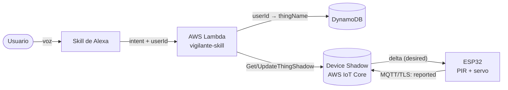

# Vigilante Inteligente — Práctica 3 (SIS-234)

Objeto inteligente que vigila un objeto valioso con un **sensor PIR HC-SR501** y controla la **cerradura de la puerta con un servo SG90**. Se integra con **Alexa** a través de **AWS Lambda**, **Amazon DynamoDB** y el **Device Shadow de AWS IoT Core** (MQTT sobre TLS). Alexa nunca habla directamente con el dispositivo: todo pasa por el Shadow. Cada usuario de Alexa vincula su propio dispositivo con un código de 6 dígitos.

- **Informe técnico:** [`docs/INFORME.md`](docs/INFORME.md)
- **Evidencias:** [`docs/anexos/`](docs/anexos/)

| Integrante | Capa |
|---|---|
| Alejandro Machaca | Nube y repositorio: Lambda, DynamoDB, IAM, IoT Core, modelo de Alexa, pruebas de integración |
| Ruben Cordero | Hardware: circuito, maqueta, `PirSensor`, `DoorLock`, banco de pruebas |
| Luciana Leaño | Firmware de comunicación: `net/` (WiFi, MQTT/TLS, Shadow), `SmartObject`, `main.cpp` |



## Estructura

```
Practica_3_IOT/
├── platformio.ini            firmware del ESP32 (abrir ESTA carpeta en PlatformIO)
├── include/
│   ├── config.h              pines, ángulos del servo, claves del Shadow y tiempos (se sube)
│   ├── secrets.example.h     plantilla de WiFi, endpoint, Thing y certificados (se sube)
│   └── secrets.h             valores reales (NO se sube, .gitignore)
├── src/
│   ├── main.cpp              crea los objetos, muestra el código de vinculación y ejecuta el loop
│   ├── core/                 interfaces Sensor, Actuator y ShadowPort
│   ├── sensors/PirSensor     HC-SR501 (RF1)
│   ├── actuators/DoorLock    servo SG90 como cerradura (RF3)
│   ├── app/SmartObject       reportes por evento y latido, reparto del delta (RF2, RF3)
│   └── net/                  WifiConnection, ShadowClient (MQTT/TLS), TimeSync (NTP)
├── test/luciana/             prueba C++ de SmartObject, PIR y servo con dobles de hardware
├── test/ruben/               prueba C++ del filtro del PIR y la calibración del servo
├── tools/prueba_hardware/    banco de pruebas en la placa: PIR + servo sin WiFi (RNF2, calibración)
├── lambda/                   backend de la skill (Python 3.13, ASK SDK)
│   ├── lambda_function.py    punto de entrada: lambda_function.lambda_handler
│   ├── vigilante/            config, link_repository, device_gateway, device_state,
│   │                         handlers, speech, skill
│   ├── events/               eventos de prueba para la consola de Lambda
│   ├── tests/                pruebas de la skill, contratos entre capas y guion de Alexa
│   └── build.ps1 / build.sh  generan build/lambda_deployment.zip
├── alexa/interaction-model.es-US.json   modelo de interacción (JSON Editor de la consola)
├── aws/                      política de IoT, política del rol de la Lambda y tabla de DynamoDB
└── docs/                     informe y anexos
```

## Puesta en marcha

### 1. Objeto inteligente (ESP32 DOIT DevKit V1)

1. Copiar `include/secrets.example.h` como `include/secrets.h` y completar el WiFi (2.4 GHz), el endpoint, el nombre del Thing (`vigilante-<código>`) y los tres certificados.
2. Abrir esta carpeta en VS Code con PlatformIO.
3. Elegir el entorno y cargar. Mientras se carga, desconectar el servo y el PIR; si se queda en `Connecting....`, mantener presionado **BOOT**.

| Entorno | Para qué | Comando |
|---|---|---|
| `esp32dev-aws` (predeterminado) | **Demo**: WiFi + MQTT/TLS + Device Shadow | `pio run -e esp32dev-aws -t upload` |
| `esp32dev` | Diagnóstico local por USB, sin AWS (`a` = abrir, `c` = cerrar) | `pio run -e esp32dev -t upload` |

4. Monitor serie a 115200 baudios: `pio device monitor`. Al arrancar se muestra el **código de vinculación** del dispositivo.

Conexiones: PIR OUT → **GPIO 27**, servo (señal) → **GPIO 25**. El PIR y el servo se alimentan con un **porta pilas de 4 × AA (6 V)** por los rieles de la protoboard; el negativo de las pilas se une al **GND del ESP32** (tierra común) y el ESP32 se alimenta por USB desde la computadora. Ver [`docs/anexos/circuito.png`](docs/anexos/circuito.png) y la vista isométrica [`docs/anexos/circuito-3d.svg`](docs/anexos/circuito-3d.svg).

### 2. Lambda

```powershell
cd lambda
powershell -ExecutionPolicy Bypass -File .\build.ps1     # o ./build.sh
```

Subir `lambda/build/lambda_deployment.zip` a la función `vigilante-skill` (Python 3.13, handler `lambda_function.lambda_handler`, 256 MB, 10 s). Variables de entorno: `IOT_ENDPOINT` (obligatoria) y `LINKS_TABLE=vigilante_vinculaciones`.

### 3. Alexa

Pegar `alexa/interaction-model.es-US.json` en *Build → Interaction Model → JSON Editor*, poner el ARN de la Lambda en *Endpoint*, presionar *Build skill* y probar en la pestaña *Test* (modo *Development*).

Los pasos detallados de AWS y Alexa están en el informe, §3.2 y §3.3.

## Pruebas

```powershell
# Lambda, contratos entre capas y guion del simulador (sin cuenta de AWS)
cd lambda
python -m venv .venv
.\.venv\Scripts\python -m pip install -r requirements-dev.txt
.\.venv\Scripts\python -m pytest -v
```

```bash
# Pruebas C++ del objeto inteligente (después de pio run -e esp32dev, que descarga ArduinoJson)
INC="-I test/luciana/stubs -I src -I include -I .pio/libdeps/esp32dev/ArduinoJson/src"
g++ -std=c++17 -Wall $INC test/luciana/test_firmware.cpp src/sensors/PirSensor.cpp \
    src/actuators/DoorLock.cpp src/app/SmartObject.cpp -o test_firmware && ./test_firmware
g++ -std=c++17 -Wall $INC test/ruben/test_hardware.cpp src/sensors/PirSensor.cpp \
    src/actuators/DoorLock.cpp -o test_hardware && ./test_hardware
```

GitHub Actions ([`.github/workflows/pruebas.yml`](.github/workflows/pruebas.yml)) corre las pruebas de Python, compila los dos entornos del firmware y el banco de pruebas del hardware, y ejecuta las dos pruebas C++ en cada push y pull request.

## Frases de ejemplo

Primero se abre la skill y luego se dan las órdenes dentro de la sesión:

- "abre vigilante inteligente"
- "vincula mi dispositivo con el código 123456"
- "hay movimiento"
- "cierra la puerta" / "abre la puerta"
- "la puerta está cerrada"
- "qué dispositivo tengo vinculado"
- "cambia mi dispositivo al código 654321"
- "desvincula mi dispositivo"

## Seguridad

Ningún certificado, clave privada, contraseña WiFi, ID de cuenta ni access key se sube al repositorio. `.gitignore` excluye `secrets.h`, `*.pem`, `*.key`, `*.crt` y `*.zip`, y una prueba automática revisa que ningún archivo versionado los contenga.
