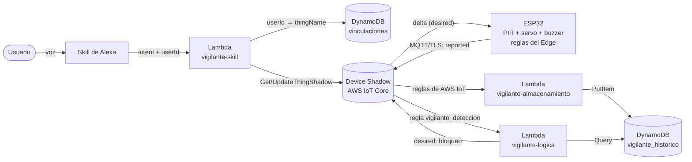

# Vigilante Inteligente — Prácticas 3 y 4 (SIS-234)

Objeto inteligente que vigila un objeto valioso con un **sensor PIR HC-SR501**, controla la **cerradura de la puerta con un servo SG90** y da la **alarma con un buzzer**. Se integra con **Alexa** a través de **AWS Lambda**, **Amazon DynamoDB** y el **Device Shadow de AWS IoT Core** (MQTT sobre TLS). Alexa nunca habla directamente con el dispositivo: todo pasa por el Shadow. Cada usuario de Alexa vincula su propio dispositivo con un código de 6 dígitos.

| Informe | Contenido |
|---|---|
| [`docs/INFORME_P4.md`](docs/INFORME_P4.md) | **Práctica 4**: buzzer como alarma, modos de operación, reglas en el Edge y en la Nube, reglas de AWS IoT, histórico en DynamoDB y mockups de reportes |
| [`docs/INFORME_P3.md`](docs/INFORME_P3.md) | **Práctica 3** (base): PIR, servo, Device Shadow, skill de Alexa y vinculación usuario ↔ Thing |

Evidencias: [`docs/anexos/`](docs/anexos/) (Práctica 3) y [`docs/anexos/p4/`](docs/anexos/p4/) (Práctica 4).

Reportes (RF15): mockups de las tres pantallas en [`docs/anexos/p4/`](docs/anexos/p4/) (`mockup-*.png`), descritos en el informe (§2.11); su fuente está en [`tools/mockups-rf15/`](tools/mockups-rf15/).

## Qué agregó la Práctica 4

La Práctica 3 controlaba el servo **solo por voz**. La Práctica 4 extiende el mismo objeto, Shadow, skill y vinculación para que el objeto **decida por sí mismo** y **guarde su historia**:

| Qué se agregó | Dónde |
|---|---|
| **Buzzer** en el GPIO 26 como segundo actuador (alarma intermitente que se apaga sola a los 30 s) | [`src/actuators/Buzzer`](src/actuators/Buzzer.h) |
| **Modo de operación** `manual` / `automatico` / `bloqueo` y parámetros `max_detecciones` y `ventana_min`, consultables y modificables por voz | [`src/settings/`](src/settings/), skill |
| **Reglas del Edge**: en automático o bloqueo, un movimiento cierra la puerta; en bloqueo, además suena la alarma. Funcionan sin Internet | [`src/rules/`](src/rules/) |
| **Regla de la Nube**: con `max_detecciones` en `ventana_min` minutos, pasa a bloqueo, cierra la puerta y enciende la alarma escribiendo solo `desired` | [`lambda-logica/`](lambda-logica/) |
| **Histórico** de lecturas y eventos con su origen (`voz`, `edge`, `nube`) en `vigilante_historico`, con TTL de 30 días | [`lambda-almacenamiento/`](lambda-almacenamiento/) |
| **Tres reglas de AWS IoT** que alimentan el almacenamiento y la lógica | [`aws/iot-rules/`](aws/iot-rules/) |
| **8 intents nuevos** en la skill: modo, parámetros y alarma (20 en total) | [`alexa/`](alexa/interaction-model.es-US.json), [`lambda/`](lambda/) |



| Integrante | Práctica 3 | Práctica 4 |
|---|---|---|
| Alejandro Machaca | Nube y repositorio: Lambda, DynamoDB, IAM, IoT Core, modelo de Alexa, pruebas de integración | Objeto inteligente y buzzer, circuito, Shadow, modelo de datos, reglas de AWS IoT, configuración de IoT Core |
| Ruben Cordero | Hardware: circuito, maqueta, `PirSensor`, `DoorLock`, banco de pruebas | Skill de Alexa, Lambda de lógica `vigilante-logica`, mockups de reportes |
| Luciana Leaño | Firmware de comunicación: `net/` (WiFi, MQTT/TLS, Shadow), `SmartObject`, `main.cpp` | Requerimientos, reglas del Edge, Lambda de almacenamiento, resultados |

## Estructura

```
Practica_3_IOT/
├── platformio.ini            firmware del ESP32 (abrir ESTA carpeta en PlatformIO)
├── include/
│   ├── config.h              pines, ángulos, claves del Shadow, modos y tiempos (se sube)
│   ├── secrets.example.h     plantilla de WiFi, endpoint, Thing y certificados (se sube)
│   └── secrets.h             valores reales (NO se sube, .gitignore)
├── src/
│   ├── main.cpp              crea los objetos, muestra el código de vinculación y ejecuta el loop
│   ├── core/                 interfaces Sensor, Actuator, Setting, ControlRule y ShadowPort
│   ├── sensors/PirSensor     HC-SR501 (RF1)
│   ├── actuators/DoorLock    servo SG90 como cerradura (RF3)
│   ├── actuators/Buzzer      buzzer como alarma (P4)
│   ├── settings/             OperatingMode e IntSetting: modo y parámetros (P4, RF14)
│   ├── rules/                AutoLockRule y AlarmRule: reglas del Edge (P4, RF13)
│   ├── app/SmartObject       reportes, reparto del delta y evaluación de reglas (RF2, RF3)
│   └── net/                  WifiConnection, ShadowClient (MQTT/TLS), TimeSync (NTP)
├── test/luciana/             pruebas C++ de SmartObject, reglas del Edge y alarma con dobles de hardware
├── test/ruben/               prueba C++ del filtro del PIR y la calibración del servo
├── tools/prueba_hardware/    banco de pruebas en la placa: PIR + servo sin WiFi (RNF2, calibración)
├── tools/mockups-rf15/       fuente de los mockups de los reportes (RF15) y sus datos ilustrativos
├── lambda/                   Lambda vigilante-skill: backend de la skill (Python 3.13, ASK SDK)
│   ├── lambda_function.py    punto de entrada: lambda_function.lambda_handler
│   ├── vigilante/            config, link_repository, device_gateway, device_state,
│   │                         handlers, speech, skill
│   ├── events/               eventos de prueba para la consola de Lambda (01–17)
│   ├── tests/                pruebas de la skill, contratos entre capas y guion de Alexa
│   └── build.ps1 / build.sh  generan build/lambda_deployment.zip
├── lambda-almacenamiento/    (P4) Lambda vigilante-almacenamiento: valida y guarda lecturas y
│                             cambios en vigilante_historico
├── lambda-logica/            (P4) Lambda vigilante-logica: regla de la Nube (RF13)
├── alexa/interaction-model.es-US.json   modelo de interacción (JSON Editor de la consola)
├── aws/                      política de IoT, políticas de los roles de las Lambdas y tablas de DynamoDB
│   └── iot-rules/            (P4) SQL de las reglas vigilante_lecturas, _eventos y _deteccion
└── docs/                     informes de las prácticas 3 y 4, y anexos (con los mockups de RF15)
```

## Puesta en marcha

### 1. Objeto inteligente (ESP32 DOIT DevKit V1)

1. Copiar `include/secrets.example.h` como `include/secrets.h` y completar el WiFi (2.4 GHz), el endpoint, el nombre del Thing (`vigilante-<código>`) y los tres certificados.
2. Abrir esta carpeta en VS Code con PlatformIO.
3. Elegir el entorno y cargar. Mientras se carga, desconectar el servo, el PIR y el buzzer; si se queda en `Connecting....`, mantener presionado **BOOT**.

| Entorno | Para qué | Comando |
|---|---|---|
| `esp32dev-aws` (predeterminado) | **Demo**: WiFi + MQTT/TLS + Device Shadow | `pio run -e esp32dev-aws -t upload` |
| `esp32dev` | Diagnóstico local por USB, sin AWS (`a` = abrir, `c` = cerrar) | `pio run -e esp32dev -t upload` |

4. Monitor serie a 115200 baudios: `pio device monitor`. Al arrancar se muestra el **código de vinculación** del dispositivo.

Conexiones: PIR OUT → **GPIO 27**, servo (señal) → **GPIO 25**, buzzer (+) → **GPIO 26**. El PIR y el servo se alimentan con un **porta pilas de 4 × AA (6 V)** por los rieles de la protoboard; el negativo de las pilas y la pata − del buzzer se unen al **GND del ESP32** (tierra común), y el ESP32 se alimenta por USB desde la computadora. Si el buzzer es pasivo, poner `BUZZER_ACTIVE 0` en `config.h`. Ver [`docs/anexos/p4/circuito.png`](docs/anexos/p4/circuito.png) y la vista isométrica [`docs/anexos/p4/circuito-3d.svg`](docs/anexos/p4/circuito-3d.svg).

### 2. AWS (región `us-east-2`)

| Recurso | Cómo |
|---|---|
| `vigilante-skill` | `cd lambda` → `powershell -ExecutionPolicy Bypass -File .\build.ps1` (o `./build.sh`) y subir `lambda/build/lambda_deployment.zip` (Python 3.13, handler `lambda_function.lambda_handler`, 256 MB, 10 s). Variables: `IOT_ENDPOINT` (obligatoria) y `LINKS_TABLE=vigilante_vinculaciones` |
| `vigilante-almacenamiento` y `vigilante-logica` | Pegar el `lambda_function.py` de cada carpeta en el editor de la consola y pulsar *Deploy*. `vigilante-logica` necesita `IOT_ENDPOINT` |
| Tablas | `vigilante_vinculaciones` y `vigilante_historico` con TTL en `expira`: definiciones en [`aws/`](aws/) |
| Reglas | Las tres de [`aws/iot-rules/`](aws/iot-rules/), cada una con su acción Lambda |

### 3. Alexa

Pegar `alexa/interaction-model.es-US.json` en *Build → Interaction Model → JSON Editor*, poner el ARN de `vigilante-skill` en *Endpoint*, presionar *Build skill* y probar en la pestaña *Test* (modo *Development*).

Los pasos detallados están en el informe de la Práctica 4, §3.2 y §3.3.

## Pruebas

No necesitan cuenta de AWS ni hardware: usan dobles en memoria.

```powershell
# Lambdas (con un entorno virtual)
cd lambda
python -m venv .venv
.\.venv\Scripts\python -m pip install -r requirements-dev.txt
.\.venv\Scripts\python -m pytest -v                                  # skill y contratos (144)
cd ..\lambda-logica;  ..\lambda\.venv\Scripts\python -m pytest -v    # regla de la Nube (15)
cd ..;  lambda\.venv\Scripts\python -m pytest -v lambda-almacenamiento/tests   # almacenamiento (12)

# Pruebas C++ del objeto inteligente (después de pio run -e esp32dev, que descarga ArduinoJson)
powershell -ExecutionPolicy Bypass -File test/luciana/run.ps1
```

GitHub Actions ([`.github/workflows/pruebas.yml`](.github/workflows/pruebas.yml)) ejecuta en cada push y pull request las pruebas de las tres Lambdas, compila los dos entornos del firmware y el banco de pruebas del hardware, y ejecuta las cuatro pruebas C++ del objeto inteligente.

## Frases de ejemplo

Primero se abre la skill ("abre vigilante inteligente") y luego se dan las órdenes dentro de la sesión:

| Práctica 3 | Práctica 4 |
|---|---|
| "vincula mi dispositivo con el código 123456" | "cambia el modo a automático" / "en qué modo está" |
| "hay movimiento" | "cambia el máximo de detecciones a 3" |
| "cierra la puerta" / "abre la puerta" | "cambia la ventana a 10 minutos" / "cuáles son los parámetros" |
| "la puerta está cerrada" | "enciende la alarma" / "apaga la alarma" |
| "qué dispositivo tengo vinculado" | "está sonando la alarma" |
| "desvincula mi dispositivo" | "cambia el modo a bloqueo" |

## Seguridad

Ningún certificado, clave privada, contraseña WiFi, ID de cuenta ni access key se sube al repositorio. `.gitignore` excluye `secrets.h`, `*.pem`, `*.key`, `*.crt` y `*.zip`, y una prueba automática revisa que ningún archivo versionado los contenga. Cada Lambda tiene documentados sus permisos mínimos en [`aws/`](aws/) y [`lambda-logica/politica-rol.json`](lambda-logica/politica-rol.json).
