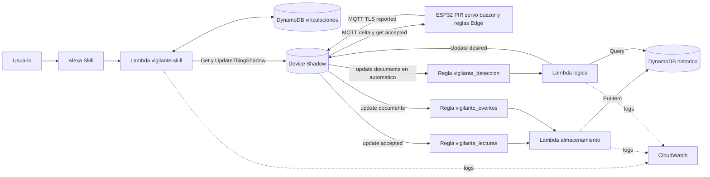
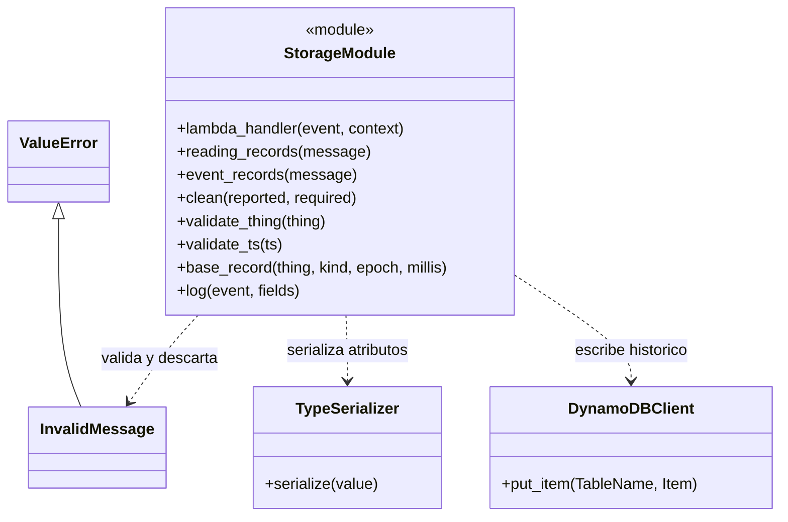
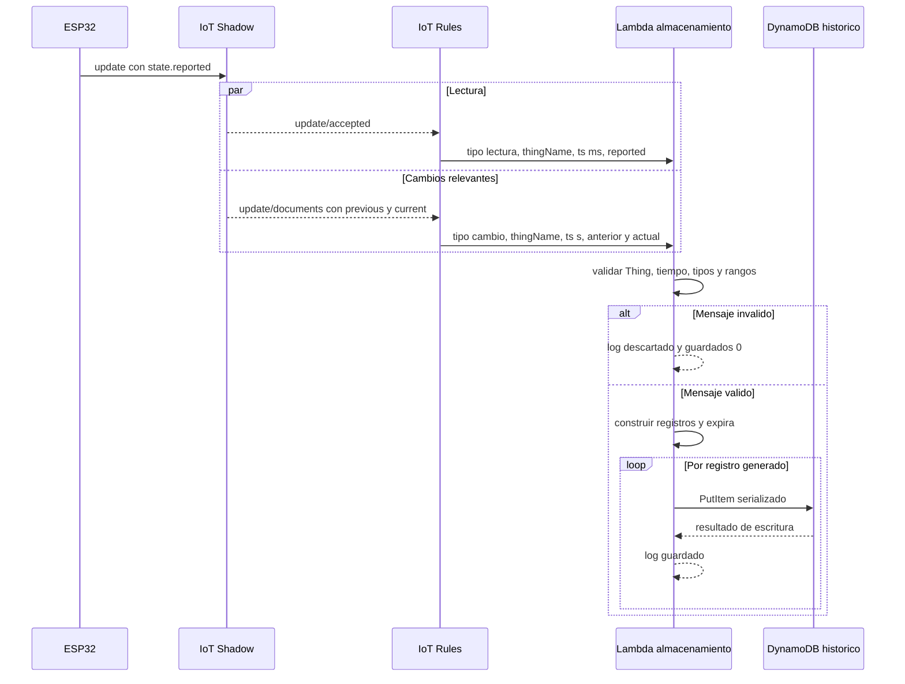
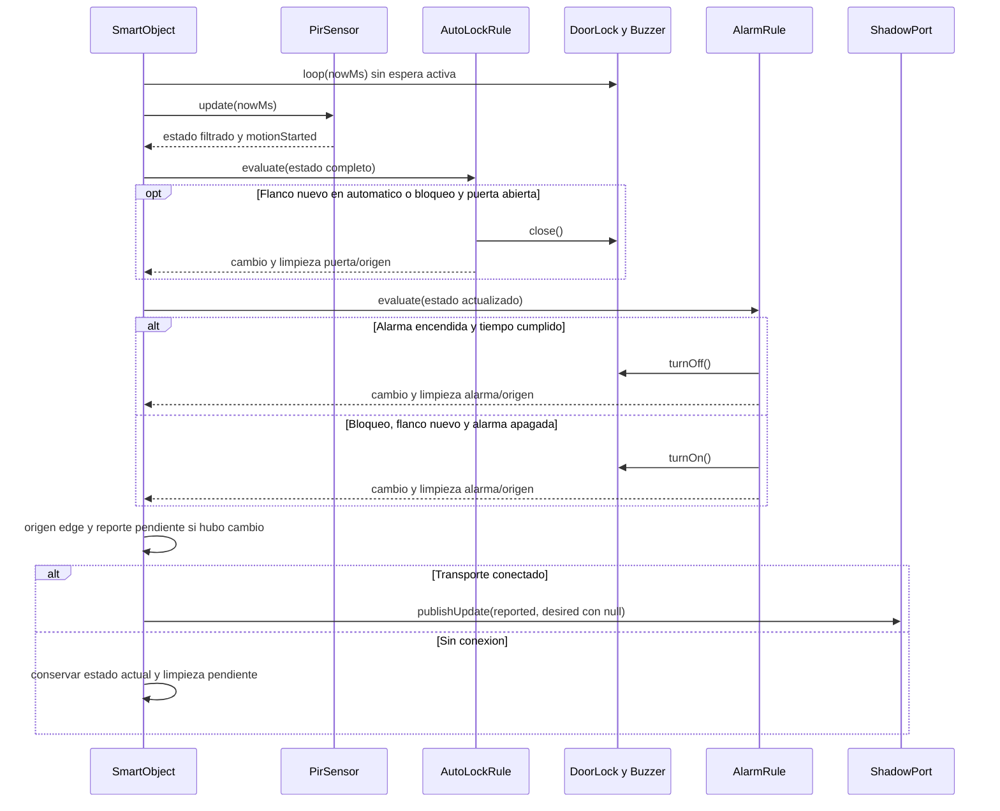
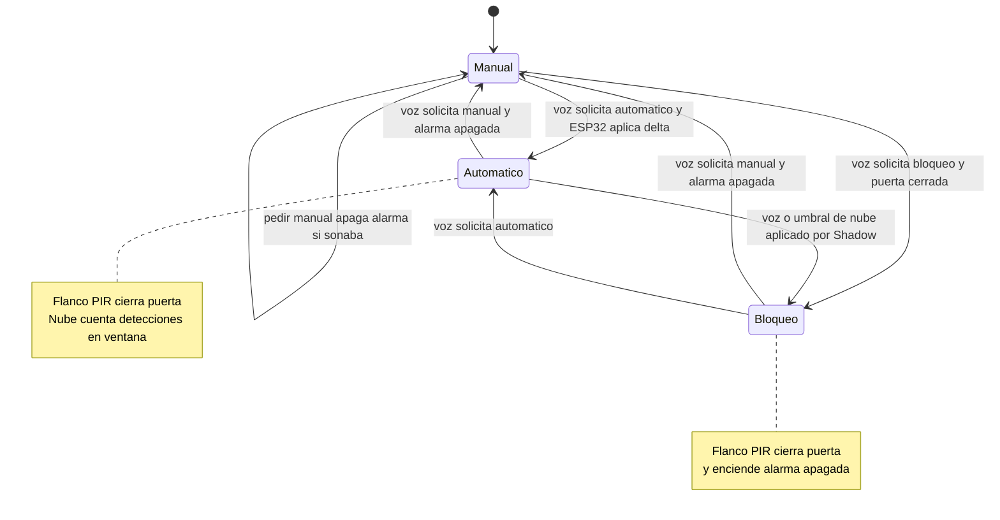
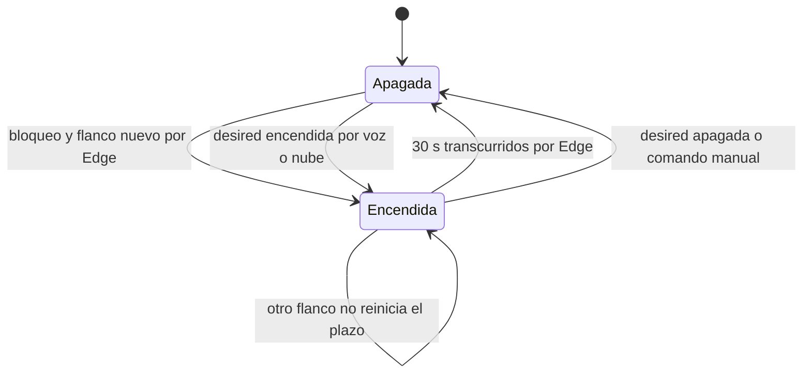

# Aporte de Luciana al informe de la Práctica 4

Este archivo contiene únicamente las secciones de Luciana: 1.2, 1.3, 2.2, 2.4c, 2.5b, 2.6, 2.9c, 3.1b y 5; sus filas para el plan de pruebas y anexos; y su conclusión y recomendaciones. Se entrega por separado en la rama `lu` para que la persona encargada una posteriormente los tres aportes en `INFORME_P4.md`.

**Base de código y pruebas:** `1dfe514`, revisada el 24 de noviembre de 2026. Para completar referencias y consolidar resultados se consultaron los siguientes aportes, sin fusionar sus ramas ni copiar sus secciones:

| Aporte consultado | Rama y versión | Uso en las secciones de Luciana |
|---|---|---|
| [Informe de Alejandro](https://github.com/Alous12/Practica_3_IOT/blob/8162bc3a0811bcc6d2a8f9b5c46c3bad9df2b306/docs/informe_ale.md) | `Rama_Ale`, `8162bc3` | Circuito, modelo de datos, reglas IoT, compilaciones, estabilidad declarada y cálculo de costo. |
| [Informe de Rubén](https://github.com/Alous12/Practica_3_IOT/blob/f36d67a7012f06875c7ddca8b8f98c1fc6c0382a/docs/informeRuben.md) | `informeRuben`, `f36d67a` | Skill, lógica de nube, configuración, diseños de reportes, pruebas de voz y método de medición de la respuesta de nube. |

Los resultados sin medición disponible se identifican como pendientes. Las pruebas automatizadas no sustituyen las pruebas del montaje ni de los servicios desplegados. Los enlaces a los aportes remiten a las versiones efectivamente revisadas; no requieren incorporar esos archivos a esta rama.

## 1.2 Requerimientos funcionales

La Práctica 4 mantiene RF1–RF9 y agrega procesamiento, histórico, control automático y diseño de reportes. La siguiente matriz relaciona cada requisito con su implementación y su verificación. “Prueba automatizada” significa una prueba de código con dobles de hardware o servicios; no acredita por sí sola el funcionamiento extremo a extremo en AWS y en el montaje.

| RF | Comportamiento requerido | Implementación y enlace | Verificación y evidencia |
|---|---|---|---|
| RF1 | Capturar movimiento del entorno. | [`PirSensor::update()`](../src/sensors/PirSensor.cpp): calentamiento, filtro y conteo de flancos. | Pruebas del PIR en `test_firmware.cpp`, `test_hardware.cpp` y ensayo físico del sensor. La comprobación actual sobre el montaje P4 queda pendiente. |
| RF2 | Publicar lecturas y estados de todos los actuadores en `reported`, por evento y periódicamente. | [`SmartObject::collectState()` y `publishState()`](../src/app/SmartObject.cpp); `report()` de PIR, puerta, buzzer y ajustes. | Pruebas de reporte, evento y latido en [`test_firmware.cpp`](../test/luciana/test_firmware.cpp). Completar captura de Shadow con puerta y alarma. |
| RF3 | Aplicar cambios del `delta` y confirmar en `reported`. | [`ShadowClient::handleMessage()`](../src/net/ShadowClient.cpp), `SmartObject::handleDelta()` y `applyDesired()` de actuadores/ajustes. | Pruebas C++ de delta, publicación fallida y reconexión; ensayo real de órdenes pendientes. |
| RF4 | Responder en español sobre el movimiento del Thing vinculado. | [`MotionQueryHandler`](../lambda/vigilante/handlers.py) y [`DeviceGateway.get_state()`](../lambda/vigilante/device_gateway.py). | [`test_skill.py`](../lambda/tests/test_skill.py), guion del simulador y evidencia de Rubén. |
| RF5 | Ejecutar comandos por voz de puerta y alarma mediante `desired`. | [`DoorCommandHandler`, `AlarmCommandHandler`](../lambda/vigilante/handlers.py) y `request_desired()`, que agrega origen `voz`. | [`test_alarma.py`](../lambda/tests/test_alarma.py), pruebas de puerta y ensayo físico desde Alexa. |
| RF6 | Consultar por voz el estado de puerta y alarma. | `DoorStatusHandler` y `AlarmStatusHandler` en [`handlers.py`](../lambda/vigilante/handlers.py). | Pruebas de la skill y contraste con `reported`; evidencia del simulador a cargo de Rubén. |
| RF7 | Vincular un Thing y conservar la vinculación entre sesiones. | [`LinkRepository.save()` y `get_thing()`](../lambda/vigilante/link_repository.py), tabla `vigilante_vinculaciones`. | Pruebas de vinculación/persistencia en `test_skill.py` y consulta de DynamoDB. |
| RF8 | Resolver el Thing en cada solicitud e indicar cómo vincular si falta. | [`LinkedThingInterceptor`](../lambda/vigilante/handlers.py), con el identificador del usuario de Alexa. | Pruebas de usuarios distintos y consultas sin vinculación en `test_skill.py` y `test_guion_alexa.py`. |
| RF9 | Verificar existencia del Thing y permitir cambio o eliminación del vínculo. | [`DeviceGateway.thing_exists()`](../lambda/vigilante/device_gateway.py), `LinkDeviceHandler`, `UnlinkDeviceHandler`. | Pruebas de Thing inexistente, cambio y desvinculación; confirmar que no se borra el Thing al desvincular. |
| RF10 | Disparar reglas IoT que invoquen procesamiento y almacenamiento. | [`vigilante_lecturas.sql`](../aws/iot-rules/vigilante_lecturas.sql), [`vigilante_eventos.sql`](../aws/iot-rules/vigilante_eventos.sql) y sus acciones Lambda. | Ensayo integrado LU-04/LU-05. Las pruebas directas de Lambda no demuestran que la regla se dispare. |
| RF11 | Validar y enriquecer lecturas con Thing y tiempo, y almacenarlas. | [`reading_records()`, `clean()`, `base_record()` y `lambda_handler()`](../lambda-almacenamiento/lambda_function.py). | LU-01/LU-02 y [`test_storage.py`](../lambda-almacenamiento/tests/test_storage.py). Capturas de guardado y rechazo en los anexos de Lu. |
| RF12 | Guardar cambios de actuadores y su origen. | `event_records()` compara puerta, modo y alarma; genera registros con valor nuevo, `anterior` y `origen`. | LU-03 verifica el evento `alarma#…`; LU-05 debe comprobar el flujo real y exportar una muestra. |
| RF13 | Ejecutar control automático donde corresponda al caso de uso. | [`AutoLockRule`](../src/rules/AutoLockRule.cpp), [`AlarmRule`](../src/rules/AlarmRule.cpp) y [`vigilante-logica`](../lambda-logica/lambda_function.py). | LU-06/LU-07/LU-08 para Edge; pruebas y medición de la regla de nube a cargo de Rubén. |
| RF14 | Reportar modo y parámetros, y consultarlos/modificarlos por voz. | [`OperatingMode`](../src/settings/OperatingMode.cpp), [`IntSetting`](../src/settings/IntSetting.cpp), registro de ajustes y manejadores de la skill. | [`test_modos.py`](../lambda/tests/test_modos.py), pruebas de rangos y confirmación en Shadow. |
| RF15 | Diseñar reportes útiles y coherentes con las consultas de DynamoDB. | Modelo `thingName` + `tipo_ts`; tres diseños textuales de Rubén en 2.11: actividad diaria, historial de puerta/alarma y bloqueos/configuración, cada uno con sus consultas. | Diseño documentado en el [aporte de Rubén](https://github.com/Alous12/Practica_3_IOT/blob/f36d67a7012f06875c7ddca8b8f98c1fc6c0382a/docs/informeRuben.md). Los tres PNG adicionales se referencian con `[COMPLETAR]` y no están en esa versión; los valores ilustrativos de los mockups no son mediciones. |

## 1.3 Requerimientos no funcionales

Los valores siguientes constituyen los criterios declarados para el ensayo P4. La columna de resultados de la sección 5 debe completarse con datos del montaje y del histórico P4. La espera de confirmación dentro de Lambda y los tiempos configurados en el firmware no se presentan como latencias físicas medidas.

| ID | Atributo y valor declarado | Método de medición | Responsable y evidencia |
|---|---|---|---|
| RNF1 | Estabilidad: al menos 30 min sin reinicios ni bloqueos, con buzzer y WiFi en uso. | Registrar `uptime_s`, monitor serie y comandos periódicos; comprobar que el contador no vuelve a cero. | Alejandro; registro y video del ensayo P4. |
| RNF2 | Detección: al menos 95 % hasta 3 m y 0 falsos positivos en 10 min sin presencia. | 20 pasadas a 1, 2 y 3 m; comparar flancos válidos con pasadas controladas. | Grupo; repetir o justificar vigencia de la validación del sensor ante el nuevo montaje. |
| RNF3 | Respuesta a voz: máximo 3 s para puerta y alarma. | 10 órdenes por actuador; video o registro de tiempo desde la orden hasta el efecto físico. `latencia_ms` se informa aparte. | Rubén y grupo; tabla, video y CloudWatch. |
| RNF4 | Reporte por evento en máximo 1 s; latido cada 60 s ± 1 s con red disponible. | Comparar marcas de tiempo de reportes/recepción MQTT durante una ventana conocida. El límite mínimo de 500 ms evita ráfagas; las confirmaciones y reglas tienen prioridad. | Grupo; monitor serie y mensajes MQTT. |
| RNF5 | Reconexión y sincronización: máximo 30 s desde que vuelve la red hasta aplicar el estado pendiente válido y reportar. | Cortar WiFi 60 s, restaurar, registrar conexión y convergencia. Incluir limpieza de órdenes anteriores tras acciones Edge. | Grupo; al menos 3 ensayos. |
| RNF6 | Integridad de almacenamiento: al menos 99 % de los reportes válidos publicados con red disponible queda guardado; 100 % de inválidos de prueba se descarta. | Ventana de 30 min; contar emisiones válidas y filas `lectura#` del mismo Thing y cohorte temporal, dejando terminar los mensajes en tránsito. Ver LU-04. | Luciana; conteos, consulta/CSV y logs. |
| RNF7 | Latencia de almacenamiento: máximo 5 s desde publicación hasta confirmación de escritura. | 10 muestras con inicio UTC sincronizado al emitir y fin del log `guardado` posterior a `PutItem`. Documentar cómo se sincronizan y registran los relojes. | Luciana; tabla de muestras y logs. |
| RNF8 | Respuesta Edge: máximo 1 s desde movimiento válido hasta cierre o primer pitido, después del calentamiento. | Video a 60 fps, 10 repeticiones por efecto; diferenciar tiempo de sensor y reacción del control. | Luciana; LU-06, video y tabla. |
| RNF9 | Respuesta nube: máximo 5 s desde la detección que cumple el umbral hasta aplicar bloqueo en el objeto. | Comparar detección, log `bloqueo_activado`, delta y efecto/estado final. | Rubén; evidencia del recorrido completo. |
| RNF10 | Sin conexión: cierre y alarma locales operan; alarma se apaga al vencer 30 s; al volver la red se reporta el estado actual. | Preparar modo automático/bloqueo, apagar hotspot, provocar flanco, observar y reconectar. No se exige conservar todas las lecturas intermedias no transmitidas. | Luciana; LU-08. |
| RNF11 | Costo: estimación mensual menor a USD 1 para un objeto con latido de 60 s y carga de eventos declarada. | Calcular mensajes, operaciones de Shadow/reglas, invocaciones y operaciones DynamoDB con precios vigentes y fecha de consulta. Separar consumo de créditos. | Alejandro; cálculo, sin presentar la referencia como factura medida. |

**Correspondencia con los aportes del grupo.** RNF1 se contrasta con el ensayo P-A1 de Alejandro; RNF9 con los cinco ensayos de respuesta de nube propuestos por Rubén; RNF11 con P-A4 y el cálculo de la sección 4.3 de Alejandro. En esta revisión P-A1 y las cinco mediciones de nube todavía tienen celdas vacías. El cálculo mensual sí está redactado: sus importes se presentan como estimación bajo supuestos, sujetos a comprobar tarifas y condiciones de la cuenta.

**Justificación de frecuencia y ubicación.** El movimiento y los cambios de actuadores son eventos que requieren respuesta rápida; por ello se reportan por cambio y se mantiene un latido de 60 s como respaldo. El cierre y el límite de duración de alarma se deciden localmente para operar sin Internet. El bloqueo por frecuencia de detecciones se decide en la nube porque requiere consultar una ventana del histórico. No es necesario convertir cada latido en una invocación de la lógica de negocio.

**Seguridad y calidad.** Certificados, clave privada y WiFi permanecen fuera de Git; el firmware es modular y las Lambdas se separan por responsabilidad. Los permisos se documentan por acción/recurso. La Lambda de almacenamiento escribe en el histórico y no necesita modificar el Shadow. Los tiempos de TLS y llamadas de red pueden bloquear temporalmente el ciclo: la ausencia de `delay()` en una regla no demuestra por sí sola que la respuesta física cumpla RNF8.

## 2.2 Arquitectura del sistema

El sistema combina control local, sincronización de estado, interacción por voz y procesamiento de datos. Alexa invoca `vigilante-skill`; esta resuelve `userId → thingName` en DynamoDB y consulta o modifica el Shadow de ese Thing. El ESP32 utiliza MQTT sobre TLS para reportar estado y recibir diferencias pendientes. Ninguna Lambda controla los GPIO directamente. La arquitectura corresponde al objeto y las reglas descritos por Alejandro en 2.1/2.9a y a los recorridos de voz y nube descritos por Rubén en 2.5a.

*Figura Lu-1. Arquitectura de la Práctica 4, reconstruida a partir del firmware, las definiciones SQL y las Lambdas de la versión revisada. Todos los recursos del proyecto se configuran en Ohio (`us-east-2`).*

Se distinguen dos tablas: `vigilante_vinculaciones`, que conserva el destino de cada usuario, y `vigilante_historico`, que conserva lecturas/eventos por Thing. Las reglas `vigilante_lecturas` y `vigilante_eventos` invocan almacenamiento; `vigilante_deteccion` invoca negocio únicamente ante nuevas detecciones en automático. Esta separación limita permisos y evita que guardar una lectura implique también decidir sobre los actuadores.

## 2.4c Estructura de la Lambda de almacenamiento

`vigilante-almacenamiento` es un módulo Python funcional, no una clase controladora. El siguiente diagrama usa el estereotipo `module` para representar sus funciones; `StorageModule` no es una clase declarada en el código. `InvalidMessage` sí es una excepción real derivada de `ValueError`.

*Figura Lu-2. Organización lógica de [`lambda-almacenamiento/lambda_function.py`](../lambda-almacenamiento/lambda_function.py). No se agregan clases artificiales para implementar la Lambda.*

El handler selecciona lectura o cambio. Las funciones de construcción validan toda la entrada antes de escribir. Después se serializan atributos con `TypeSerializer` y se ejecuta `PutItem` por registro. Un error de validación devuelve `descartado: true`; un error de servicio no se transforma en un falso éxito y queda disponible para el tratamiento de errores de Lambda. Esta representación complementa las Lambdas de voz y negocio descritas en 2.4b de Rubén; no duplica sus manejadores ni su diagrama.

## 2.5b Secuencias de almacenamiento y reglas del Edge

### Almacenamiento de lecturas y eventos

*Figura Lu-3. El camino de cambios solo se invoca si el SQL detecta una diferencia relevante. El primer estado puede no tener un documento anterior comparable. Ambas invocaciones pueden ejecutarse concurrentemente; el diagrama no implica una transacción entre ellas.*

### Cierre y alarma locales incluso sin conexión

*Figura Lu-4. Las reglas se evalúan después de actualizar sensores y antes del retorno por falta de transporte. La temporización de alarma se evalúa también cuando no existe un flanco nuevo.*

Al reconectar, `requestDocument()` recupera el Shadow. Mientras hay limpieza local pendiente, `handleDelta()` omite la clave del actuador afectado para evitar revertir la acción con una orden anterior. Se publica el estado y la eliminación de `desired.puerta`/`desired.alarma` y `desired.origen` en un mismo mensaje según las reglas que actuaron. Un retorno exitoso de `mqtt.publish()` no es un acuse `update/accepted` ni una comprobación mecánica.

## 2.6 Estados de la lógica de control

### Modos de operación

*Figura Lu-5. Modo inicial manual. El cambio de modo de nube se vuelve efectivo en el objeto cuando se aplica el delta. La recuperación de `desired` puede modificar los valores iniciales tras reconectar.*

### Estado lógico de la alarma

*Figura Lu-6. El apagado por tiempo no cambia el modo bloqueo. La intermitencia de 500 ms corresponde a la salida sonora dentro de Encendida, no a cambios del atributo `alarma` ni a nuevos eventos de encendido.*

| Regla | Ubicación | Justificación y convivencia |
|---|---|---|
| Cerrar ante un flanco en automático o bloqueo. | Edge: `AutoLockRule`. | Respuesta local aunque falle Internet. `close()` no repite PWM si ya estaba cerrada. |
| Activar alarma ante un flanco en bloqueo. | Edge: `AlarmRule`. | Intrusión exige respuesta inmediata. No se activa por PIR en manual ni en automático. |
| Apagar alarma a los 30 s, cualquiera que haya sido su origen. | Edge: `AlarmRule`. | Evita sonido indefinido sin depender de conexión. El vencimiento tiene prioridad sobre un flanco simultáneo. |
| Pasar a bloqueo al alcanzar `max_detecciones` en `ventana_min`. | Nube: `vigilante-logica`. | Consulta histórico de detecciones en automático. Solicita bloqueo, cierre y alarma mediante `desired`, con origen nube. |
| Abrir por voz únicamente en manual; cerrar en todos los modos. | Backend de la skill. | `OpenDoorHandler` revisa también un modo deseado pendiente. Rechaza abrir en automático/bloqueo explicando cómo pasar a manual. |

Las órdenes de voz usan origen `voz`; la nube usa `nube`; las reglas locales reportan `edge`; el arranque comienza con `inicio`. El origen es un atributo global del último cambio reportado, no una auditoría independiente de cada actuador. La restricción de apertura está en la skill: un cliente autorizado que escriba directamente el Shadow no pasa por ese rechazo. La regla Edge responde al flanco, no verifica continuamente la posición física.

## 2.9c Diseño de la Lambda de almacenamiento

| Aspecto | Diseño implementado |
|---|---|
| Responsabilidad | Validar y guardar lecturas/eventos; no decide el modo ni modifica el Shadow. |
| Disparadores | `vigilante_lecturas` sobre `update/accepted`; `vigilante_eventos` sobre `update/documents`. |
| Entradas | `tipo`, `thingName`, `ts`; `reported` para lectura o `anterior`/`actual` para cambio. |
| Validación | Thing con prefijo configurado y seis dígitos; tiempo entero positivo; tipos/rangos conocidos. Requiere movimiento, detecciones y puerta. Alarma es opcional para compatibilidad, pero si existe debe ser encendida/apagada. |
| Enriquecimiento | `tipo`, `fecha` UTC, `epoch`, `tipo_ts` y `expira`. Convierte el `ts` en milisegundos de lecturas a segundos cuando corresponde. |
| Persistencia | `TypeSerializer` convierte atributos y `dynamodb.put_item()` escribe en `vigilante_historico`. |
| Eventos | Un registro por cambio comparable de puerta, modo o alarma; detección si el contador aumenta. Si baja al reiniciar, no genera una detección nueva. |
| TTL | `expira = int(epoch) + TTL_DAYS * 86400`; predeterminado 30 días. DynamoDB debe tener TTL habilitado sobre `expira`; borrar vencidos es asíncrono. |
| Permisos | Rol básico de logs y [`dynamodb:PutItem` sobre el histórico](../aws/almacenamiento-role-policy.json). La regla necesita autorización para invocar Lambda, distinta del rol de ejecución. |
| Configuración | Python 3.13, handler `lambda_function.lambda_handler`, espera configurada en consola de 10 s. Valores predeterminados: `HISTORY_TABLE=vigilante_historico`, `THING_PREFIX=vigilante-`, `TTL_DAYS=30`. Verificar valores reales al desplegar. |
| Observabilidad | Logs `guardado` o `descartado`; respuesta con cantidad de registros y claves. No contiene access keys. |

**Límites del modelo actual.** Los eventos del mismo tipo y Thing usan fecha con resolución de segundos: dos cambios de ese tipo en el mismo segundo pueden compartir clave y reemplazarse con `PutItem`. No existe una transacción entre lectura y evento ni un identificador de entrega que garantice contabilización exacta de duplicados. Estas condiciones deben considerarse al interpretar integridad y mejoras futuras.

## 3.1b Desarrollo e implementación del firmware

| Módulo | Función y fragmento clave |
|---|---|
| [`core/`](../src/core/) | Contratos `Sensor`, `Actuator`, `Setting`, `ControlRule` y `ShadowPort`. Permiten registrar componentes sin acoplar el coordinador al transporte. |
| [`PirSensor`](../src/sensors/PirSensor.cpp) | `update()` acepta un nivel estable durante 50 ms y `motionStarted()` identifica solo el flanco aceptado del ciclo. No cuenta durante el calentamiento de 60 s. |
| [`DoorLock`](../src/actuators/DoorLock.cpp) | `applyDesired()` valida abierta/cerrada; `moveTo()` ordena el ángulo. `close()` es idempotente y `loop()` retira PWM después de 700 ms, sin cortar alimentación. |
| [`Buzzer`](../src/actuators/Buzzer.cpp) | `turnOn()` conserva la hora inicial y no la reinicia si ya suena; `loop()` alterna pitido/silencio cada 500 ms sin `delay()`. `turnOff()` detiene la salida. |
| [`settings/`](../src/settings/) | `OperatingMode` y `IntSetting` validan enum y rangos. Los ajustes se incluyen tanto en el estado publicado como en el que leen las reglas. |
| [`AutoLockRule`](../src/rules/AutoLockRule.cpp) | Evalúa modo, flanco y estado de puerta; solicita limpieza de puerta/origen después de actuar. |
| [`AlarmRule`](../src/rules/AlarmRule.cpp) | Primero evalúa vencimiento con resta unsigned de `millis()`; después permite encender por flanco en bloqueo. Limpia alarma/origen. |
| [`SmartObject`](../src/app/SmartObject.cpp) | Registra componentes, actualiza actuadores/sensores, construye estado y evalúa reglas antes de comprobar red. Conserva `reportPending_` y `pendingDesired_` si falla publicar. |
| [`net/`](../src/net/) | WiFi y MQTT con reintentos; sincronización NTP; certificados TLS, tópicos del Shadow y recuperación por `get`. |
| [`main.cpp`](../src/main.cpp) | Compone PIR, puerta, buzzer, modo y parámetros; registra primero `AutoLockRule` y luego `AlarmRule`. Selecciona transporte local o AWS mediante el entorno de PlatformIO. |

**Orden de ejecución.** En `SmartObject::loop()` se actualizan los actuadores y los sensores, después las reglas, y finalmente se comprueba `shadow_.connected()`. Así, la falta de transporte impide publicar pero no evaluar la lógica local. La confirmación y las acciones Edge fuerzan un reporte prioritario; los eventos ordinarios respetan 500 ms de separación y el latido de 60 s.

**Recuperación.** La limpieza de `desired` se acumula entre reglas, de modo que cerrar puerta y activar alarma en el mismo ciclo conserva ambas claves. Si no hay red, se mantiene en RAM para la siguiente publicación. No hay cola persistente de todas las lecturas offline; un reinicio pierde las variables pendientes y el histórico puede no reconstruir transiciones que nunca se transmitieron.

**Configuración.** [`config.h`](../include/config.h) contiene pines y parámetros públicos; `secrets.h`, excluido de Git, contiene WiFi, endpoint y certificados. El búfer MQTT es de 3072 bytes y el de serialización del reporte es de 1024; si el documento no cabe, no se envía JSON truncado. La hora NTP permite fechar detecciones; un valor `ultima_deteccion=0` indica que aún no había una hora válida.

## 4 Filas de Luciana para el plan de pruebas compartido

Estas filas se incorporarán a la única tabla de pruebas del informe junto con P-A1–P-A4 de Alejandro, S-01–S-13 y los ensayos de nube de Rubén. Los archivos de evidencia propios se listan en el índice; “pendiente” no significa “cumple”. Los procedimientos de otros integrantes se consultan como referencia, sin atribuirles resultados que todavía no documentan.

| ID | Requisito | Procedimiento | Resultado esperado | Resultado/evidencia disponible |
|---|---|---|---|---|
| LU-01 | RF11 | Invocar almacenamiento con una lectura válida y consultar la tabla. | `guardados=1`, `descartado=false`, fila `lectura#`. | Capturas reales de configuración: [log](anexos/p4/lu-almacenamiento-guardado.png) y [fila](anexos/p4/lu-tabla-lectura-prueba.png). Es un dato de prueba, no una medición del PIR. |
| LU-02 | RF11 | Repetir con `puerta=rota` y con `alarma=rota`. | Descarte sin escrituras. | [Captura de puerta inválida](anexos/p4/lu-almacenamiento-descartado.png); validación de alarma cubierta en `test_storage.py`. Falta captura nueva de alarma inválida en consola. |
| LU-03 | RF12 | Evento con alarma apagada→encendida y detecciones 4→5; repetir apagado y sin cambios. | Dos registros en el primer caso; valor anterior/origen correctos; sin evento extra si no cambia. | Prueba automatizada del ejemplo de la guía y pruebas de apagado por origen. La integrante confirmó el ensayo de consola; no se adjuntó captura de ese resultado ni CSV. |
| LU-04 | RNF6 | Operar 30 min con red; contar reportes válidos y lecturas guardadas del mismo Thing/ventana. | `100*N_guardados/N_publicados >= 99`. | Pendiente de ejecución/conteos y CSV. Registrar duplicados y permitir finalizar escrituras en tránsito. |
| LU-05 | RNF7, RF10–RF12 | Medir 10 reportes desde emisión UTC hasta log guardado posterior a PutItem; consultar lecturas y eventos. | Todas las latencias ≤5 s; filas y origen corresponden al mensaje. | Pendiente de muestras y relojes comparables. `fecha` viene del mensaje/regla: por sí sola no mide el instante de escritura. |
| LU-06 | RNF8, RF13 | Con PIR listo y puerta abierta, generar 10 flancos en automático/bloqueo; video de mano→inicio de cierre. Repetir alarma en bloqueo. | Cierre/primer pitido ≤1 s; manual y automático no activan alarma por PIR. | Lógica cubierta por `test_edge.cpp` y `test_alarm.cpp`; medición física pendiente. |
| LU-07 | RF13 | Encender por voz/nube/Edge, mantener nivel alto y comprobar apagado al vencer 30 s; repetir flanco. | No se renueva el plazo mientras suena; se apaga por Edge y otro flanco posterior puede iniciar otro ciclo en bloqueo. | Pruebas C++ de límite exacto y desborde; ensayo de sonido real pendiente. |
| LU-08 | RNF10, RNF5 | Preparar modo, apagar hotspot, provocar flanco, esperar apagado y restaurar red. | Cierre/alarma sin red; estado final y origen Edge al volver; sin reactivación por la orden anterior pendiente. | Pruebas con transporte simulado y publicación fallida; video y Shadow reales pendientes. |
| LU-09 | Regresión | Ejecutar suites de almacenamiento, negocio, skill y firmware sobre `1dfe514`. | Todas las aserciones correctas. | Salidas automatizadas de Lu en los anexos. Coinciden con las 144 pruebas de skill y 15 de lógica documentadas por Rubén; se agregan las 12 de almacenamiento. No sustituye mediciones RNF. |

**Ejecución automatizada del 24/11/2026.** Se obtuvieron 12 pruebas de almacenamiento correctas (más 18 subcasos), 15 de lógica y 144 de la skill. También finalizaron correctamente los cuatro programas C++ de firmware, hardware, cierre Edge y alarma. Son 171 pruebas Python y cuatro ejecutables C++; los subcasos no se suman de nuevo al total de pruebas. Las suites existentes mantienen sus autores: esta ejecución es una comprobación de regresión realizada para el informe.

### Procedimiento para obtener las mediciones que faltan

1. Anotar Thing, versión de firmware/Lambda, hora UTC de inicio y fin, red y modo. Esperar `sensor_listo=true` antes de medir PIR.
2. Para integridad, registrar cada publicación válida, consultar **DynamoDB → Explorar elementos → Consulta**, usar `thingName` y `tipo_ts BETWEEN lectura#inicio AND lectura#fin`, y exportar resultados. El conteo debe cubrir la misma cohorte; una fila no acredita por sí sola correspondencia uno a uno ante duplicados.
3. Para latencia, registrar un tiempo de emisión con reloj UTC sincronizado y el del log emitido tras `PutItem`. Si el firmware no expone el inicio UTC, instrumentar o documentar un registro externo comparable. No usar solo la fecha que la regla agrega, ni `latencia_ms` de la skill.
4. Para respuesta Edge, grabar a 60 fps y contar cuadros desde la condición observable hasta el inicio del efecto. Duración = cuadros/60. Registrar 10 muestras por efecto, promedio, máximo y fallos; no sustituir el máximo por el promedio.
5. Para offline, grabar el corte de red y los efectos físicos. Al reconectar, capturar Shadow y consultar la ventana del histórico, documentando las lecturas/eventos que nunca se transmitieron.
6. Guardar evidencia con prefijo `lu-`, ocultar ID de cuenta y Skill ID si aparecen, y eliminar únicamente filas identificadas como datos de prueba después de conservar su evidencia.

## 5 Resultados

La matriz consolida los tres aportes revisados y distingue resultados de ejecución, resultados informados por otro integrante, estimaciones y mediciones aún pendientes. Los resultados físicos publicados en el informe de P3 son antecedentes: no se reutilizan como mediciones P4 con buzzer, nuevas Lambdas e histórico. Los números dibujados en los mockups de Rubén son datos de diseño y no una muestra exportada de DynamoDB.

| RNF | Valor declarado | Obtenido P4 | Estado y evidencia |
|---|---|---|---|
| RNF1 Estabilidad | ≥30 min sin reinicios | P-A1 de Alejandro define 30 min con voz y Edge, pero su tabla sigue sin horas, uptime ni resultados | Pendiente de medir; el procedimiento ya está documentado. |
| RNF2 Detección | ≥95 % hasta 3 m; 0 falsos/10 min | Sin nueva medición adjunta | Validar montaje actual; el 98,3 % publicado corresponde a P3. |
| RNF3 Voz | ≤3 s por actuador | Guion S-01–S-13 de Rubén y prueba de voz de P3 documentados; sin nuevos tiempos físicos P4 | Pendiente de medición P4. No convertir respuestas esperadas ni `latencia_ms` en tiempos físicos. |
| RNF4 Reporte | Evento ≤1 s; latido 60±1 s | Período configurado de 60 s y separación mínima de 500 ms | Configuración verificada en código; medición en AWS pendiente. |
| RNF5 Reconexión | ≤30 s y sincronización | Lógica de reintento cubierta por pruebas con dobles | Medición real P4 pendiente. |
| RNF6 Integridad | ≥99 % válidos; 100 % inválidos descartados en ensayo | Guardado/rechazo manuales y validación automatizada comprobados; sin ventana de conteos | No se puede calcular aún un porcentaje de integridad real. |
| RNF7 Almacenamiento | Máximo ≤5 s, 10 muestras | Sin muestras sincronizadas | Pendiente; tabla de mediciones vacía. |
| RNF8 Edge | Máximo ≤1 s, 10 ensayos por efecto | Lógica correcta en simulación | Video y tiempos físicos pendientes. |
| RNF9 Nube | Máximo ≤5 s | 15 pruebas de negocio correctas. Rubén propone cinco ensayos de detección→primer pitido, aún con `[COMPLETAR]` | Lógica comprobada con dobles; latencia real pendiente. El buzzer distingue la reacción de nube del cierre que ya hizo el Edge. |
| RNF10 Offline | Actúa sin red y sincroniza estado final | Encendido/apagado/cierre con transporte simulado y limpieza pendiente | Falta evidencia de hotspot apagado y montaje real. No se afirma histórico offline completo. |
| RNF11 Costo | Estimación <USD1/mes bajo carga declarada | Alejandro estima ≈USD0,19/mes para un objeto, ≈50000 reportes y ≈57200 invocaciones | Resultado estimado, inferior al objetivo bajo los supuestos de su sección 4.3. Falta confirmar vigencia de tarifas y condiciones de gratuidad/créditos de la cuenta; no es costo facturado. |

### Resultados verificables de implementación y diseño

| Componente | Resultado disponible | Fuente y alcance |
|---|---|---|
| Almacenamiento | 12 pruebas correctas, más 18 subcasos; guardado/rechazo manual con capturas | Anexos de Lu. Los subcasos no se suman como otras 18 pruebas; no hubo una ventana real de integridad medida. |
| Skill y nube | 144 pruebas de skill y 15 de negocio correctas | Ejecución de regresión de Lu y sección de pruebas de Rubén: 159 coincidentes, no dos conjuntos de ejecuciones diferentes que deban sumarse. |
| Reglas del firmware | Cuatro ejecutables C++ correctos | Ejecución de Lu. Buzzer y transporte simulados; sin medición acústica o mecánica. |
| Compilación del montaje P4 | Alejandro informa `SUCCESS` para AWS activo, local activo y AWS pasivo, volviendo luego a activo | P-A2 de `Rama_Ale`. Información atribuida al autor; no es una repetición del ensayo físico ni evidencia de estabilidad de 30 min. |
| Diseño de reportes RF15 | Tres mockups textuales y sus consultas por `thingName` y tipo/fecha | Sección 2.11 de `informeRuben`. Los PNG de presentación se señalan como pendientes en esa versión. |
| Costo | Estimación ≈USD0,19 por objeto y mes | P-A4 de Alejandro. El valor depende de volumen, tamaño de datos y beneficios aplicables; no se midió facturación en este aporte. |

El diseño de reportes permite consultar actividad, cambios de actuadores y bloqueos sin confundir el estado actual con el histórico. Para calcular actividad se agrupan eventos de detección; no se suman los valores acumulados de `detecciones`. El tiempo en bloqueo requiere emparejar transiciones de modo, y la configuración actual se obtiene de la última lectura. Estas consultas explican de qué datos salen los mockups; sus cifras de ejemplo no completan los resultados experimentales.

Las pruebas de almacenamiento comprueban mensajes válidos/invalidos, TTL calculado, claves y eventos con alarma; las pruebas de firmware verifican flancos, temporización, funcionamiento con transporte desactivado y limpieza combinada de `desired`. Estos resultados sustentan la corrección de la lógica bajo los escenarios programados, pero no permiten declarar cumplimiento de todas las metas de tiempo, integridad, costo o funcionamiento físico.

## 6 Conclusión de Luciana

La separación entre reglas locales y almacenamiento permite que el cierre y el límite de duración de la alarma no dependan de Internet, mientras el histórico conserva los datos que efectivamente llegan a AWS. La validación previa a `PutItem` evita registrar estados incompatibles y las pruebas automatizadas comprueban el manejo de cambios y la recuperación del estado pendiente. El alcance comprobado no equivale a una conservación completa de eventos offline ni a una garantía de latencia del montaje: esas propiedades requieren las mediciones declaradas y evidencias del recorrido real antes de afirmar su cumplimiento.

## 7 Recomendaciones de Luciana

- Incorporar identificador único de evento y mayor resolución temporal, con una estrategia de idempotencia, para distinguir reintentos y evitar reemplazos de eventos del mismo tipo en un segundo.
- Para uso permanente, agregar una cola persistente acotada de eventos offline y documentar reenvío, límites, expiración y recuperación tras reinicio; conservar solo el estado final es insuficiente para una auditoría de intrusiones.
- Medir el montaje completo e incorporar realimentación física de puerta y un origen por evento/actuador. En una instalación real, un estado lógico reportado no basta para garantizar que un pestillo se movió ni para atribuir cambios simultáneos con precisión.

## 8 Filas de Luciana para el índice de anexos

| Evidencia | Qué acredita | Alcance |
|---|---|---|
| [lu-almacenamiento-guardado.png](anexos/p4/lu-almacenamiento-guardado.png) | Log `guardado` de una lectura de prueba. | Prueba manual de configuración, sin medición de latencia. |
| [lu-tabla-lectura-prueba.png](anexos/p4/lu-tabla-lectura-prueba.png) | Fila del Thing de prueba en DynamoDB. | La fecha del dato es de ejemplo; no es una lectura física medida. |
| [lu-almacenamiento-descartado.png](anexos/p4/lu-almacenamiento-descartado.png) | Rechazo de `puerta=rota`. | Descarte de mensaje inválido en la Lambda real. |
| [lu-pruebas-almacenamiento.txt](anexos/p4/lu-pruebas-almacenamiento.txt) | Ejecución automatizada de almacenamiento del 24/11/2026. | DynamoDB simulado; no genera escrituras en AWS. |
| [lu-regresion-logica.txt](anexos/p4/lu-regresion-logica.txt) | Regresión de la función de negocio. | Servicios simulados; no acredita tiempo de nube real. |
| [lu-regresion-skill.txt](anexos/p4/lu-regresion-skill.txt) | Regresión del backend de Alexa. | No sustituye pruebas en simulador de Alexa. |
| [lu-pruebas-firmware.txt](anexos/p4/lu-pruebas-firmware.txt) | Ejecución de cuatro programas de prueba C++. | GPIO, servo, buzzer y transporte sustituidos por dobles. |
| [lu-revision-referencias.md](anexos/p4/lu-revision-referencias.md) | Versiones de los aportes consultados y observaciones para quien integre. | No incorpora archivos ni fusiona ramas de otros autores. |

Las capturas conservadas son las compartidas durante la configuración de almacenamiento de P4. La exportación del histórico, la muestra CSV y los videos/mediciones físicas aún deben adjuntarse. Los diagramas Lu-1 a Lu-6 están incluidos como bloques Mermaid y se visualizan directamente en GitHub.
