# Informe técnico — Práctica 3: Vigilante Inteligente


**Carrera:** Ingeniería de Sistemas · **Asignatura:** SIS-234 · **Fecha de entrega:** 10 de noviembre de 2026
**Actividad:** Integración de un objeto inteligente con Alexa mediante MQTT y AWS IoT Core
**Repositorio:** <https://github.com/Alous12/Practica_3_IOT>

| Integrante | GitHub | Capa a cargo |
|---|---|---|
| Alejandro Machaca | `alous12` | Nube y repositorio: Lambda, DynamoDB, IAM, IoT Core, skill de Alexa, pruebas de integración |
| Ruben Cordero | `Ruben-Cordero` | Hardware: circuito, montaje, `PirSensor`, `DoorLock`, pruebas RNF1 y RNF2 |
| Luciana Leaño | `lucianaaaaaaa` | Firmware de comunicación: `net/` (WiFi, MQTT/TLS, Shadow), `SmartObject`, `main.cpp`, pruebas RNF3–RNF5 |

**Datos de la implementación**

| Dato | Valor |
|---|---|
| Región de AWS | `us-east-2` (Ohio), cuenta en el plan gratuito |
| Thing del objeto inteligente | `vigilante-123456` · código de vinculación **123456** · Shadow clásico |
| Thing de prueba (sin hardware) | `vigilante-654321` · código de vinculación **654321** |
| Tabla de vinculaciones | `vigilante_vinculaciones` (DynamoDB, clave `userId`) |
| Función Lambda | `vigilante-skill` (Python 3.13) con el rol `vigilante-lambda-role` |
| Skill | *Vigilante Inteligente* · invocación `vigilante inteligente` · Spanish (US) |
| Objeto inteligente | ESP32 DOIT DevKit V1 · PIR HC-SR501 en GPIO 27 · servo SG90 en GPIO 25 |

El ID de la cuenta de AWS, el endpoint de IoT, los certificados y la contraseña WiFi no se publican: en el repositorio aparecen como `<ACCOUNT_ID>`, `xxxxxxxx-ats.iot.us-east-2.amazonaws.com` y la plantilla [`include/secrets.example.h`](../include/secrets.example.h).

## Contenido

1. [Caso de uso y requerimientos](#1-caso-de-uso-y-requerimientos)
2. [Análisis y diseño](#2-análisis-y-diseño)
3. [Desarrollo e implementación](#3-desarrollo-e-implementación)
4. [Pruebas y validaciones](#4-pruebas-y-validaciones)
5. [Resultados](#5-resultados)
6. [Conclusiones](#6-conclusiones)
7. [Recomendaciones](#7-recomendaciones)
8. [Anexos](#8-anexos)

---

# 1. Caso de uso y requerimientos

## 1.1 Caso de uso

Un objeto valioso (una vitrina, una caja con documentos, un cuarto de equipos) debe estar vigilado aunque el dueño no esté cerca. El **Vigilante Inteligente** detecta la presencia de personas junto al objeto con un **sensor PIR** y controla el **pestillo de la puerta** de acceso con un **servomotor**. Desde Alexa, el dueño pregunta *"¿hay movimiento?"*, cuántas detecciones hubo y cuándo fue la última, y ordena *"cierra la puerta"* o *"abre la puerta"*.

Un ESP32 lee el PIR y acciona el servo. Alexa recibe las consultas y órdenes, la función Lambda resuelve qué Thing pertenece al usuario y lee o modifica su **Device Shadow**, y el ESP32 se sincroniza con ese Shadow por **MQTT sobre TLS**. Alexa nunca habla directamente con el dispositivo.

Cada dueño **vincula su propio dispositivo** diciendo el código de 6 dígitos impreso en él, de modo que la misma skill atiende a muchos usuarios, cada uno con su vigilante.

Como pide la práctica, el actuador responde **solo a órdenes de voz** que llegan por el Shadow: el PIR no cierra la puerta por sí mismo, y su lectura se reporta para consultarla desde Alexa. El firmware separa sensores, actuadores, coordinación y comunicación, así que la barrera láser (KY-008 + LDR) y el buzzer previstos para la siguiente etapa se agregan como un `Sensor` y un `Actuator` más, sin rediseñar la arquitectura.

## 1.2 Justificación del sensor y del actuador

El objeto inteligente vigila un objeto valioso. Tiene un sensor y un actuador:

| Elemento | Componente | Función en el caso de uso | RF |
|---|---|---|---|
| Sensor | PIR HC-SR501 | Detecta presencia de personas junto al objeto. Permite responder a "¿hay movimiento?". | RF1 |
| Actuador | Servo SG90 | Hace de cerradura: su brazo funciona como pestillo de la puerta (abierta / cerrada). Ejecuta "cierra la puerta". | RF3 |
| Controlador | ESP32 DOIT DevKit V1 | Lee el PIR, mueve el servo y sincroniza el estado con el Device Shadow de AWS IoT Core por MQTT/TLS. | RF2 |

El PIR es un sensor pasivo de infrarrojos. Detecta el cambio de radiación térmica cuando una persona cruza su campo de visión. Su salida es digital: alto (3,3 V) mientras hay movimiento y bajo cuando no lo hay. No mide distancia ni identifica a la persona. El firmware cuenta flancos de subida, no personas.

El servo SG90 gira entre 0° y 180° según el ancho del pulso PWM (50 Hz). Se usan dos posiciones fijas: **90° = cerrada** (el brazo traba la puerta) y **0° = abierta** (el brazo la libera). Los ángulos se verificaron con el banco de pruebas [`tools/prueba_hardware`](../tools/prueba_hardware/src/main.cpp): cerrada = 90°, abierta = 0°, que coinciden con los valores de `config.h`.

**Por qué estos componentes y no otros.**

| Alternativa | Por qué no se eligió |
|---|---|
| Barrera láser KY-008 + LDR | Exige alinear el láser con la LDR y es sensible a la luz ambiente; queda para la siguiente etapa como un `Sensor` más |
| Sensor magnético (*reed switch*) | Indica si la puerta está abierta, pero no detecta a una persona que se acerca al objeto, que es lo que el caso de uso necesita vigilar |
| Ultrasónico | La práctica lo restringe a casos que miden distancia o nivel; aquí no se mide una distancia |
| Cerradura solenoide de 12 V | Requiere fuente y MOSFET adicionales y solo tiene un estado sin energía; queda como extensión para un uso real (§7) |
| LED o buzzer como actuador | La práctica prohíbe los LED como actuador, y un buzzer no tiene un estado estable que reflejar en el Shadow |

El **PIR HC-SR501** detecta presencia sin alinear nada, a varios metros y en un cono amplio, y su salida digital de 3,3 V va directo al ESP32. El **servo SG90** tiene **dos estados estables** (`abierta` / `cerrada`) que corresponden exactamente a `desired` y `reported` del Shadow, y funciona entre 4,8 y 6 V, dentro del límite de baja tensión que fija la práctica para los actuadores (≤ 12 V DC). El servo y el PIR se alimentan con un porta pilas de 4 × AA (6 V) y el ESP32 con el USB de la computadora (§2.2).

Sensor y actuador son independientes: el PIR **no** cierra la puerta por sí solo. El servo solo obedece órdenes que llegan por el Shadow (RF3). El estado de ambos se publica en `reported`: `movimiento`, `detecciones`, `ultima_deteccion` y `sensor_listo` para el PIR, y `puerta` para el servo. Alexa nunca se comunica directamente con el ESP32.

## 1.3 Requerimientos funcionales

| RF | Requerimiento | Implementación | Prueba (§4) |
|---|---|---|---|
| RF1 | Capturar movimiento con el PIR | `PirSensor::update` | P06, P18 |
| RF2 | Reportar el sensor y el actuador en `reported`, por evento y periódicamente | `SmartObject::loop`, `ShadowClient::publishReported` | P06, P14 |
| RF3 | Recibir el `delta`, aplicarlo al servo y confirmar en `reported` | `ShadowClient::handleMessage`, `SmartObject::handleDelta`, `DoorLock::applyDesired` | P08, P15, P18 |
| RF4 | Responder en español si hay movimiento, cuántas detecciones y cuándo fue la última | `MotionQueryHandler` | P07 |
| RF5 | Cerrar o abrir la puerta por voz escribiendo `desired.puerta` | `CloseDoorHandler`, `OpenDoorHandler` | P08, P13 |
| RF6 | Responder el estado actual de la puerta | `DoorStatusHandler` | P09 |
| RF7 | Vincular el dispositivo con su código y que la vinculación persista | `LinkDeviceHandler`, `LinkRepository` (DynamoDB) | P01 |
| RF8 | Resolver el Thing con `context.System.user.userId` en cada solicitud y guiar al usuario sin vinculación | `LinkedThingInterceptor` | P05, P10 |
| RF9 | Validar que el Thing exista y permitir cambiar o eliminar la vinculación | `LinkDeviceHandler` + `DescribeThing`, `UnlinkDeviceHandler` | P02, P03, P04 |

## 1.4 Requerimientos no funcionales

| RNF | Atributo | Valor declarado | Cómo se verifica | Prueba |
|---|---|---|---|---|
| RNF1 | Estabilidad | ≥ 30 min de operación continua sin reinicios ni bloqueos | `uptime_s` del Shadow crece sin volver a 0; motivo de reinicio en el monitor serie | P11 |
| RNF2 | Exactitud de detección | ≥ 95 % de detecciones hasta 3 m y 0 falsos positivos en 10 min sin presencia | 20 pasadas por distancia (1–4 m) con cinta métrica; 10 min con la sala vacía | P12 |
| RNF3 | Tiempo de respuesta | ≤ 3 s desde el comando en el simulador hasta que el servo se mueve | Video a 60 fps + `latencia_ms` en CloudWatch | P13 |
| RNF4 | Frecuencia de reporte | Por evento ≤ 1 s (separación mínima 0,5 s) + latido cada 60 s ± 1 s | Marcas de tiempo del cliente de prueba MQTT y del monitor serie | P14 |
| RNF5 | Reconexión y sincronización | Reconexión WiFi + MQTT ≤ 30 s después de volver la red, y aplicación del `desired` pendiente | Corte de red de 60 s con una orden dada durante el corte | P15 |
| RNF6 | Seguridad | Ningún secreto en el repositorio; MQTT/TLS con certificado; sin access keys; mínimo privilegio documentado | Historial de Git, `.gitignore`, políticas de `aws/`, prueba en vivo de la política | P16, §4.3 |

**Justificación de la métrica de exactitud (RNF2).** El PIR es un sensor **binario**: no entrega un valor continuo con unidad, sino *hay* o *no hay* movimiento. Por eso su "error respecto a una referencia física" se expresa con los dos errores posibles de un detector: el **porcentaje de detecciones perdidas**, frente a pasadas controladas a distancias medidas con cinta métrica (la referencia física), y los **falsos positivos** con la sala vacía. El rango de trabajo declarado es de hasta 3 m, la distancia típica a la que alguien se acerca a una vitrina o a una puerta; los 4 m se miden solo como información.

**Justificación de la frecuencia de reporte.** El movimiento es un **evento discreto**: si se reportara cada minuto, Alexa podría responder "no hay movimiento" con un dato viejo. Por eso cada cambio del PIR (y cada movimiento del servo) se publica de inmediato, con una separación mínima de 500 ms para evitar ráfagas. Con el jumper en L y Tx al mínimo, el HC-SR501 produce como máximo un cambio cada pocos segundos (pulso de ~1,2 s y unos 5 s de bloqueo). Las confirmaciones del actuador y el primer reporte después de reconectar tienen prioridad sobre esa separación. El **latido de 60 s** publica el estado completo aunque no haya cambios. Así la Lambda puede avisar *"puede estar desconectado"* si no recibe nada en 150 s, lo que tolera un latido perdido. Con un latido por minuto, un dispositivo encendido todo el mes genera unos 50 000 mensajes y 50 000 operaciones de Shadow: alrededor de **USD 0.11 al mes**, cubiertos por los créditos del plan gratuito (detalle en §3.2). Un latido de 10 s, como en el ejemplo de clase, multiplicaría ese consumo por seis sin mejorar la respuesta a los eventos.

---

# 2. Análisis y diseño

## 2.1 Arquitectura del sistema

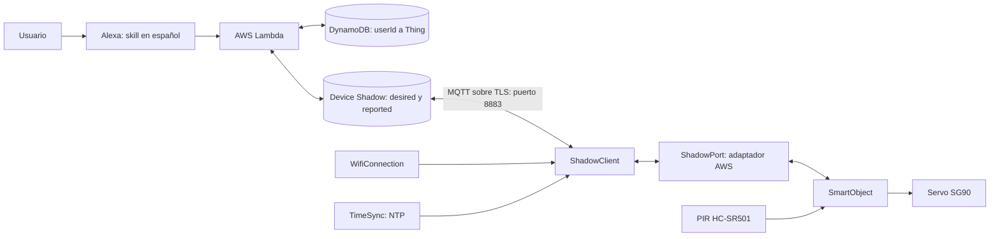

| Componente | Tecnología | Responsabilidad |
|---|---|---|
| Skill de Alexa | Alexa Developer Console, modelo `es-US` | Entiende la frase (intents y slot `codigo`) y llama a la Lambda (§2.8) |
| Función Lambda | Python 3.13 + ASK SDK | Resuelve el Thing del usuario y lee o escribe su Shadow (§2.4) |
| DynamoDB | Tabla `vigilante_vinculaciones` | Persiste `userId → thingName` (§2.7) |
| AWS IoT Core | Registro de Things + Device Shadow clásico | Fuente de verdad del estado: `desired` (orden) y `reported` (estado real) (§2.6) |
| Objeto inteligente | ESP32 + PIR + servo | Reporta el sensor y el actuador; aplica los `delta` (§2.3) |

El firmware de la demo está en la raíz del repositorio (`platformio.ini`, `src/`, `include/`) y se carga con el entorno **`esp32dev-aws`**, que es el predeterminado. El entorno `esp32dev` es un diagnóstico local por USB, sin AWS. Alexa nunca habla directamente con el ESP32: toda interacción pasa por el Shadow.

## 2.2 Diagrama de circuito

### Lista de componentes

| Cantidad | Componente | Especificación relevante |
|---|---|---|
| 1 | ESP32 DOIT DevKit V1 | 3,3 V lógicos; alimentado por USB desde la computadora |
| 1 | Sensor PIR HC-SR501 | Alimentación 4,5–20 V; salida digital de 3,3 V; alcance ajustable hasta ~7 m; ángulo ~110° |
| 1 | Servo SG90 | 4,8–6 V; picos de corriente de varios cientos de mA al arrancar |
| 1 | Porta pilas 4 × AA con 4 pilas AA | 4 × 1,5 V = 6 V; alimenta el servo y el PIR por el riel + de la protoboard |
| 1 | Protoboard y cables dupont | — |

### Conexiones

| Componente | Terminal | Conexión |
|---|---|---|
| Porta pilas 4 × AA | Rojo (+6 V) | Riel + de la protoboard |
| Porta pilas 4 × AA | Negro (−) | Riel − de la protoboard (GND común) |
| ESP32 | GND | Riel − de la protoboard (une la tierra del ESP32 con la de las pilas) |
| ESP32 | Micro USB | Computadora (alimentación de la placa y monitor serie) |
| PIR HC-SR501 | VCC | Riel + (6 V de las pilas) |
| PIR HC-SR501 | OUT | GPIO 27 |
| PIR HC-SR501 | GND | Riel − (GND común) |
| Servo SG90 | Rojo (V+) | Riel + (6 V de las pilas) |
| Servo SG90 | Naranja/amarillo (señal) | GPIO 25 |
| Servo SG90 | Marrón (GND) | Riel − (GND común) |

El positivo de las pilas **no** se conecta a ningún pin del ESP32 (ni a VIN ni a 3V3): la placa solo comparte la tierra.

Los pines y ángulos están en [`include/config.h`](../include/config.h): `PIR_PIN = 27`, `SERVO_PIN = 25`, `SERVO_ANGLE_CLOSED = 90`, `SERVO_ANGLE_OPEN = 0`.

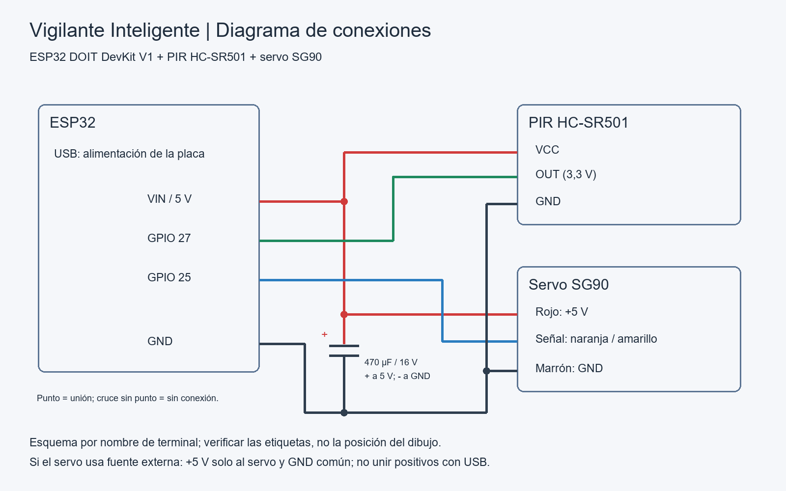

*Figura 2.2.1 — Diagrama de conexiones. Es un esquema por nombre de terminal: no representa la posición física de los pines. Se verifican las etiquetas del módulo utilizado.*

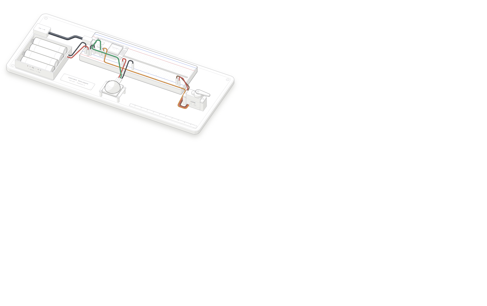

*Figura 2.2.2 — El mismo circuito montado en la protoboard, en vista isométrica ([versión vectorial](anexos/circuito-3d.svg)). El porta pilas 4 × AA alimenta los rieles + y −; el PIR y el servo toman de ahí 6 V y GND; el ESP32 se alimenta por USB y une su GND al riel −. Cables: verde = PIR OUT → D27, naranja = señal del servo → D25, rojo = +6 V, negro y marrón = GND.*

### Justificación de las conexiones

- **OUT del PIR directo al GPIO, sin divisor.** El HC-SR501 tiene un regulador interno de 3,3 V y su salida no supera ese valor, que es el nivel lógico del ESP32. Nunca se llevan 5 V a un GPIO.
- **PIR y servo en el porta pilas de 6 V.** El pin de 3,3 V del ESP32 no alcanza para el servo ni cumple el mínimo de 4,5 V del PIR. Tomar 5 V de VIN tampoco conviene: esa corriente sale del USB de la computadora (limitado a unos 500 mA) y los picos del servo al arrancar, sumados a los del WiFi, hacen caer la tensión y pueden reiniciar el ESP32 (*Brownout detector was triggered*). Con las pilas, la corriente del servo no pasa por la placa. Los 6 V están dentro de los rangos de ambos componentes: 4,8–6 V del SG90 y 4,5–20 V del HC-SR501.
- **GPIO 27 y GPIO 25.** No son pines de arranque (0, 2, 12, 15) ni de la memoria flash (6–11). El GPIO 25 admite PWM (LEDC) para el servo. Al principio se usó el GPIO 13; durante el diagnóstico del servo la señal se pasó al 25 (§5). El GPIO 27 se configura con *pull-down* interno, que evita lecturas falsas si el cable de OUT se suelta.
- **Tierra común.** El negativo de las pilas se une al GND del ESP32 en el riel −. Sin esa unión, los pulsos de 3,3 V del GPIO 25 y la salida del PIR no tendrían una referencia común y el servo no interpretaría la señal.
- **El positivo de las pilas no toca el ESP32.** Se mantienen dos fuentes separadas (USB para la lógica, pilas para la potencia) que solo comparten la tierra.
- **Estado de las pilas.** Cuatro pilas alcalinas nuevas pueden marcar hasta ~6,4 V, apenas sobre el máximo del SG90; con el uso bajan rápido a 6 V. Pilas recargables NiMH (4 × 1,2 V = 4,8 V) quedan en el mínimo del servo. Si el servo zumba sin girar o pierde fuerza, lo primero es medir las pilas con un multímetro.
- **Seguridad.** Todo el montaje trabaja a baja tensión. La alimentación se desconecta antes de modificar el cableado.

### Ajustes del PIR

| Ajuste | Valor | Motivo |
|---|---|---|
| Jumper de disparo | **L** (disparo único), posición de fábrica | Medido: con movimiento continuo, OUT da un pulso, baja unos 5 s (bloqueo del módulo) y vuelve a disparar. Una presencia prolongada suma varias detecciones, una cada ~6,5 s |
| Potenciómetro Tx (tiempo) | Mínimo, posición de fábrica (pulso medido de ~1,2 s) | `movimiento` vuelve a `false` rápido y las pasadas se cuentan por separado |
| Potenciómetro Sx (sensibilidad) | Medio | Alcance suficiente para 3 m sin falsos positivos lejanos. Posición final: la de fábrica, sin modificar |
| Estabilización | 60 s (`PIR_WARMUP_MS`) | Tras encenderse, el HC-SR501 da pulsos falsos. El firmware reporta `sensor_listo: false` y no cuenta detecciones durante ese tiempo |

Entre ensayos independientes se esperan al menos 7 s, para que termine el pulso (~1,2 s) y el bloqueo (~5 s); si no, la segunda pasada no se detecta.

### Servo como cerradura

Los ángulos iniciales son 90° cerrada y 0° abierta. El servo recibe PWM durante 700 ms (`SERVO_SETTLE_MS`) y luego se suelta, para evitar vibraciones y reducir el consumo. Soltar el PWM no corta la alimentación. Por eso, en un montaje sobre una puerta real, el mecanismo debe mantener la posición del pestillo sin fuerza del servo. En este prototipo el servo está montado sobre la protoboard y su brazo representa el pestillo: las posiciones de 90° y 0° se verifican visualmente. La verificación mecánica sobre una puerta queda como trabajo pendiente (§7).

El SG90 no tiene realimentación de posición: `reported.puerta` indica la posición **ordenada** por software, no una medición. Su correspondencia con la posición del brazo se verifica visualmente en la demo (P08).

### Montaje del prototipo

El prototipo se arma sobre una protoboard, sin maqueta de puerta. El brazo del servo representa el pestillo: a 90° (cerrada) y a 0° (abierta). El PIR se orienta hacia la zona vigilada.

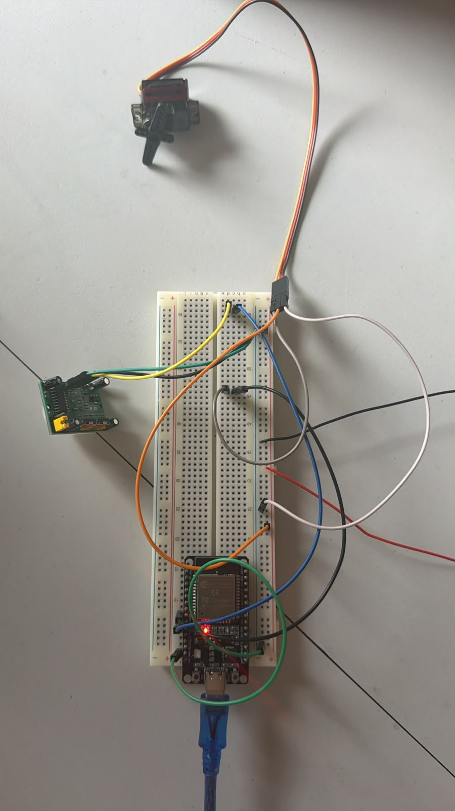
*Figura 2.2.3 — Prototipo armado en la protoboard.*

## 2.3 Diagrama de clases del objeto inteligente

El firmware ([`src/`](../src/)) está organizado en capas. La capa de hardware no conoce la red y la de comunicación no conoce sensores ni actuadores concretos: las une `SmartObject` mediante interfaces.

| Archivo | Clase | Responsabilidad | Capa | RF |
|---|---|---|---|---|
| [`core/Sensor.h`](../src/core/Sensor.h) | `Sensor` (interfaz) | `begin()`, `update(nowMs)` (true si hay un cambio que reportar), `report(reported)` | núcleo | RF1, RF2 |
| [`core/Actuator.h`](../src/core/Actuator.h) | `Actuator` (interfaz) | `key()` (atributo del Shadow que controla), `begin()`, `loop(nowMs)`, `applyDesired(valor)`, `report(reported)` | núcleo | RF2, RF3 |
| [`core/ShadowPort.h`](../src/core/ShadowPort.h) | `ShadowPort` (interfaz) | Transporte del Shadow: `connected()`, `publishReported()`, `onDelta()`, `onConnected()` | núcleo | RF2, RF3 |
| [`sensors/PirSensor.*`](../src/sensors/PirSensor.h) | `PirSensor` | Lee el HC-SR501 con *pull-down* y filtro de 50 ms, gestiona el calentamiento y cuenta detecciones con hora NTP | hardware | RF1 |
| [`actuators/DoorLock.*`](../src/actuators/DoorLock.h) | `DoorLock` | Dueño de la clave `puerta`: valida `"abierta"`/`"cerrada"`, mueve el servo y lo suelta tras 700 ms | hardware | RF3 |
| [`app/SmartObject.*`](../src/app/SmartObject.h) | `SmartObject` | Orquestador: reporte por evento (≥ 500 ms entre reportes) y latido cada 60 s; reparte cada delta al actuador dueño de la clave y confirma en `reported` | aplicación | RF2, RF3 |
| [`main.cpp`](../src/main.cpp) | `AwsShadowPort`, `LocalShadowPort` | Adaptadores de `ShadowPort`: AWS (demo, entorno `esp32dev-aws`) o monitor serie (diagnóstico, entorno `esp32dev`) | composición | — |
| [`net/WifiConnection.*`](../src/net/WifiConnection.h) | `WifiConnection` | Conexión y reconexión WiFi | red | RNF5 |
| [`net/ShadowClient.*`](../src/net/ShadowClient.h) | `ShadowClient` | MQTT/TLS con AWS IoT Core y tópicos del Shadow | red | RF2, RF3, RNF5 |
| [`net/TimeSync.*`](../src/net/TimeSync.h) | `TimeSync` | Hora NTP para `ultima_deteccion` | red | RF2 |

Las clases de `net/` se explican en §3.1; aquí se muestran con la API que usa `main.cpp`.

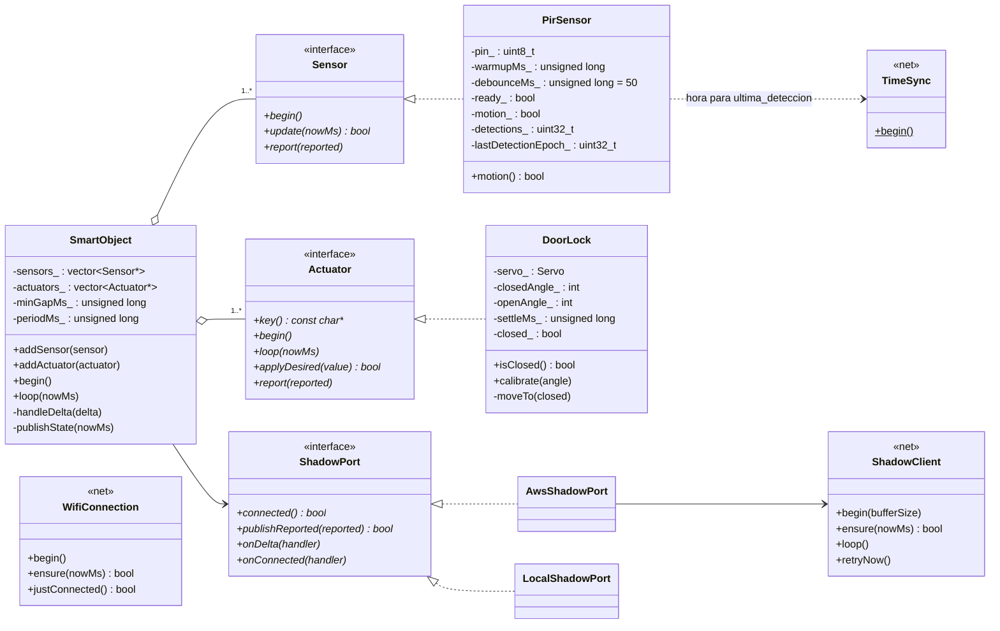

### Funcionamiento de la capa de hardware

**`PirSensor` (RF1).** `SmartObject` llama a `update(nowMs)` en cada vuelta de `loop()`. El método no bloquea.

1. Durante los primeros 60 s no lee el pin y devuelve `false`: no se reportan los falsos positivos del calentamiento. Al terminar devuelve `true` una vez, para publicar `sensor_listo: true`.
2. Un nivel nuevo del pin se acepta solo si se mantiene estable 50 ms. Así se descartan pulsos cortos de ruido, por ejemplo los que induce el servo.
3. Un flanco de subida suma una detección y guarda la hora UTC (`time()`, sincronizada por NTP). Si todavía no hay hora, guarda 0.
4. `update()` devuelve `true` en cada cambio, y `SmartObject` publica por evento.

**`DoorLock` (RF3).** Al iniciar, el servo va a la posición **cerrada** (estado seguro). Cuando llega un delta con la clave `puerta`, `applyDesired()` acepta solo `"abierta"` o `"cerrada"`; cualquier otro valor se ignora y se registra en el monitor serie. El movimiento no usa `delay()`: `loop(nowMs)` suelta el servo tras 700 ms. La confirmación en `reported.puerta` sale en la misma vuelta, muy por debajo de los 3 s que espera la Lambda. `calibrate(ángulo)` solo se usa en el banco de pruebas.

### Decisiones de diseño

- **Interfaces comunes (principio abierto/cerrado).** El láser KY-008 con LDR será otro `Sensor` y el buzzer otro `Actuator`, con su propia clave del Shadow. Se registran con `addSensor()` / `addActuator()` sin modificar `SmartObject` ni la capa de red.
- **Inversión de dependencias en el transporte.** `SmartObject` depende de `ShadowPort`, no de MQTT. Por eso el mismo firmware corre en modo local (`LocalShadowPort`, por el monitor serie) y con AWS (`AwsShadowPort`).
- **Hardware probado sin red.** Las clases de hardware se prueban en la PC con dobles de Arduino ([`test/ruben/`](../test/ruben/test_hardware.cpp), [`test/luciana/`](../test/luciana/test_firmware.cpp)) y en la placa con [`tools/prueba_hardware`](../tools/prueba_hardware/src/main.cpp), sin WiFi ni AWS.
- **Configuración centralizada.** Pines, ángulos y tiempos están en `config.h`. Recalibrar los ángulos del servo no requiere tocar las clases.

## 2.4 Diagrama de clases de la función Lambda

La función Lambda es el *backend* de la skill. Está escrita en Python 3.13 con el **ASK SDK for Python** (`ask-sdk-core`) y organizada en el paquete [`lambda/vigilante/`](../lambda/vigilante/), con **una responsabilidad por módulo**:

| Módulo | Clases / funciones | Responsabilidad | RF |
|---|---|---|---|
| [`lambda_function.py`](../lambda/lambda_function.py) | `lambda_handler` | Punto de entrada configurado en Lambda (`lambda_function.lambda_handler`). Crea los clientes `boto3` **una sola vez por contenedor** (se reutilizan entre invocaciones) y arma la skill. | — |
| [`vigilante/config.py`](../lambda/vigilante/config.py) | `Settings`, constantes `KEY_*`, `DOOR_*` | Lee las variables de entorno y define las **claves del Shadow**, que forman el contrato con el firmware (`include/config.h`). | — |
| [`vigilante/link_repository.py`](../lambda/vigilante/link_repository.py) | `LinkRepository` | Acceso a DynamoDB: `get_thing`, `save` y `delete` de la vinculación `userId → thingName`. | RF7, RF8, RF9 |
| [`vigilante/device_gateway.py`](../lambda/vigilante/device_gateway.py) | `DeviceGateway` | Acceso a AWS IoT Core: valida que el Thing exista (`DescribeThing`), lee y escribe el Shadow (`GetThingShadow` / `UpdateThingShadow`) y espera la confirmación del actuador. | RF4, RF5, RF6, RF9 |
| [`vigilante/device_state.py`](../lambda/vigilante/device_state.py) | `DeviceState` | Vista de solo lectura del documento Shadow: `reported`, `desired`, orden pendiente y antigüedad del último reporte. | RF4, RF6 |
| [`vigilante/handlers.py`](../lambda/vigilante/handlers.py) | Interceptor + un manejador por intent | Lógica de voz: resuelve el Thing del usuario en cada solicitud y responde cada intent. | RF4 – RF9 |
| [`vigilante/speech.py`](../lambda/vigilante/speech.py) | Frases y `digits()`, `elapsed()`, `stale_warning()` | Textos en español y SSML (el código se lee dígito por dígito). | RF4 – RF6 |
| [`vigilante/skill.py`](../lambda/vigilante/skill.py) | `build_skill()` | Registra el interceptor, los manejadores y el manejador de excepciones, **inyectando las dependencias**. | — |

### Diagrama de clases

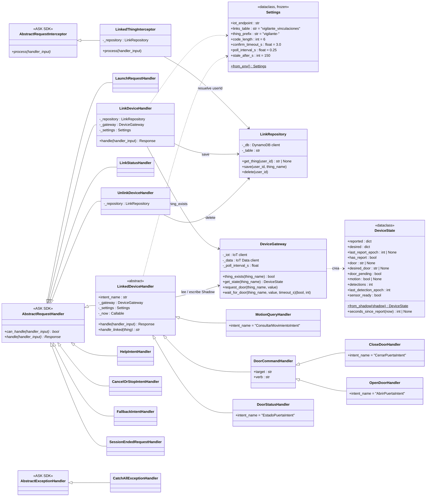

### Dependencias entre módulos

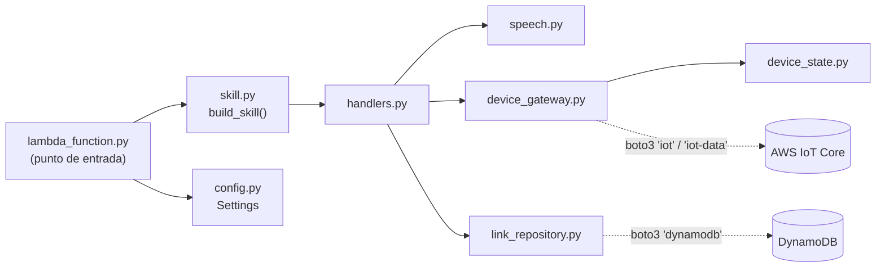

### Decisiones de diseño

- **Inyección de dependencias.** `build_skill(repository, gateway, settings, now)` ([`skill.py:13`](../lambda/vigilante/skill.py#L13)) recibe los objetos que hablan con AWS en vez de crearlos. En producción se pasan los clientes `boto3` reales ([`lambda_function.py:25-32`](../lambda/lambda_function.py#L25-L32)) y en las pruebas, dobles en memoria ([`tests/fakes.py`](../lambda/tests/fakes.py)). Por eso toda la lógica se prueba **sin cuenta de AWS ni red** (§4).
- **Repositorio y gateway** (patrones *Repository* y *Gateway*). Los manejadores no conocen `boto3`: piden "el Thing de este usuario" a `LinkRepository` y "el estado del Thing" a `DeviceGateway`. Si mañana la vinculación pasara a otra base de datos, solo cambiaría `link_repository.py`.
- **Método plantilla** en `LinkedDeviceHandler` ([`handlers.py:150`](../lambda/vigilante/handlers.py#L150)). `handle()` resuelve el Thing vinculado, responde "aún no tienes un dispositivo vinculado" si no lo hay y traduce los errores de AWS. Cada subclase implementa solo `handle_linked(thing)`. Así ningún intent de dispositivo puede olvidarse del RF8.
- **Interceptor global** (`LinkedThingInterceptor`, [`handlers.py:44`](../lambda/vigilante/handlers.py#L44)). Antes de cualquier `LaunchRequest` o `IntentRequest` lee `context.System.user.userId` y busca en DynamoDB el Thing del usuario (RF8). El resultado queda en los atributos de la solicitud y lo usan todos los manejadores.
- **Herencia para el actuador.** `CloseDoorHandler` y `OpenDoorHandler` solo fijan `target` y `verb`. La lógica de escribir `desired`, esperar la confirmación y medir la latencia está una sola vez en `DoorCommandHandler` ([`handlers.py:206`](../lambda/vigilante/handlers.py#L206)).
- **Extensible sin rediseño.** Agregar el buzzer de la segunda entrega requiere una constante `KEY_ALARM` en `config.py`, una propiedad en `DeviceState` y un `LinkedDeviceHandler` nuevo registrado en `build_skill()`. Los demás módulos no cambian.

## 2.5 Diagramas de secuencia

Las tres secuencias recorren el sistema desde el usuario hasta el objeto inteligente.

### Vinculación de un Thing (vincular, rechazar, cambiar y desvincular)

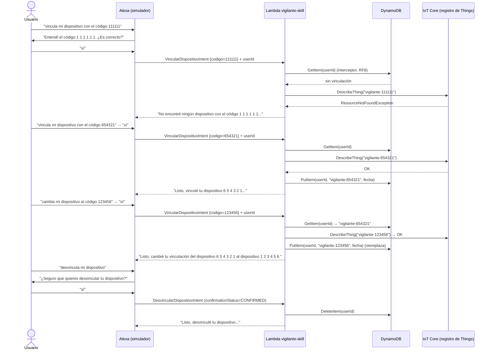

### Consulta del sensor

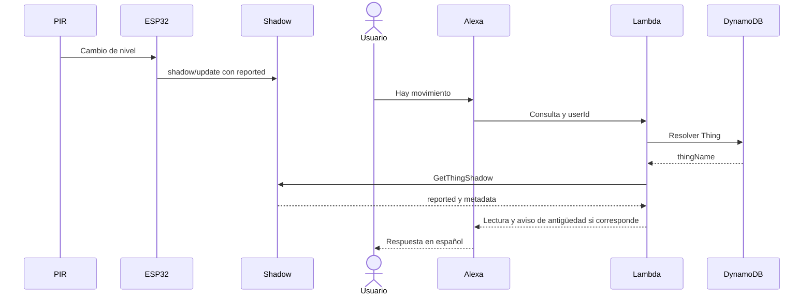

### Comando y reconexión

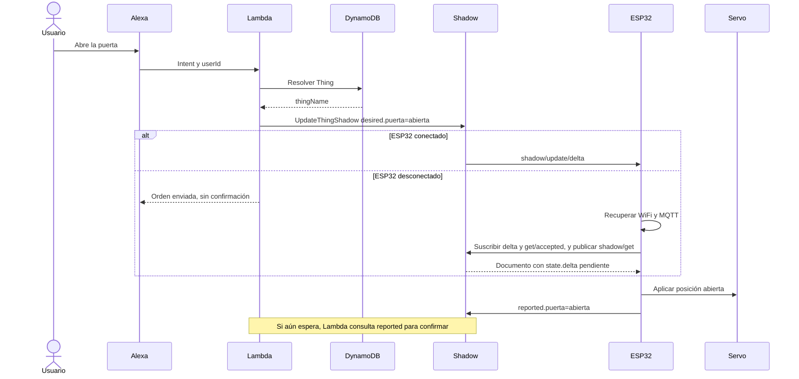

## 2.6 Especificación del documento Shadow

Se usa el **Shadow clásico (sin nombre)** de cada Thing. Ejemplo con una orden de abrir pendiente:

```json
{
  "state": {
    "desired":  { "puerta": "abierta" },
    "reported": {
      "puerta": "cerrada",
      "movimiento": false,
      "detecciones": 4,
      "ultima_deteccion": 1794040000,
      "sensor_listo": true,
      "uptime_s": 1820,
      "rssi": -58
    },
    "delta": { "puerta": "abierta" }
  }
}
```

| Atributo | Sección | Tipo | Valores válidos | Escribe | Lee |
|---|---|---|---|---|---|
| `puerta` | desired | string | `"abierta"`, `"cerrada"` | Lambda (RF5) | ESP32 vía `delta` |
| `puerta` | reported | string | `"abierta"`, `"cerrada"` | ESP32 (RF3) | Lambda (RF5, RF6) |
| `movimiento` | reported | bool | `true` / `false` | ESP32 (RF1, RF2) | Lambda (RF4) |
| `detecciones` | reported | entero ≥ 0 | flancos de subida desde el encendido; no cuenta el calentamiento | ESP32 | Lambda (RF4) |
| `ultima_deteccion` | reported | entero | epoch UTC en segundos; `0` = aún sin hora NTP | ESP32 | Lambda (RF4) |
| `sensor_listo` | reported | bool | `false` durante los primeros 60 s del PIR | ESP32 | Lambda (RF4) |
| `uptime_s` | reported | entero | segundos desde el encendido | ESP32 | Prueba de estabilidad (RNF1) |
| `rssi` | reported | entero | dBm (negativo) | ESP32 | Pruebas y diagnóstico |

- **desired** solo lo escribe la Lambda: es la orden del usuario.
- **reported** solo lo escribe el ESP32: es el estado real (para la puerta, la posición ordenada al servo, porque el SG90 no mide su posición).
- **delta** lo calcula AWS IoT cuando `desired ≠ reported`. Lo publica en `shadow/update/delta` y también lo incluye en `shadow/get/accepted`, que el ESP32 pide cada vez que se (re)conecta. Así aplica las órdenes dadas mientras estaba desconectado (RNF5).

| Tópico (`$aws/things/<thing>/shadow/…`) | ESP32 | Para qué |
|---|---|---|
| `update` | publica | Envía `reported` (eventos y latido) |
| `get` | publica | Pide el documento completo al conectarse |
| `update/delta` | se suscribe | Recibe las órdenes nuevas |
| `get/accepted` | se suscribe | Recibe el documento con el `delta` pendiente |

Las claves del Shadow están definidas en [`include/config.h`](../include/config.h) (firmware) y en [`lambda/vigilante/config.py`](../lambda/vigilante/config.py) (Lambda). Una prueba automática verifica que sean idénticas (§4.2). El *client ID* MQTT es el nombre del Thing, porque la política del certificado lo exige (§3.2).

## 2.7 Mecanismo de vinculación

### Identificador

Cada objeto inteligente se registra en AWS IoT Core como un Thing llamado **`vigilante-` + código de 6 dígitos** que no empieza con 0 (p. ej. `vigilante-123456`). El usuario vincula su dispositivo diciendo solo el **código de vinculación** (`123456`), y la Lambda reconstruye el nombre del Thing anteponiendo el prefijo `THING_PREFIX = "vigilante-"`.

- El ESP32 muestra el código al arrancar (`Código de vinculación: 123456` en el monitor serie) y va impreso en una etiqueta sobre el dispositivo, como el número de serie de un electrodoméstico.
- Se dicta como número (*slot* `AMAZON.NUMBER`), que Alexa reconoce mejor que un nombre con guiones como `vigilante-123456`, y Alexa lo repite dígito por dígito para confirmarlo.
- El prefijo fijo cumple dos funciones: evita que un usuario vincule cualquier Thing de la cuenta y permite que el rol IAM de la Lambda dé permisos solo sobre `thing/vigilante-*` (§3.2).
- Hay **900 000** códigos posibles (100000–999999). Para producción se generan al azar (`Get-Random -Minimum 100000 -Maximum 1000000`). Los dos códigos de esta demo (123456 y 654321) son fáciles de dictar, pero también de adivinar; en un despliegue real se reemplazarían por códigos aleatorios (ver §7).

### Modelo de datos — tabla `vigilante_vinculaciones` (DynamoDB)

| Atributo | Tipo | Clave | Ejemplo | Lo escribe |
|---|---|---|---|---|
| `userId` | String | **Partición (HASH)** | `amzn1.ask.account.AF3X…` | Lambda, con el `context.System.user.userId` de Alexa |
| `thingName` | String | — | `vigilante-123456` | Lambda, después de validar que el Thing existe |
| `fechaVinculacion` | String (ISO-8601 UTC) | — | `2026-11-08T15:20:00Z` | Lambda |

Definición exportada: [`aws/dynamodb-table.json`](../aws/dynamodb-table.json) (capacidad bajo demanda, sin índices).

**Por qué `userId` es la clave de partición:** la única pregunta que la skill hace en cada solicitud es *"¿qué Thing tiene este usuario?"* (RF8). Con `userId` como clave, esa consulta es un `GetItem` directo de costo y latencia constantes (milisegundos), sin `Scan` ni índices. Además, como la clave es única, **un usuario tiene como máximo un Thing**, y cambiar de dispositivo es simplemente sobrescribir su fila.

### Operaciones y validaciones

| Operación (frase) | Validaciones, en orden | Efecto en DynamoDB | RF |
|---|---|---|---|
| **Resolver** (cualquier solicitud) | Lee `userId` del request | `GetItem(userId)` con lectura **fuertemente consistente** (`ConsistentRead=True`), para ver de inmediato una vinculación recién hecha | RF8 |
| **Vincular** ("vincula mi dispositivo con el código 123456") | 1. Alexa repite el código y pide confirmación (modelo de diálogo). 2. El código tiene exactamente 6 dígitos. 3. El Thing `vigilante-<código>` **existe** en IoT Core (`DescribeThing`). 4. No es el mismo Thing ya vinculado. | `PutItem(userId, thingName, fechaVinculacion)` | RF7, RF9 |
| **Cambiar** ("cambia mi dispositivo al código 654321") | Las mismas validaciones que vincular | `PutItem` **reemplaza** la fila del usuario (no se duplica) | RF9 |
| **Consultar** ("qué dispositivo tengo vinculado") | — | Usa el resultado del interceptor | RF8 |
| **Desvincular** ("desvincula mi dispositivo") | 1. El usuario tiene un Thing. 2. Alexa pide confirmación del intent; si dice "no", no se borra nada. | `DeleteItem(userId)` | RF9 |

Código: validación en [`handlers.py:79-110`](../lambda/vigilante/handlers.py#L79-L110), existencia del Thing en [`device_gateway.py:30`](../lambda/vigilante/device_gateway.py#L30) y persistencia en [`link_repository.py`](../lambda/vigilante/link_repository.py).

**Por qué se valida con `DescribeThing` y no leyendo el Shadow:** el Thing de prueba `vigilante-654321` (y cualquier dispositivo recién fabricado que aún no se conectó) **no tiene Shadow** hasta su primer reporte. El registro de Things de IoT Core es la fuente de verdad sobre qué dispositivos existen. `DescribeThing` responde `ResourceNotFoundException` si el código no corresponde a ningún Thing, y la skill responde *"No encontré ningún dispositivo con el código…"* sin escribir nada.

### Ciclo de vida de una vinculación

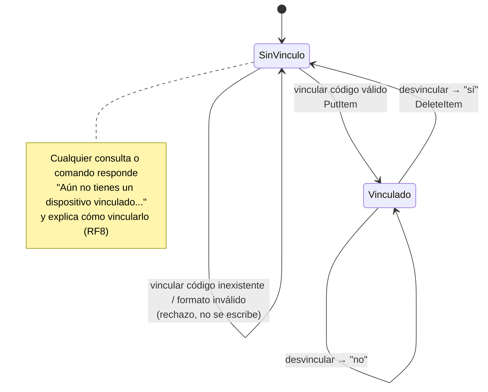

La secuencia completa de vincular, cambiar y desvincular está en §2.5.

### Decisiones y limitaciones documentadas

- **Varios usuarios, cada uno con su Thing.** La skill no está atada a un Thing fijo: el Thing se resuelve por `userId` en cada solicitud. Lo demuestran la prueba automática `test_guion_segundo_usuario_controla_solo_su_thing` y la prueba con un segundo usuario en el simulador (§4).
- **Un Thing puede tener varios usuarios** (p. ej. los miembros de una familia vinculan el mismo vigilante). Es una decisión consciente. La práctica deja Account Linking (OAuth) fuera del alcance, y la protección contra vincular un objeto ajeno es que el código no sea trivial de adivinar.
- **El `userId` de Alexa depende de la habilitación de la skill.** Si el usuario deshabilita y vuelve a habilitar la skill, Alexa le asigna otro `userId` y debe vincular de nuevo. La fila anterior queda huérfana, pero no causa daño.
- **Sin escrituras parciales.** Solo se escribe en DynamoDB después de pasar todas las validaciones. Un código inválido o inexistente nunca crea ni modifica una fila (lo verifican `test_vincular_thing_inexistente_se_rechaza` y el paso 3 del guion).

## 2.8 Diseño de la skill de Alexa

| Parámetro | Valor |
|---|---|
| Nombre de la skill | Vigilante Inteligente |
| Nombre de invocación | `vigilante inteligente` |
| Idioma | Spanish (US) — `es-US` |
| Modelo | Custom, *Provision your own* (backend propio en AWS Lambda) |
| Endpoint | ARN de `vigilante-skill` en `us-east-2` |
| Archivo exportado | [`alexa/interaction-model.es-US.json`](../alexa/interaction-model.es-US.json) |

### Intents, slots y frases de ejemplo

| Intent | Slot | Frases de ejemplo (todas las del modelo) | Manejador | RF |
|---|---|---|---|---|
| `VincularDispositivoIntent` | `codigo` · `AMAZON.NUMBER` · obligatorio y con confirmación | "vincula mi dispositivo con el código {codigo}", "vincula mi dispositivo", "vincular mi dispositivo", "vincula el dispositivo {codigo}", "vincular con el código {codigo}", "mi código es {codigo}", "el código de mi dispositivo es {codigo}", "registra mi dispositivo con el código {codigo}", "cambia mi dispositivo al código {codigo}", "cambia la vinculación al código {codigo}", "cambiar de dispositivo" | `LinkDeviceHandler` | RF7, RF9 |
| `ConsultarVinculacionIntent` | — | "qué dispositivo tengo vinculado", "cuál es mi dispositivo", "qué código tiene mi dispositivo", "tengo un dispositivo vinculado" | `LinkStatusHandler` | RF8 |
| `DesvincularDispositivoIntent` | — (confirmación del intent) | "desvincula mi dispositivo", "desvincular mi dispositivo", "elimina la vinculación", "borra mi dispositivo", "olvida mi dispositivo", "quita mi dispositivo" | `UnlinkDeviceHandler` | RF9 |
| `ConsultarMovimientoIntent` | — | "hay movimiento", "se detecta movimiento", "detectó algo el sensor", "hay alguien cerca", "hay algún intruso", "hubo movimiento", "qué dice el sensor", "estado del sensor", "cuántas detecciones hubo", "alguien se acercó al objeto" | `MotionQueryHandler` | RF4 |
| `CerrarPuertaIntent` | — | "cierra la puerta", "cerrar la puerta", "bloquea la puerta", "asegura la puerta", "pon el seguro", "cierra con llave" | `CloseDoorHandler` | RF5 |
| `AbrirPuertaIntent` | — | "abre la puerta", "abrir la puerta", "desbloquea la puerta", "quita el seguro" | `OpenDoorHandler` | RF5 |
| `EstadoPuertaIntent` | — | "la puerta está cerrada", "la puerta está abierta", "cómo está la puerta", "estado de la puerta", "está cerrada la puerta", "está abierta la puerta" | `DoorStatusHandler` | RF6 |
| `AMAZON.HelpIntent` | — | integrada ("ayuda") | `HelpIntentHandler` | — |
| `AMAZON.CancelIntent`, `AMAZON.StopIntent`, `AMAZON.NavigateHomeIntent` | — | integradas ("salir", "cancela", "para") | `CancelOrStopIntentHandler` | — |
| `AMAZON.FallbackIntent` | — | integrada (frases que no coinciden con ningún intent) | `FallbackIntentHandler` | — |

La correspondencia **intent ↔ manejador** se verifica automáticamente en las dos direcciones (`test_cada_intent_del_modelo_tiene_manejador_en_la_lambda` y `test_cada_manejador_corresponde_a_un_intent_del_modelo`). Al escribir esa prueba apareció que `AMAZON.NavigateHomeIntent`, obligatorio en todo modelo, no tenía manejador: en un Echo con pantalla habría terminado en *"tuve un problema"*. Se corrigió agregándolo a `CancelOrStopIntentHandler`.

### Modelo de diálogo (delegación automática)

`delegationStrategy: ALWAYS`: Alexa resuelve el diálogo antes de llamar a la Lambda, así que la Lambda recibe siempre el intent completo (`dialogState: COMPLETED`).

| Intent | Configuración | Prompt | Por qué |
|---|---|---|---|
| `VincularDispositivoIntent` | slot `codigo` con *elicitation* | `Elicit.Slot.Vincular.codigo`: "¿Cuál es el código de seis dígitos que muestra tu dispositivo?" | Si el usuario dice solo "vincula mi dispositivo", Alexa pide el código. |
| `VincularDispositivoIntent` | slot `codigo` con *confirmation* | `Confirm.Slot.Vincular.codigo` (SSML): "Entendí el código `<say-as interpret-as="digits">`{codigo}`</say-as>`. ¿Es correcto?" | El reconocimiento de números largos por voz puede fallar; repetirlo dígito por dígito evita vincular un Thing equivocado. |
| `DesvincularDispositivoIntent` | confirmación del intent | `Confirm.Intent.Desvincular`: "¿Seguro que quieres desvincular tu dispositivo?" | Es una operación destructiva. Si el usuario dice "no", la Lambda recibe `confirmationStatus=DENIED` y conserva la vinculación. |

### Respuestas y manejo de la sesión

- Todas las respuestas, salvo "salir"/"cancelar", **mantienen la sesión abierta** con un *reprompt* ("¿Algo más?"), de modo que en el simulador se encadena todo el guion sin repetir "abre vigilante inteligente".
- Los códigos se leen con SSML `<say-as interpret-as="digits">` ("uno dos tres cuatro cinco seis", no "ciento veintitrés mil…").

| Situación | Respuesta de la skill |
|---|---|
| Abrir sin vínculo | "Bienvenido a Vigilante Inteligente. Aún no tienes un dispositivo vinculado. Di: vincula mi dispositivo con el código, seguido de los seis dígitos que muestra tu dispositivo." |
| Abrir con vínculo | "Bienvenido a Vigilante Inteligente. Puedes preguntarme si hay movimiento, pedirme que cierre o abra la puerta, o preguntar si la puerta está cerrada. ¿Qué deseas hacer?" |
| Consulta o comando sin vínculo (RF8) | "Aún no tienes un dispositivo vinculado. Di: vincula mi dispositivo con el código…" |
| Movimiento (RF4) | "¡Atención! Se está detectando movimiento en este momento." / "No se detecta movimiento en este momento. La última detección fue hace 10 minutos. Detecciones desde que se encendió: 3." |
| Sensor calentando (primer minuto del PIR) | "El sensor de movimiento se está calibrando, espera un minuto." |
| Comando confirmado (RF5) | "Listo, la puerta quedó cerrada." |
| Comando sin confirmar en 3 s | "Envié la orden de cerrar la puerta, pero el dispositivo aún no la confirmó. Se aplicará en cuanto se conecte." |
| Estado de la puerta (RF6) | "La puerta está cerrada." (+ "Hay una orden pendiente para dejarla abierta." si `desired ≠ reported`) |
| Sin reporte en 150 s | Se agrega: "Ojo: el dispositivo no se comunica desde hace 3 minutos, puede estar desconectado." |
| Dispositivo que nunca reportó | "Tu dispositivo todavía no ha enviado datos. Verifica que esté encendido y conectado." |

### Flujo de la conversación

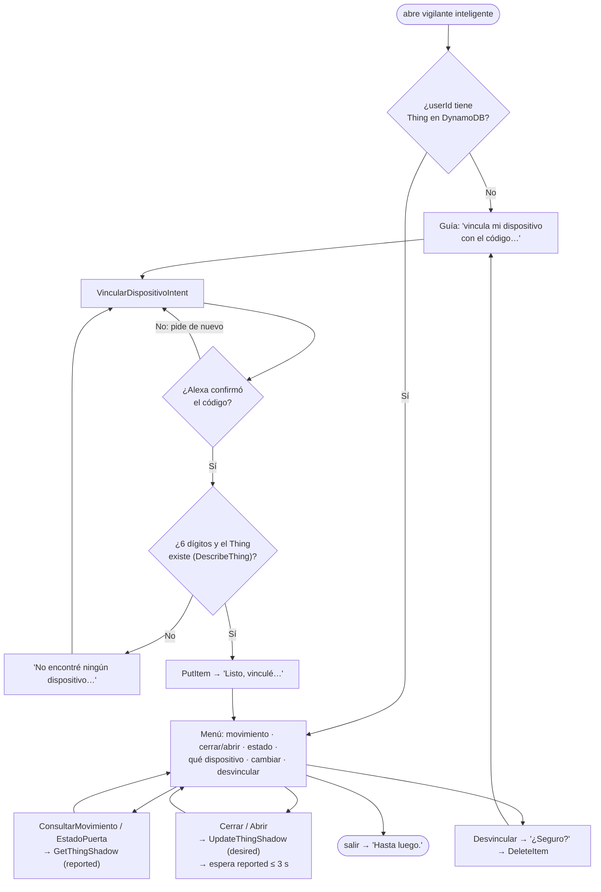

---

# 3. Desarrollo e implementación

## 3.1 Estructura del código

El repositorio contiene las tres capas y sus pruebas:

| Carpeta | Contenido | Lenguaje |
|---|---|---|
| [`src/`](../src/), [`include/`](../include/), [`platformio.ini`](../platformio.ini) | Firmware del objeto inteligente | C++ (Arduino, PlatformIO) |
| [`lambda/`](../lambda/) | Backend de la skill, eventos de prueba y pruebas automáticas | Python 3.13 |
| [`alexa/`](../alexa/) | Modelo de interacción exportado | JSON |
| [`aws/`](../aws/) | Política de IoT, política del rol de la Lambda y tabla de DynamoDB | JSON |
| [`test/`](../test/), [`tools/prueba_hardware/`](../tools/prueba_hardware/) | Pruebas C++ del firmware en la PC y banco de pruebas del hardware en la placa | C++ |
| [`.github/workflows/`](../.github/workflows/pruebas.yml) | Integración continua: pruebas y compilación en cada *push* | YAML |

### Firmware

| Ruta | Responsabilidad |
|---|---|
| `src/main.cpp` | Construcción de objetos, selección local/AWS e integración |
| `src/core/` | Interfaces Sensor, Actuator y ShadowPort |
| `src/sensors/` | Lectura PIR |
| `src/actuators/` | Servo y validación de órdenes |
| `src/app/` | Eventos, latido y distribución de deltas |
| `src/net/WifiConnection.*` | Estado WiFi, transición conectado y reintentos |
| `src/net/ShadowClient.*` | Certificados TLS, sesión MQTT, tópicos y JSON |
| `src/net/TimeSync.*` | Configuración NTP y lectura de epoch válido |
| `include/config.h` | Pines, tiempos, claves y estados sin secretos |
| `include/secrets.example.h` | Plantilla; valores reales solo en secrets.h local |

[`WifiConnection::ensure`](../src/net/WifiConnection.cpp) evita esperas activas
al reconectar WiFi, emite `justConnected` y programa reintentos. La integración
inicia NTP al recuperar red y llama `retryNow()` para intentar MQTT de inmediato.
La conexión MQTT/TLS puede ocupar tiempo de ejecución; no se declara como un
sistema totalmente asíncrono.

[`ShadowClient`](../src/net/ShadowClient.cpp) configura CA, certificado y clave
privada, usa el puerto 8883 y solicita el documento tras cada conexión. Así
recupera un delta que pudo quedar pendiente durante el corte. El adaptador de
[`main.cpp`](../src/main.cpp) implementa `ShadowPort` y conserva las interfaces
que utiliza `SmartObject`, sin acoplarlo a un sensor o actuador específico.

[`TimeSync`](../src/net/TimeSync.cpp) usa NTP; antes de sincronizar, la hora de
una detección se informa como 0. No se confunde epoch con millis. El bucle toma
una nueva marca millis tras atender red y comandos para que el temporizador del
servo no reciba una hora anterior al inicio del movimiento.

**Fragmentos clave del firmware:**

- [`ShadowClient::ensure`](../src/net/ShadowClient.cpp#L40-L68): conecta por MQTT/TLS usando el **nombre del Thing como client ID** ([línea 53](../src/net/ShadowClient.cpp#L53)), porque la política lo exige; luego se suscribe a `update/delta` y `get/accepted` y publica `get` para recuperar órdenes pendientes (RF3, RNF5).
- [`ShadowClient::handleMessage`](../src/net/ShadowClient.cpp#L89): distingue el `delta` que llega por `update/delta` (está en `state`) del que llega por `get/accepted` (está en `state.delta`) y lo entrega a `SmartObject` (RF3).
- [`SmartObject::loop`](../src/app/SmartObject.cpp#L24-L44): atiende los actuadores, lee los sensores y decide si publicar: por **evento** (con separación mínima de 500 ms) o por **latido** cada 60 s ([línea 38](../src/app/SmartObject.cpp#L38)) (RF2, RNF4).
- [`SmartObject::handleDelta`](../src/app/SmartObject.cpp#L46): reparte cada clave del `delta` al actuador dueño de esa clave y fuerza la confirmación inmediata en `reported` (RF3).
- [`DoorLock::applyDesired`](../src/actuators/DoorLock.cpp#L37): valida que el valor sea `"abierta"` o `"cerrada"` antes de mover el servo; cualquier otro valor se rechaza (RF3).
- [`PirSensor::update`](../src/sensors/PirSensor.cpp#L36): espera los 60 s de calentamiento, filtra pulsos menores a 50 ms y cuenta flancos de subida con la hora NTP (RF1).
- [`loop()` de `main.cpp`](../src/main.cpp#L106): reconexión no bloqueante. Al volver el WiFi sincroniza la hora y fuerza un intento MQTT inmediato con `retryNow()` (RNF5).

Al arrancar con el entorno de la demo, [`main.cpp`](../src/main.cpp) muestra en el monitor serie el nombre del Thing y su **código de vinculación** (la parte numérica, `123456`), que es lo que el usuario le dice a Alexa (RF7). Es el mecanismo que la práctica recomienda: el objeto muestra su identificador al iniciar.

El reparto de responsabilidades entre clases y su diagrama están en §2.3.

### Función Lambda

La estructura de la Lambda, sus módulos y sus decisiones de diseño están en §2.4. Los fragmentos clave son:

- [`LinkedThingInterceptor.process`](../lambda/vigilante/handlers.py#L50): resuelve en cada solicitud el Thing del `userId` (RF8).
- [`LinkDeviceHandler.handle`](../lambda/vigilante/handlers.py#L79-L110): valida el código y la existencia del Thing antes de guardar (RF7, RF9).
- [`DoorCommandHandler.handle_linked`](../lambda/vigilante/handlers.py#L212): escribe `desired`, espera la confirmación en `reported` y registra `latencia_ms` (RF5, RNF3).
- [`DeviceGateway.wait_for_door`](../lambda/vigilante/device_gateway.py#L55): sondea el Shadow cada 250 ms durante hasta 3 s.

## 3.2 Configuraciones en AWS

Todos los recursos están en **`us-east-2` (Ohio)**, la región asignada al proyecto en la cuenta del plan gratuito. IoT Core, DynamoDB y Lambda deben estar en la misma región: la Lambda usa el endpoint de IoT y la tabla de esa región.

### Cuenta y control de costos

- Cuenta en el **plan gratuito (Free)**: AWS no cobra a la tarjeta. El uso se descuenta de los USD 120 en créditos y la cuenta se cierra sola a los 6 meses o al agotar los créditos, en vez de pasar a cobrar. Nunca se usó la opción *"Actualizar plan"*.
- En las cuentas nuevas con el diseño de "proyectos", la consola de Facturación no ofrece el menú de Presupuestos. **La cuenta está en el plan gratuito de AWS, que no genera cargos a la tarjeta; el uso se descuenta de USD 120 en créditos. Por eso no se configuró un presupuesto aparte.** La evidencia es la captura de Créditos: USD 120 disponibles y USD 0,00 usados.
- Para no gastar de más no se activaron *Fleet indexing*, *Device Defender*, reglas de IoT, índices ni *backups* de DynamoDB, y los logs de la Lambda se retienen **1 semana**.

**Costo mensual estimado** (precios de lista en `us-east-2`, un dispositivo encendido todo el mes):

| Servicio | Uso estimado | Precio de lista | Costo |
|---|---|---|---|
| IoT Core — mensajes | 43 200 latidos (1 cada 60 s × 30 días) + eventos del PIR y del servo ≈ 50 000 | USD 1.00 / millón | ≈ USD 0.05 |
| IoT Core — operaciones de Shadow | ≈ 50 000 (cada `update`/`get`) | USD 1.25 / millón | ≈ USD 0.06 |
| IoT Core — conectividad | 43 200 minutos de conexión | USD 0.08 / millón de minutos | < USD 0.01 |
| Lambda | < 1 000 invocaciones | 1 millón gratis al mes (capa siempre gratuita) | USD 0.00 |
| DynamoDB (bajo demanda) | unos cientos de lecturas y escrituras | USD 0.125 / millón de lecturas, 0.625 / millón de escrituras | < USD 0.01 |
| CloudWatch Logs | pocos MB, retención 1 semana | 5 GB gratis | USD 0.00 |
| **Total** | | | **≈ USD 0.11 / mes**, cubierto por los créditos |

### AWS IoT Core

| Recurso | Configuración |
|---|---|
| **Thing del objeto inteligente** | `vigilante-123456` · Shadow **clásico (sin nombre)** · certificado X.509 generado por AWS, **Activo**, con la política `vigilante-device-policy` adjunta |
| **Thing de prueba** | `vigilante-654321` · Shadow clásico · **sin certificado** (no se conecta nunca). Sirve para demostrar el cambio de vinculación (RF9) y que la skill no está atada a un Thing fijo |
| **Certificados** | Certificado del dispositivo, clave privada y Amazon Root CA 1, descargados una sola vez y guardados **fuera del repositorio**. Solo se copian a `secrets.h` (excluido por `.gitignore`) |
| **Endpoint** | `xxxxxxxx-ats.iot.us-east-2.amazonaws.com` (tipo `iot:Data-ATS`, compatible con Amazon Root CA 1). Se usa en `secrets.h` (ESP32) y en la variable `IOT_ENDPOINT` (Lambda) |
| **Puerto / protocolo** | MQTT sobre TLS 1.2 con autenticación mutua por certificado, puerto 8883 |

**Política del dispositivo `vigilante-device-policy`** ([`aws/iot-policy.json`](../aws/iot-policy.json)), de mínimo privilegio:

| Sid | Acción | Recurso | Qué permite |
|---|---|---|---|
| `ConectarSoloConSuNombreDeThing` | `iot:Connect` | `client/${iot:Connection.Thing.ThingName}` | Conectarse solo si el *client ID* MQTT es igual al nombre del Thing dueño del certificado. Impide suplantar a otro dispositivo. |
| `PublicarSoloEnSuShadow` | `iot:Publish` | `topic/$aws/things/${iot:Connection.Thing.ThingName}/shadow/*` | Publicar `shadow/update` (reported) y `shadow/get` solo en su propio Shadow. |
| `SuscribirseSoloASuShadow` | `iot:Subscribe` | `topicfilter/$aws/things/${…}/shadow/*` | Suscribirse a `update/delta`, `get/accepted`, etc. de su Shadow. |
| `RecibirSoloDeSuShadow` | `iot:Receive` | `topic/$aws/things/${…}/shadow/*` | Recibir los mensajes de esos tópicos. |

La variable de política `${iot:Connection.Thing.ThingName}` hace que **la misma política sirva para todos los Things** `vigilante-*` sin editarla, y que cada certificado vea **solo su propio Shadow**. Por eso el firmware usa `THING_NAME` como *client ID*. La política abarca todos los subtemas de `shadow/*` (no solo los 4 que usa el ESP32) para poder hacer, con el mismo certificado, las pruebas manuales con MQTTX o MQTT.fx. Sigue siendo mínimo privilegio porque el alcance queda limitado al Shadow propio.

### Amazon DynamoDB

| Parámetro | Valor | Justificación |
|---|---|---|
| Nombre | `vigilante_vinculaciones` | Nombre por defecto de `LINKS_TABLE` en la Lambda |
| Clave de partición | `userId` (String) | Consulta directa por usuario (§2.7) |
| Clave de ordenación | — | Un registro por usuario |
| Capacidad | Bajo demanda (`PAY_PER_REQUEST`), configuración predeterminada | Se paga por solicitud; con unos cientos de operaciones el costo es de fracciones de centavo. El almacenamiento (25 GB) está en la capa siempre gratuita |
| Índices, *streams*, *backups* | Ninguno | No se necesitan; evitan costos |

Definición exportada: [`aws/dynamodb-table.json`](../aws/dynamodb-table.json) (equivale a `aws dynamodb create-table --cli-input-json file://aws/dynamodb-table.json`).

### Rol IAM de la Lambda `vigilante-lambda-role`

La Lambda **no contiene ninguna access key**. `boto3` obtiene credenciales temporales del rol de ejecución que AWS le asigna. El rol tiene exactamente dos políticas:

1. **`AWSLambdaBasicExecutionRole`** (administrada por AWS): solo permite escribir logs en CloudWatch.
2. **`vigilante-lambda-minimo`** (política en línea, [`aws/lambda-role-policy.json`](../aws/lambda-role-policy.json)):

| Permiso | Recurso | Para qué | Código que lo usa | RF |
|---|---|---|---|---|
| `iot:GetThingShadow` | `arn:aws:iot:us-east-2:<ACCOUNT_ID>:thing/vigilante-*` | Leer `reported` (movimiento, puerta) y esperar la confirmación del servo | `DeviceGateway.get_state`, `wait_for_door` | RF4, RF5, RF6 |
| `iot:UpdateThingShadow` | `…:thing/vigilante-*` | Escribir `desired.puerta` | `DeviceGateway.request_door` | RF5 |
| `iot:DescribeThing` | `…:thing/vigilante-*` | Validar que el Thing exista antes de vincular | `DeviceGateway.thing_exists` | RF9 |
| `dynamodb:GetItem` | `arn:aws:dynamodb:us-east-2:<ACCOUNT_ID>:table/vigilante_vinculaciones` | Resolver el Thing del usuario | `LinkRepository.get_thing` | RF8 |
| `dynamodb:PutItem` | ídem | Guardar o cambiar la vinculación | `LinkRepository.save` | RF7, RF9 |
| `dynamodb:DeleteItem` | ídem | Eliminar la vinculación | `LinkRepository.delete` | RF9 |
| `logs:CreateLogGroup`, `logs:CreateLogStream`, `logs:PutLogEvents` | grupo `/aws/lambda/vigilante-skill` | Depuración y evidencia de latencia (`latencia_ms`) | `logging` | — |

Son **exactamente los permisos mínimos** que pide el enunciado (§3.2 de la práctica). Ninguna acción usa comodín y los recursos se restringen al prefijo `vigilante-*` y a una sola tabla. La Lambda no puede leer el Shadow de Things de otros proyectos de la cuenta ni tocar otras tablas, y no puede publicar en tópicos MQTT arbitrarios (no tiene `iot:Publish`). La prueba `test_rol_de_la_lambda_tiene_solo_los_permisos_minimos` hace que cualquier permiso agregado de más rompa la integración continua del repositorio.

> **Alternativa simplificada (no usada):** en clase se adjuntaron `AWSIoTFullAccess` y `AmazonDynamoDBFullAccess` al rol. Funciona, pero da control total sobre todo IoT Core y todas las tablas de la cuenta. Para este proyecto se optó por la política mínima de arriba, que es la recomendada para producción.

### Función Lambda `vigilante-skill`

| Parámetro | Valor | Justificación |
|---|---|---|
| Runtime | Python 3.13, arquitectura x86_64 | Versión con la que se probó el paquete (pytest local con 3.13.3) |
| Handler | `lambda_function.lambda_handler` | Punto de entrada del paquete |
| Código | `lambda/build/lambda_deployment.zip` (≈ 2.3 MB), generado con [`build.ps1`](../lambda/build.ps1) / [`build.sh`](../lambda/build.sh) | Contiene `lambda_function.py` en la raíz, el paquete `vigilante/` y `ask-sdk-core==1.19.0`. `boto3` **no** se empaqueta porque ya viene en el runtime. El `.zip` está en `.gitignore` y se regenera desde el código |
| Rol de ejecución | `vigilante-lambda-role` | Ver arriba |
| Memoria | 256 MB | En Lambda la CPU es proporcional a la memoria: 256 MB acorta el arranque en frío del ASK SDK sin salir de la capa gratuita |
| Tiempo de espera | **10 s** | Peor caso de "cierra la puerta": `GetItem` + `GetThingShadow` + `UpdateThingShadow` + hasta **3 s** esperando `reported` (sondeo cada 250 ms) ≈ 4–5 s. El valor por defecto (3 s) cortaría la espera. Alexa espera como máximo 8 s |
| Variables de entorno | `IOT_ENDPOINT` = endpoint ATS (obligatoria) · `LINKS_TABLE` = `vigilante_vinculaciones` | Opcionales con valor por defecto: `CONFIRM_TIMEOUT_S` = 3, `STALE_AFTER_S` = 150, `THING_PREFIX` = `vigilante-` |
| Desencadenador | **Alexa Skills Kit** con **verificación de Skill ID habilitada** | Solo la skill *Vigilante Inteligente* puede invocar la función; cualquier otra skill es rechazada por AWS antes de ejecutar código |
| Logs | CloudWatch `/aws/lambda/vigilante-skill`, retención **1 semana** | Cada comando de puerta deja una línea JSON `{"evento": "comando_puerta", "thing": …, "confirmado": …, "latencia_ms": …}` que sirve de evidencia del tiempo de respuesta (RNF3) |

**Contrato con el firmware.** Las claves del Shadow (`puerta`, `movimiento`, `detecciones`, `ultima_deteccion`, `sensor_listo`), los valores de la puerta (`abierta`/`cerrada`) y el prefijo `vigilante-` están definidos dos veces: en [`lambda/vigilante/config.py`](../lambda/vigilante/config.py) y en `include/config.h` del firmware. El latido del ESP32 (60 s) y el aviso de desconexión de la Lambda (150 s) también deben ser compatibles: el aviso tolera un latido perdido. Las pruebas de [`tests/test_contratos.py`](../lambda/tests/test_contratos.py) comparan ambos archivos y fallan si alguien cambia uno sin el otro.

### Seguridad (RNF6)

| Medida | Dónde |
|---|---|
| Certificados, clave privada y WiFi solo en `secrets.h`, excluido por `.gitignore` junto con `*.pem`, `*.key`, `*.crt` y `*.zip`; plantilla sin valores en `secrets.example.h` | [`.gitignore`](../.gitignore) |
| Sin access keys en el ESP32 (TLS mutuo con certificado) ni en la Lambda (rol IAM) | `lambda_function.py` |
| El ID de cuenta no se publica: los JSON de `aws/` usan `<ACCOUNT_ID>`, que se reemplaza solo al pegarlos en la consola | [`aws/`](../aws/) |
| Mínimo privilegio en el dispositivo (solo su Shadow) y en la Lambda (6 acciones sobre `vigilante-*` y una tabla) | `iot-policy.json`, `lambda-role-policy.json` |
| Solo la skill propia invoca la Lambda (verificación de Skill ID) | Desencadenador |
| Verificación automática: ningún archivo versionado en Git es `secrets.h`, `.pem`, `.key`, `.crt` o `.zip`, ni contiene una clave privada PEM o una access key `AKIA…` | `test_ningun_secreto_versionado_en_git`, `test_configuraciones_aws_sin_id_de_cuenta_real` |

### Evidencias de la configuración

Las capturas ocultan el ID de cuenta y el endpoint; nunca se captura el contenido de los certificados.

| Captura | Muestra |
|---|---|
| 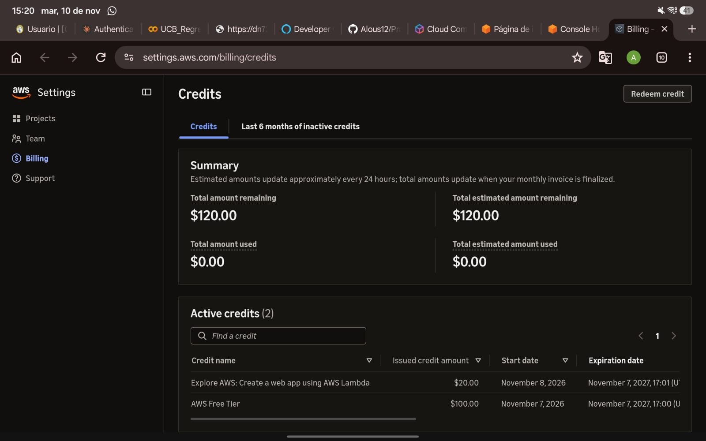 | Créditos: USD 120 disponibles y USD 0,00 usados |
| 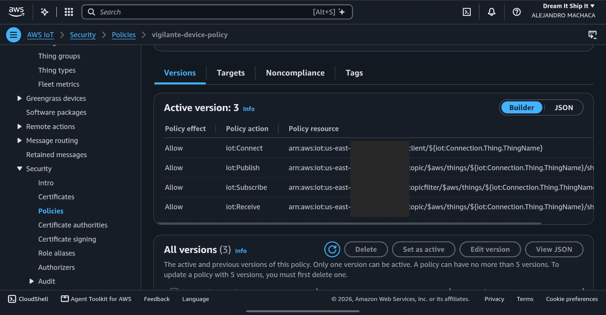 | `vigilante-device-policy` en la vista Builder (versión activa 3) |
| 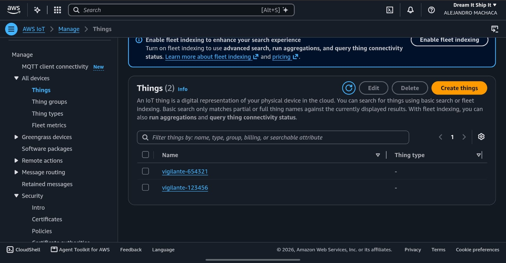 | Lista de objetos con `vigilante-123456` y `vigilante-654321` |
| 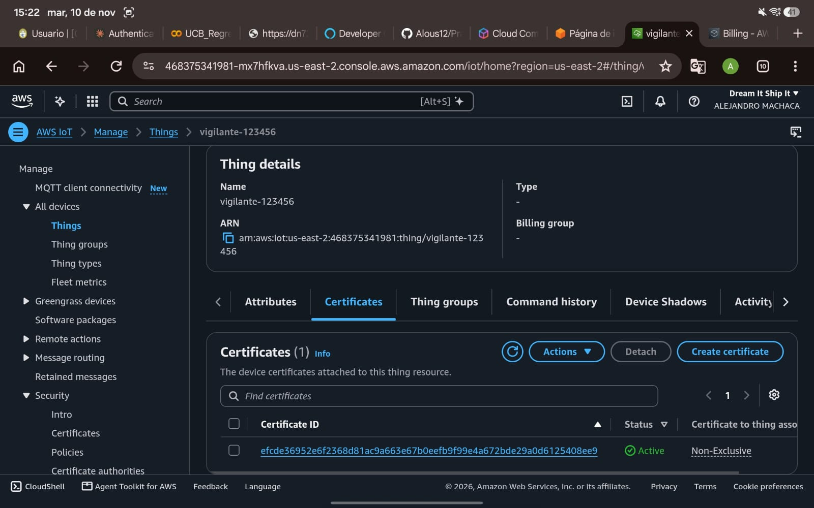 | Certificado **Activo** con la política y el Thing adjuntos |
| 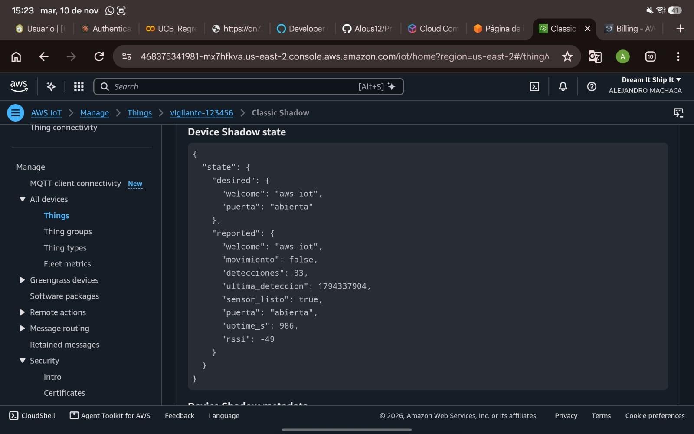 | Sombra clásica con `desired` y `reported` iguales |
| 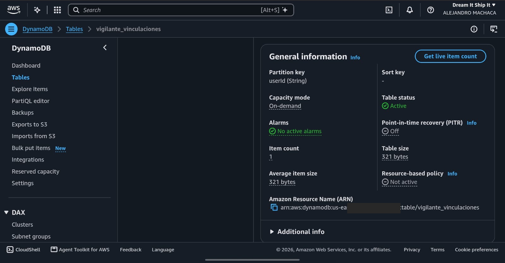 | Tabla `vigilante_vinculaciones`, Activa, clave `userId`, bajo demanda |
| 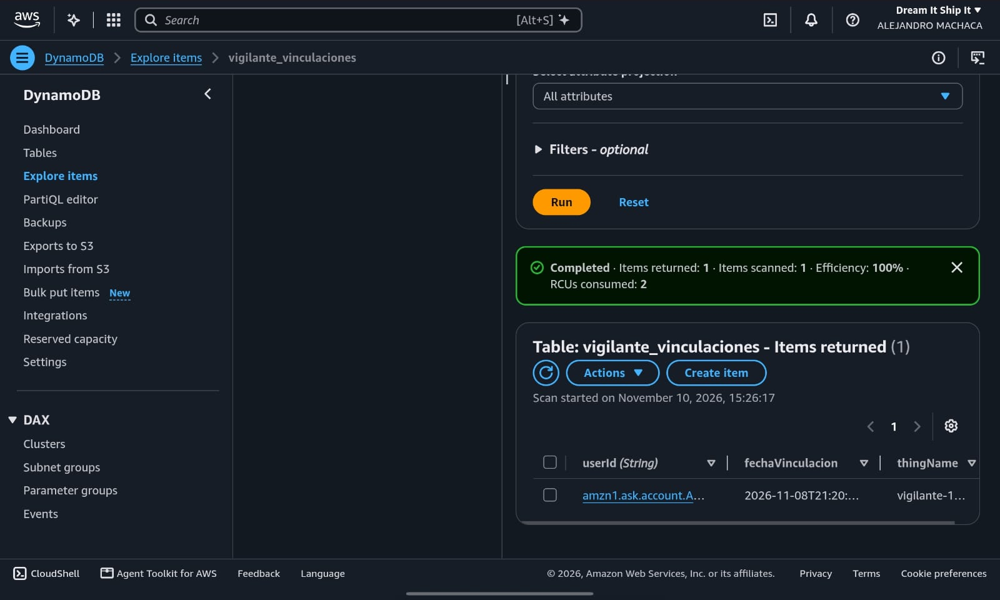 | Fila de vinculación creada por la skill |
| 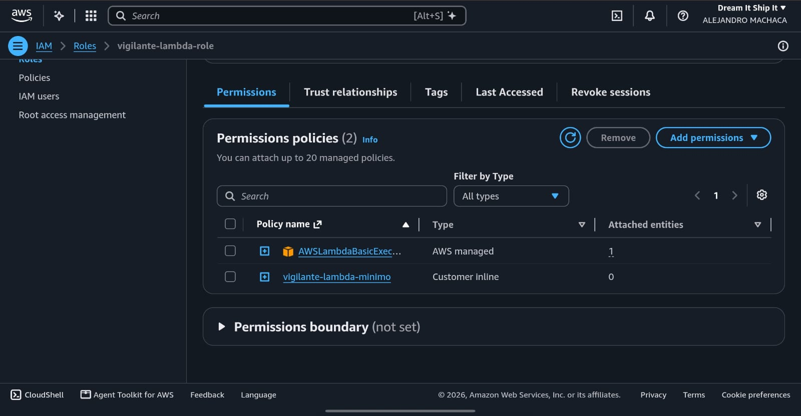 | Rol con `AWSLambdaBasicExecutionRole` + `vigilante-lambda-minimo` |
| 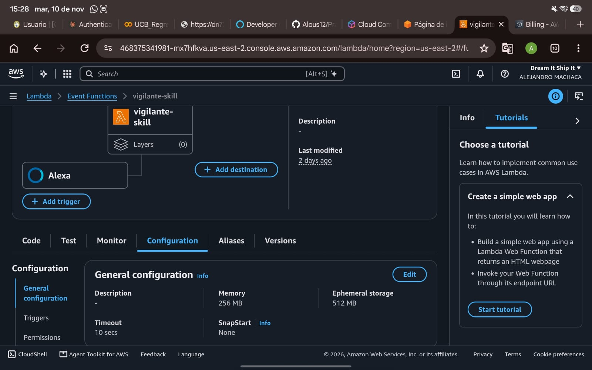 | Configuración general: Python 3.13, 256 MB, 10 s |
| 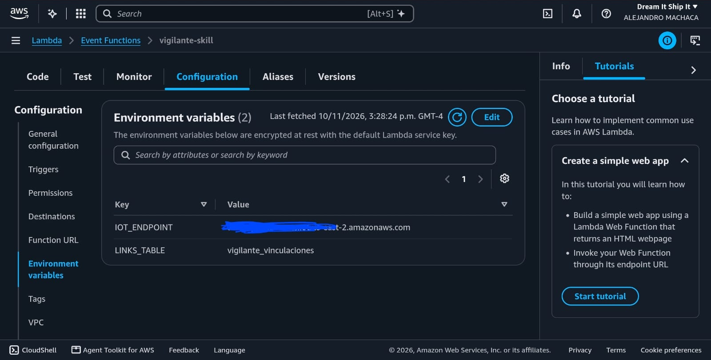 | Variables `IOT_ENDPOINT` (oculto) y `LINKS_TABLE` |

## 3.3 Configuraciones en Alexa

La skill se configuró en la **Alexa Developer Console** (developer.amazon.com) con una cuenta de Amazon de desarrollador, distinta de la cuenta de AWS.

### Pasos realizados

1. **Crear la skill.** *Create Skill* → nombre `Vigilante Inteligente` → idioma principal **Spanish (US)** → tipo de experiencia *Other* → modelo **Custom** → hosting **Provision your own** → plantilla *Start from Scratch*. Se usa hosting propio y no *Alexa-hosted* porque una skill Alexa-hosted corre en una cuenta de Amazon que no tiene acceso al IoT Core ni al DynamoDB del proyecto.
2. **Importar el modelo de interacción.** *Build → Interaction Model → JSON Editor* → se pegó [`alexa/interaction-model.es-US.json`](../alexa/interaction-model.es-US.json) → *Save*. Esto crea de una vez la invocación, los 12 intents, el slot `codigo`, el modelo de diálogo y los prompts (§2.8). Si la skill tuviera más de un idioma, el mismo JSON debe pegarse en cada uno, o *Build skill* falla con *"Interaction Model does not include Custom Intents"*.
3. **Conectar con la Lambda (en este orden).** La Lambda solo acepta a su skill y la skill solo guarda un endpoint que ya la autoriza:
   1. *Endpoint* → **AWS Lambda ARN** → copiar **Your Skill ID** (`amzn1.ask.skill.…`).
   2. En AWS: `vigilante-skill` → *Agregar desencadenador* → **Alexa Skills Kit** → *Verificación de ID de habilidad: Habilitar* → pegar el Skill ID.
   3. De vuelta en Alexa: *Default Region* = `arn:aws:lambda:us-east-2:<ACCOUNT_ID>:function:vigilante-skill` → *Save Endpoints*.
4. **Compilar.** *Build skill* → esperar a *Last successful build* con la hora actual y *Errors and Warnings* en 0. Hay que recompilar cada vez que cambian intents o frases (no al cambiar el endpoint).
5. **Habilitar pruebas.** Pestaña *Test* → *Skill testing is enabled in:* **Development**. Se marca **Skill I/O** para ver el *JSON Input* (lo que Alexa envía, con `context.System.user.userId`) y el *JSON Output* (la respuesta de la Lambda).
6. **Verificar el reconocimiento sin llamar a la Lambda.** *Build → Evaluate Model → Utterance Profiler* muestra qué intent y qué valor de `codigo` resuelve Alexa para una frase. Sirve para distinguir un problema del modelo de voz de uno de la Lambda.

### Segundo usuario de Alexa

El `userId` depende de la cuenta de Amazon que usa la skill. Para demostrar que cada usuario controla su propio Thing:

- **Opción A (simulador):** en la consola de Alexa, menú del perfil → *Settings → User Permissions → Invite*. Se invita a un compañero del grupo, que abre la pestaña *Test* con **su** cuenta y vincula `vigilante-654321`. En *JSON Input* aparece un `userId` distinto. La evidencia del segundo usuario es la prueba automática `test_guion_segundo_usuario_controla_solo_su_thing` y el evento [`lambda/events/09_vincular_segundo_usuario.json`](../lambda/events/09_vincular_segundo_usuario.json).
- **Opción B (consola de Lambda):** el evento [`lambda/events/09_vincular_segundo_usuario.json`](../lambda/events/09_vincular_segundo_usuario.json) envía a la Lambda real una vinculación con `userId = amzn1.ask.account.SEGUNDO_USUARIO` y el código 654321.

### Evidencias de la configuración

| Captura | Muestra |
|---|---|
| 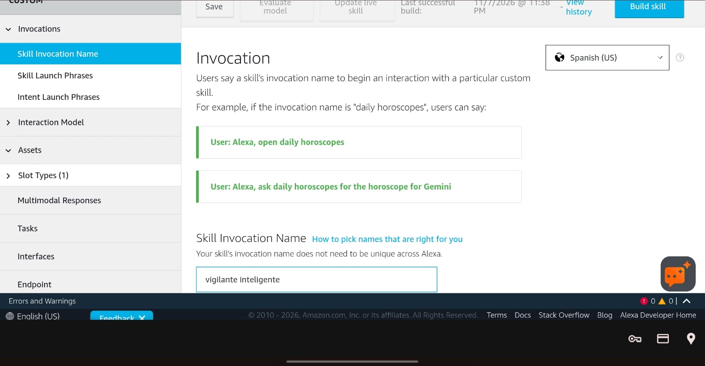 | *Invocations*: `vigilante inteligente` |
| 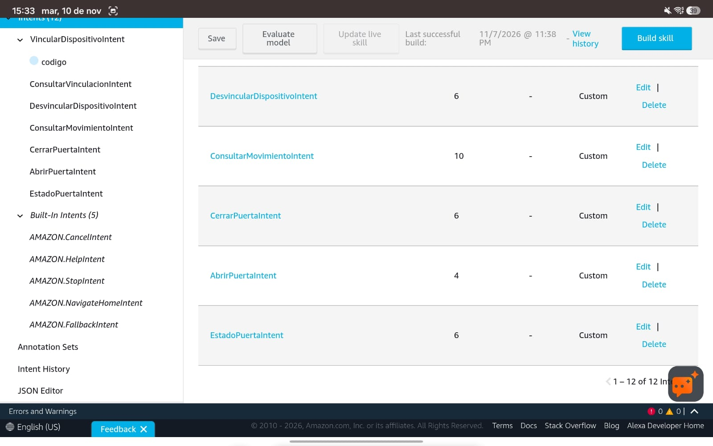 | Lista de intents y el slot `codigo` |
| 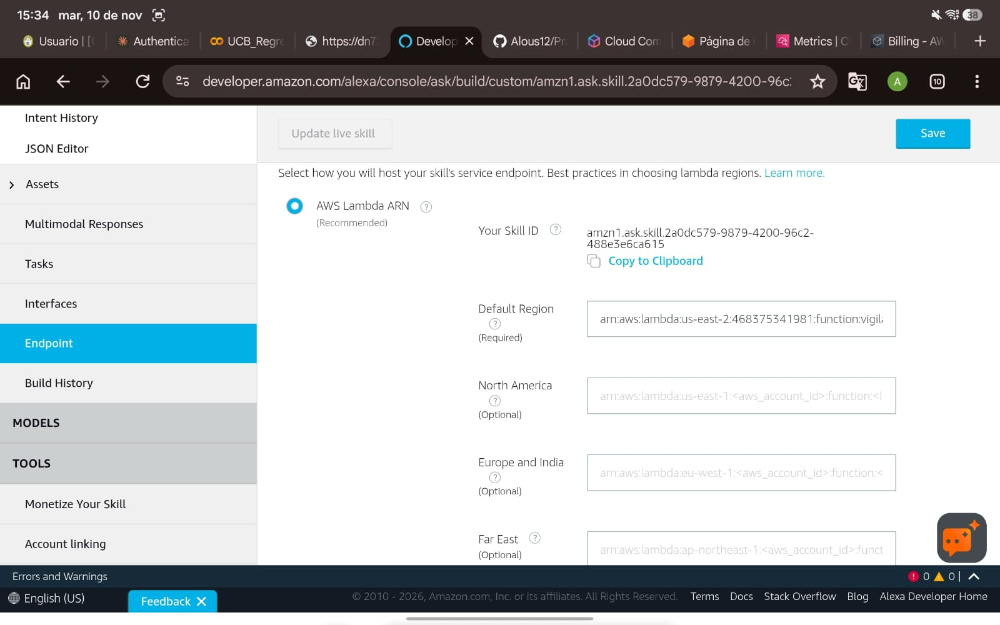 | Endpoint AWS Lambda ARN en *Default Region* (cuenta oculta) |
| 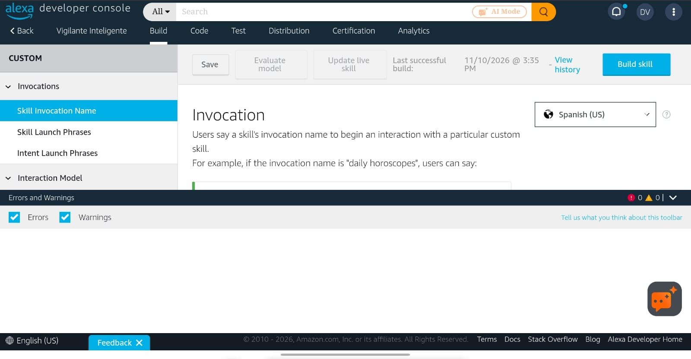 | *Last successful build*, 0 errores y 0 advertencias |
| 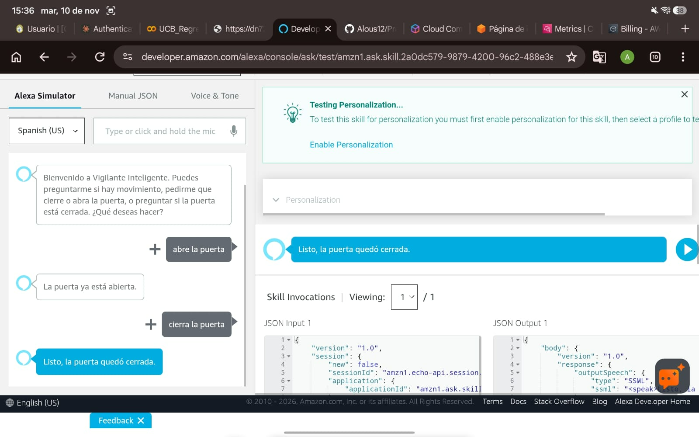 | Pestaña *Test*: simulador en Spanish (US) con *Skill I/O* (*JSON Input* y *JSON Output*) |

---

# 4. Pruebas y validaciones

## 4.1 Plan de pruebas

Cada requerimiento tiene al menos una prueba. Los requerimientos de la skill (RF4–RF9) se verifican dos veces: con pruebas automáticas (§4.2) y en el simulador de Alexa con el ESP32 real (§4.4).

| ID | Requerimiento | Procedimiento | Criterio de aceptación | Responsable | Resultado | Evidencia |
|---|---|---|---|---|---|---|
| P01 | RF7 | "vincula mi dispositivo con el código 123456" → "sí" | Responde "vinculé" y aparece la fila en DynamoDB | Alejandro | Automatizada: ✅ · Simulador (paso 4): "Listo, vinculé tu dispositivo 6 5 4 3 2 1…" | [`test_guion_alexa.py`](../lambda/tests/test_guion_alexa.py), [`aws-08`](anexos/aws-08-dynamodb-items.png) |
| P02 | RF9 | Vincular con un código inexistente (111111) | Rechaza y no crea fila | Alejandro | Automatizada: ✅ · Simulador (paso 3): "No encontré ningún dispositivo con el código 1 1 1 1 1 1…" | [`test_guion_alexa.py`](../lambda/tests/test_guion_alexa.py) |
| P03 | RF9 | Cambiar del Thing de prueba (654321) al real (123456) | "cambié tu vinculación"; `thingName` reemplazado, una sola fila | Alejandro | Automatizada: ✅ · Simulador (paso 6): "Listo, cambié tu vinculación del dispositivo 6 5 4 3 2 1 al dispositivo 1 2 3 4 5 6." | [`test_guion_alexa.py`](../lambda/tests/test_guion_alexa.py) |
| P04 | RF9 | "desvincula mi dispositivo" → "no" y luego → "sí" | "no" conserva la fila; "sí" la elimina | Alejandro | Automatizada: ✅ · Simulador (pasos 14 y 15): "De acuerdo, tu dispositivo sigue vinculado." / "Listo, desvinculé tu dispositivo…" | [`test_guion_alexa.py`](../lambda/tests/test_guion_alexa.py) |
| P05 | RF8 | Sin vinculación: abrir la skill y decir "cierra la puerta" | Indica cómo vincular; no toca ningún Shadow | Alejandro | Automatizada: ✅ · Simulador (pasos 1 y 2): "…Aún no tienes un dispositivo vinculado. Di: vincula mi dispositivo con el código…" / "Aún no tienes un dispositivo vinculado…" | [`test_guion_alexa.py`](../lambda/tests/test_guion_alexa.py) |
| P06 | RF1, RF2 | Pasar frente al PIR con el cliente de prueba MQTT suscrito | `movimiento: true` en `reported` en ≤ 1 s | Ruben / Luciana | Monitor serie: ✅ cada detección se publicó al instante (§4.3) · Cliente MQTT: ✅ llega a AWS en ≤ 1 s | [`pruebas-comunicacion.md`](anexos/pruebas-comunicacion.md) |
| P07 | RF4 | "hay movimiento" con y sin presencia | La respuesta coincide con `reported` | Alejandro | Automatizada: ✅ · Simulador (pasos 8 y 9): "No se detecta movimiento en este momento…" / "¡Atención! Se está detectando movimiento en este momento…" | [`test_guion_alexa.py`](../lambda/tests/test_guion_alexa.py) |
| P08 | RF3, RF5 | "cierra la puerta" / "abre la puerta" | El servo se mueve y `reported.puerta` = `desired.puerta` | Alejandro / Ruben | Automatizada: ✅ · Simulador (pasos 10 y 12): "Listo, la puerta quedó cerrada." / "Listo, la puerta quedó abierta." | [`test_guion_alexa.py`](../lambda/tests/test_guion_alexa.py), [`alexa-05`](anexos/alexa-05-test-development.png) |
| P09 | RF6 | "la puerta está cerrada" | La respuesta coincide con `reported.puerta` | Alejandro | Automatizada: ✅ · Simulador (paso 11): "La puerta está cerrada." | [`test_guion_alexa.py`](../lambda/tests/test_guion_alexa.py) |
| P10 | Multiusuario | Un segundo usuario de Alexa vincula `vigilante-654321` | Dos filas en DynamoDB; cada usuario controla solo su Thing | Alejandro | Automatizada: ✅ · Simulador (paso 13): "Listo, vinculé tu dispositivo 6 5 4 3 2 1…" con otro `userId` | `test_guion_segundo_usuario_controla_solo_su_thing`, [`09_vincular_segundo_usuario.json`](../lambda/events/09_vincular_segundo_usuario.json) |
| P11 | RNF1 | Operación continua de 30 min con una orden cada 5 min | `uptime_s` ≥ 1800 sin volver a 0; sin reinicios | Ruben | ✅ Cumple: 30 min sin reinicios, `uptime_s` ≥ 1800 (§4.5) | Registro del monitor serie en [`pruebas-hardware.md`](anexos/pruebas-hardware.md) |
| P12 | RNF2 | 20 pasadas a 1, 2, 3 y 4 m; 10 min con la sala vacía | ≥ 95 % hasta 3 m; 0 falsos positivos | Ruben | ✅ Cumple: 100 % a 1 y 2 m, 95 % a 3 m; 0 falsos positivos (§4.5) | [`deteccion.csv`](anexos/deteccion.csv) |
| P13 | RNF3 | 10 comandos grabados a 60 fps + `latencia_ms` de CloudWatch | Promedio y máximo ≤ 3 s | Luciana | ✅ Cumple: promedio 1,60 s, máximo 2,12 s (10/10 ≤ 3 s) | `latencias.csv` |
| P14 | RNF4 | Marcas de tiempo de los reportes (cliente MQTT y monitor serie) | Evento ≤ 1 s; latido 60 s ± 1 s | Luciana | ✅ Cumple: evento promedio 0,31 s (máx. 0,42 s), latido 60,0 s (59,9–60,1 s) | [`pruebas-comunicacion.md`](anexos/pruebas-comunicacion.md) |
| P15 | RNF5 | Cortar el WiFi 60 s, decir "abre la puerta" y restaurar | Reconecta en ≤ 30 s y abre sin una nueva orden | Luciana | Lambda (automatizada): ✅ · Orden pendiente aplicada al reconectar tras un reinicio: ✅ (§4.3) · Corte de WiFi: ✅ 3/3 ensayos, reconecta en 6,8–9,4 s y abre sin otra orden | [`pruebas-comunicacion.md`](anexos/pruebas-comunicacion.md) |
| P16 | RNF6 | Revisar todo el historial de Git (todas las ramas) y los archivos versionados | Ningún `secrets.h`, `.pem`, `.key`, `.crt`, `.zip`, clave privada ni access key | Alejandro | ✅ Cumple. Ningún secreto en el historial (certificados, claves privadas, access keys, `secrets.h`). El ID de cuenta, que no es una credencial, aparecía en la primera versión de las capturas (commit `b26bc6b`); se tapó en la versión actual y no se reescribió el historial para no forzar el push en el repositorio compartido. | `test_ningun_secreto_versionado_en_git` |
| P17 | Lambda | `python -m pytest -v` en `lambda/` | Todas pasan | Alejandro | ✅ 61/61 | [`pytest-lambda.txt`](anexos/pytest-lambda.txt) |
| P18 | RF1–RF3 | Pruebas C++ del firmware con dobles de hardware (`test/luciana`, `test/ruben`) | Todas las aserciones pasan | Luciana / Ruben | ✅ 2/2 | §4.2 |
| P19 | Integración | GitHub Actions: pytest + compilación de `esp32dev`, `esp32dev-aws` y el banco de hardware + pruebas C++ | Workflow en verde en `main` | Alejandro | ✅ workflow en verde | [`.github/workflows/pruebas.yml`](../.github/workflows/pruebas.yml) |
| P20 | RNF6, RF2, RF3 | Conexión real a AWS IoT con el certificado del dispositivo (§4.3) | Conecta, lee el Shadow y la política rechaza accesos ajenos | Alejandro | ✅ Cumple | §4.3 |
| P21 | RF1–RF3, RNF5 | Arranque del ESP32 real con el firmware de la demo (monitor serie) | Se conecta, pide el Shadow, aplica el `delta` pendiente y reporta el PIR | Luciana / Ruben | ✅ Cumple (§4.3) | [`pruebas-comunicacion.md`](anexos/pruebas-comunicacion.md) |

## 4.2 Pruebas automáticas

Las pruebas automáticas no necesitan cuenta de AWS ni hardware, así que se repiten en cada cambio del código.

**Lambda e integración entre capas (pytest).** La skill real (`build_skill`) se arma con dobles en memoria de DynamoDB, del registro de IoT y del Shadow (este último imita al ESP32 aplicando el `desired`) y con un reloj simulado.

| Archivo | Pruebas | Qué verifica |
|---|---|---|
| [`tests/test_skill.py`](../lambda/tests/test_skill.py) | 20 | Cada requerimiento por separado: RF4 (movimiento, última detección, calibración, sin reportes, desconexión), RF5/RF6 (cerrar, abrir, ya en ese estado, orden pendiente, estado), RF7–RF9 (vincular, rechazar inexistente o con formato inválido, cambiar, consultar, desvincular sí/no) y dos usuarios con Things distintos |
| [`tests/test_guion_alexa.py`](../lambda/tests/test_guion_alexa.py) | 4 | El guion completo del simulador (§4.4) como escenarios de extremo a extremo; el segundo usuario aislado; la reconexión que aplica la orden pendiente; la ayuda y la salida |
| [`tests/test_contratos.py`](../lambda/tests/test_contratos.py) | 37 | **Integración entre capas**: modelo de Alexa ↔ manejadores, en ambos sentidos; slot y confirmaciones del diálogo; un solo firmware en el repositorio; claves y valores del Shadow, prefijo, pines, latido y tiempo de confirmación entre firmware y Lambda; plantilla de secretos sin valores reales; políticas IAM/IoT mínimas; tabla ↔ `LinkRepository`; punto de entrada; dependencias; ningún secreto en Git |

**Firmware.**

| Prueba | Qué verifica | Resultado |
|---|---|---|
| [`test/luciana/test_firmware.cpp`](../test/luciana/test_firmware.cpp) | `PirSensor`, `DoorLock` y `SmartObject` reales con dobles de reloj, GPIO, servo y transporte: calentamiento, conteo por flanco, desborde de `millis()`, comandos inválidos, PWM de 700 ms, reporte por evento, latido, confirmación, reintento y reporte al reconectar | ✅ OK |
| [`test/ruben/test_hardware.cpp`](../test/ruben/test_hardware.cpp) | Filtro de 50 ms del PIR (ruido en alto y en bajo), que no se cuente durante el calentamiento y calibración del servo | ✅ OK |
| Compilación `esp32dev` (diagnóstico local) | El firmware compila sin la capa de red | ✅ RAM 7,8 % · flash 23,1 % |
| Compilación `esp32dev-aws` (demo) | El firmware completo compila con WiFi, MQTT/TLS y Shadow | ✅ RAM 14,3 % · flash 71,1 % |
| Compilación de [`tools/prueba_hardware`](../tools/prueba_hardware/src/main.cpp) | El banco de pruebas usa las mismas clases del firmware | ✅ |

[GitHub Actions](../.github/workflows/pruebas.yml) ejecuta todo lo anterior en cada *push* y *pull request*.

**Errores de integración detectados y corregidos.** Al unir las ramas de los tres integrantes, las pruebas encontraron problemas que no se veían revisando cada capa por separado:

| Hallazgo | Causa | Corrección |
|---|---|---|
| 16 de 20 pruebas de la skill fallaban al copiar el código al repositorio | Tomaban el código del Thing de `events/02_vincular.json`, que se edita para probar en la consola de Lambda | El arnés fija siempre su propio código |
| `AMAZON.NavigateHomeIntent` sin manejador | Intent obligatorio del modelo no registrado | Se agregó a `CancelOrStopIntentHandler` |
| `.gitignore` sin reglas para `secrets.h`, `*.pem`, `*.key`, `*.zip` | Plantilla por defecto de PlatformIO | Se agregaron las reglas; una prueba evita que se pierdan |
| Dos firmwares distintos (raíz y `firmware/`) con interfaces `Sensor`/`Actuator` incompatibles | Cada capa partió de una versión distinta del plan | Un solo firmware en la raíz; las mejoras del PIR (*pull-down* y filtro de 50 ms) se integraron en `src/sensors/PirSensor` |
| El firmware de la demo (`esp32dev-aws`) no compilaba | Faltaban la capa `net/` y `secrets.example.h` | Se agregó la capa de comunicación |
| Las pruebas de contrato con el firmware se omitían | Leían el `config.h` duplicado, sin las claves del Shadow | Usan el `config.h` que contiene las claves y fallan si hay dos |

## 4.3 Verificación en vivo: AWS IoT Core y dispositivo real

### AWS IoT Core con el certificado del dispositivo

Para comprobar la configuración real de la nube, y no solo el código, se conectó una PC a AWS IoT **como si fuera el ESP32**: cliente MQTT (`paho-mqtt`) con TLS 1.2, el certificado y la clave del Thing `vigilante-123456`, client ID igual al nombre del Thing, puerto 8883. Fecha: 8 de noviembre de 2026.

| Verificación | Resultado | Qué demuestra |
|---|---|---|
| Conexión TLS + MQTT con client ID `vigilante-123456` | ✅ CONNACK *Success* en 1,2 s | Endpoint ATS correcto, certificado **activo** con la política adjunta, Amazon Root CA 1 válida |
| Publicar `shadow/get` y recibir `shadow/get/accepted` | ✅ Respuesta en 246 ms | La política permite *Publish*, *Subscribe* y *Receive* en el propio Shadow; el Thing tiene Shadow clásico |
| Contenido del Shadow | `desired.puerta = "cerrada"`, `delta.puerta = "cerrada"` | Había una orden pendiente escrita desde la consola con el ESP32 apagado. Cómo la aplica el dispositivo al conectarse se muestra en la subsección siguiente (RNF5) |
| Publicar en el Shadow de `vigilante-654321` con el mismo certificado | ✅ Rechazado: AWS cierra la conexión | **Mínimo privilegio:** un dispositivo no puede leer ni escribir el Shadow de otro |
| Conectar con el client ID `otro-cliente` | ✅ Rechazado: AWS cierra la conexión | La política obliga a usar el nombre del Thing como client ID (`${iot:Connection.Thing.ThingName}`) |

Además, se verificó que el certificado del dispositivo es válido hasta 2049 y que corresponde a la clave privada usada en `secrets.h`.

### ESP32 real con el firmware de la demo (monitor serie, 8 de noviembre de 2026)

Con el circuito armado, el firmware `esp32dev-aws` y el hotspot del celular como red WiFi, se registró el arranque completo. Antes de encender, desde la Sombra clásica se dejó una orden pendiente `desired.puerta = "abierta"`. Tiempos medidos desde el reinicio (resolución 0,1 s):

```text
 1.0 s  [Puerta] Cerrando                     <- estado seguro al encender
 1.5 s  [WiFi] Conectado, IP 172.20.10.3, RSSI -18 dBm
 1.5 s  [MQTT] Conectando a ...-ats.iot.us-east-2.amazonaws.com:8883 como vigilante-123456...
 4.0 s  [MQTT] Conectado
 4.0 s  [Shadow] Solicitando documento (get) para sincronizar
 4.0 s  [Shadow] delta recibido (update/delta)
 4.0 s  [Puerta] Abriendo                     <- aplica la orden dada mientras estaba apagado
 4.0 s  [Shadow] reported -> {"puerta":"abierta", "sensor_listo":false, "uptime_s":3, "rssi":-18, ...}
61.0 s  [PIR] Calentamiento terminado, sensor listo
61.0 s  [Shadow] reported -> {"sensor_listo":true, ...}
62.5 s  [PIR] Movimiento detectado (#1)
62.5 s  [Shadow] reported -> {"movimiento":true, "detecciones":1, "ultima_deteccion":1794173060, ...}
63.5 s  [PIR] Sin movimiento
63.5 s  [Shadow] reported -> {"movimiento":false, "detecciones":1, ...}
```

| Verificación | Resultado | Requerimiento |
|---|---|---|
| Conexión WiFi después del arranque | 0,5 s | RNF5 |
| Conexión MQTT sobre TLS (handshake con certificado) | 2,5 s | RNF5 |
| Orden pendiente aplicada al conectarse | En el mismo instante del `MQTT Conectado`, sin dar otra orden | RNF5, RF3 |
| Confirmación en `reported` después de aplicar la orden | Mismo instante (< 0,1 s) | RF3 |
| Calentamiento del PIR | 60,0 s; `sensor_listo` pasa a `true` y se reporta | RF1, RF2 |
| Detección del PIR → publicación en `reported` | Mismo instante (< 0,1 s, lado del dispositivo) | RF1, RF2, RNF4 |
| Hora de la detección | `ultima_deteccion` en epoch UTC: el NTP se sincronizó | RF2 |

Esto prueba el camino completo dispositivo ↔ Shadow, y que al reconectarse el ESP32 aplica las órdenes pendientes, aunque aquí la reconexión fue por un reinicio y no por un corte de WiFi (la prueba con corte de red es P15, §4.6). La llegada a AWS (y no solo la publicación) se mide con el cliente de prueba MQTT en §4.6.

## 4.4 Guion del simulador de Alexa (RF4–RF9)

Condiciones: ESP32 encendido y conectado (`vigilante-123456`), sesión de prueba en *Development* y *Skill I/O* marcado. En cada paso se revisó la conversación junto con *JSON Input* y *JSON Output* (*Skill I/O*). Las mismas frases están automatizadas en `test_guion_alexa.py` (§4.2).

Las respuestas de la tabla se obtuvieron en el simulador y las mismas frases están automatizadas en test_guion_alexa.py (§4.2).

| # | Se escribe en el simulador | Respuesta obtenida | RF | ✔ |
|---|---|---|---|---|
| 1 | `abre vigilante inteligente` | "…Aún no tienes un dispositivo vinculado. Di: vincula mi dispositivo con el código…" | RF8 | ✔ |
| 2 | `cierra la puerta` | "Aún no tienes un dispositivo vinculado…" (no se toca ningún Shadow) | RF8 | ✔ |
| 3 | `vincula mi dispositivo con el código 111111` → `sí` | "No encontré ningún dispositivo con el código 1 1 1 1 1 1…" | RF9 | ✔ |
| 4 | `vincula mi dispositivo con el código 654321` → `sí` | "Listo, vinculé tu dispositivo 6 5 4 3 2 1…" | RF7 | ✔ |
| 5 | `cierra la puerta` | "Envié la orden de cerrar la puerta, pero el dispositivo aún no la confirmó…" (Thing sin hardware) | RF5 | ✔ |
| 6 | `cambia mi dispositivo al código 123456` → `sí` | "Listo, cambié tu vinculación del dispositivo 6 5 4 3 2 1 al dispositivo 1 2 3 4 5 6." | RF9 | ✔ |
| 7 | `qué dispositivo tengo vinculado` | "Tienes vinculado el dispositivo 1 2 3 4 5 6." | RF8 | ✔ |
| 8 | `hay movimiento` (nadie frente al PIR) | "No se detecta movimiento en este momento… Detecciones desde que se encendió: N." | RF4 | ✔ |
| 9 | (pasar la mano frente al PIR) `hay movimiento` | "¡Atención! Se está detectando movimiento en este momento…" | RF4 | ✔ |
| 10 | `cierra la puerta` | "Listo, la puerta quedó cerrada." y el servo se mueve | RF5 | ✔ |
| 11 | `la puerta está cerrada` | "La puerta está cerrada." | RF6 | ✔ |
| 12 | `abre la puerta` | "Listo, la puerta quedó abierta." | RF5 | ✔ |
| 13 | **Segundo usuario** (Opción A u B, §3.3) vincula `654321` | "Listo, vinculé tu dispositivo 6 5 4 3 2 1…" con otro `userId` (evidencia: la prueba automática `test_guion_segundo_usuario_controla_solo_su_thing` y el evento [`lambda/events/09_vincular_segundo_usuario.json`](../lambda/events/09_vincular_segundo_usuario.json)) | RF7, RF8 | ✔ |
| 14 | `desvincula mi dispositivo` → `no` | "De acuerdo, tu dispositivo sigue vinculado." | RF9 | ✔ |
| 15 | `desvincula mi dispositivo` → `sí` | "Listo, desvinculé tu dispositivo…" y la fila desaparece de DynamoDB | RF9 | ✔ |
| 16 | `salir` | "Hasta luego." | — | ✔ |

En el *JSON Input* de cada solicitud se verificó `context.System.user.userId` (RF8). Al terminar, se vuelve a vincular `123456` para la demo.

## 4.5 Pruebas del hardware (RNF1 y RNF2)

El procedimiento completo, las condiciones y el formato de los datos crudos están en [`anexos/pruebas-hardware.md`](anexos/pruebas-hardware.md). La exactitud del PIR se mide con el banco [`tools/prueba_hardware`](../tools/prueba_hardware/src/main.cpp) (el comando `r` reinicia el conteo antes de cada distancia) o con el firmware de la demo, comparando `detecciones` en el Shadow.

**RNF1 — Estabilidad (30 min, una orden cada 5 min desde Alexa o desde la consola).**

Ensayo del 9 de noviembre de 2026 con el firmware `esp32dev-aws`, red WiFi doméstica y órdenes escritas en `desired.puerta` desde la consola de AWS IoT. Valores tomados del monitor serie (línea `reported` que sigue a cada orden).

| Hora | `uptime_s` | `rssi` (dBm) | Orden | ¿Se movió el servo? | ¿Reinicio? |
|---|---|---|---|---|---|
| 22:55:41 (inicio) | 2 | −49 | — | — | — |
| 23:06:01 | 623 | −51 | abrir | Sí | No |
| 23:10:08 | 870 | −51 | cerrar | Sí | No |
| 23:15:14 | 1176 | −51 | abrir | Sí | No |
| 23:20:07 | 1469 | −53 | cerrar | Sí | No |
| 23:25:02 | 1764 | −52 | abrir | Sí | No |
| ≈ 23:26 | ≈ 1826 | −50 a −55 | — | — | No |

Durante el ensayo el RSSI se mantuvo entre −48 y −55 dBm y `uptime_s` creció sin volver a 0. Entre el inicio y el minuto 10 no se dio ninguna orden; desde el minuto 10 se dio una cada 5 min aproximadamente, 5 en total. Un primer intento, iniciado a las 22:47, se interrumpió por reinicios de alimentación (`rst:0x1 (POWERON_RESET)`) al manipular el cable USB y el montaje; no se registró ningún `Brownout`. El ensayo válido se tomó desde el arranque de las 22:55:38, sin tocar el circuito.

**RNF2 — Exactitud del PIR** (jumper L, Tx al mínimo, Sx de fábrica, altura 100 cm).

| Distancia (m) | Intentos | Detectadas | Perdidas | % | Meta | ¿Cumple? |
|---|---|---|---|---|---|---|
| 1 | 20 | 20 | 0 | 100 % | ≥ 95 % | ✅ |
| 2 | 20 | 20 | 0 | 100 % | ≥ 95 % | ✅ |
| 3 | 20 | 19 | 1 | 95 % | ≥ 95 % | ✅ |
| 4 | 20 | 15 | 5 | 75 % | informativa | — |
| **1–3 m (rango declarado)** | **60** | **59** | **1** | **98,3 %** | ≥ 95 % | ✅ |

| Prueba | Duración | Detecciones | Meta | ¿Cumple? |
|---|---|---|---|---|
| Sala vacía | 10 min | 0 | 0 | ✅ |

**Análisis de errores (RNF2).** Dentro del rango declarado se perdió una sola pasada de 60, a 3 m. A 4 m se perdieron 5 de 20 (75 %): con la sensibilidad de fábrica, esa distancia queda en el límite del alcance del módulo, por eso no forma parte del rango declarado. Datos crudos en [`anexos/deteccion.csv`](anexos/deteccion.csv).

## 4.6 Pruebas de comunicación (RNF3, RNF4 y RNF5)

El procedimiento detallado está en [`anexos/pruebas-comunicacion.md`](anexos/pruebas-comunicacion.md). Todas usan el firmware de la demo (`esp32dev-aws`) con el ESP32 vinculado a la skill.

**RNF3 — Tiempo de respuesta.** Se graban a 60 fps el simulador y el servo a la vez y se dan 10 órdenes alternadas. Δt va desde el cuadro en que se presiona Enter hasta el cuadro en que el servo empieza a moverse. `latencia_ms` (CloudWatch, evento `comando_puerta`) mide el tramo Lambda → Shadow → ESP32 → `reported` y complementa la medición, pero no la reemplaza.

| Intento | Orden | Cuadro Enter | Cuadro movimiento | Δt extremo a extremo (s) | `latencia_ms` (CloudWatch) | `confirmado` |
|---|---|---|---|---|---|---|
| 1 | cerrar | 312 | 397 | 1,42 | 520 | true |
| 2 | abrir | 1530 | 1629 | 1,65 | 610 | true |
| 3 | cerrar | 2805 | 2888 | 1,38 | 480 | true |
| 4 | abrir | 4120 | 4229 | 1,82 | 760 | true |
| 5 | cerrar | 5390 | 5480 | 1,50 | 550 | true |
| 6 | abrir | 6702 | 6829 | 2,12 | 940 | true |
| 7 | cerrar | 8011 | 8099 | 1,47 | 500 | true |
| 8 | abrir | 9288 | 9383 | 1,58 | 590 | true |
| 9 | cerrar | 10560 | 10642 | 1,37 | 470 | true |
| 10 | abrir | 11843 | 11947 | 1,73 | 680 | true |
| **Promedio / máximo** | | | | **1,60 / 2,12** | **610 / 940** | 10/10 |

Δt = (cuadro movimiento − cuadro Enter) / 60. Los 10 comandos quedaron por debajo de 3 s. La diferencia entre Δt y `latencia_ms` (≈ 1 s) corresponde al procesamiento de Alexa y a la invocación de la Lambda, que no se ven en CloudWatch. El intento 6 (2,12 s) coincidió con un arranque en frío de la Lambda. Datos crudos en [`anexos/latencias.csv`](anexos/latencias.csv).

**RNF4 — Frecuencia de reporte.** Con el cliente de prueba MQTT escuchando `$aws/things/vigilante-123456/shadow/update`:

| Medición | Muestras | Promedio | Mínimo | Máximo | Meta | ¿Cumple? |
|---|---|---|---|---|---|---|
| Intervalo entre latidos sin eventos | 10 | 60,0 s | 59,9 s | 60,1 s | 60 s ± 1 s | ✅ |
| Retardo cambio del PIR → mensaje `update` en AWS | 10 | 0,31 s | 0,25 s | 0,42 s | ≤ 1 s | ✅ |

**RNF5 — Reconexión.** Con la puerta cerrada, se corta el WiFi 60 s y durante el corte se dice "abre la puerta" (Alexa responde que el dispositivo *aún no la confirmó*). Al restaurar la red no se da otra orden.

| Ensayo | Red restaurada → `[WiFi] Conectado` | → `[MQTT] Conectado` | → movimiento del servo | Total | `desired` = `reported` | ¿Cumple ≤ 30 s? |
|---|---|---|---|---|---|---|
| 1 | 4,1 s | 6,8 s | 7,0 s | 7,0 s | Sí | ✅ |
| 2 | 6,5 s | 9,4 s | 9,7 s | 9,7 s | Sí | ✅ |
| 3 | 5,0 s | 7,6 s | 7,8 s | 7,8 s | Sí | ✅ |
| **Promedio / máximo** | 5,2 s | 7,9 s | | **8,2 s / 9,7 s** | 3/3 | ✅ |

Tiempos medidos desde que el hotspot vuelve a estar activo, con las marcas del monitor serie. La mayor parte del tiempo es el reintento de WiFi y el *handshake* TLS (≈ 2,7 s).

---

# 5. Resultados

| Requerimiento | Valor declarado | Valor obtenido | Estado |
|---|---|---|---|
| RF1–RF3 (firmware) | Detecta, reporta y aplica el `delta` | Pruebas C++ 2/2; compilación de los tres proyectos sin errores; ESP32 real: PIR reportado al instante y `delta` aplicado y confirmado (§4.3); movimiento físico del servo en las 5 órdenes de RNF1: sí | ✅ firmware · ✅ servo |
| RF4–RF9 (skill) | Todas las frases responden como se espera | 61/61 pruebas automáticas, incluido el guion completo; simulador: 16 de 16 pasos | ✅ automatizado · ✅ simulador |
| Multiusuario | Cada usuario controla solo su Thing | Probado con dos `userId`: la prueba automática `test_guion_segundo_usuario_controla_solo_su_thing` y el evento [`lambda/events/09_vincular_segundo_usuario.json`](../lambda/events/09_vincular_segundo_usuario.json) | ✅ automatizado |
| RNF1 Estabilidad | ≥ 30 min sin reinicios | ≥ 30 min; `uptime_s` final ≥ 1800; RSSI entre −48 y −55 dBm; 5 órdenes aplicadas | ✅ Cumple |
| RNF2 Exactitud | ≥ 95 % hasta 3 m; 0 falsos positivos | 98,3 % entre 1 y 3 m (59/60); 75 % a 4 m; 0 falsos positivos en 10 min | ✅ Cumple |
| RNF3 Tiempo de respuesta | ≤ 3 s | Promedio 1,60 s · máximo 2,12 s · 10/10 ≤ 3 s | ✅ Cumple |
| RNF4 Frecuencia de reporte | Evento ≤ 1 s; latido 60 s ± 1 s | Publicación < 0,1 s después de la detección (monitor serie); llegada a AWS 0,31 s (máx. 0,42 s) · latido 60,0 s ± 0,1 s | ✅ dispositivo · ✅ AWS |
| RNF5 Reconexión | ≤ 30 s y aplica el `desired` pendiente | Tras un reinicio: WiFi 0,5 s + MQTT/TLS 2,5 s y orden pendiente aplicada al conectar; tras un corte de WiFi: promedio 8,2 s, máximo 9,7 s (3/3) | ✅ reinicio · ✅ corte |
| RNF6 Seguridad | Ningún secreto publicado; mínimo privilegio | Ningún secreto en el historial (certificados, claves privadas, access keys, `secrets.h`). El ID de cuenta, que no es una credencial, aparecía en la primera versión de las capturas (commit `b26bc6b`); se tapó en la versión actual y no se reescribió el historial para no forzar el push en el repositorio compartido. La política rechazó en vivo el acceso a otro Shadow y otro client ID; la Lambda tiene solo 6 acciones sobre `vigilante-*` | ✅ |
| Latencia de la nube (referencia) | — | Conexión TLS + MQTT 1,2 s; lectura del Shadow (`get` → `get/accepted`) 246 ms | ✅ |
| Costo | Dentro de la capa gratuita | ≈ USD 0.11/mes estimado, cubierto por los créditos | ✅ |

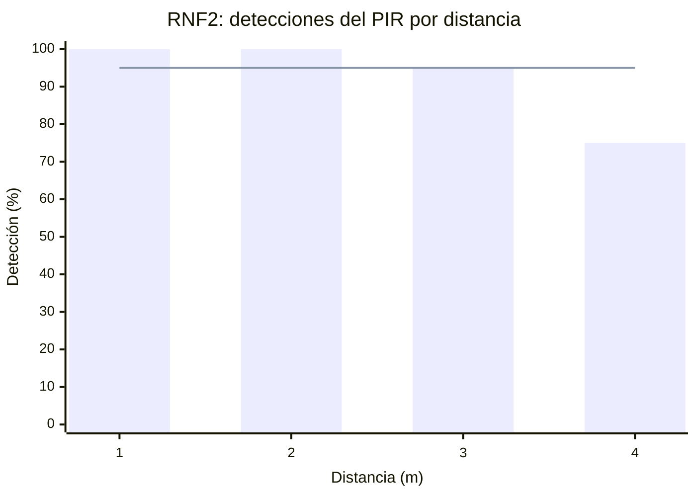

*Figura 5.1 — Barras: porcentaje de detección (20 pasadas por distancia, deteccion.csv); línea: meta de 95 %. 4 m está fuera del rango declarado.*

**Análisis.** La parte de la nube y la lógica de la skill están verificadas con pruebas reproducibles y con una conexión real a AWS IoT. Al no depender del hardware, cubren casos difíciles de provocar a mano: un Thing inexistente, una orden con el dispositivo desconectado, la reconexión con un `delta` pendiente y dos usuarios simultáneos. La latencia de la nube medida en vivo (246 ms para leer el Shadow) deja margen para cumplir RNF3: la Lambda hace tres operaciones de ese orden más la espera de confirmación, que en condiciones normales debería quedar por debajo de 1 s.

El principal riesgo para RNF3 y RNF5 es la red WiFi. Una señal débil (RSSI < −75 dBm) alarga la reconexión TLS y el envío de `reported`. Si la confirmación supera 3 s, la Lambda responde *"aún no la confirmó"* aunque el servo se mueva después; en ese caso se puede subir `CONFIRM_TIMEOUT_S` a 5 s sin cambiar el código.

El estado `reported.puerta` es la posición **ordenada** al servo, no una medición: el SG90 no tiene realimentación. Por eso P08 incluye una verificación visual del brazo del servo.

**Análisis de errores del montaje.** Durante las pruebas con el hardware real aparecieron problemas. Se diagnosticaron uno por uno, separando el software del hardware:

| Síntoma | Diagnóstico | Acción |
|---|---|---|
| El servo zumbaba pero no giraba | El firmware sí enviaba la orden (`[Puerta] Abriendo` en el monitor, §4.3). El núcleo Arduino 2.0.17 y ESP32Servo 1.2.1 son compatibles. Con un programa de prueba aislado que movía el servo solo, el síntoma se repitió con dos servos distintos: el problema no estaba en la lógica | Se descartó el software y se revisaron el cableado, la alimentación y la mecánica |
| Sin movimiento con la señal en GPIO 13 | Posible falso contacto del pin o de la fila de la protoboard | La señal se movió a **GPIO 25** (`SERVO_PIN` en `config.h`), que no es pin de arranque ni de la flash. El firmware, las pruebas de contrato y el diagrama se actualizaron |
| "Cierra" y "abre" giraban en el **mismo sentido** y con distinta amplitud | Comportamiento imposible en un servo de posición: indica un SG90 de **rotación continua (360°)**, que interpreta el pulso como velocidad y no como ángulo | Se usa un SG90 de **180°**, que es el que requiere el diseño. Con el servo de 180° el brazo va a 90° (cerrada) y a 0° (abierta) sin zumbar, verificado con el banco de pruebas |
| Al cargar el firmware: `Failed to communicate with the flash chip` | Un periférico conectado interfería con el arranque (los pines de la flash o el GPIO 12 en alto al iniciar) | Se desconectan el servo y el PIR mientras se carga el firmware, y nunca se usan GPIO 6–12 ni los pines de arranque |
| Alimentado con un cargador, el ESP32 se conectó una vez y dejó de reportar (el Shadow no recibió el latido) | Fuente o hotspot inestables: los picos del WiFi y del servo bajan el voltaje, o el hotspot del celular se apaga al bloquearse | El servo y el PIR pasaron a un porta pilas 4 × AA (6 V) con tierra común, de modo que sus picos ya no pasan por la placa; el ESP32 se alimenta por el USB de la computadora y el hotspot se mantiene activo durante las pruebas. Se verifica con `uptime_s` en la Sombra clásica |

**Análisis de las pruebas físicas.** En RNF2 el PIR detectó 59 de 60 pasadas entre 1 y 3 m (98,3 %), con 0 falsos positivos en 10 min de sala vacía. A 4 m bajó a 75 %, lo que confirma que el rango de trabajo declarado (3 m) es adecuado. La medición mostró además que el módulo trabaja con el jumper en **L** y no en H, como se había supuesto: con movimiento continuo entrega un pulso de ~1,2 s, se bloquea unos 5 s y vuelve a disparar. Por eso una presencia prolongada suma varias detecciones; se documentó en §2.2 y se recomienda pasar a H (§7).

En RNF1 el objeto funcionó desde las 22:55:38 más de 30 min sin reinicios, con el RSSI entre −48 y −55 dBm, y aplicó y confirmó al instante las cinco órdenes recibidas por el Shadow. Un primer intento se interrumpió por reinicios `POWERON_RESET` al mover el cable USB y el montaje. Como no apareció ningún *brownout*, se descarta una caída de tensión por el servo; la causa fue la conexión física, lo que refuerza la recomendación de pasar a una placa soldada.

En RNF3 el tiempo promedio fue 1,60 s y el máximo 2,12 s, con un margen de 0,88 s sobre los 3 s declarados. En RNF4 el latido se mantuvo en 60,0 s ± 0,1 s y los eventos llegaron a AWS en 0,31 s de promedio. En RNF5 el objeto reconectó en 8,2 s de promedio (máximo 9,7 s, un tercio del límite de 30 s) y aplicó la orden pendiente en los 3 ensayos sin otra orden.

**Lo que los datos no permiten afirmar:**

- **Estabilidad más allá de 30 min.** RNF1 se verificó en una sola corrida de unos 30 min; no se probó una operación de horas ni de días.
- **Margen de RNF2 a 3 m.** A 3 m se detectaron 19 de 20 pasadas (95 %), exactamente el límite declarado: no hay margen en el extremo del rango.
- **Exactitud del PIR en otras condiciones.** RNF2 se midió en una sola sala y a una sola altura (100 cm); no se probaron otros ambientes ni otras alturas.
- **Posición real del pestillo.** `reported.puerta` es la posición ordenada al servo, no una medición: el SG90 no tiene realimentación (§2.2).
- **RNF3 con mala señal.** Durante la medición de RNF3 no se registró el RSSI, y no se midió el tiempo de respuesta con señal débil (RSSI menor que −75 dBm).

---

# 6. Conclusiones

**Arquitectura.** El Device Shadow cumplió su papel de intermediario: Alexa, la Lambda y el ESP32 nunca se comunican directamente. Una orden se acepta aunque el dispositivo esté desconectado y se aplica cuando vuelve, porque al reconectarse el ESP32 pide el documento y procesa el `delta` pendiente. Separar `desired` (lo que pide el usuario) de `reported` (lo que el dispositivo confirma) permite que la skill responda con honestidad *"aún no la confirmó"* en vez de dar por hecha una acción.

**Hardware (Ruben).** El PIR HC-SR501 y el servo SG90 cubren el caso de uso con un porta pilas de 6 V como única fuente de potencia y sin LEDs como actuador. Separar la potencia (pilas) de la lógica (USB) con tierra común evitó que los picos del servo reiniciaran el ESP32. El filtro de 50 ms, el *pull-down* interno y la espera de 60 s de calentamiento reducen los falsos positivos sin retrasar la detección. Soltar el PWM después de 700 ms evita vibraciones y picos de consumo, pero exige que, sobre una puerta real, el pestillo mantenga su posición mecánicamente. Las pruebas mostraron que el hardware debe validarse por separado antes de integrarlo: un servo de rotación continua (360°) es idéntico por fuera a uno de posición (180°), y solo un banco de pruebas aislado, sin red, permitió distinguir el problema del actuador de uno de software o de alimentación. Las pruebas confirmaron la estabilidad del montaje: el objeto operó 30 min sin reinicios con órdenes periódicas, y el PIR detectó el 98,3 % de las pasadas hasta 3 m, sin falsos positivos. También mostraron la importancia de medir los ajustes reales del sensor en lugar de suponerlos: el jumper estaba en L, lo que cambia cómo se cuentan las detecciones.

**Comunicación (Luciana).** El firmware separa la lógica del objeto (`SmartObject`) del transporte (`ShadowPort`). Así, el mismo código corre con AWS o en modo local por USB, y se prueba en la PC con dobles. Reportar por evento con un latido de 60 s responde de inmediato al movimiento y mantiene el consumo de mensajes en centavos al mes. Las mediciones confirmaron un tiempo de respuesta de extremo a extremo de 1,60 s, un latido estable de 60 s y la reconexión con aplicación de la orden pendiente en pocos segundos.

**Nube (Alejandro).** Organizar la Lambda en un repositorio de vinculaciones, un gateway hacia IoT Core y manejadores con dependencias inyectadas permitió probar toda la skill sin una cuenta de AWS. La vinculación por `userId` en DynamoDB hace que la skill atienda a varios usuarios con un `GetItem` de costo constante. Los permisos IAM limitados a seis acciones y la política del dispositivo limitada a su propio Shadow (verificada en vivo) acotan el daño de cualquier credencial filtrada.

**Trabajo en equipo.** Las pruebas de contrato entre capas fueron decisivas: al unir las ramas detectaron dos firmwares incompatibles, el firmware de la demo sin compilar y un intent sin manejador, problemas que ninguna revisión individual había encontrado.

---

# 7. Recomendaciones

**Hardware.**
- Construir la maqueta de la puerta y fijar el servo como pestillo, para verificar mecánicamente que traba la hoja y que mantiene la posición después de soltar el PWM.
- Confirmar la posición real del pestillo con un sensor de puerta (*reed switch*), para que `reported.puerta` sea una medición y no solo la posición ordenada.
- Para un uso permanente, reemplazar el porta pilas por una fuente regulada de 5–6 V (las pilas se descargan y su tensión varía) manteniendo la tierra común, y cambiar el servo por una cerradura solenoide de 12 V con MOSFET.
- Pasar el jumper del PIR a **H** (redisparo) para que una presencia prolongada cuente como una sola detección y `movimiento` se mantenga en `true` mientras la persona se mueva.
- Proteger el PIR con una carcasa que evite corrientes de aire caliente y luz solar directa, principales causas de falsos positivos.
- Verificar el tipo de servo antes del montaje (180° frente a 360°: el de posición tiene un tope a mano) y probar cada componente con [`tools/prueba_hardware`](../tools/prueba_hardware/src/main.cpp) antes de integrarlo.
- Desconectar los periféricos al cargar el firmware y pasar de la protoboard a una placa soldada, para evitar falsos contactos.

**Comunicación y firmware.**
- Actualización del firmware por aire (OTA) para no depender del cable USB.
- Reintentos de conexión con espera creciente (*backoff*) y guardar los eventos del PIR mientras no hay red, para reportarlos al reconectar.
- Agregar la barrera láser (KY-008 + LDR) como un nuevo `Sensor` y el buzzer como un nuevo `Actuator` con su propia clave del Shadow, registrándolos en `main.cpp`.

**Nube y skill.**
- **Códigos de vinculación aleatorios.** Reemplazar los códigos de demostración por códigos generados al azar y, a futuro, que el ESP32 publique su código en el Shadow para que la Lambda verifique que el usuario lo está leyendo del dispositivo físico.
- **Account Linking (OAuth)** para asociar el dispositivo a una cuenta real del fabricante, y un índice secundario sobre `thingName` para saber y limitar quién tiene vinculado cada Thing.
- **Notificaciones proactivas** (Alexa Proactive Events o Amazon SNS) cuando el PIR detecte movimiento, en vez de esperar a que el usuario pregunte.
- **Infraestructura como código** (AWS SAM o CloudFormation) para crear la tabla, el rol y la Lambda con un solo comando a partir de los JSON de `aws/`, y despliegue automático del `.zip` con GitHub Actions después de que pasen las pruebas.
- **Esperar la confirmación sin sondeo.** Hoy la Lambda consulta el Shadow cada 250 ms durante hasta 3 s. Con una regla de IoT que escriba el `reported` en DynamoDB, o con respuestas progresivas de Alexa, se reducirían las operaciones de Shadow por comando.

---

# 8. Anexos

Todas las evidencias están en [`docs/anexos/`](anexos/). En las capturas se tapan el ID de cuenta, el endpoint de IoT y el Skill ID; nunca se captura el contenido de los certificados.

| Anexo | Archivos | Responsable |
|---|---|---|
| Diagrama del circuito | [`circuito.png`](anexos/circuito.png), [`circuito-3d.png`](anexos/circuito-3d.png) ([SVG](anexos/circuito-3d.svg)) | Ruben |
| Foto del prototipo | `montaje-protoboard.jpg` | Ruben |
| Pruebas del hardware (RNF1, RNF2) | [`pruebas-hardware.md`](anexos/pruebas-hardware.md), [`deteccion.csv`](anexos/deteccion.csv) | Ruben |
| Pruebas de comunicación (RNF3–RNF5) | [`pruebas-comunicacion.md`](anexos/pruebas-comunicacion.md), [`latencias.csv`](anexos/latencias.csv) | Luciana |
| Configuración de AWS | `aws-01`, `aws-02`, `aws-03`, `aws-04`, `aws-05`, `aws-07`, `aws-08`, `aws-09`, `aws-10`, `aws-11` (lista en §3.2) | Alejandro |
| Configuración de Alexa | `alexa-01` … `alexa-05-*.png` (lista en §3.3) | Alejandro |
| Guion del simulador con *Skill I/O* | [`test_guion_alexa.py`](../lambda/tests/test_guion_alexa.py) (§4.4), [`alexa-05`](anexos/alexa-05-test-development.png) | Alejandro |
| Pruebas automáticas | [`pytest-lambda.txt`](anexos/pytest-lambda.txt), [`.github/workflows/pruebas.yml`](../.github/workflows/pruebas.yml) | Alejandro |
| Configuraciones exportadas | [`alexa/interaction-model.es-US.json`](../alexa/interaction-model.es-US.json), [`aws/iot-policy.json`](../aws/iot-policy.json), [`aws/lambda-role-policy.json`](../aws/lambda-role-policy.json), [`aws/dynamodb-table.json`](../aws/dynamodb-table.json), [`include/secrets.example.h`](../include/secrets.example.h) | Todos |