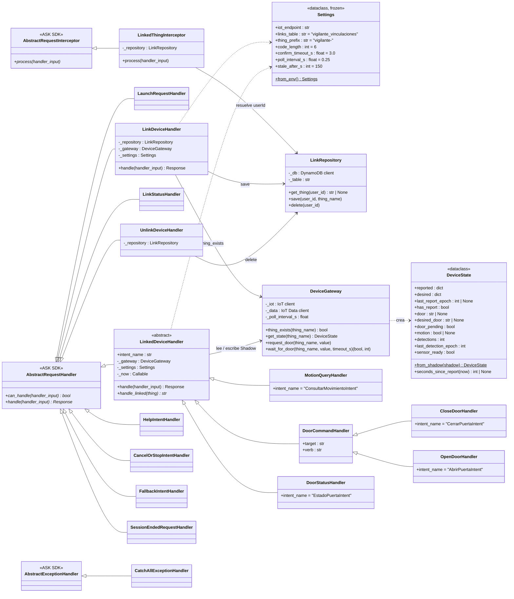
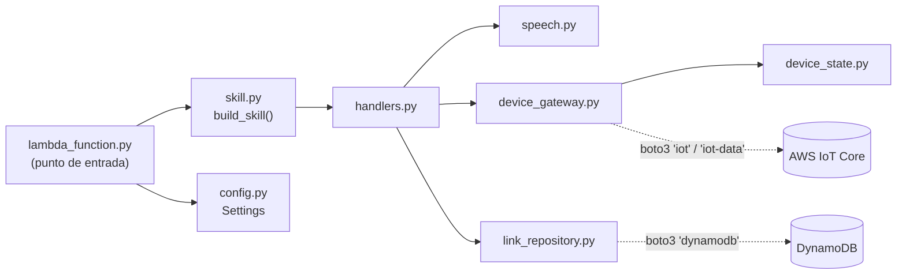
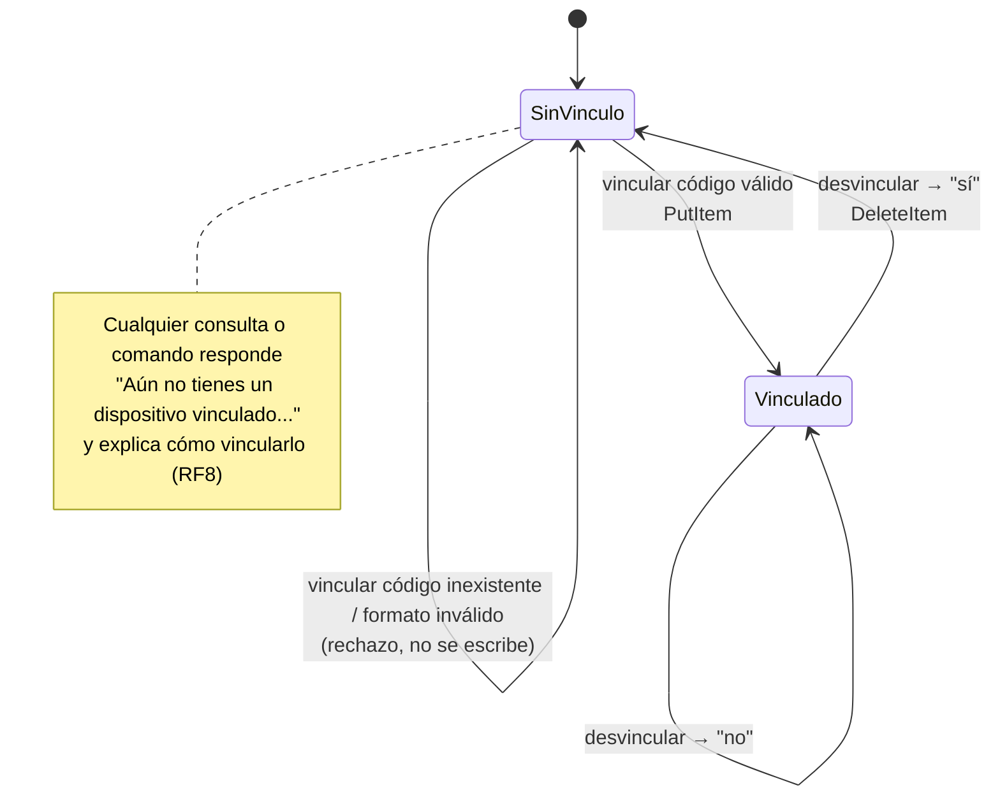
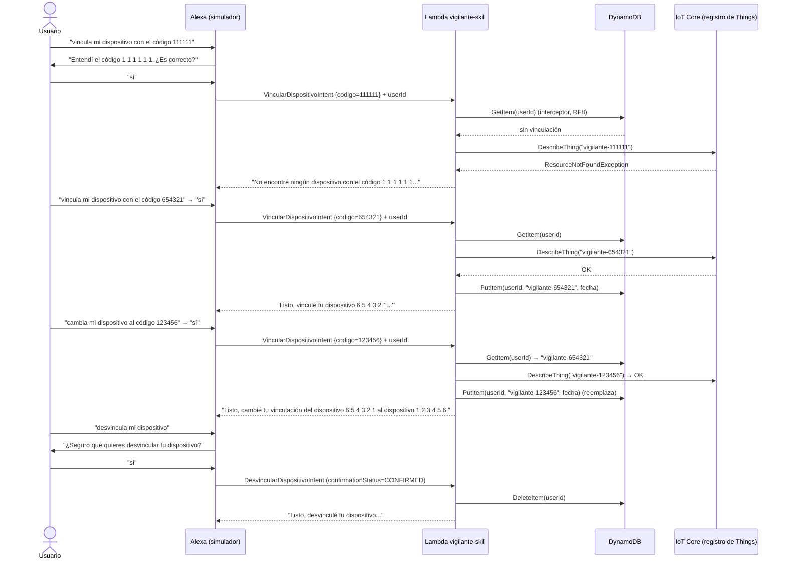

# Informe técnico — Práctica 3: Vigilante Inteligente

**Carrera:** Ingeniería de Sistemas · **Asignatura:** SIS-234 · **Fecha de entrega:** 10 de noviembre de 2026
**Repositorio:** <https://github.com/Alous12/Practica_3_IOT>

| Integrante | GitHub | Capa y secciones del informe |
|---|---|---|
| Alejandro Machaca | `alous12` | Nube y repositorio — §2.4, §2.7, §2.8, §3.2, §3.3, §4 (consolidación), §8 |
| Ruben Cordero | [COMPLETAR] | Hardware — §1.2, §2.2, §2.3 |
| Luciana Leaño | `lucianaaaaaaa` | Firmware de comunicación — §1.1, §1.3, §1.4, §2.1, §2.5, §2.6, §3.1, §5 |

**Datos de la implementación**

| Dato | Valor |
|---|---|
| Región de AWS | `us-east-2` (Ohio) |
| Thing del objeto inteligente (ESP32) | `vigilante-123456` · código de vinculación **123456** |
| Thing de prueba (sin hardware) | `vigilante-654321` · código de vinculación **654321** |
| Tabla de vinculaciones | `vigilante_vinculaciones` (DynamoDB) |
| Función Lambda | `vigilante-skill` (Python 3.13) |
| Skill | *Vigilante Inteligente* · invocación `vigilante inteligente` · Spanish (US) |
| Microcontrolador | ESP32 DOIT DevKit V1 · PIR HC-SR501 (GPIO 27) · servo SG90 (GPIO 13) |

---

# 1. Caso de Uso y Requerimientos

## 1.1 Caso de uso

> ⏳ **Pendiente — Luciana.** Descripción del caso de uso (vigilar un objeto valioso: el PIR detecta presencia y el servo cierra o abre la puerta desde Alexa; cada dueño vincula su dispositivo con un código de 6 dígitos) y por qué es un caso real.

## 1.2 Justificación del sensor y del actuador

> ⏳ **Pendiente — Ruben.** Tomar la sección 1.2 de `Informe_Ruben.md`, con los ángulos calibrados reales.

## 1.3 Requerimientos funcionales

> ⏳ **Pendiente — Luciana.** Tabla RF1–RF9 con la clase o función que implementa cada uno (firmware: `PirSensor`, `SmartObject`, `DoorLock`, `ShadowClient`; Lambda: ver la columna RF de §2.4 y §2.8).

## 1.4 Requerimientos no funcionales

> ⏳ **Pendiente — Luciana.** Tabla RNF1–RNF6 con el valor declarado y cómo se verifica (RNF1 ≥ 30 min, RNF2 ≥ 95 % a ≤ 3 m, RNF3 ≤ 3 s, RNF4 evento ≤ 1 s + latido 60 s, RNF5 reconexión ≤ 30 s, RNF6 seguridad), con la justificación de la frecuencia de reporte según la dinámica del PIR y el consumo de mensajes (el costo está en §3.2: ≈ USD 0.11/mes).

---

# 2. Análisis y Diseño

## 2.1 Arquitectura del sistema

> ⏳ **Pendiente — Luciana.** Diagrama de bloques o de despliegue: Usuario → Alexa → Lambda → DynamoDB / Device Shadow ↔ ESP32 (MQTT/TLS 8883).

## 2.2 Diagrama de circuito

> ⏳ **Pendiente — Ruben.** Sección 2.2 de `Informe_Ruben.md` fusionada con el texto de `SECCION_2_2_LUCIANA.md`, con un único `anexos/circuito.png` y fotos del montaje. Pines: `PIR_PIN` = 27 y `SERVO_PIN` = 13 en `include/config.h`.

## 2.3 Diagrama de clases del objeto inteligente

> ⏳ **Pendiente — Ruben.** Diagrama de las clases que realmente se compilan en `src/`: `Sensor`, `Actuator`, `ShadowPort`, `PirSensor`, `DoorLock`, `SmartObject` y las de `net/` (`WifiConnection`, `ShadowClient`, `TimeSync`).

## 2.4 Diagrama de clases de la función Lambda

La función Lambda es el *backend* de la skill. Está escrita en Python 3.13 con el **ASK SDK for Python** (`ask-sdk-core`) y organizada en el paquete [`lambda/vigilante/`](../lambda/vigilante/), con **una responsabilidad por módulo**:

| Módulo | Clases / funciones | Responsabilidad | RF |
|---|---|---|---|
| [`lambda_function.py`](../lambda/lambda_function.py) | `lambda_handler` | Punto de entrada configurado en Lambda (`lambda_function.lambda_handler`). Crea los clientes `boto3` **una sola vez por contenedor** (se reutilizan entre invocaciones) y arma la skill. | — |
| [`vigilante/config.py`](../lambda/vigilante/config.py) | `Settings`, constantes `KEY_*`, `DOOR_*` | Lee las variables de entorno y define las **claves del Shadow**, que forman el contrato con el firmware (`include/config.h`). | — |
| [`vigilante/link_repository.py`](../lambda/vigilante/link_repository.py) | `LinkRepository` | Acceso a DynamoDB: `get_thing`, `save` y `delete` de la vinculación `userId → thingName`. | RF7, RF8, RF9 |
| [`vigilante/device_gateway.py`](../lambda/vigilante/device_gateway.py) | `DeviceGateway` | Acceso a AWS IoT Core: valida que el Thing exista (`DescribeThing`), lee y escribe el Shadow (`GetThingShadow` / `UpdateThingShadow`) y espera la confirmación del actuador. | RF4, RF5, RF6, RF9 |
| [`vigilante/device_state.py`](../lambda/vigilante/device_state.py) | `DeviceState` | Vista de solo lectura del documento Shadow: `reported`, `desired`, orden pendiente y antigüedad del último reporte. | RF4, RF6 |
| [`vigilante/handlers.py`](../lambda/vigilante/handlers.py) | Interceptor + un manejador por intent | Lógica de voz: resuelve el Thing del usuario en cada solicitud y responde cada intent. | RF4 – RF9 |
| [`vigilante/speech.py`](../lambda/vigilante/speech.py) | Frases y `digits()`, `elapsed()`, `stale_warning()` | Textos en español y SSML (el código se lee dígito por dígito). | RF4 – RF6 |
| [`vigilante/skill.py`](../lambda/vigilante/skill.py) | `build_skill()` | Registra el interceptor, los manejadores y el manejador de excepciones, **inyectando las dependencias**. | — |

### Diagrama de clases



### Dependencias entre módulos



### Decisiones de diseño

- **Inyección de dependencias.** `build_skill(repository, gateway, settings, now)` ([`skill.py:13`](../lambda/vigilante/skill.py#L13)) recibe los objetos que hablan con AWS en vez de crearlos. En producción se pasan los clientes `boto3` reales ([`lambda_function.py:25-32`](../lambda/lambda_function.py#L25-L32)) y en las pruebas, dobles en memoria ([`tests/fakes.py`](../lambda/tests/fakes.py)). Por eso toda la lógica se prueba **sin cuenta de AWS ni red** (§4.2).
- **Repositorio y gateway** (patrones *Repository* y *Gateway*). Los manejadores no conocen `boto3`: piden "el Thing de este usuario" a `LinkRepository` y "el estado del Thing" a `DeviceGateway`. Si mañana la vinculación pasara a otra base de datos, solo cambiaría `link_repository.py`.
- **Método plantilla** en `LinkedDeviceHandler` ([`handlers.py:150`](../lambda/vigilante/handlers.py#L150)). `handle()` resuelve el Thing vinculado, responde "aún no tienes un dispositivo vinculado" si no lo hay y traduce los errores de AWS. Cada subclase implementa solo `handle_linked(thing)`. Así ningún intent de dispositivo puede olvidarse del RF8.
- **Interceptor global** (`LinkedThingInterceptor`, [`handlers.py:44`](../lambda/vigilante/handlers.py#L44)). Antes de cualquier `LaunchRequest` o `IntentRequest` lee `context.System.user.userId` y busca en DynamoDB el Thing del usuario (RF8). El resultado queda en los atributos de la solicitud y lo usan todos los manejadores.
- **Herencia para el actuador.** `CloseDoorHandler` y `OpenDoorHandler` solo fijan `target` y `verb`. La lógica de escribir `desired`, esperar la confirmación y medir la latencia está una sola vez en `DoorCommandHandler` ([`handlers.py:206`](../lambda/vigilante/handlers.py#L206)).
- **Extensible sin rediseño.** Agregar el buzzer de la segunda entrega requiere una constante `KEY_ALARM` en `config.py`, una propiedad en `DeviceState` y un `LinkedDeviceHandler` nuevo registrado en `build_skill()`. Los demás módulos no cambian.

## 2.5 Diagramas de secuencia

> ⏳ **Pendiente — Luciana.** Al menos la consulta del sensor (PIR → ESP32 → Shadow ← Lambda ← Alexa) y el comando sobre el actuador (Alexa → Lambda → desired → delta → ESP32 → reported), incluida la reconexión con `shadow/get`. La secuencia de **vinculación** está en §2.7.

## 2.6 Especificación del documento Shadow

> ⏳ **Pendiente — Luciana.** JSON de ejemplo y tabla de atributos (`puerta`, `movimiento`, `detecciones`, `ultima_deteccion`, `sensor_listo`, `uptime_s`, `rssi`) con tipo, valores válidos, quién escribe y quién lee, y el uso de `desired`, `reported` y `delta`. Las claves deben ser las de `include/config.h` (lo verifica `test_contratos.py`).

## 2.7 Mecanismo de vinculación

### Identificador

Cada objeto inteligente se registra en AWS IoT Core como un Thing llamado **`vigilante-` + código de 6 dígitos** que no empieza con 0 (p. ej. `vigilante-123456`). El usuario vincula su dispositivo diciendo solo el **código de vinculación** (`123456`), y la Lambda reconstruye el nombre del Thing anteponiendo el prefijo `THING_PREFIX = "vigilante-"`.

- El ESP32 muestra el código al arrancar (`Código de vinculación: 123456` en el monitor serie) y va impreso en una etiqueta sobre el dispositivo, como el número de serie de un electrodoméstico.
- Se dicta como número (*slot* `AMAZON.NUMBER`), que Alexa reconoce mejor que un nombre con guiones como `vigilante-123456`, y Alexa lo repite dígito por dígito para confirmarlo.
- El prefijo fijo cumple dos funciones: evita que un usuario vincule cualquier Thing de la cuenta y permite que el rol IAM de la Lambda dé permisos solo sobre `thing/vigilante-*` (§3.2).
- Hay **900 000** códigos posibles (100000–999999). Para producción se generan al azar (`Get-Random -Minimum 100000 -Maximum 1000000`). Los dos códigos de esta demo (123456 y 654321) son fáciles de dictar, pero también de adivinar; en un despliegue real se reemplazarían por códigos aleatorios (ver Recomendaciones).

### Modelo de datos — tabla `vigilante_vinculaciones` (DynamoDB)

| Atributo | Tipo | Clave | Ejemplo | Lo escribe |
|---|---|---|---|---|
| `userId` | String | **Partición (HASH)** | `amzn1.ask.account.AF3X…` | Lambda, con el `context.System.user.userId` de Alexa |
| `thingName` | String | — | `vigilante-123456` | Lambda, después de validar que el Thing existe |
| `fechaVinculacion` | String (ISO-8601 UTC) | — | `2026-11-08T15:20:00Z` | Lambda |

Definición exportada: [`aws/dynamodb-table.json`](../aws/dynamodb-table.json) (capacidad bajo demanda, sin índices).

**Por qué `userId` es la clave de partición:** la única pregunta que la skill hace en cada solicitud es *"¿qué Thing tiene este usuario?"* (RF8). Con `userId` como clave, esa consulta es un `GetItem` directo de costo y latencia constantes (milisegundos), sin `Scan` ni índices. Además, como la clave es única, **un usuario tiene como máximo un Thing**, y cambiar de dispositivo es simplemente sobrescribir su fila.

### Operaciones y validaciones

| Operación (frase) | Validaciones, en orden | Efecto en DynamoDB | RF |
|---|---|---|---|
| **Resolver** (cualquier solicitud) | Lee `userId` del request | `GetItem(userId)` con lectura **fuertemente consistente** (`ConsistentRead=True`), para ver de inmediato una vinculación recién hecha | RF8 |
| **Vincular** ("vincula mi dispositivo con el código 123456") | 1. Alexa repite el código y pide confirmación (modelo de diálogo). 2. El código tiene exactamente 6 dígitos. 3. El Thing `vigilante-<código>` **existe** en IoT Core (`DescribeThing`). 4. No es el mismo Thing ya vinculado. | `PutItem(userId, thingName, fechaVinculacion)` | RF7, RF9 |
| **Cambiar** ("cambia mi dispositivo al código 654321") | Las mismas validaciones que vincular | `PutItem` **reemplaza** la fila del usuario (no se duplica) | RF9 |
| **Consultar** ("qué dispositivo tengo vinculado") | — | Usa el resultado del interceptor | RF8 |
| **Desvincular** ("desvincula mi dispositivo") | 1. El usuario tiene un Thing. 2. Alexa pide confirmación del intent; si dice "no", no se borra nada. | `DeleteItem(userId)` | RF9 |

Código: validación en [`handlers.py:79-110`](../lambda/vigilante/handlers.py#L79-L110), existencia del Thing en [`device_gateway.py:30`](../lambda/vigilante/device_gateway.py#L30) y persistencia en [`link_repository.py`](../lambda/vigilante/link_repository.py).

**Por qué se valida con `DescribeThing` y no leyendo el Shadow:** el Thing de prueba `vigilante-654321` (y cualquier dispositivo recién fabricado que aún no se conectó) **no tiene Shadow** hasta su primer reporte. El registro de Things de IoT Core es la fuente de verdad sobre qué dispositivos existen. `DescribeThing` responde `ResourceNotFoundException` si el código no corresponde a ningún Thing, y la skill responde *"No encontré ningún dispositivo con el código…"* sin escribir nada.

### Ciclo de vida de una vinculación



### Secuencia: vincular, cambiar y desvincular



### Decisiones y limitaciones documentadas

- **Varios usuarios, cada uno con su Thing.** La skill no está atada a un Thing fijo: el Thing se resuelve por `userId` en cada solicitud. Lo demuestran la prueba automática `test_guion_segundo_usuario_controla_solo_su_thing` y la prueba con un segundo usuario en el simulador (§4.3).
- **Un Thing puede tener varios usuarios** (p. ej. los miembros de una familia vinculan el mismo vigilante). Es una decisión consciente. La práctica deja Account Linking (OAuth) fuera del alcance, y la protección contra vincular un objeto ajeno es que el código no sea trivial de adivinar.
- **El `userId` de Alexa depende de la habilitación de la skill.** Si el usuario deshabilita y vuelve a habilitar la skill, Alexa le asigna otro `userId` y debe vincular de nuevo. La fila anterior queda huérfana, pero no causa daño.
- **Sin escrituras parciales.** Solo se escribe en DynamoDB después de pasar todas las validaciones. Un código inválido o inexistente nunca crea ni modifica una fila (lo verifican `test_vincular_thing_inexistente_se_rechaza` y el paso 3 del guion).

## 2.8 Diseño de la skill de Alexa

| Parámetro | Valor |
|---|---|
| Nombre de la skill | Vigilante Inteligente |
| Nombre de invocación | `vigilante inteligente` |
| Idioma | Spanish (US) — `es-US` |
| Modelo | Custom, *Provision your own* (backend propio en AWS Lambda) |
| Endpoint | ARN de `vigilante-skill` en `us-east-2` |
| Archivo exportado | [`alexa/interaction-model.es-US.json`](../alexa/interaction-model.es-US.json) |

### Intents, slots y frases de ejemplo

| Intent | Slot | Frases de ejemplo (todas las del modelo) | Manejador | RF |
|---|---|---|---|---|
| `VincularDispositivoIntent` | `codigo` · `AMAZON.NUMBER` · obligatorio y con confirmación | "vincula mi dispositivo con el código {codigo}", "vincula mi dispositivo", "vincular mi dispositivo", "vincula el dispositivo {codigo}", "vincular con el código {codigo}", "mi código es {codigo}", "el código de mi dispositivo es {codigo}", "registra mi dispositivo con el código {codigo}", "cambia mi dispositivo al código {codigo}", "cambia la vinculación al código {codigo}", "cambiar de dispositivo" | `LinkDeviceHandler` | RF7, RF9 |
| `ConsultarVinculacionIntent` | — | "qué dispositivo tengo vinculado", "cuál es mi dispositivo", "qué código tiene mi dispositivo", "tengo un dispositivo vinculado" | `LinkStatusHandler` | RF8 |
| `DesvincularDispositivoIntent` | — (confirmación del intent) | "desvincula mi dispositivo", "desvincular mi dispositivo", "elimina la vinculación", "borra mi dispositivo", "olvida mi dispositivo", "quita mi dispositivo" | `UnlinkDeviceHandler` | RF9 |
| `ConsultarMovimientoIntent` | — | "hay movimiento", "se detecta movimiento", "detectó algo el sensor", "hay alguien cerca", "hay algún intruso", "hubo movimiento", "qué dice el sensor", "estado del sensor", "cuántas detecciones hubo", "alguien se acercó al objeto" | `MotionQueryHandler` | RF4 |
| `CerrarPuertaIntent` | — | "cierra la puerta", "cerrar la puerta", "bloquea la puerta", "asegura la puerta", "pon el seguro", "cierra con llave" | `CloseDoorHandler` | RF5 |
| `AbrirPuertaIntent` | — | "abre la puerta", "abrir la puerta", "desbloquea la puerta", "quita el seguro" | `OpenDoorHandler` | RF5 |
| `EstadoPuertaIntent` | — | "la puerta está cerrada", "la puerta está abierta", "cómo está la puerta", "estado de la puerta", "está cerrada la puerta", "está abierta la puerta" | `DoorStatusHandler` | RF6 |
| `AMAZON.HelpIntent` | — | integrada ("ayuda") | `HelpIntentHandler` | — |
| `AMAZON.CancelIntent`, `AMAZON.StopIntent`, `AMAZON.NavigateHomeIntent` | — | integradas ("salir", "cancela", "para") | `CancelOrStopIntentHandler` | — |
| `AMAZON.FallbackIntent` | — | integrada (frases que no coinciden con ningún intent) | `FallbackIntentHandler` | — |

La correspondencia **intent ↔ manejador** se verifica automáticamente en las dos direcciones (`test_cada_intent_del_modelo_tiene_manejador_en_la_lambda` y `test_cada_manejador_corresponde_a_un_intent_del_modelo`). Al escribir esa prueba apareció que `AMAZON.NavigateHomeIntent`, obligatorio en todo modelo, no tenía manejador: en un Echo con pantalla habría terminado en *"tuve un problema"*. Se corrigió agregándolo a `CancelOrStopIntentHandler`.

### Modelo de diálogo (delegación automática)

`delegationStrategy: ALWAYS`: Alexa resuelve el diálogo antes de llamar a la Lambda, así que la Lambda recibe siempre el intent completo (`dialogState: COMPLETED`).

| Intent | Configuración | Prompt | Por qué |
|---|---|---|---|
| `VincularDispositivoIntent` | slot `codigo` con *elicitation* | `Elicit.Slot.Vincular.codigo`: "¿Cuál es el código de seis dígitos que muestra tu dispositivo?" | Si el usuario dice solo "vincula mi dispositivo", Alexa pide el código. |
| `VincularDispositivoIntent` | slot `codigo` con *confirmation* | `Confirm.Slot.Vincular.codigo` (SSML): "Entendí el código `<say-as interpret-as="digits">`{codigo}`</say-as>`. ¿Es correcto?" | El reconocimiento de números largos por voz puede fallar; repetirlo dígito por dígito evita vincular un Thing equivocado. |
| `DesvincularDispositivoIntent` | confirmación del intent | `Confirm.Intent.Desvincular`: "¿Seguro que quieres desvincular tu dispositivo?" | Es una operación destructiva. Si el usuario dice "no", la Lambda recibe `confirmationStatus=DENIED` y conserva la vinculación. |

### Respuestas y manejo de la sesión

- Todas las respuestas, salvo "salir"/"cancelar", **mantienen la sesión abierta** con un *reprompt* ("¿Algo más?"), de modo que en el simulador se encadena todo el guion sin repetir "abre vigilante inteligente".
- Los códigos se leen con SSML `<say-as interpret-as="digits">` ("uno dos tres cuatro cinco seis", no "ciento veintitrés mil…").

| Situación | Respuesta de la skill |
|---|---|
| Abrir sin vínculo | "Bienvenido a Vigilante Inteligente. Aún no tienes un dispositivo vinculado. Di: vincula mi dispositivo con el código, seguido de los seis dígitos que muestra tu dispositivo." |
| Abrir con vínculo | "Bienvenido a Vigilante Inteligente. Puedes preguntarme si hay movimiento, pedirme que cierre o abra la puerta, o preguntar si la puerta está cerrada. ¿Qué deseas hacer?" |
| Consulta o comando sin vínculo (RF8) | "Aún no tienes un dispositivo vinculado. Di: vincula mi dispositivo con el código…" |
| Movimiento (RF4) | "¡Atención! Se está detectando movimiento en este momento." / "No se detecta movimiento en este momento. La última detección fue hace 10 minutos. Detecciones desde que se encendió: 3." |
| Sensor calentando (primer minuto del PIR) | "El sensor de movimiento se está calibrando, espera un minuto." |
| Comando confirmado (RF5) | "Listo, la puerta quedó cerrada." |
| Comando sin confirmar en 3 s | "Envié la orden de cerrar la puerta, pero el dispositivo aún no la confirmó. Se aplicará en cuanto se conecte." |
| Estado de la puerta (RF6) | "La puerta está cerrada." (+ "Hay una orden pendiente para dejarla abierta." si `desired ≠ reported`) |
| Sin reporte en 150 s | Se agrega: "Ojo: el dispositivo no se comunica desde hace 3 minutos, puede estar desconectado." |
| Dispositivo que nunca reportó | "Tu dispositivo todavía no ha enviado datos. Verifica que esté encendido y conectado." |

### Flujo de la conversación


---

# 3. Desarrollo e Implementación

## 3.1 Estructura del código

> ⏳ **Pendiente — Luciana.** Módulos y clases del firmware con enlaces al código y explicación de los fragmentos clave (`ShadowClient`: delta y `get/accepted`; `SmartObject::loop`: reporte por evento + latido; `DoorLock::applyDesired`). La estructura de la Lambda está en §2.4.

## 3.2 Configuraciones en AWS

Todos los recursos están en **`us-east-2` (Ohio)**, la región asignada al proyecto en la cuenta del plan gratuito. IoT Core, DynamoDB y Lambda deben estar en la misma región: la Lambda usa el endpoint de IoT y la tabla de esa región.

### Cuenta y control de costos

- Cuenta en el **plan gratuito (Free)**: AWS no cobra a la tarjeta. El uso se descuenta de los USD 100 en créditos y la cuenta se cierra sola a los 6 meses o al agotar los créditos, en vez de pasar a cobrar. Nunca se usó la opción *"Actualizar plan"*.
- En las cuentas nuevas con el diseño de "proyectos", la consola de Facturación no ofrece el menú de Presupuestos. **La cuenta está en el plan gratuito de AWS, que no genera cargos a la tarjeta; el uso se descuenta de USD 100 en créditos. Por eso no se configuró un presupuesto aparte.** La evidencia es la captura de Facturación con *Plan actual: Gratis* e *Importe a pagar $0.00*.
- Para no gastar de más no se activaron *Fleet indexing*, *Device Defender*, reglas de IoT, índices ni *backups* de DynamoDB, y los logs de la Lambda se retienen **1 semana**.

**Costo mensual estimado** (precios de lista en `us-east-2`, un dispositivo encendido todo el mes):

| Servicio | Uso estimado | Precio de lista | Costo |
|---|---|---|---|
| IoT Core — mensajes | 43 200 latidos (1 cada 60 s × 30 días) + eventos del PIR y del servo ≈ 50 000 | USD 1.00 / millón | ≈ USD 0.05 |
| IoT Core — operaciones de Shadow | ≈ 50 000 (cada `update`/`get`) | USD 1.25 / millón | ≈ USD 0.06 |
| IoT Core — conectividad | 43 200 minutos de conexión | USD 0.08 / millón de minutos | < USD 0.01 |
| Lambda | < 1 000 invocaciones | 1 millón gratis al mes (capa siempre gratuita) | USD 0.00 |
| DynamoDB (bajo demanda) | unos cientos de lecturas y escrituras | USD 0.125 / millón de lecturas, 0.625 / millón de escrituras | < USD 0.01 |
| CloudWatch Logs | pocos MB, retención 1 semana | 5 GB gratis | USD 0.00 |
| **Total** | | | **≈ USD 0.11 / mes**, cubierto por los créditos |

### AWS IoT Core

| Recurso | Configuración |
|---|---|
| **Thing del objeto inteligente** | `vigilante-123456` · Shadow **clásico (sin nombre)** · certificado X.509 generado por AWS, **Activo**, con la política `vigilante-device-policy` adjunta |
| **Thing de prueba** | `vigilante-654321` · Shadow clásico · **sin certificado** (no se conecta nunca). Sirve para demostrar el cambio de vinculación (RF9) y que la skill no está atada a un Thing fijo |
| **Certificados** | Certificado del dispositivo, clave privada y Amazon Root CA 1, descargados una sola vez y guardados **fuera del repositorio**. Solo se copian a `secrets.h` (excluido por `.gitignore`) |
| **Endpoint** | `xxxxxxxx-ats.iot.us-east-2.amazonaws.com` (tipo `iot:Data-ATS`, compatible con Amazon Root CA 1). Se usa en `secrets.h` (ESP32) y en la variable `IOT_ENDPOINT` (Lambda) |
| **Puerto / protocolo** | MQTT sobre TLS 1.2 con autenticación mutua por certificado, puerto 8883 |

**Política del dispositivo `vigilante-device-policy`** ([`aws/iot-policy.json`](../aws/iot-policy.json)), de mínimo privilegio:

| Sid | Acción | Recurso | Qué permite |
|---|---|---|---|
| `ConectarSoloConSuNombreDeThing` | `iot:Connect` | `client/${iot:Connection.Thing.ThingName}` | Conectarse solo si el *client ID* MQTT es igual al nombre del Thing dueño del certificado. Impide suplantar a otro dispositivo. |
| `PublicarSoloEnSuShadow` | `iot:Publish` | `topic/$aws/things/${iot:Connection.Thing.ThingName}/shadow/*` | Publicar `shadow/update` (reported) y `shadow/get` solo en su propio Shadow. |
| `SuscribirseSoloASuShadow` | `iot:Subscribe` | `topicfilter/$aws/things/${…}/shadow/*` | Suscribirse a `update/delta`, `get/accepted`, etc. de su Shadow. |
| `RecibirSoloDeSuShadow` | `iot:Receive` | `topic/$aws/things/${…}/shadow/*` | Recibir los mensajes de esos tópicos. |

La variable de política `${iot:Connection.Thing.ThingName}` hace que **la misma política sirva para todos los Things** `vigilante-*` sin editarla, y que cada certificado vea **solo su propio Shadow**. Por eso el firmware usa `THING_NAME` como *client ID*. La política abarca todos los subtemas de `shadow/*` (no solo los 4 que usa el ESP32) para poder hacer, con el mismo certificado, las pruebas manuales con MQTTX o MQTT.fx. Sigue siendo mínimo privilegio porque el alcance queda limitado al Shadow propio.

### Amazon DynamoDB

| Parámetro | Valor | Justificación |
|---|---|---|
| Nombre | `vigilante_vinculaciones` | Nombre por defecto de `LINKS_TABLE` en la Lambda |
| Clave de partición | `userId` (String) | Consulta directa por usuario (§2.7) |
| Clave de ordenación | — | Un registro por usuario |
| Capacidad | Bajo demanda (`PAY_PER_REQUEST`), configuración predeterminada | Se paga por solicitud; con unos cientos de operaciones el costo es de fracciones de centavo. El almacenamiento (25 GB) está en la capa siempre gratuita |
| Índices, *streams*, *backups* | Ninguno | No se necesitan; evitan costos |

Definición exportada: [`aws/dynamodb-table.json`](../aws/dynamodb-table.json) (equivale a `aws dynamodb create-table --cli-input-json file://aws/dynamodb-table.json`).

### Rol IAM de la Lambda `vigilante-lambda-role`

La Lambda **no contiene ninguna access key**. `boto3` obtiene credenciales temporales del rol de ejecución que AWS le asigna. El rol tiene exactamente dos políticas:

1. **`AWSLambdaBasicExecutionRole`** (administrada por AWS): solo permite escribir logs en CloudWatch.
2. **`vigilante-lambda-minimo`** (política en línea, [`aws/lambda-role-policy.json`](../aws/lambda-role-policy.json)):

| Permiso | Recurso | Para qué | Código que lo usa | RF |
|---|---|---|---|---|
| `iot:GetThingShadow` | `arn:aws:iot:us-east-2:<ACCOUNT_ID>:thing/vigilante-*` | Leer `reported` (movimiento, puerta) y esperar la confirmación del servo | `DeviceGateway.get_state`, `wait_for_door` | RF4, RF5, RF6 |
| `iot:UpdateThingShadow` | `…:thing/vigilante-*` | Escribir `desired.puerta` | `DeviceGateway.request_door` | RF5 |
| `iot:DescribeThing` | `…:thing/vigilante-*` | Validar que el Thing exista antes de vincular | `DeviceGateway.thing_exists` | RF9 |
| `dynamodb:GetItem` | `arn:aws:dynamodb:us-east-2:<ACCOUNT_ID>:table/vigilante_vinculaciones` | Resolver el Thing del usuario | `LinkRepository.get_thing` | RF8 |
| `dynamodb:PutItem` | ídem | Guardar o cambiar la vinculación | `LinkRepository.save` | RF7, RF9 |
| `dynamodb:DeleteItem` | ídem | Eliminar la vinculación | `LinkRepository.delete` | RF9 |
| `logs:CreateLogGroup`, `logs:CreateLogStream`, `logs:PutLogEvents` | grupo `/aws/lambda/vigilante-skill` | Depuración y evidencia de latencia (`latencia_ms`) | `logging` | — |

Son **exactamente los permisos mínimos** que pide el enunciado (§3.2 de la práctica). Ninguna acción usa comodín y los recursos se restringen al prefijo `vigilante-*` y a una sola tabla. La Lambda no puede leer el Shadow de Things de otros proyectos de la cuenta ni tocar otras tablas, y no puede publicar en tópicos MQTT arbitrarios (no tiene `iot:Publish`). La prueba `test_rol_de_la_lambda_tiene_solo_los_permisos_minimos` hace que cualquier permiso agregado de más rompa la integración continua del repositorio.

> **Alternativa simplificada (no usada):** en clase se adjuntaron `AWSIoTFullAccess` y `AmazonDynamoDBFullAccess` al rol. Funciona, pero da control total sobre todo IoT Core y todas las tablas de la cuenta. Para este proyecto se optó por la política mínima de arriba, que es la recomendada para producción.

### Función Lambda `vigilante-skill`

| Parámetro | Valor | Justificación |
|---|---|---|
| Runtime | Python 3.13, arquitectura x86_64 | Versión con la que se probó el paquete (pytest local con 3.13.3) |
| Handler | `lambda_function.lambda_handler` | Punto de entrada del paquete |
| Código | `lambda/build/lambda_deployment.zip` (≈ 2.3 MB), generado con [`build.ps1`](../lambda/build.ps1) / [`build.sh`](../lambda/build.sh) | Contiene `lambda_function.py` en la raíz, el paquete `vigilante/` y `ask-sdk-core==1.19.0`. `boto3` **no** se empaqueta porque ya viene en el runtime. El `.zip` está en `.gitignore` y se regenera desde el código |
| Rol de ejecución | `vigilante-lambda-role` | Ver arriba |
| Memoria | 256 MB | En Lambda la CPU es proporcional a la memoria: 256 MB acorta el arranque en frío del ASK SDK sin salir de la capa gratuita |
| Tiempo de espera | **10 s** | Peor caso de "cierra la puerta": `GetItem` + `GetThingShadow` + `UpdateThingShadow` + hasta **3 s** esperando `reported` (sondeo cada 250 ms) ≈ 4–5 s. El valor por defecto (3 s) cortaría la espera. Alexa espera como máximo 8 s |
| Variables de entorno | `IOT_ENDPOINT` = endpoint ATS (obligatoria) · `LINKS_TABLE` = `vigilante_vinculaciones` | Opcionales con valor por defecto: `CONFIRM_TIMEOUT_S` = 3, `STALE_AFTER_S` = 150, `THING_PREFIX` = `vigilante-` |
| Desencadenador | **Alexa Skills Kit** con **verificación de Skill ID habilitada** | Solo la skill *Vigilante Inteligente* puede invocar la función; cualquier otra skill es rechazada por AWS antes de ejecutar código |
| Logs | CloudWatch `/aws/lambda/vigilante-skill`, retención **1 semana** | Cada comando de puerta deja una línea JSON `{"evento": "comando_puerta", "thing": …, "confirmado": …, "latencia_ms": …}` que sirve de evidencia del tiempo de respuesta (RNF3) |

**Contrato con el firmware.** Las claves del Shadow (`puerta`, `movimiento`, `detecciones`, `ultima_deteccion`, `sensor_listo`), los valores de la puerta (`abierta`/`cerrada`) y el prefijo `vigilante-` están definidos dos veces: en [`lambda/vigilante/config.py`](../lambda/vigilante/config.py) y en `include/config.h` del firmware. El latido del ESP32 (60 s) y el aviso de desconexión de la Lambda (150 s) también deben ser compatibles: el aviso tolera un latido perdido. Las pruebas de [`tests/test_contratos.py`](../lambda/tests/test_contratos.py) comparan ambos archivos y fallan si alguien cambia uno sin el otro.

### Seguridad (RNF6)

| Medida | Dónde |
|---|---|
| Certificados, clave privada y WiFi solo en `secrets.h`, excluido por `.gitignore` junto con `*.pem`, `*.key`, `*.crt` y `*.zip`; plantilla sin valores en `secrets.example.h` | [`.gitignore`](../.gitignore) |
| Sin access keys en el ESP32 (TLS mutuo con certificado) ni en la Lambda (rol IAM) | `lambda_function.py` |
| El ID de cuenta no se publica: los JSON de `aws/` usan `<ACCOUNT_ID>`, que se reemplaza solo al pegarlos en la consola | [`aws/`](../aws/) |
| Mínimo privilegio en el dispositivo (solo su Shadow) y en la Lambda (6 acciones sobre `vigilante-*` y una tabla) | `iot-policy.json`, `lambda-role-policy.json` |
| Solo la skill propia invoca la Lambda (verificación de Skill ID) | Desencadenador |
| Verificación automática: ningún archivo versionado en Git es `secrets.h`, `.pem`, `.key`, `.crt` o `.zip`, ni contiene una clave privada PEM o una access key `AKIA…` | `test_ningun_secreto_versionado_en_git`, `test_configuraciones_aws_sin_id_de_cuenta_real` |

### Evidencias de la configuración

Las capturas ocultan el ID de cuenta y el endpoint; nunca se captura el contenido de los certificados.

| Captura | Muestra |
|---|---|
|  | Plan Gratis, importe a pagar $0.00, créditos restantes |
|  | `vigilante-device-policy` en la vista JSON |
|  | Lista de objetos con `vigilante-123456` y `vigilante-654321` |
|  | Certificado **Activo** con la política y el Thing adjuntos |
|  | Sombra clásica con `desired` y `reported` iguales |
|  | Cliente de prueba MQTT: secuencia `update/delta` → `update` con `reported` |
|  | Tabla `vigilante_vinculaciones`, Activa, clave `userId`, bajo demanda |
|  | Filas creadas por la skill (dos usuarios) |
|  | Rol con `AWSLambdaBasicExecutionRole` + `vigilante-lambda-minimo` |
|  | Configuración general: Python 3.13, 256 MB, 10 s |
|  | Variables `IOT_ENDPOINT` (oculto) y `LINKS_TABLE` |
|  | Alexa Skills Kit con verificación de Skill ID |
|  | Línea `comando_puerta` con `latencia_ms` y retención de 1 semana |

## 3.3 Configuraciones en Alexa

La skill se configuró en la **Alexa Developer Console** (developer.amazon.com) con una cuenta de Amazon de desarrollador, distinta de la cuenta de AWS.

### Pasos realizados

1. **Crear la skill.** *Create Skill* → nombre `Vigilante Inteligente` → idioma principal **Spanish (US)** → tipo de experiencia *Other* → modelo **Custom** → hosting **Provision your own** → plantilla *Start from Scratch*. Se usa hosting propio y no *Alexa-hosted* porque una skill Alexa-hosted corre en una cuenta de Amazon que no tiene acceso al IoT Core ni al DynamoDB del proyecto.
2. **Importar el modelo de interacción.** *Build → Interaction Model → JSON Editor* → se pegó [`alexa/interaction-model.es-US.json`](../alexa/interaction-model.es-US.json) → *Save*. Esto crea de una vez la invocación, los 12 intents, el slot `codigo`, el modelo de diálogo y los prompts (§2.8). Si la skill tuviera más de un idioma, el mismo JSON debe pegarse en cada uno, o *Build skill* falla con *"Interaction Model does not include Custom Intents"*.
3. **Conectar con la Lambda (en este orden).** La Lambda solo acepta a su skill y la skill solo guarda un endpoint que ya la autoriza:
   1. *Endpoint* → **AWS Lambda ARN** → copiar **Your Skill ID** (`amzn1.ask.skill.…`).
   2. En AWS: `vigilante-skill` → *Agregar desencadenador* → **Alexa Skills Kit** → *Verificación de ID de habilidad: Habilitar* → pegar el Skill ID.
   3. De vuelta en Alexa: *Default Region* = `arn:aws:lambda:us-east-2:<ACCOUNT_ID>:function:vigilante-skill` → *Save Endpoints*.
4. **Compilar.** *Build skill* → esperar a *Last successful build* con la hora actual y *Errors and Warnings* en 0. Hay que recompilar cada vez que cambian intents o frases (no al cambiar el endpoint).
5. **Habilitar pruebas.** Pestaña *Test* → *Skill testing is enabled in:* **Development**. Se marca **Skill I/O** para ver el *JSON Input* (lo que Alexa envía, con `context.System.user.userId`) y el *JSON Output* (la respuesta de la Lambda).
6. **Verificar el reconocimiento sin llamar a la Lambda.** *Build → Evaluate Model → Utterance Profiler* muestra qué intent y qué valor de `codigo` resuelve Alexa para una frase. Sirve para distinguir un problema del modelo de voz de uno de la Lambda.

### Segundo usuario de Alexa

El `userId` depende de la cuenta de Amazon que usa la skill. Para demostrar que cada usuario controla su propio Thing:

- **Opción A (simulador):** en la consola de Alexa, menú del perfil → *Settings → User Permissions → Invite*. Se invita a un compañero del grupo, que abre la pestaña *Test* con **su** cuenta y vincula `vigilante-654321`. En *JSON Input* aparece un `userId` distinto, y en DynamoDB, dos filas.
- **Opción B (consola de Lambda):** el evento [`lambda/events/09_vincular_segundo_usuario.json`](../lambda/events/09_vincular_segundo_usuario.json) envía a la Lambda real una vinculación con `userId = amzn1.ask.account.SEGUNDO_USUARIO` y el código 654321.

### Evidencias de la configuración

| Captura | Muestra |
|---|---|
|  | *Invocations*: `vigilante inteligente` |
|  | Lista de intents y el slot `codigo` |
|  | Endpoint AWS Lambda ARN en *Default Region* (cuenta oculta) |
|  | *Last successful build*, 0 errores y 0 advertencias |
|  | Pestaña *Test* en *Development* con *Skill I/O* activo |

---

# 4. Pruebas y Validaciones

## 4.1 Plan de pruebas

Cada requerimiento tiene al menos una prueba. Los requerimientos de la skill (RF4–RF9) se verifican dos veces: con pruebas automáticas (§4.2) y en el simulador de Alexa con el ESP32 real (§4.3).

| ID | Requerimiento | Procedimiento | Criterio de aceptación | Responsable | Resultado | Evidencia |
|---|---|---|---|---|---|---|
| P01 | RF7 | "vincula mi dispositivo con el código 123456" → "sí" | Responde "vinculé" y aparece la fila en DynamoDB | Alejandro | Automatizada: ✅ · Simulador: [COMPLETAR] | `alexa-sim-04`, `alexa-sim-06`, `aws-08` |
| P02 | RF9 | Vincular con un código inexistente (111111) | Rechaza y no crea fila | Alejandro | Automatizada: ✅ · Simulador: [COMPLETAR] | `alexa-sim-03` |
| P03 | RF9 | Cambiar del Thing de prueba (654321) al real (123456) | "cambié tu vinculación"; `thingName` reemplazado, una sola fila | Alejandro | Automatizada: ✅ · Simulador: [COMPLETAR] | `alexa-sim-06` |
| P04 | RF9 | "desvincula mi dispositivo" → "no" y luego → "sí" | "no" conserva la fila; "sí" la elimina | Alejandro | Automatizada: ✅ · Simulador: [COMPLETAR] | `alexa-sim-14`, `alexa-sim-15` |
| P05 | RF8 | Sin vinculación: abrir la skill y decir "cierra la puerta" | Indica cómo vincular; no toca ningún Shadow | Alejandro | Automatizada: ✅ · Simulador: [COMPLETAR] | `alexa-sim-01`, `alexa-sim-02` |
| P06 | RF1, RF2 | Pasar frente al PIR con el cliente de prueba MQTT suscrito | `movimiento: true` en `reported` en ≤ 1 s | Ruben / Luciana | [COMPLETAR] | [COMPLETAR] |
| P07 | RF4 | "hay movimiento" con y sin presencia | La respuesta coincide con `reported` | Alejandro | Automatizada: ✅ · Simulador: [COMPLETAR] | `alexa-sim-08`, `alexa-sim-09` |
| P08 | RF3, RF5 | "cierra la puerta" / "abre la puerta" | El servo se mueve y `reported.puerta` = `desired.puerta` | Alejandro / Ruben | Automatizada: ✅ · Simulador: [COMPLETAR] | `alexa-sim-10`, `alexa-sim-12`, `aws-06` |
| P09 | RF6 | "la puerta está cerrada" | La respuesta coincide con `reported.puerta` | Alejandro | Automatizada: ✅ · Simulador: [COMPLETAR] | `alexa-sim-11` |
| P10 | Multiusuario | Un segundo usuario de Alexa vincula `vigilante-654321` | Dos filas en DynamoDB; cada usuario controla solo su Thing | Alejandro | Automatizada: ✅ · Simulador/Lambda: [COMPLETAR] | `alexa-sim-13`, `aws-08` |
| P11 | RNF1 | Operación continua 30 min con una orden cada 5 min | `uptime_s` ≥ 1800 sin volver a 0; sin reinicios | Ruben | [COMPLETAR] | `rnf1-*` |
| P12 | RNF2 | 20 pasadas a 1, 2, 3 y 4 m; 10 min con la sala vacía | ≥ 95 % hasta 3 m; 0 falsos positivos | Ruben | [COMPLETAR] | `deteccion.csv`, `rnf2-*` |
| P13 | RNF3 | 10 comandos grabados a 60 fps + `latencia_ms` de CloudWatch | Promedio y máximo ≤ 3 s | Luciana | [COMPLETAR] | `latencias.csv`, `aws-13` |
| P14 | RNF4 | Marcas de tiempo de los reportes (MQTT y monitor serie) | Evento ≤ 1 s; latido 60 s ± 1 s | Luciana | [COMPLETAR] | [COMPLETAR] |
| P15 | RNF5 | Cortar el WiFi 60 s, decir "abre la puerta" y restaurar | Reconecta en ≤ 30 s y abre sin una nueva orden | Luciana | Lambda (automatizada): ✅ · ESP32: [COMPLETAR] | video + monitor serie |
| P16 | RNF6 | Revisar todo el historial de Git (todas las ramas) y los archivos versionados | Ningún `secrets.h`, `.pem`, `.key`, `.crt`, `.zip`, clave privada, access key ni ID de cuenta | Alejandro | ✅ Cumple (8-nov) | `test_ningun_secreto_versionado_en_git` |
| P17 | Lambda | `python -m pytest -v` en `lambda/` | Todas pasan | Alejandro | [COMPLETAR: 61/61] | `pytest-lambda.txt`, `pytest-final.png` |
| P18 | RF1–RF3 | Prueba C++ del objeto inteligente con dobles de hardware (`test/luciana`) | Todas las aserciones pasan | Luciana | ✅ Pasa (8-nov) | [COMPLETAR: captura] |
| P19 | Integración | GitHub Actions: pytest + compilación de `esp32dev` y `esp32dev-aws` + prueba C++ | Workflow en verde en `main` | Alejandro | [COMPLETAR] | `ci-verde.png` |

**Verificación de P16 (8 de noviembre de 2026).** `git log --all --name-only` no muestra ningún archivo `secrets.h`, `*.pem`, `*.key`, `*.crt` ni `*.zip`. `git log --all -p` no contiene claves privadas PEM con contenido real ni access keys `AKIA…`, y los JSON de `aws/` no tienen IDs de cuenta de 12 dígitos en ninguna versión.

## 4.2 Pruebas automáticas de la Lambda y de integración (pytest)

Se ejecutan sin cuenta de AWS, sin red y sin esperas reales. La skill real (`build_skill`) se arma con dobles en memoria de DynamoDB, del registro de IoT y del Shadow (que además imita al ESP32 aplicando el `desired`) y con un reloj simulado.

```powershell
cd lambda
python -m venv .venv
.\.venv\Scripts\python -m pip install -r requirements-dev.txt
.\.venv\Scripts\python -m pytest -v
```

| Archivo | Pruebas | Qué verifica |
|---|---|---|
| [`tests/test_skill.py`](../lambda/tests/test_skill.py) | 20 | Cada requerimiento por separado: RF4 (movimiento, última detección, calibración, sin reportes, desconexión), RF5/RF6 (cerrar, abrir, ya en ese estado, orden pendiente, estado), RF7–RF9 (vincular, rechazar inexistente o con formato inválido, cambiar, consultar, desvincular sí/no) y dos usuarios con Things distintos |
| [`tests/test_guion_alexa.py`](../lambda/tests/test_guion_alexa.py) | 4 | El **guion completo del simulador** (§4.3) como escenarios de extremo a extremo, más el segundo usuario aislado, la reconexión que aplica la orden pendiente (RNF5 desde la Lambda), la ayuda y la salida |
| [`tests/test_contratos.py`](../lambda/tests/test_contratos.py) | 37 | **Integración entre capas**: modelo de Alexa ↔ manejadores (en ambos sentidos, y cada intent sin error), slot y confirmaciones del diálogo, eventos de prueba ↔ modelo, un solo firmware en el repositorio, claves y valores del Shadow, prefijo, pines, latido y tiempo de confirmación firmware ↔ Lambda, plantilla `secrets.example.h`, políticas IAM/IoT mínimas, tabla ↔ `LinkRepository`, punto de entrada, dependencias y ausencia de secretos en Git |

**Resultado** (Python 3.13.3, pytest 9.2.0; salida completa en [`anexos/pytest-lambda.txt`](anexos/pytest-lambda.txt)): **61 pruebas** en total.

| Momento | Resultado | Observación |
|---|---|---|
| Solo la capa de la nube (8-nov) | 53 passed, 5 skipped | Las pruebas que comparan con el firmware se omiten porque el firmware aún no estaba en el repositorio |
| Después de unir las tres ramas (8-nov) | 59 passed, 1 failed, 1 skipped | Las claves, valores, prefijo, pines y tiempos del firmware **coinciden** con la Lambda. Falla `test_hay_un_solo_firmware_en_el_repositorio` (había dos copias del firmware, en la raíz y en `firmware/`) y se omite la de `secrets.example.h` (faltaba la capa `net/`) |
| Versión final | [COMPLETAR: 61 passed] | Evidencia: `anexos/pytest-final.png` |

Además, **GitHub Actions** ([`.github/workflows/pruebas.yml`](../.github/workflows/pruebas.yml)) ejecuta en cada *push* y *pull request* estas pruebas, compila los dos entornos del firmware (`esp32dev` y `esp32dev-aws`, este último con la plantilla de secretos) y corre la prueba C++ del objeto inteligente. Así, ninguna rama puede romper la integración sin que se note antes de fusionarla.

**Errores encontrados por las pruebas y corregidos:**

| Hallazgo | Causa | Corrección |
|---|---|---|
| 16 de 20 pruebas fallaban al copiar el código al repositorio | Las pruebas tomaban el código del Thing de `events/02_vincular.json`, archivo que se edita con el código real para probar en la consola de Lambda | El arnés fija siempre el código de la prueba; los eventos se pueden editar sin romper las pruebas |
| `AMAZON.NavigateHomeIntent` sin manejador | Intent obligatorio del modelo no registrado en la Lambda | Se agregó a `CancelOrStopIntentHandler` |
| `.gitignore` inicial del repositorio sin reglas para `secrets.h`, `*.pem`, `*.key`, `*.zip` | Plantilla por defecto de PlatformIO | Se agregaron las reglas; `test_gitignore_excluye_secretos` evita que se pierdan |
| Dos firmwares distintos al unir las ramas (raíz y `firmware/`), con interfaces `Sensor`/`Actuator` incompatibles | Cada capa partió de una versión diferente del plan | Un solo firmware en la raíz, con las mejoras del PIR integradas (Ruben); `test_hay_un_solo_firmware_en_el_repositorio` impide que vuelva a pasar |
| El firmware de la demo (`esp32dev-aws`) no compilaba al unir las ramas | Faltaba la capa `net/` y `secrets.example.h` | Se agrega la capa de comunicación (Luciana); el workflow compila ese entorno en cada *pull request* |
| La prueba de contratos leía el `config.h` equivocado y se omitía | Buscaba primero en `firmware/include/`, que no tenía las claves del Shadow | Ahora usa el `config.h` que contiene las claves y falla si hay dos |

## 4.3 Guion del simulador de Alexa (RF4–RF9, con *Skill I/O*)

Condiciones: ESP32 encendido y conectado (`vigilante-123456`), sesión de prueba en *Development* y *Skill I/O* marcado. Por cada paso se captura la conversación junto con *JSON Input* y *JSON Output*. Las mismas frases están automatizadas en `test_guion_alexa.py` (§4.2).

| # | Se escribe en el simulador | Respuesta esperada | RF | Captura | ✔ |
|---|---|---|---|---|---|
| 1 | `abre vigilante inteligente` | "…Aún no tienes un dispositivo vinculado. Di: vincula mi dispositivo con el código…" | RF8 | `alexa-sim-01-launch.png` | ☐ |
| 2 | `cierra la puerta` | "Aún no tienes un dispositivo vinculado…" (no se toca ningún Shadow) | RF8 | `alexa-sim-02-sin-vinculo.png` | ☐ |
| 3 | `vincula mi dispositivo con el código 111111` → `sí` | "No encontré ningún dispositivo con el código 1 1 1 1 1 1…" | RF9 | `alexa-sim-03-codigo-inexistente.png` | ☐ |
| 4 | `vincula mi dispositivo con el código 654321` → `sí` | "Listo, vinculé tu dispositivo 6 5 4 3 2 1…" | RF7 | `alexa-sim-04-vincular-prueba.png` | ☐ |
| 5 | `cierra la puerta` | "Envié la orden de cerrar la puerta, pero el dispositivo aún no la confirmó…" (Thing sin hardware) | RF5 | `alexa-sim-05-thing-sin-hardware.png` | ☐ |
| 6 | `cambia mi dispositivo al código 123456` → `sí` | "Listo, cambié tu vinculación del dispositivo 6 5 4 3 2 1 al dispositivo 1 2 3 4 5 6." | RF9 | `alexa-sim-06-cambiar-vinculo.png` | ☐ |
| 7 | `qué dispositivo tengo vinculado` | "Tienes vinculado el dispositivo 1 2 3 4 5 6." | RF8 | `alexa-sim-07-consultar-vinculo.png` | ☐ |
| 8 | `hay movimiento` (nadie frente al PIR) | "No se detecta movimiento en este momento… Detecciones desde que se encendió: N." | RF4 | `alexa-sim-08-sin-movimiento.png` | ☐ |
| 9 | (pasar la mano frente al PIR) `hay movimiento` | "¡Atención! Se está detectando movimiento en este momento…" | RF4 | `alexa-sim-09-movimiento.png` | ☐ |
| 10 | `cierra la puerta` | "Listo, la puerta quedó cerrada." y el servo se mueve | RF5 | `alexa-sim-10-cerrar.png` | ☐ |
| 11 | `la puerta está cerrada` | "La puerta está cerrada." | RF6 | `alexa-sim-11-estado.png` | ☐ |
| 12 | `abre la puerta` | "Listo, la puerta quedó abierta." | RF5 | `alexa-sim-12-abrir.png` | ☐ |
| 13 | **Segundo usuario** (Opción A u B, §3.3) vincula `654321` | "Listo, vinculé tu dispositivo 6 5 4 3 2 1…" con otro `userId`; dos filas en DynamoDB | RF7, RF8 | `alexa-sim-13-segundo-usuario.png`, `aws-08-dynamodb-items.png` | ☐ |
| 14 | `desvincula mi dispositivo` → `no` | "De acuerdo, tu dispositivo sigue vinculado." | RF9 | `alexa-sim-14-desvincular-no.png` | ☐ |
| 15 | `desvincula mi dispositivo` → `sí` | "Listo, desvinculé tu dispositivo…" y la fila desaparece de DynamoDB | RF9 | `alexa-sim-15-desvincular.png` | ☐ |
| 16 | `salir` | "Hasta luego." | — | `alexa-sim-16-salir.png` | ☐ |

En la captura del paso 1 se debe ver `context.System.user.userId` en *JSON Input* (evidencia de RF8). Para los pasos 10 y 12 se registra también el `latencia_ms` de CloudWatch (`aws-13-cloudwatch-latencia.png`). Al terminar, se vuelve a vincular `123456` para la demo.

## 4.4 Pruebas del hardware y de la comunicación

> ⏳ **Pendiente — Ruben.** RNF1 y RNF2 con las tablas de `anexos/pruebas-hardware.md` completas con datos reales.

> ⏳ **Pendiente — Luciana.** RNF3 (tabla de 10 mediciones con promedio y máximo), RNF4 (marcas de tiempo de eventos y latidos) y RNF5 (tiempo hasta `[MQTT] Conectado` y aplicación del `desired` pendiente).

---

# 5. Resultados

> ⏳ **Pendiente — Luciana.** Tabla de valores medidos frente a los declarados (RNF1–RNF6 y P01–P19), con análisis de errores y su causa cuando algo no se cumple (p. ej. RSSI < −75 dBm).

---

# 6. Conclusiones

**Alejandro (nube y repositorio).** Separar la skill en un repositorio de vinculaciones, un gateway hacia IoT Core y manejadores que reciben sus dependencias permitió probar toda la lógica de Alexa sin una cuenta de AWS. Además, las pruebas de contrato detectaron al unir las ramas problemas que no se ven al revisar cada capa por separado: dos firmwares distintos, el firmware de la demo sin compilar y un intent sin manejador. El Device Shadow cumplió su papel de intermediario: la skill no necesita que el ESP32 esté conectado para aceptar una orden, y el dispositivo la aplica al reconectarse. La vinculación por `userId` en DynamoDB permite que la skill atienda a varios usuarios con un costo y una latencia constantes, y los permisos IAM, limitados a seis acciones, acotan el riesgo a los recursos `vigilante-*`.

> ⏳ **Pendiente — Ruben.** Un párrafo de conclusiones de su capa.

> ⏳ **Pendiente — Luciana.** Un párrafo de conclusiones de su capa.

---

# 7. Recomendaciones

**Alejandro (nube y repositorio).**

- **Códigos de vinculación aleatorios.** Reemplazar los códigos de demostración por códigos generados al azar y, a futuro, que el ESP32 publique su código en el Shadow para que la Lambda verifique que el usuario lo está leyendo del dispositivo físico.
- **Account Linking (OAuth)** para asociar el dispositivo a una cuenta real del fabricante, y un índice secundario sobre `thingName` para saber y limitar quién tiene vinculado cada Thing.
- **Notificaciones proactivas** (Alexa Proactive Events o Amazon SNS) cuando el PIR detecte movimiento, en vez de esperar a que el usuario pregunte.
- **Infraestructura como código** (AWS SAM o CloudFormation) para crear la tabla, el rol y la Lambda con un solo comando a partir de los JSON de `aws/`, y despliegue automático del `.zip` con GitHub Actions después de que pasen las pruebas.
- **Esperar la confirmación sin sondeo.** Hoy la Lambda consulta el Shadow cada 250 ms durante hasta 3 s. Con una regla de IoT que escriba el `reported` en DynamoDB, o con respuestas progresivas de Alexa, se reducirían las operaciones de Shadow por comando.

> ⏳ **Pendiente — Ruben.** Un párrafo de recomendaciones de su capa (p. ej. *reed switch* para confirmar el pestillo, fuente dedicada para el servo, carcasa del PIR).

> ⏳ **Pendiente — Luciana.** Un párrafo de recomendaciones de su capa (p. ej. actualización OTA, reconexión con *backoff*, guardar eventos mientras no hay red).

---

# 8. Anexos

Todas las evidencias están en [`docs/anexos/`](anexos/). En las capturas se tapan el ID de cuenta, el endpoint de IoT y el Skill ID.

| Anexo | Archivos | Responsable |
|---|---|---|
| Diagrama del circuito | `circuito.png`, `wokwi/diagram.json` | Ruben |
| Fotos del montaje | `montaje-*.jpg` | Ruben |
| Pruebas de hardware (RNF1, RNF2) | `pruebas-hardware.md`, `deteccion.csv`, `rnf1-*.png`, `rnf2-*` | Ruben |
| Pruebas de comunicación (RNF3–RNF5) | `latencias.csv`, capturas del monitor serie y del cliente MQTT, videos (enlace) | Luciana |
| Configuración de AWS | `aws-01` … `aws-13-*.png` | Alejandro |
| Configuración de Alexa | `alexa-01` … `alexa-05-*.png` | Alejandro |
| Guion del simulador con *Skill I/O* | `alexa-sim-01` … `alexa-sim-16-*.png` | Alejandro |
| Pruebas automáticas | `pytest-lambda.txt`, `pytest-final.png`, `ci-verde.png` | Alejandro |
| Configuraciones exportadas | [`alexa/interaction-model.es-US.json`](../alexa/interaction-model.es-US.json), [`aws/iot-policy.json`](../aws/iot-policy.json), [`aws/lambda-role-policy.json`](../aws/lambda-role-policy.json), [`aws/dynamodb-table.json`](../aws/dynamodb-table.json), `include/secrets.example.h` | Alejandro / Luciana |
