# Informe técnico — Práctica 4: Vigilante Inteligente

<!--
ACTUALIZACION DE LU, 24/11/2026: mediciones reales, estimaciones declaradas y evidencia.
LU-04 completado con 132/132 publicaciones; P-A1 aporta 30 min de seguimiento serie.
LU-05 mide el tramo AWS (17 muestras), no aun ESP32 -> escritura.
LU-07 aporta 7 apagados logicos Edge; G-01 aporta 19 intervalos de latido.
Los escenarios E de las otras pruebas NO acreditan cumplimiento ni reemplazan capturas.
Revisar anexos/p4/lu-estimaciones-y-verificacion.md antes de cerrar la entrega.

-->

**Carrera:** Ingeniería de Sistemas · **Asignatura:** SIS-234 · **Fecha de entrega:** 24 de noviembre de 2026
**Actividad:** Integración de un objeto inteligente con AWS (IoT Core, IoT Rules, Lambda y DynamoDB) y Alexa, con procesamiento, almacenamiento de datos y lógica de control en el Edge y en la Nube
**Repositorio:** <https://github.com/Alous12/Practica_3_IOT>

La Práctica 4 amplía el objeto inteligente, el Shadow, la skill y la vinculación de la Práctica 3, cuyo informe está en [`INFORME_P3.md`](INFORME_P3.md). Este documento es el informe de la Práctica 4 y reúne los aportes de los tres integrantes.

| Integrante | GitHub | Capa a cargo en la Práctica 4 | Secciones |
|---|---|---|---|
| Alejandro Machaca | `alous12` | Objeto inteligente, circuito con el buzzer, Shadow, modelo de datos, reglas de AWS IoT y configuración de IoT Core | 1.1, 2.1, 2.3, 2.4.1, 2.7, 2.8, 2.9.1, 3.2.1, P-A1 a P-A4 |
| Ruben Cordero | `Ruben-Cordero` | Skill de Alexa, Lambda `vigilante-skill`, Lambda de lógica `vigilante-logica` y reportes | 2.4.2, 2.5 (voz y Nube), 2.9.2, 2.10, 2.11, 3.1.2, 3.2.2, 3.3, S-01 a S-13, N-01, N-02 |
| Luciana Leaño | `lucianaaaaaaa` | Requerimientos, reglas del Edge, Lambda de almacenamiento y resultados | 1.2, 1.3, 2.2, 2.4.3, 2.5 (almacenamiento y Edge), 2.6, 2.9.3, 3.1.1, 5, LU-01 a LU-09 |

Las secciones 4 (plan de pruebas), 6, 7 y 8 son compartidas: cada integrante aportó sus filas y párrafos.

**Datos de la implementación**

| Dato | Valor |
|---|---|
| Región de AWS | `us-east-2` (Ohio), cuenta en el plan gratuito |
| Objeto inteligente | ESP32 DevKit · PIR HC-SR501 en GPIO 27 · servo SG90 en GPIO 25 · **buzzer activo en GPIO 26** |
| Things | `vigilante-123456` (objeto real) y `vigilante-654321` (Thing de prueba, sin hardware) |
| Tablas de DynamoDB | `vigilante_vinculaciones` (P3) y **`vigilante_historico`** (P4, con TTL) |
| Reglas de AWS IoT | **`vigilante_lecturas`**, **`vigilante_eventos`** y **`vigilante_deteccion`** |
| Funciones Lambda | `vigilante-skill` (backend de Alexa), **`vigilante-almacenamiento`** y **`vigilante-logica`** (Python 3.13) |
| Skill | *Vigilante Inteligente* · invocación `vigilante inteligente` · Spanish (US) · 20 intents |

En negrita, lo nuevo de la Práctica 4. El ID de la cuenta de AWS, el endpoint de IoT, el Skill ID, los certificados y la contraseña WiFi no se publican: en el repositorio aparecen como `<ACCOUNT_ID>`, `xxxxxxxx-ats.iot.us-east-2.amazonaws.com` y la plantilla [`include/secrets.example.h`](../include/secrets.example.h).

**Lectura de los resultados (actualización de Luciana, 24/11/2026).** **M** identifica datos medidos y conservados en los anexos; **E** identifica escenarios estimados solicitados para completar el borrador. Un intervalo E es un presupuesto orientativo, no una muestra ni un máximo garantizado, y no se marca como cumplimiento de un RNF. **Por capturar/verificar** identifica evidencia que no existe todavía. La herramienta de acceso a la consola se detuvo al no poder identificar la URL del navegador; no se certifica desde aquí el despliegue actual. Los supuestos y los pasos de cierre están en [`lu-estimaciones-y-verificacion.md`](anexos/p4/lu-estimaciones-y-verificacion.md).

## Contenido

1. [Caso de uso y requerimientos](#1-caso-de-uso-y-requerimientos)
2. [Análisis y diseño](#2-análisis-y-diseño)
3. [Desarrollo e implementación](#3-desarrollo-e-implementación)
4. [Pruebas y validaciones](#4-pruebas-y-validaciones)
5. [Resultados](#5-resultados)
6. [Conclusiones](#6-conclusiones)
7. [Recomendaciones](#7-recomendaciones)
8. [Anexos](#8-anexos)

---

# 1. Caso de uso y requerimientos

## 1.1 Caso de uso ampliado

### De la Práctica 3 a la Práctica 4

En la Práctica 3, el Vigilante Inteligente detectaba personas junto a un objeto valioso con un **PIR** y movía el **pestillo de una puerta** con un **servo**. El servo obedecía **solo a la voz**: Alexa escribía `desired.puerta` y el ESP32 la aplicaba. El PIR solo se consultaba.

En la Práctica 4 el objeto **decide por sí mismo** y **guarda su historia**:

| Qué se agregó | Para qué | Dónde corre |
|---|---|---|
| **Modo de operación** `manual` / `automatico` / `bloqueo` y parámetros `max_detecciones` y `ventana_min` | El dueño elige cuánta autonomía tiene el objeto y lo ajusta por voz (RF14) | Shadow (`desired`/`reported`), firmware y skill |
| **Cierre automático** al detectar un movimiento nuevo en `automatico` o `bloqueo` | La puerta se cierra al instante, aunque no haya Internet | Edge (`AutoLockRule`) |
| **Buzzer como alarma** (segundo actuador) | Avisa de una intrusión con sonido: en `bloqueo`, cada movimiento nuevo hace sonar la alarma | Edge (`AlarmRule`), voz y Nube |
| **Bloqueo por exceso de detecciones** | Si en automático hay `max_detecciones` detecciones dentro de `ventana_min` minutos, pasa a `bloqueo`, cierra la puerta y enciende la alarma | Nube (`vigilante-logica`), porque depende del histórico |
| **Histórico** de lecturas y eventos con su origen (`voz`, `edge`, `nube`) | Responder quién abrió, cuándo sonó la alarma y cuántas detecciones hubo, y alimentar los reportes (RF15) | IoT Rules + `vigilante-almacenamiento` + DynamoDB |

El caso de uso se amplía hacia el objetivo original del proyecto: un vigilante **avisa** cuando alguien se acerca, no solo cierra. Por eso el segundo actuador es una alarma sonora.

### Sensores y actuadores: cuántos y por qué

| Elemento | Componente | Función en el caso de uso | Atributo del Shadow | Alimentación |
|---|---|---|---|---|
| Sensor | PIR HC-SR501 | Detecta la presencia de una persona junto al objeto | `movimiento`, `detecciones`, `ultima_deteccion`, `sensor_listo` | 6 V (porta pilas) |
| Actuador 1 | Servo SG90 | Pestillo de la puerta: `abierta` / `cerrada` | `puerta` | 6 V (porta pilas) |
| Actuador 2 | **Buzzer activo** (12 mm, 2 patas) | Alarma sonora intermitente: `encendida` / `apagada` | `alarma` | 3,3 V desde el GPIO 26 |
| Controlador | ESP32 DevKit | Lee el PIR, mueve el servo, hace sonar el buzzer, ejecuta las reglas del Edge y se sincroniza con el Shadow por MQTT/TLS | — | 5 V por USB |

- **Un solo sensor alcanza.** El caso de uso necesita saber **si hay alguien cerca**: el PIR lo responde sin alinear nada, a varios metros y en un cono de ~110°. Su exactitud se midió en la P3: 98,3 % de detecciones hasta 3 m y 0 falsos positivos en 10 min.
- **Dos actuadores, porque hacen cosas distintas.** El servo **impide** el acceso: es una barrera con dos estados estables. El buzzer **avisa**: disuade al intruso y alerta a quien esté cerca. Ninguno sustituye al otro. En `bloqueo` trabajan juntos: la puerta ya está cerrada y cada movimiento nuevo hace sonar la alarma.
- **Por qué el buzzer ahora y no en la P3.** En la P3 se descartó porque "un buzzer no tiene un estado estable que reflejar en el Shadow". En la P4 se le dio uno: `alarma` vale `encendida` o `apagada`, el ESP32 lo reporta siempre, y la alarma se apaga sola a los 30 s (`ALARM_MAX_MS`). Así el Shadow refleja el estado real aunque nadie la apague, y la alarma no suena sin fin si se pierde la red.

### Restricciones de la práctica

| Restricción | Cómo se cumple |
|---|---|
| Al menos un actuador que no sea LED | Hay dos, servo y buzzer, y ninguno es LED. El objeto no usa LEDs como actuador |
| Ultrasónico solo si el caso lo requiere | No se usa: no se mide ninguna distancia ni nivel |
| Actuadores a baja tensión (≤ 12 V DC), sin 220 V AC | Servo y PIR a 6 V (4 × AA), buzzer a 3,3 V, ESP32 a 5 V por USB. Nada se conecta a la red eléctrica |
| Extensible sin rediseñar | El buzzer entró como un `Actuator` más y la alarma como una `ControlRule` más, **sin modificar** `SmartObject` ni la capa de red (§2.4.1) |

### Alternativas consideradas para la alarma

| Alternativa | Por qué no se eligió |
|---|---|
| Buzzer **pasivo** | Necesita generar un tono PWM de ~2 kHz y ocupa un canal LEDC más. El firmware lo soporta (`BUZZER_ACTIVE 0`), pero el buzzer disponible es activo y suena con solo poner el pin en alto |
| Sirena piezoeléctrica de 12 V | Más volumen, pero exige otra fuente y un transistor o relé. Queda como extensión para un uso real (§7) |
| Módulo de buzzer con transistor (KY-012) | Equivalente en función. Se usó el buzzer suelto porque es el que estaba disponible; el módulo es la mejora recomendada (§2.3) |
| LED de aviso | La práctica no permite el LED como único actuador y no disuade a nadie |

## 1.2 Requerimientos funcionales

La Práctica 4 mantiene RF1–RF9 y agrega procesamiento, histórico, control automático y diseño de reportes. La siguiente matriz relaciona cada requisito con su implementación y su verificación. “Prueba automatizada” significa una prueba de código con dobles de hardware o servicios; no acredita por sí sola el funcionamiento extremo a extremo en AWS y en el montaje.

| RF | Comportamiento requerido | Implementación y enlace | Verificación y evidencia |
|---|---|---|---|
| RF1 | Capturar movimiento del entorno. | [`PirSensor::update()`](../src/sensors/PirSensor.cpp): calentamiento, filtro y conteo de flancos. | Pruebas del PIR en `test_firmware.cpp`, `test_hardware.cpp` y ensayo físico del sensor. La comprobación actual sobre el montaje P4 queda pendiente. |
| RF2 | Publicar lecturas y estados de todos los actuadores en `reported`, por evento y periódicamente. | [`SmartObject::collectState()` y `publishState()`](../src/app/SmartObject.cpp); `report()` de PIR, puerta, buzzer y ajustes. | Pruebas de reporte, evento y latido en [`test_firmware.cpp`](../test/luciana/test_firmware.cpp). Completar captura de Shadow con puerta y alarma. |
| RF3 | Aplicar cambios del `delta` y confirmar en `reported`. | [`ShadowClient::handleMessage()`](../src/net/ShadowClient.cpp), `SmartObject::handleDelta()` y `applyDesired()` de actuadores/ajustes. | Pruebas C++ de delta, publicación fallida y reconexión; ensayo real de órdenes pendientes. |
| RF4 | Responder en español sobre el movimiento del Thing vinculado. | [`MotionQueryHandler`](../lambda/vigilante/handlers.py) y [`DeviceGateway.get_state()`](../lambda/vigilante/device_gateway.py). | [`test_skill.py`](../lambda/tests/test_skill.py), guion del simulador (§4.6). |
| RF5 | Ejecutar comandos por voz de puerta y alarma mediante `desired`. | [`DoorCommandHandler`, `AlarmCommandHandler`](../lambda/vigilante/handlers.py) y `request_desired()`, que agrega origen `voz`. | [`test_alarma.py`](../lambda/tests/test_alarma.py), pruebas de puerta y ensayo físico desde Alexa. |
| RF6 | Consultar por voz el estado de puerta y alarma. | `DoorStatusHandler` y `AlarmStatusHandler` en [`handlers.py`](../lambda/vigilante/handlers.py). | Pruebas de la skill y contraste con `reported`; guion del simulador (§4.6). |
| RF7 | Vincular un Thing y conservar la vinculación entre sesiones. | [`LinkRepository.save()` y `get_thing()`](../lambda/vigilante/link_repository.py), tabla `vigilante_vinculaciones`. | Pruebas de vinculación/persistencia en `test_skill.py` y consulta de DynamoDB. |
| RF8 | Resolver el Thing en cada solicitud e indicar cómo vincular si falta. | [`LinkedThingInterceptor`](../lambda/vigilante/handlers.py), con el identificador del usuario de Alexa. | Pruebas de usuarios distintos y consultas sin vinculación en `test_skill.py` y `test_guion_alexa.py`. |
| RF9 | Verificar existencia del Thing y permitir cambio o eliminación del vínculo. | [`DeviceGateway.thing_exists()`](../lambda/vigilante/device_gateway.py), `LinkDeviceHandler`, `UnlinkDeviceHandler`. | Pruebas de Thing inexistente, cambio y desvinculación; confirmar que no se borra el Thing al desvincular. |
| RF10 | Disparar reglas IoT que invoquen procesamiento y almacenamiento. | [`vigilante_lecturas.sql`](../aws/iot-rules/vigilante_lecturas.sql), [`vigilante_eventos.sql`](../aws/iot-rules/vigilante_eventos.sql) y sus acciones Lambda. | Ensayo integrado LU-04/LU-05. Las pruebas directas de Lambda no demuestran que la regla se dispare. |
| RF11 | Validar y enriquecer lecturas con Thing y tiempo, y almacenarlas. | [`reading_records()`, `clean()`, `base_record()` y `lambda_handler()`](../lambda-almacenamiento/lambda_function.py). | LU-01/LU-02 y [`test_storage.py`](../lambda-almacenamiento/tests/test_storage.py). Capturas de guardado y rechazo en §8. |
| RF12 | Guardar cambios de actuadores y su origen. | `event_records()` compara puerta, modo y alarma; genera registros con valor nuevo, `anterior` y `origen`. | LU-03 verifica el evento `alarma#…`; LU-05 debe comprobar el flujo real y exportar una muestra. |
| RF13 | Ejecutar control automático donde corresponda al caso de uso. | [`AutoLockRule`](../src/rules/AutoLockRule.cpp), [`AlarmRule`](../src/rules/AlarmRule.cpp) y [`vigilante-logica`](../lambda-logica/lambda_function.py). | LU-06/LU-07/LU-08 para Edge; N-01/N-02 para la regla de la Nube (§4.7). |
| RF14 | Reportar modo y parámetros, y consultarlos/modificarlos por voz. | [`OperatingMode`](../src/settings/OperatingMode.cpp), [`IntSetting`](../src/settings/IntSetting.cpp), registro de ajustes y manejadores de la skill. | [`test_modos.py`](../lambda/tests/test_modos.py), pruebas de rangos y confirmación en Shadow. |
| RF15 | Diseñar reportes útiles y coherentes con las consultas de DynamoDB. | Modelo `thingName` + `tipo_ts`; tres mockups de §2.11: actividad diaria, historial de puerta/alarma y bloqueos/configuración, cada uno con sus consultas. | Diseño documentado en §2.11. Los valores ilustrativos de los mockups no son mediciones. |

## 1.3 Requerimientos no funcionales

Los valores siguientes constituyen los criterios declarados para el ensayo P4. La columna de resultados de la sección 5 debe completarse con datos del montaje y del histórico P4. La espera de confirmación dentro de Lambda y los tiempos configurados en el firmware no se presentan como latencias físicas medidas.

| ID | Atributo y valor declarado | Método de medición | Responsable y evidencia |
|---|---|---|---|
| RNF1 | Estabilidad: al menos 30 min sin reinicios ni bloqueos, con buzzer y WiFi en uso. | Registrar `uptime_s`, monitor serie y comandos periódicos; comprobar que el contador no vuelve a cero. | Alejandro; registro y video del ensayo P4. |
| RNF2 | Detección: al menos 95 % hasta 3 m y 0 falsos positivos en 10 min sin presencia. | 20 pasadas a 1, 2 y 3 m; comparar flancos válidos con pasadas controladas. | Grupo; repetir o justificar vigencia de la validación del sensor ante el nuevo montaje. |
| RNF3 | Respuesta a voz: máximo 3 s para puerta y alarma. | 10 órdenes por actuador; video o registro de tiempo desde la orden hasta el efecto físico. `latencia_ms` se informa aparte. | Rubén y grupo; tabla, video y CloudWatch. |
| RNF4 | Reporte por evento en máximo 1 s; latido cada 60 s ± 1 s con red disponible. | Comparar marcas de tiempo de reportes/recepción MQTT durante una ventana conocida. El límite mínimo de 500 ms evita ráfagas; las confirmaciones y reglas tienen prioridad. | Grupo; monitor serie y mensajes MQTT. |
| RNF5 | Reconexión y sincronización: máximo 30 s desde que vuelve la red hasta aplicar el estado pendiente válido y reportar. | Cortar WiFi 60 s, restaurar, registrar conexión y convergencia. Incluir limpieza de órdenes anteriores tras acciones Edge. | Grupo; al menos 3 ensayos. |
| RNF6 | Integridad de almacenamiento: al menos 99 % de los reportes válidos publicados con red disponible queda guardado; 100 % de inválidos de prueba se descarta. | Ventana de 30 min; contar emisiones válidas y filas `lectura#` del mismo Thing y cohorte temporal, dejando terminar los mensajes en tránsito. Ver LU-04. | Luciana; conteos, consulta/CSV y logs. |
| RNF7 | Latencia de almacenamiento: máximo 5 s desde publicación hasta confirmación de escritura. | 10 muestras con inicio UTC sincronizado al emitir y fin del log `guardado` posterior a `PutItem`. Documentar cómo se sincronizan y registran los relojes. | Luciana; tabla de muestras y logs. |
| RNF8 | Respuesta Edge: máximo 1 s desde movimiento válido hasta cierre o primer pitido, después del calentamiento. | Video a 60 fps, 10 repeticiones por efecto; diferenciar tiempo de sensor y reacción del control. | Luciana; LU-06, video y tabla. |
| RNF9 | Respuesta nube: máximo 5 s desde la detección que cumple el umbral hasta aplicar bloqueo en el objeto. | Comparar detección, log `bloqueo_activado`, delta y efecto/estado final. | Rubén; evidencia del recorrido completo. |
| RNF10 | Sin conexión: cierre y alarma locales operan; alarma se apaga al vencer 30 s; al volver la red se reporta el estado actual. | Preparar modo automático/bloqueo, apagar hotspot, provocar flanco, observar y reconectar. No se exige conservar todas las lecturas intermedias no transmitidas. | Luciana; LU-08. |
| RNF11 | Costo: estimación mensual menor a USD 1 para un objeto con latido de 60 s y carga de eventos declarada. | Calcular mensajes, operaciones de Shadow/reglas, invocaciones y operaciones DynamoDB con precios vigentes y fecha de consulta. Separar consumo de créditos. | Alejandro; cálculo, sin presentar la referencia como factura medida. |

**Trazabilidad con las pruebas.** RNF1 se verifica con P-A1 (§4.3); RNF6 y RNF7 con LU-04 y LU-05 (§4.4); RNF8 y RNF10 con LU-06 a LU-08 (§4.3); RNF9 con N-01 (§4.7); RNF11 con P-A4 (§4.8). La sección 5 compara el valor declarado con el obtenido.

**Justificación de frecuencia y ubicación.** El movimiento y los cambios de actuadores son eventos que requieren respuesta rápida; por ello se reportan por cambio y se mantiene un latido de 60 s como respaldo. El cierre y el límite de duración de alarma se deciden localmente para operar sin Internet. El bloqueo por frecuencia de detecciones se decide en la nube porque requiere consultar una ventana del histórico. No es necesario convertir cada latido en una invocación de la lógica de negocio.

**Seguridad y calidad.** Certificados, clave privada y WiFi permanecen fuera de Git; el firmware es modular y las Lambdas se separan por responsabilidad. Los permisos se documentan por acción/recurso. La Lambda de almacenamiento escribe en el histórico y no necesita modificar el Shadow. Los tiempos de TLS y llamadas de red pueden bloquear temporalmente el ciclo: la ausencia de `delay()` en una regla no demuestra por sí sola que la respuesta física cumpla RNF8.

---

# 2. Análisis y diseño

## 2.1 Diagrama de bloques del objeto inteligente

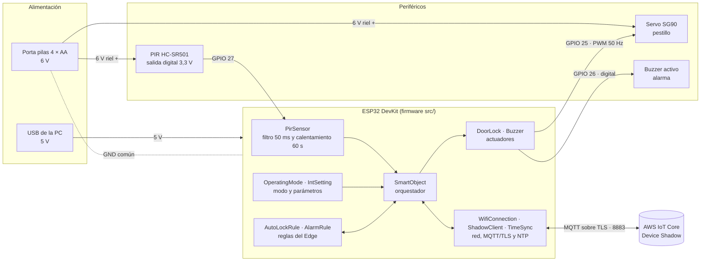

*Figura 2.1.1 — Bloques del objeto inteligente: alimentación, periféricos y firmware.*

| Bloque | Componentes | Responsabilidad |
|---|---|---|
| Alimentación | USB de la PC (5 V), porta pilas 4 × AA (6 V) | Dos fuentes que solo comparten la tierra. El USB alimenta la lógica; las pilas, el servo y el PIR, para que los picos del servo no reinicien el ESP32 |
| Sensado | PIR → `PirSensor` | Convierte la salida del PIR en `movimiento` y `detecciones`, sin reportar los falsos positivos del calentamiento |
| Actuación | `DoorLock` → servo, `Buzzer` → buzzer | Cada actuador es dueño de una clave del Shadow (`puerta`, `alarma`), valida el valor deseado y reporta su estado |
| Configuración | `OperatingMode`, `IntSetting` × 2 | Guardan `modo`, `max_detecciones` y `ventana_min`, validados con los mismos rangos que la skill |
| Lógica del Edge | `AutoLockRule`, `AlarmRule` | Cierran la puerta y hacen sonar o apagan la alarma **sin depender de la red** |
| Orquestación | `SmartObject` | En cada vuelta: actuadores → sensores → reglas → publicación por evento o por latido de 60 s |
| Comunicación | `WifiConnection`, `ShadowClient`, `TimeSync` | Reconexión WiFi y MQTT, tópicos del Shadow y hora NTP para `ultima_deteccion` |

## 2.2 Arquitectura del sistema

El sistema combina control local, sincronización de estado, interacción por voz y procesamiento de datos. Alexa invoca `vigilante-skill`; esta resuelve `userId → thingName` en DynamoDB y consulta o modifica el Shadow de ese Thing. El ESP32 utiliza MQTT sobre TLS para reportar estado y recibir diferencias pendientes. Ninguna Lambda controla los GPIO directamente. El objeto se detalla en §2.1 y §2.3, las reglas en §2.9 y los recorridos de voz y de la Nube en §2.5.

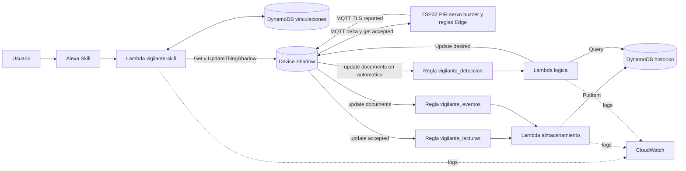

*Figura 2.2.1. Arquitectura de la Práctica 4, reconstruida a partir del firmware, las definiciones SQL y las Lambdas de la versión revisada. Todos los recursos del proyecto se configuran en Ohio (`us-east-2`).*

Se distinguen dos tablas: `vigilante_vinculaciones`, que conserva el destino de cada usuario, y `vigilante_historico`, que conserva lecturas/eventos por Thing. Las reglas `vigilante_lecturas` y `vigilante_eventos` invocan almacenamiento; `vigilante_deteccion` invoca negocio únicamente ante nuevas detecciones en automático. Esta separación limita permisos y evita que guardar una lectura implique también decidir sobre los actuadores.

## 2.3 Diagrama de circuito

### Componentes

| Cant. | Componente | Especificación relevante |
|---|---|---|
| 1 | ESP32 DevKit (30 pines) | Lógica de 3,3 V; alimentado por USB desde la computadora |
| 1 | Sensor PIR HC-SR501 | Alimentación de 4,5 a 20 V; salida digital de 3,3 V; jumper L; Tx al mínimo |
| 1 | Servo SG90 | De 4,8 a 6 V; picos de varios cientos de mA al arrancar |
| 1 | **Buzzer activo de 12 mm** | Oscilador interno: suena con un nivel alto continuo; sellado por debajo |
| 1 | Porta pilas 4 × AA | 6 V para el servo y el PIR por el riel + de la protoboard |
| 1 | Protoboard de 830 puntos y cables dupont | — |

### Conexiones

| Componente | Terminal | Conexión |
|---|---|---|
| Porta pilas | Rojo (+6 V) / Negro (−) | Riel + / Riel − (GND común) |
| ESP32 | GND | Riel − (une la tierra del ESP32 con la de las pilas) |
| ESP32 | USB | Computadora (alimentación y monitor serie) |
| PIR HC-SR501 | VCC / OUT / GND | Riel + (6 V) / **GPIO 27** / Riel − |
| Servo SG90 | Rojo / Naranja (señal) / Marrón | Riel + (6 V) / **GPIO 25** / Riel − |
| **Buzzer activo** | **Pata larga (+)** | **GPIO 26**, directo |
| **Buzzer activo** | **Pata corta (−)** | **Riel − (GND común)** |

El PIR y el servo no cambian respecto de la P3. Lo nuevo son las dos conexiones del buzzer. Los pines están en [`include/config.h`](../include/config.h): `PIR_PIN 27`, `SERVO_PIN 25` y `BUZZER_PIN 26`, con `BUZZER_ACTIVE 1`.

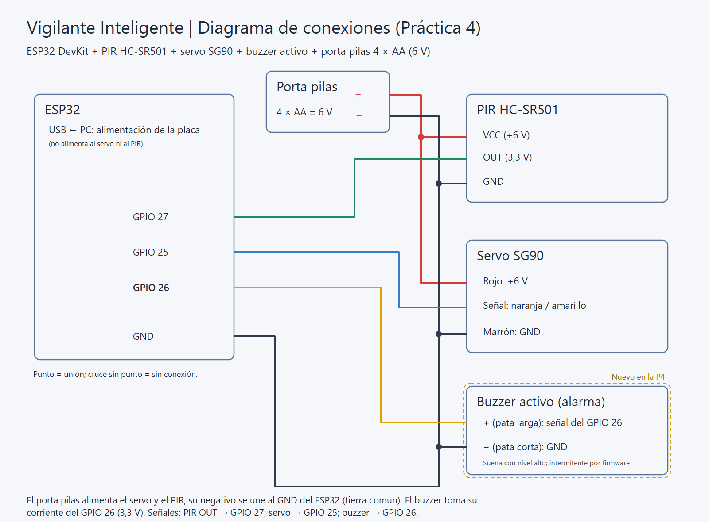

*Figura 2.3.1 — Diagrama de conexiones de la P4. Es un esquema por terminal: no representa la posición física de los pines. Lo nuevo respecto de la P3 es el buzzer en el GPIO 26.*

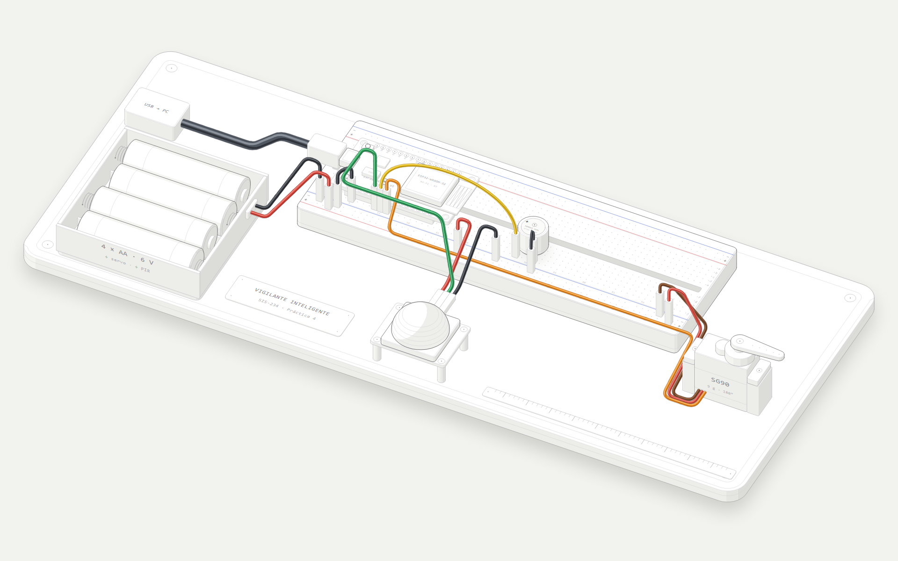

*Figura 2.3.2 — El circuito montado en la protoboard, en vista isométrica ([versión vectorial](anexos/p4/circuito-3d.svg)). El buzzer está en la mitad derecha de la protoboard. El cable amarillo lleva su señal desde el GPIO 26 y el negro une su pata − al riel −. El resto del montaje es el de la P3: verde = PIR OUT → GPIO 27, naranja = señal del servo → GPIO 25, rojo = +6 V, negro y marrón = GND.*

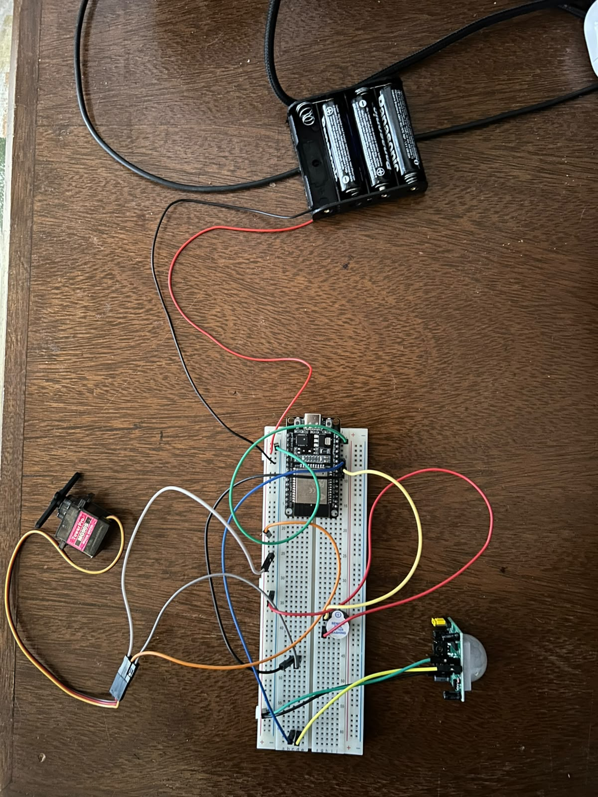

*Figura 2.3.3 — Prototipo real de la P4. Arriba, el porta pilas; al centro, el ESP32 en la protoboard; abajo a la derecha, el buzzer (con la etiqueta "REMOVE SEAL AFTER WASHING" de los buzzers activos sellados) y el PIR; a la izquierda, el servo.*

### Justificación de las conexiones del buzzer

- **GPIO 26.** No es un pin de arranque (0, 2, 5, 12, 15), no pertenece a la memoria flash (6 a 11) y no es de solo entrada (34 a 39). Admite salida digital y PWM (LEDC), así que sirve tanto para el buzzer activo como para uno pasivo. No comparte nada con el PIR (27) ni con el servo (25).
- **Buzzer activo, alimentado por el propio GPIO.** Tiene un oscilador interno: con 3,3 V continuos pita solo, y el firmware lo enciende con `digitalWrite(HIGH)`. La alarma es **intermitente** (500 ms sí, 500 ms no, `ALARM_BEEP_MS`): esa cadencia la genera el firmware con `millis()`, sin `delay()`. Se alimenta del GPIO y no de las pilas porque así funciona con la lógica de 3,3 V sin agregar componentes, y porque su consumo no pasa por el riel del servo.
- **Sin resistencia en serie (montaje actual).** El buzzer suelto va directo al GPIO 26. El ESP32 limita la corriente de cada GPIO con su *drive strength*: unos 20 mA en la configuración por defecto, con un máximo absoluto de 40 mA. Un buzzer activo de 3,3 V suele consumir unos 20 a 30 mA, así que funciona, aunque cerca del límite del pin. La guía recomendaba una resistencia de 220 Ω en serie, que limita la corriente a 3,3 V / 220 Ω ≈ 15 mA a costa de un poco de volumen. Para un uso prolongado conviene agregarla o, mejor, mover el buzzer a un transistor NPN (§7).
- **Tierra común.** La pata − va al riel −, el mismo GND del ESP32, de las pilas, del PIR y del servo. Sin esa unión, el nivel alto del GPIO 26 no tendría referencia.
- **Canal PWM separado (si fuera pasivo).** Con `BUZZER_ACTIVE 0`, el firmware genera el tono de 2 kHz con `ESP32PWM`, la misma biblioteca que mueve el servo. La biblioteca asigna un canal y un timer LEDC distintos según la frecuencia (50 Hz el servo, 2 kHz el buzzer), así que el tono no altera el pulso del servo.
- **Seguridad.** Todo el montaje trabaja a 6 V como máximo. La alimentación se desconecta antes de tocar el cableado.

### Prueba rápida del buzzer sin firmware

Antes de cargar el firmware se identificó el tipo de buzzer: con su pata + tocando un instante el pin **3V3** y la − en el riel −, **pita**. Eso lo identifica como **activo**; uno pasivo solo haría "clic". Por eso `config.h` queda con `BUZZER_ACTIVE 1`.

### Correspondencia entre el modelo y el montaje

El modelo 3D reproduce la **topología** del montaje: qué terminal va a qué pin o riel. No reproduce la posición exacta de cada cable, que en la foto está pensada para que los cables no se crucen sobre el ESP32. Las dos coinciden en lo que importa: el buzzer en la protoboard, su señal en el GPIO 26 y su tierra en el riel −.

## 2.4 Diagramas de clases

El sistema tiene cuatro piezas de software con su propio diseño: el firmware del objeto (orientado a objetos) y tres funciones Lambda organizadas por responsabilidad.

### 2.4.1 Objeto inteligente (firmware)

El firmware ([`src/`](../src/)) se organiza en capas. Las interfaces del núcleo (`core/`) separan el hardware, la lógica y la red, y `SmartObject` las une sin conocer ninguna clase concreta. En la P4 se agregaron dos interfaces nuevas: `Setting`, para el modo y los parámetros, y `ControlRule`, para las reglas del Edge.

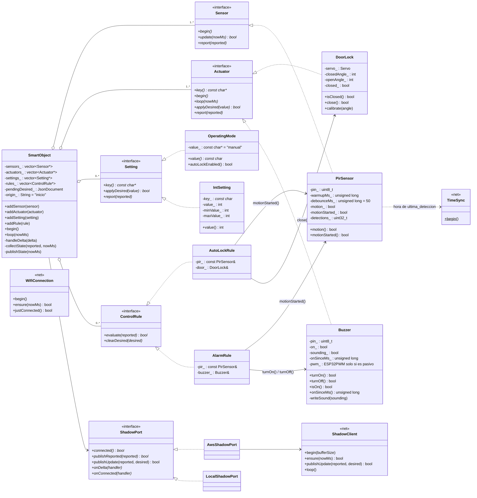

*Figura 2.4.1.1 — Clases del firmware de la P4. `SmartObject` depende solo de las cinco interfaces.*

| Archivo | Clase | Responsabilidad | Capa | RF |
|---|---|---|---|---|
| [`core/Actuator.h`](../src/core/Actuator.h) | `Actuator` | Interfaz de un actuador dueño de una clave del Shadow | núcleo | RF3 |
| [`core/Setting.h`](../src/core/Setting.h) | `Setting` | Interfaz de un parámetro de la lógica: valida el `desired` y lo reporta | núcleo | RF14 |
| [`core/ControlRule.h`](../src/core/ControlRule.h) | `ControlRule` | Interfaz de una regla del Edge: `evaluate()` actúa y devuelve `true` si cambió un actuador; `clearDesired()` indica qué claves de `desired` limpiar | núcleo | RF13 |
| [`actuators/Buzzer.*`](../src/actuators/Buzzer.h) | `Buzzer` | Dueño de la clave `alarma`: acepta `encendida`/`apagada`, pita de forma intermitente sin bloquear y expone desde cuándo suena | hardware | RF3, RF13 |
| [`actuators/DoorLock.*`](../src/actuators/DoorLock.h) | `DoorLock` | Dueño de `puerta`; `close()` es idempotente para que la regla no repita el PWM | hardware | RF3, RF13 |
| [`sensors/PirSensor.*`](../src/sensors/PirSensor.h) | `PirSensor` | Detecciones filtradas; `motionStarted()` marca el flanco nuevo del ciclo actual | hardware | RF1 |
| [`settings/OperatingMode.*`](../src/settings/OperatingMode.h) | `OperatingMode` | `modo` ∈ {manual, automatico, bloqueo}; arranca en `manual` | lógica | RF14 |
| [`settings/IntSetting.*`](../src/settings/IntSetting.h) | `IntSetting` | Entero con rango: `max_detecciones` (1–20, 3 por defecto) y `ventana_min` (1–120, 10 por defecto) | lógica | RF14 |
| [`rules/AutoLockRule.*`](../src/rules/AutoLockRule.h) | `AutoLockRule` | En `automatico` o `bloqueo`, un flanco nuevo del PIR cierra la puerta | Edge | RF13 |
| [`rules/AlarmRule.*`](../src/rules/AlarmRule.h) | `AlarmRule` | En `bloqueo`, un flanco nuevo enciende la alarma; en cualquier modo, la apaga a los 30 s | Edge | RF13 |
| [`app/SmartObject.*`](../src/app/SmartObject.h) | `SmartObject` | Orquestador: reparte los deltas, evalúa las reglas **antes** de comprobar la red, unifica el `origen` y publica `reported` junto con la limpieza de `desired` | aplicación | RF2, RF3, RF12 |
| [`main.cpp`](../src/main.cpp) | `AwsShadowPort`, `LocalShadowPort` | Composición: crea las instancias, las registra y elige el transporte (AWS o monitor serie) | composición | — |

#### El buzzer en detalle

- **Estado lógico y estado físico.** `on_` es lo que se reporta (`alarma: encendida`). `sounding_` es la fase del pitido. `loop(nowMs)` calcula la fase con `((nowMs − onSinceMs_) / ALARM_BEEP_MS) % 2` y solo escribe el pin cuando la fase cambia.
- **`turnOn()` y `turnOff()` devuelven `true` solo si hubo cambio.** Así, una alarma que ya suena no reinicia su cuenta de 30 s, y `AlarmRule` sabe si debe marcar el origen como `edge`.
- **`onSinceMs()`** permite que `AlarmRule` apague la alarma a los 30 s **la haya encendido quien la haya encendido** (Edge, voz o Nube). La resta `millis() − onSinceMs()` es *unsigned* y funciona aunque `millis()` se desborde a los 49 días.
- **Activo o pasivo, decidido al compilar.** `Buzzer.h` incluye `config.h` antes de declarar la clase, y el miembro `ESP32PWM pwm_` existe solo con `BUZZER_ACTIVE 0`. Así la clase tiene el mismo tamaño en todos los archivos que la incluyen (regla de una definición, ODR). Las dos variantes compilan (§4.2, prueba P-A2).

#### Decisiones de diseño

- **Principio abierto/cerrado comprobado.** El buzzer se agregó con una clase nueva y una línea en `main.cpp` (`addActuator(&buzzer)`). `SmartObject`, `ShadowClient` y las demás clases no se modificaron. La P3 lo había anticipado (§2.3 de la P3) y la P4 lo confirmó.
- **Reglas desacopladas.** `AutoLockRule` y `AlarmRule` se registran por separado y en ese orden. Una regla nueva, por ejemplo "cerrar si la alarma suena", se agrega sin tocar las existentes.
- **Las reglas leen el estado completo.** `SmartObject` arma una sola foto del estado (`collectState`) con sensores, actuadores y ajustes, y se la pasa a cada regla. Si una regla actúa, se rehace la foto antes de evaluar la siguiente.
- **Una sola fuente de `origen`.** `SmartObject` guarda el origen del último cambio: `inicio` al arrancar, `edge` cuando actúa una regla, y `voz` o `nube` cuando llega un delta con ese origen.

### 2.4.2 Funciones Lambda `vigilante-skill` y `vigilante-logica`

El sistema tiene tres funciones Lambda con responsabilidades separadas. Aquí se describen dos de ellas: `vigilante-skill` (backend de Alexa) y `vigilante-logica` (lógica de negocio en la Nube, **P4**). La de almacenamiento está en §2.4.3.

#### `vigilante-skill`

La función es el *backend* de la skill. Está escrita en Python 3.13 con el **ASK SDK for Python** (`ask-sdk-core`) y organizada en el paquete [`lambda/vigilante/`](../lambda/vigilante/), con **una responsabilidad por módulo**:

| Módulo | Clases / funciones | Responsabilidad | RF |
|---|---|---|---|
| [`lambda_function.py`](../lambda/lambda_function.py) | `lambda_handler` | Punto de entrada configurado en Lambda (`lambda_function.lambda_handler`). Crea los clientes `boto3` **una sola vez por contenedor** (se reutilizan entre invocaciones) y arma la skill. | — |
| [`vigilante/config.py`](../lambda/vigilante/config.py) | `Settings`, constantes `KEY_*`, `DOOR_*`, `ALARM_*`, `MODE_*`, `ORIGIN_*`, rangos | Lee las variables de entorno y define las **claves del Shadow**, los modos, los rangos de los parámetros y los orígenes, que forman el contrato con el firmware (`include/config.h`). **P4:** modo, `max_detecciones`, `ventana_min`, `origen` y `alarma`. | — |
| [`vigilante/link_repository.py`](../lambda/vigilante/link_repository.py) | `LinkRepository` | Acceso a DynamoDB: `get_thing`, `save` y `delete` de la vinculación `userId → thingName`. | RF7, RF8, RF9 |
| [`vigilante/device_gateway.py`](../lambda/vigilante/device_gateway.py) | `DeviceGateway` | Acceso a AWS IoT Core: valida que el Thing exista (`DescribeThing`), lee y escribe el Shadow (`GetThingShadow` / `UpdateThingShadow`) y espera la confirmación. **P4:** `request_desired` agrega siempre `"origen": "voz"` y `wait_for` confirma cualquier atributo, no solo la puerta. | RF4, RF5, RF6, RF9, RF14 |
| [`vigilante/device_state.py`](../lambda/vigilante/device_state.py) | `DeviceState` | Vista de solo lectura del documento Shadow: `reported`, `desired`, órdenes pendientes y antigüedad del último reporte. **P4:** modo, modo pedido (`target_mode`), parámetros, alarma y origen. | RF4, RF6, RF14 |
| [`vigilante/handlers.py`](../lambda/vigilante/handlers.py) | Interceptor + un manejador por intent | Lógica de voz: resuelve el Thing del usuario en cada solicitud y responde cada intent. **P4:** 8 manejadores nuevos (modo, parámetros, alarma). | RF4 – RF9, RF14 |
| [`vigilante/speech.py`](../lambda/vigilante/speech.py) | Frases y `digits()`, `elapsed()`, `stale_warning()` | Textos en español y SSML (el código se lee dígito por dígito). **P4:** frases de modo, parámetros, alarma, rechazo y origen. | RF4 – RF6, RF14 |
| [`vigilante/skill.py`](../lambda/vigilante/skill.py) | `build_skill()` | Registra el interceptor, los 20 manejadores y el manejador de excepciones, **inyectando las dependencias**. | — |

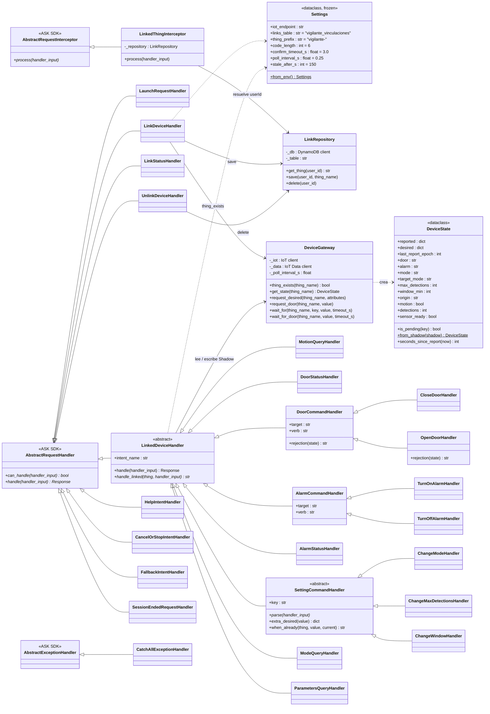

Los manejadores nuevos de la Práctica 4 son `AlarmCommandHandler` (y sus dos subclases), `AlarmStatusHandler`, `SettingCommandHandler` (y sus tres subclases), `ModeQueryHandler` y `ParametersQueryHandler`.

##### Dependencias entre módulos

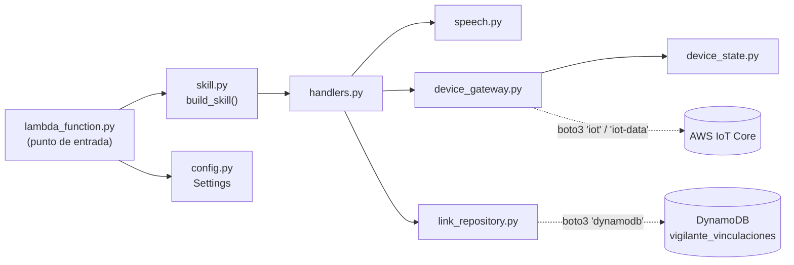

##### Decisiones de diseño

- **Inyección de dependencias.** `build_skill(repository, gateway, settings, now)` ([`build_skill`](../lambda/vigilante/skill.py)) recibe los objetos que hablan con AWS en vez de crearlos. En producción se pasan los clientes `boto3` reales ([`lambda_handler`](../lambda/lambda_function.py)) y en las pruebas, dobles en memoria ([`tests/fakes.py`](../lambda/tests/fakes.py)). Por eso toda la lógica se prueba **sin cuenta de AWS ni red** (§4.2).
- **Repositorio y gateway** (patrones *Repository* y *Gateway*). Los manejadores no conocen `boto3`: piden "el Thing de este usuario" a `LinkRepository` y "el estado del Thing" a `DeviceGateway`. Si mañana la vinculación pasara a otra base de datos, solo cambiaría `link_repository.py`.
- **Método plantilla** en [`LinkedDeviceHandler`](../lambda/vigilante/handlers.py). `handle()` resuelve el Thing vinculado, responde "aún no tienes un dispositivo vinculado" si no lo hay y traduce los errores de AWS. Cada subclase implementa solo `handle_linked()`. Así ningún intent de dispositivo puede olvidarse del RF8.
- **Interceptor global** ([`LinkedThingInterceptor`](../lambda/vigilante/handlers.py)). Antes de cualquier `LaunchRequest` o `IntentRequest` lee `context.System.user.userId` y busca en DynamoDB el Thing del usuario (RF8). El resultado queda en los atributos de la solicitud y lo usan todos los manejadores.
- **Herencia para los actuadores.** `CloseDoorHandler` y `OpenDoorHandler` solo fijan `target` y `verb`; la lógica de escribir `desired`, esperar la confirmación y medir la latencia está una sola vez en [`DoorCommandHandler`](../lambda/vigilante/handlers.py). **P4:** el buzzer siguió el mismo patrón ([`AlarmCommandHandler`](../lambda/vigilante/handlers.py)), y los ajustes también ([`SettingCommandHandler`](../lambda/vigilante/handlers.py)): validar el slot → comparar con `reported` → escribir `desired` con `origen: voz` → esperar hasta 3 s → responder.
- **Extensible sin rediseño (comprobado en P4).** En la Práctica 3 se anticipó que agregar el buzzer requeriría solo una constante, una propiedad en `DeviceState` y un manejador nuevo. Así fue: la alarma se agregó con `KEY_ALARM`, `DeviceState.alarm` y tres manejadores, sin cambiar los módulos existentes.
- **(P4) Ganchos para convivir con la lógica automática** (§2.10): `OpenDoorHandler.rejection()` rechaza abrir en `automatico` o `bloqueo`; `ChangeModeHandler.extra_desired()` agrega `puerta: cerrada` al pasar a bloqueo y `alarma: apagada` al pasar a manual; `when_already()` apaga la alarma si se pide manual estando ya en manual.

#### `vigilante-logica` (P4, [`lambda-logica/lambda_function.py`](../lambda-logica/lambda_function.py))

Es una función **funcional y sin estado**: cada invocación decide solo con el mensaje de la regla y una consulta al historial. Los clientes `boto3` se crean una vez por contenedor.

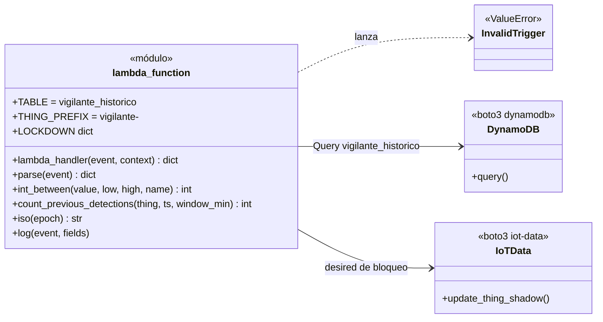

| Función | Entrada | Salida | Qué hace |
|---|---|---|---|
| `lambda_handler(event, context)` | Mensaje de la regla `vigilante_deteccion` | `{accion, detecciones_en_ventana, …}` | Orquesta: valida, cuenta y, si corresponde, bloquea |
| `parse(event)` | `thingName`, `ts`, `modo`, `max_detecciones`, `ventana_min` | dict validado o `InvalidTrigger` | `thingName` = `vigilante-` + 6 dígitos; rangos 1–20 y 1–120 |
| `count_previous_detections(thing, ts, window_min)` | Thing, instante, ventana | entero | `Query` con `Select: COUNT` entre `deteccion#<ts − ventana>` y `deteccion#<ts − 1>`, filtrando `modo = automatico`; sigue `LastEvaluatedKey` |
| `iso(epoch)` | epoch en segundos | `AAAA-MM-DDTHH:MM:SSZ` | Mismo formato que la clave `tipo_ts` que escribe el almacenamiento |

### 2.4.3 Función Lambda `vigilante-almacenamiento`

`vigilante-almacenamiento` es un módulo Python funcional, no una clase controladora. El siguiente diagrama usa el estereotipo `module` para representar sus funciones; `StorageModule` no es una clase declarada en el código. `InvalidMessage` sí es una excepción real derivada de `ValueError`.

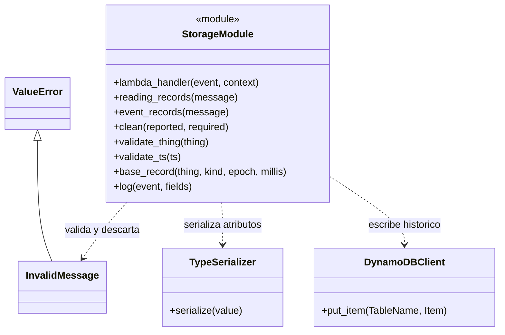

*Figura 2.4.3. Organización lógica de [`lambda-almacenamiento/lambda_function.py`](../lambda-almacenamiento/lambda_function.py). No se agregan clases artificiales para implementar la Lambda.*

El handler selecciona lectura o cambio. Las funciones de construcción validan toda la entrada antes de escribir. Después se serializan atributos con `TypeSerializer` y se ejecuta `PutItem` por registro. Un error de validación devuelve `descartado: true`; un error de servicio no se transforma en un falso éxito y queda disponible para el tratamiento de errores de Lambda. Complementa las Lambdas de voz y de negocio de §2.4.2.

## 2.5 Diagramas de secuencia

Las secuencias recorren el sistema desde el usuario o el sensor hasta el actuador o la base de datos. Cubren lo que pide la práctica:

| Diagrama | Qué muestra | Origen |
|---|---|---|
| Vinculación de un Thing | Vincular, rechazar, cambiar y desvincular (RF7–RF9) | P3 |
| Consulta del sensor | "¿hay movimiento?" desde Alexa hasta el Shadow | P3 |
| Comando y reconexión | "abre la puerta", con el ESP32 conectado o desconectado | P3, ampliado |
| Comando de modo | "cambia el modo a bloqueo" (RF14) | P4 |
| Regla de la Nube | Bloqueo por exceso de detecciones (RF13) | P4 |
| Almacenamiento | Objeto → regla de IoT → Lambda → DynamoDB (RF10–RF12), Figura 2.5.6 | P4 |
| Reglas del Edge | Cierre y alarma locales, incluso sin conexión (RF13), Figura 2.5.7 | P4 |

### Vinculación de un Thing (vincular, rechazar, cambiar y desvincular)

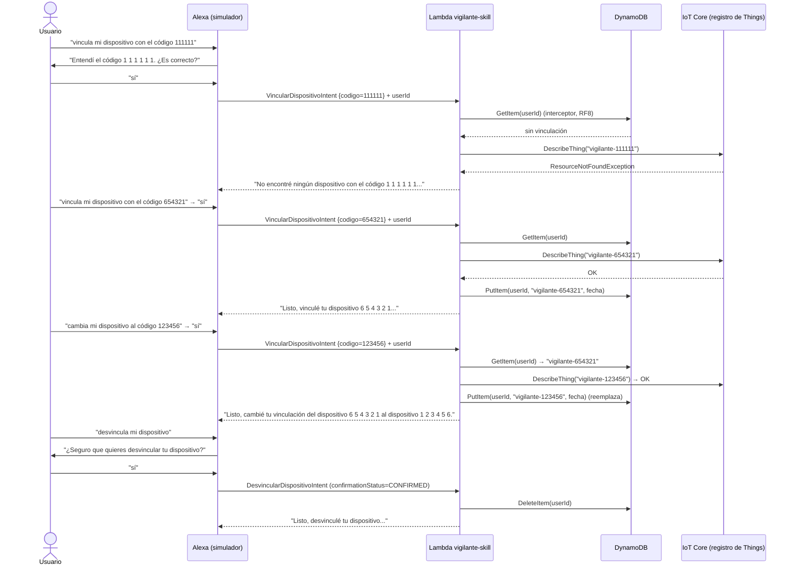

### Consulta del sensor: "¿hay movimiento?"

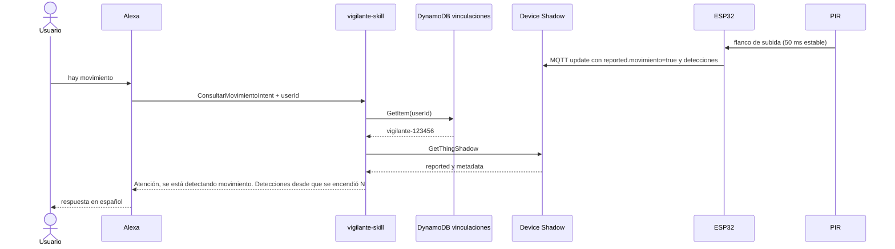

Si el último reporte tiene más de 150 s, la respuesta agrega "puede estar desconectado"; si el PIR está en su minuto de calentamiento, responde "el sensor se está calibrando".

### Comando y reconexión: "abre la puerta"

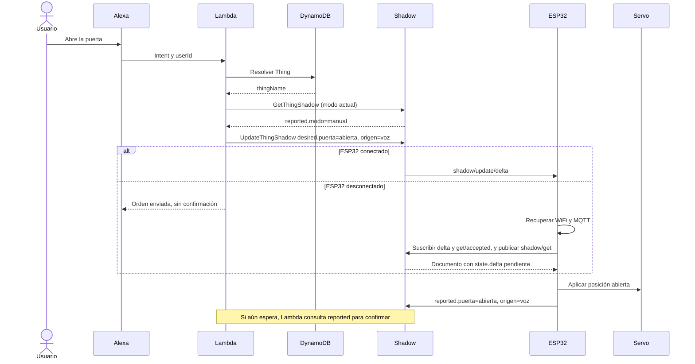

**(P4)** Si `reported.modo` (o el modo pedido y aún pendiente) es `automatico` o `bloqueo`, la Lambda rechaza la orden después de leer el Shadow y no escribe `desired` (§2.10).

### (P4) Comando de modo: "cambia el modo a bloqueo"

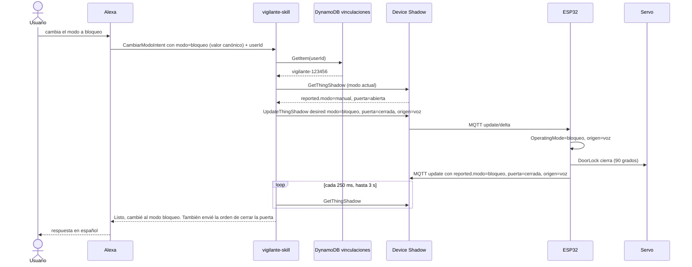

### (P4) Regla de la Nube: bloqueo por exceso de detecciones (RF13)

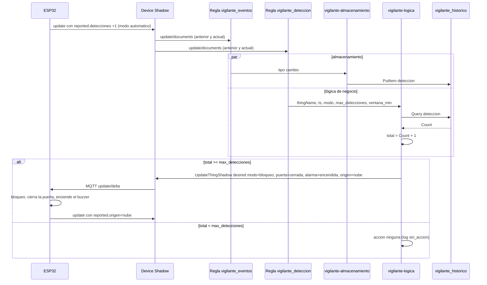

La consulta termina en `ts − 1` porque `vigilante-almacenamiento` guarda la detección actual **al mismo tiempo** (bloque `par`): según qué termine primero, esa fila puede estar o no en la tabla. Contando solo las anteriores y sumando 1 por la actual, el resultado es el mismo en los dos casos.

### Almacenamiento de lecturas y eventos

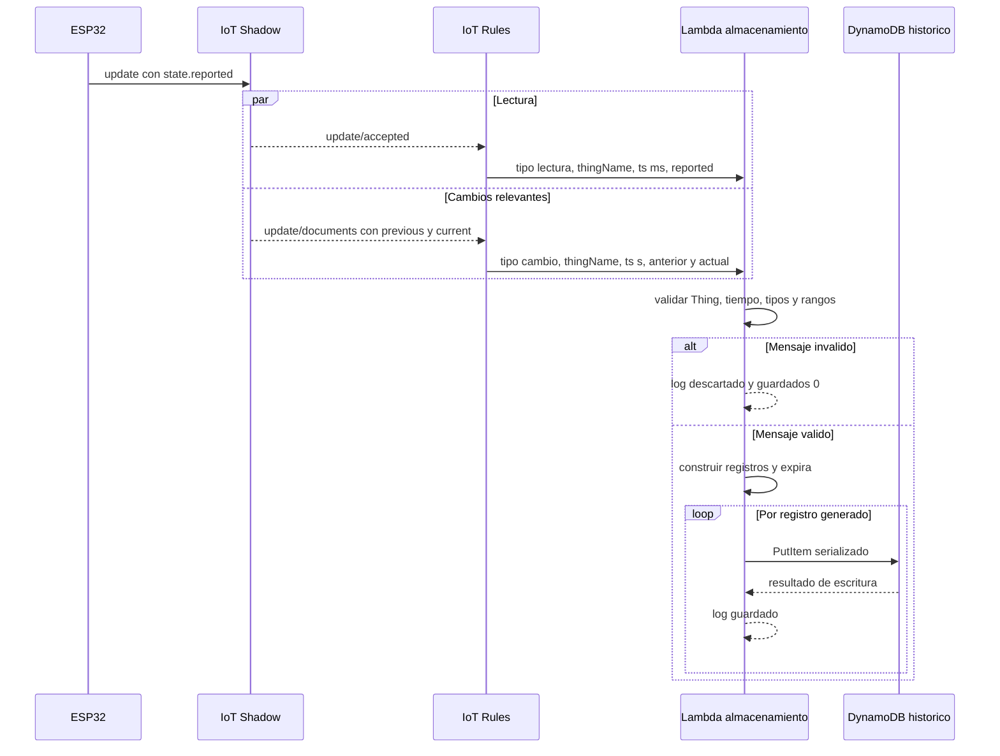

*Figura 2.5.6. El camino de cambios solo se invoca si el SQL detecta una diferencia relevante. El primer estado puede no tener un documento anterior comparable. Ambas invocaciones pueden ejecutarse concurrentemente; el diagrama no implica una transacción entre ellas.*

### Cierre y alarma locales incluso sin conexión

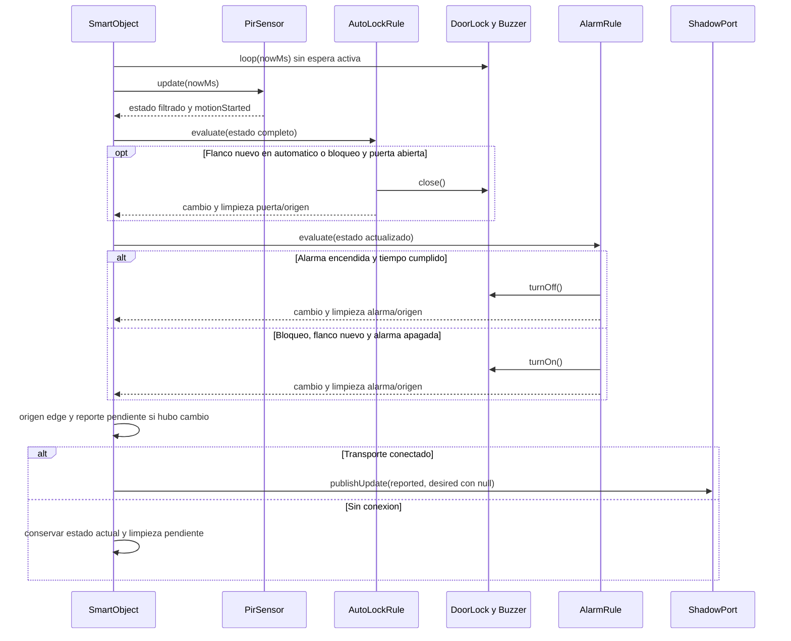

*Figura 2.5.7. Las reglas se evalúan después de actualizar sensores y antes del retorno por falta de transporte. La temporización de alarma se evalúa también cuando no existe un flanco nuevo.*

Al reconectar, `requestDocument()` recupera el Shadow. Mientras hay limpieza local pendiente, `handleDelta()` omite la clave del actuador afectado para evitar revertir la acción con una orden anterior. Se publica el estado y la eliminación de `desired.puerta`/`desired.alarma` y `desired.origen` en un mismo mensaje según las reglas que actuaron. Un retorno exitoso de `mqtt.publish()` no es un acuse `update/accepted` ni una comprobación mecánica.

## 2.6 Lógica de control: estados y ubicación de las reglas

### Modos de operación

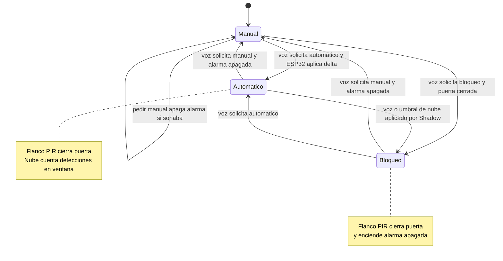

*Figura 2.6.1. Modo inicial manual. El cambio de modo de nube se vuelve efectivo en el objeto cuando se aplica el delta. La recuperación de `desired` puede modificar los valores iniciales tras reconectar.*

### Estado lógico de la alarma

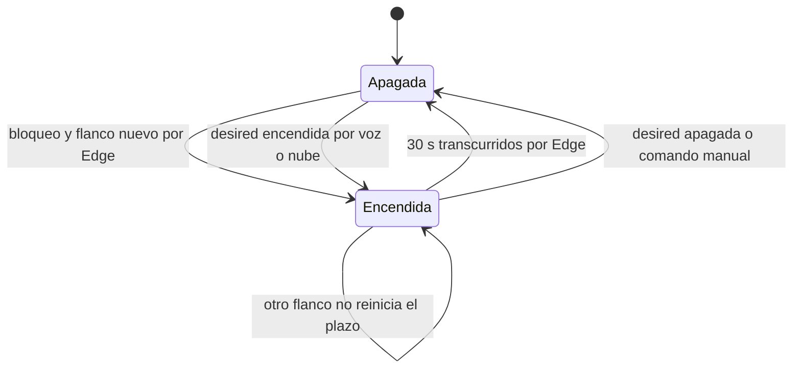

*Figura 2.6.2. El apagado por tiempo no cambia el modo bloqueo. La intermitencia de 500 ms corresponde a la salida sonora dentro de Encendida, no a cambios del atributo `alarma` ni a nuevos eventos de encendido.*

| Regla | Ubicación | Justificación y convivencia |
|---|---|---|
| Cerrar ante un flanco en automático o bloqueo. | Edge: `AutoLockRule`. | Respuesta local aunque falle Internet. `close()` no repite PWM si ya estaba cerrada. |
| Activar alarma ante un flanco en bloqueo. | Edge: `AlarmRule`. | Intrusión exige respuesta inmediata. No se activa por PIR en manual ni en automático. |
| Apagar alarma a los 30 s, cualquiera que haya sido su origen. | Edge: `AlarmRule`. | Evita sonido indefinido sin depender de conexión. El vencimiento tiene prioridad sobre un flanco simultáneo. |
| Pasar a bloqueo al alcanzar `max_detecciones` en `ventana_min`. | Nube: `vigilante-logica`. | Consulta histórico de detecciones en automático. Solicita bloqueo, cierre y alarma mediante `desired`, con origen nube. |
| Abrir por voz únicamente en manual; cerrar en todos los modos. | Backend de la skill. | `OpenDoorHandler` revisa también un modo deseado pendiente. Rechaza abrir en automático/bloqueo explicando cómo pasar a manual. |

Las órdenes de voz usan origen `voz`; la nube usa `nube`; las reglas locales reportan `edge`; el arranque comienza con `inicio`. El origen es un atributo global del último cambio reportado, no una auditoría independiente de cada actuador. La restricción de apertura está en la skill: un cliente autorizado que escriba directamente el Shadow no pasa por ese rechazo. La regla Edge responde al flanco, no verifica continuamente la posición física.

## 2.7 Especificación del documento Shadow

Se usa el **Shadow clásico** de cada Thing `vigilante-<código>`. Ejemplo durante una intrusión en modo bloqueo, con una orden de voz pendiente para apagar la alarma:

```json
{
  "state": {
    "desired": {
      "modo": "bloqueo", "max_detecciones": 3, "ventana_min": 10,
      "alarma": "apagada", "origen": "voz"
    },
    "reported": {
      "movimiento": true, "detecciones": 7, "ultima_deteccion": 1795169742, "sensor_listo": true,
      "puerta": "cerrada", "alarma": "encendida",
      "modo": "bloqueo", "max_detecciones": 3, "ventana_min": 10,
      "origen": "edge", "uptime_s": 812, "rssi": -58
    },
    "delta": { "alarma": "apagada", "origen": "voz" }
  }
}
```

### Atributos

| Atributo | Sección | Tipo | Valores válidos | Escribe | Lee |
|---|---|---|---|---|---|
| `puerta` | desired | string | `abierta`, `cerrada`, `null` | Skill (RF5), `vigilante-logica` (`cerrada`), ESP32 (`null`) | ESP32 vía `delta` |
| `puerta` | reported | string | `abierta`, `cerrada` | ESP32 | Skill, reglas, almacenamiento |
| `alarma` | desired | string | `encendida`, `apagada`, `null` | Skill (encender, apagar, pasar a manual), `vigilante-logica` (`encendida`), ESP32 (`null`) | ESP32 vía `delta` |
| `alarma` | reported | string | `encendida`, `apagada`; `apagada` al encender | ESP32 | Skill, regla `vigilante_eventos`, almacenamiento |
| `modo` | desired / reported | string | `manual`, `automatico`, `bloqueo`; `manual` al encender | Skill y `vigilante-logica` / ESP32 | ESP32, skill, reglas |
| `max_detecciones` | desired / reported | entero | 1 a 20; 3 por defecto | Skill / ESP32 | ESP32, `vigilante_deteccion` |
| `ventana_min` | desired / reported | entero | 1 a 120 minutos; 10 por defecto | Skill / ESP32 | ESP32, `vigilante_deteccion` |
| `origen` | desired | string | `voz`, `nube`, `null` | Skill (`voz`), `vigilante-logica` (`nube`), ESP32 (`null`) | ESP32 vía `delta` |
| `origen` | reported | string | `inicio`, `voz`, `edge`, `nube` | ESP32 | Skill (dice quién activó la alarma), almacenamiento (RF12) |
| `movimiento` | reported | bool | `true` / `false` | ESP32 | Skill (RF4) |
| `detecciones` | reported | entero ≥ 0 | flancos de subida desde el encendido (vuelve a 0 al reiniciar) | ESP32 | Skill, reglas |
| `ultima_deteccion` | reported | entero | epoch UTC en segundos; `0` = sin hora NTP | ESP32 | Skill |
| `sensor_listo` | reported | bool | `false` durante los 60 s de calentamiento | ESP32 | Skill |
| `uptime_s` | reported | entero | segundos desde el encendido | ESP32 | Prueba de estabilidad (§4.3) |
| `rssi` | reported | entero | dBm, negativo | ESP32 | Diagnóstico |

Los valores válidos son los mismos en los cuatro lugares que los usan: [`include/config.h`](../include/config.h) (firmware), [`lambda/vigilante/config.py`](../lambda/vigilante/config.py) (skill), [`lambda-logica`](../lambda-logica/lambda_function.py) y [`lambda-almacenamiento`](../lambda-almacenamiento/lambda_function.py), que descarta cualquier otro valor (por ejemplo `alarma: "rota"`).

### Uso de `desired`, `reported`, `delta` y `null`

- **`desired` es una orden.** La escriben la skill (siempre con `origen: "voz"`) y `vigilante-logica` (siempre con `origen: "nube"`). Una sola escritura puede llevar varios atributos que deben aplicarse juntos: el bloqueo de la Nube escribe `modo`, `puerta`, `alarma` y `origen` en el mismo `desired`, y "activa el modo manual" lleva también `alarma: "apagada"`.
- **`reported` es el estado real.** Solo lo escribe el ESP32: por evento, en cuanto algo cambia (con 500 ms mínimo entre publicaciones), y en un latido completo cada 60 s.
- **`delta` lo calcula AWS IoT** cuando `desired ≠ reported`. El ESP32 lo recibe en `shadow/update/delta` y, al reconectarse, en `shadow/get/accepted`. Así aplica las órdenes dadas mientras estaba desconectado.
- **`null` borra una clave de `desired`.** Cuando una regla del Edge actúa (cierra la puerta, enciende o apaga la alarma), el ESP32 publica en **un mismo mensaje** el nuevo `reported` y `"desired": {"puerta": null, "alarma": null, "origen": null}` (solo las claves de la regla que actuó). Sin esa limpieza, un `desired` viejo, por ejemplo `alarma: encendida` de la Nube, generaría un `delta` que volvería a encender la alarma recién apagada por el Edge. El ESP32 **nunca** escribe un valor en `desired`: solo borra claves.

### Tópicos que usa cada componente

| Tópico (`$aws/things/<thing>/shadow/…`) | Quién | Para qué |
|---|---|---|
| `update` | ESP32 publica | `reported` (eventos y latido) y la limpieza de `desired` |
| `get` | ESP32 publica | Pedir el documento completo al conectarse |
| `update/delta` | ESP32 se suscribe | Recibir las órdenes nuevas |
| `get/accepted` | ESP32 se suscribe | Recibir el documento con el `delta` pendiente al reconectarse |
| `update/accepted` | Regla `vigilante_lecturas` | Guardar cada `reported` aceptado como lectura (§2.9.1) |
| `update/documents` | Reglas `vigilante_eventos` y `vigilante_deteccion` | Comparar el estado anterior con el actual (§2.9.1) |

La política del dispositivo no cambió respecto de la P3: el ESP32 sigue publicando y suscribiéndose solo en `shadow/*` de **su propio** Thing.

## 2.8 Modelo de datos de DynamoDB

El sistema usa dos tablas con responsabilidades distintas: una pequeña, que se lee en cada pedido a Alexa, y otra que crece con el tiempo y se consulta por rangos de fecha.

| Tabla | Para qué | Claves | Capacidad | TTL |
|---|---|---|---|---|
| `vigilante_vinculaciones` (P3) | `userId` de Alexa → Thing del usuario | Partición `userId` (S) | Bajo demanda | No |
| `vigilante_historico` (P4) | Lecturas y eventos de cada objeto | Partición `thingName` (S) · ordenación `tipo_ts` (S) | Bajo demanda | Sí, atributo `expira` (30 días) |

Las definiciones exportadas son [`aws/dynamodb-table.json`](../aws/dynamodb-table.json), [`aws/dynamodb-historico.json`](../aws/dynamodb-historico.json) y [`aws/dynamodb-historico-ttl.json`](../aws/dynamodb-historico-ttl.json).

### `vigilante_vinculaciones`

No cambia respecto de la P3: `userId` (clave de partición), `thingName` y `fechaVinculacion`. La única pregunta que se le hace es *"¿qué Thing tiene este usuario?"*, un `GetItem` directo en cada solicitud a la skill.

### `vigilante_historico`

**Clave de ordenación compuesta: `tipo_ts = <tipo>#<fecha ISO UTC>`.** El prefijo separa los tipos de registro y la fecha los ordena en el tiempo. Como las fechas ISO se ordenan igual como texto que como tiempo, un `Query` con `BETWEEN` o `begins_with` responde cualquier pregunta "registros de tipo X de este Thing entre dos fechas" sin `Scan` ni índices secundarios.

| Tipo (`tipo`) | Ejemplo de `tipo_ts` | Atributos propios | Lo origina |
|---|---|---|---|
| `lectura` | `lectura#2026-11-20T10:15:42.318Z` | Todo el `reported` validado: `movimiento`, `detecciones`, `puerta`, `alarma`, `modo`, `max_detecciones`, `ventana_min`, `origen`, `uptime_s`, `rssi`, … | Regla `vigilante_lecturas` (cada reporte aceptado) |
| `deteccion` | `deteccion#2026-11-20T10:15:42Z` | `detecciones`, `puerta`, `modo` | Regla `vigilante_eventos` (sube `detecciones`) |
| `puerta` | `puerta#2026-11-20T10:15:42Z` | `puerta`, `anterior`, `origen` | `vigilante_eventos` (cambia `puerta`) |
| `modo` | `modo#2026-11-20T10:16:05Z` | `modo`, `anterior`, `origen` | `vigilante_eventos` (cambia `modo`) |
| `alarma` | `alarma#2026-11-20T10:15:42Z` | `alarma`, `anterior`, `origen` | `vigilante_eventos` (cambia `alarma`) |

**Atributos comunes a todos los registros:**

| Atributo | Tipo | Ejemplo | Para qué |
|---|---|---|---|
| `thingName` | S (partición) | `vigilante-123456` | Separa los datos de cada objeto: la skill es multiusuario |
| `tipo_ts` | S (ordenación) | `alarma#2026-11-20T10:15:42Z` | Tipo + instante; hace única cada fila |
| `tipo` | S | `alarma` | Filtrar o exportar por tipo sin partir la clave |
| `fecha` | S | `2026-11-20T10:15:42Z` | Fecha legible para los reportes |
| `epoch` | N | `1795169742` | Instante numérico para calcular duraciones |
| `expira` | N | `1797761742` | `epoch + 30 días`: DynamoDB borra la fila al vencer (TTL) |

Ejemplo de un evento de alarma tal como queda guardado:

```json
{
  "thingName": "vigilante-123456",
  "tipo_ts": "alarma#2026-11-20T10:15:42Z",
  "tipo": "alarma", "fecha": "2026-11-20T10:15:42Z",
  "epoch": 1795169742, "expira": 1797761742,
  "alarma": "encendida", "anterior": "apagada", "origen": "edge"
}
```

### Patrones de acceso

Todas las consultas son `Query` sobre la clave primaria, con `thingName = :t`:

| # | Pregunta | Condición de clave (además de `thingName = :t`) | Filtro | Quién la usa |
|---|---|---|---|---|
| PA1 | Lecturas de un Thing entre dos fechas | `tipo_ts BETWEEN 'lectura#<desde>' AND 'lectura#<hasta>'` | — | Reporte de actividad y señal WiFi (mockups, RF15) |
| PA2 | Detecciones en automático de la última ventana | `tipo_ts BETWEEN 'deteccion#<ts − ventana>' AND 'deteccion#<ts − 1 s>'` | `modo = automatico` | `vigilante-logica` (RF13) |
| PA3 | Aperturas y cierres de un día, con su origen | `begins_with(tipo_ts, 'puerta#2026-11-20')` | — | Reporte "quién abrió" (voz, edge o nube) |
| PA4 | **Historial de alarmas** | `begins_with(tipo_ts, 'alarma#')` o `BETWEEN 'alarma#<desde>' AND 'alarma#<hasta>'` | — | Reporte "Historial de alarmas" (RF15) |
| PA5 | Cambios de modo | `begins_with(tipo_ts, 'modo#')` | — | Reporte de modos y bloqueos de la Nube |
| PA6 | Detecciones por día | `begins_with(tipo_ts, 'deteccion#2026-11-20')` con `Select: COUNT` | — | Gráfica de detecciones por día |

### Decisiones de diseño

- **Por qué `thingName` como partición.** Toda pregunta del sistema es sobre **un** objeto, y la partición separa los datos de cada usuario. Un objeto genera ~1 escritura por minuto, muy lejos del límite de 1 000 escrituras por segundo de una partición, así que no hay riesgo de "partición caliente".
- **Por qué no una clave de ordenación solo con la fecha.** Con `ts` solo, pedir "las alarmas de hoy" exigiría leer **todas** las filas del día (más de 1 400 lecturas) y descartar el resto con un filtro, pagando cada lectura. Con el prefijo de tipo, DynamoDB lee solo las filas `alarma#…`.
- **Por qué no hay índices secundarios.** Todos los patrones parten de un Thing conocido y un tipo, que la clave primaria ya resuelve. Un GSI duplicaría cada escritura y su costo sin responder ninguna pregunta nueva.
- **Unicidad de la clave.** Las lecturas llevan milisegundos (`.318Z`), porque el ESP32 puede publicar dos reportes en el mismo segundo (separación mínima de 500 ms). Los eventos usan segundos: dos detecciones no caen en el mismo segundo (el PIR tarda ~6,5 s entre detecciones) y eventos de tipos distintos tienen prefijos distintos. Dos cambios del mismo actuador en el mismo segundo (por ejemplo, dos órdenes de voz seguidas) compartirían la clave y el segundo reemplazaría al primero; es un límite conocido del modelo (§2.9.3 y §7).
- **TTL de 30 días.** Las lecturas de un mes alcanzan para los reportes (tendencias diarias y semanales). El TTL mantiene el tamaño de la tabla en ~20 MB por objeto (§4.8), no cobra los borrados y limita cuánto tiempo se guarda la actividad de una vivienda, que es un dato sensible. Se cambia con la variable `TTL_DAYS` de `vigilante-almacenamiento`, sin tocar la tabla.
- **Bajo demanda.** El tráfico es bajo e irregular (ráfagas cuando hay movimiento). Con capacidad provisionada se pagaría capacidad ociosa casi todo el tiempo.

## 2.9 Reglas de AWS IoT y funciones Lambda de la Nube

El procesamiento en la Nube se reparte en **tres reglas** y **dos funciones Lambda** con responsabilidades separadas. La tercera Lambda, `vigilante-skill`, atiende a Alexa (§2.4.2 y §3.2.2).

| Función | Responsabilidad | Disparador | Recursos | Permisos mínimos |
|---|---|---|---|---|
| `vigilante-almacenamiento` | Validar, enriquecer y guardar lecturas y eventos | Reglas `vigilante_lecturas` y `vigilante_eventos` | `vigilante_historico` | `dynamodb:PutItem` sobre la tabla |
| `vigilante-logica` | Decidir el bloqueo por exceso de detecciones | Regla `vigilante_deteccion` | `vigilante_historico` y Shadow | `dynamodb:Query` + `iot:UpdateThingShadow` (solo `desired`) |
| `vigilante-skill` | Traducir voz en consultas y órdenes | Alexa Skills Kit | `vigilante_vinculaciones` y Shadow | `GetItem`/`PutItem`/`DeleteItem` + `GetThingShadow`/`UpdateThingShadow`/`DescribeThing` |

Separar el almacenamiento de la lógica de negocio cumple el principio de responsabilidad única, deja que cada función tenga solo sus permisos y evita invocar la lógica con cada latido: la regla `vigilante_deteccion` filtra en SQL y la invoca solo con detecciones nuevas en modo automático.

### 2.9.1 Reglas de AWS IoT

Las tres reglas están en **AWS IoT Core → Enrutamiento de mensajes → Reglas** (`us-east-2`). El SQL exacto está versionado en [`aws/iot-rules/`](../aws/iot-rules/).

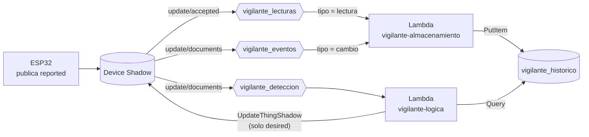

*Figura 2.9.1.1 — Tres reglas sobre el mismo Shadow: dos alimentan el almacenamiento y una la lógica de la Nube.*

| Regla | Tópico | Condición | Acción | Frecuencia estimada |
|---|---|---|---|---|
| `vigilante_lecturas` | `$aws/things/+/shadow/update/accepted` | Thing `vigilante-*` y el mensaje trae `state.reported` | Lambda `vigilante-almacenamiento` con `tipo = lectura` | Cada reporte: ~1 por minuto más los eventos (~50 000/mes) |
| `vigilante_eventos` | `$aws/things/+/shadow/update/documents` | Cambió `puerta`, `modo` o `alarma`, o subió `detecciones` | Lambda `vigilante-almacenamiento` con `tipo = cambio` | Solo en cambios (~3 600/mes) |
| `vigilante_deteccion` | `$aws/things/+/shadow/update/documents` | Subió `detecciones` **y** `modo = automatico` | Lambda `vigilante-logica` | Solo detecciones en automático (≤ 3 000/mes) |

#### `vigilante_lecturas` — almacenar cada reporte

```sql
SELECT 'lectura' AS tipo, topic(3) AS thingName, timestamp() AS ts, state.reported AS reported
FROM '$aws/things/+/shadow/update/accepted'
WHERE startswith(topic(3), 'vigilante-') AND NOT isUndefined(state.reported)
```

- `update/accepted` publica el contenido de cada actualización aceptada por el Shadow. Es justo lo que el ESP32 reportó.
- `topic(3)` es el tercer segmento del tópico, es decir, el nombre del Thing. `startswith(…, 'vigilante-')` ignora otros Things de la cuenta.
- `NOT isUndefined(state.reported)` descarta las actualizaciones que solo traen `desired` (las órdenes de la skill y de la Nube): no son lecturas del objeto.
- `timestamp()` es la hora de la regla en milisegundos. La Lambda la usa como marca de tiempo de la lectura (enriquecimiento, RF11).

#### `vigilante_eventos` — almacenar los cambios de estado con su origen

```sql
SELECT 'cambio' AS tipo, topic(3) AS thingName,
       current.metadata.reported.detecciones.timestamp AS ts,
       previous.state.reported AS anterior, current.state.reported AS actual
FROM '$aws/things/+/shadow/update/documents'
WHERE startswith(topic(3), 'vigilante-')
  AND (current.state.reported.puerta <> previous.state.reported.puerta
       OR current.state.reported.modo <> previous.state.reported.modo
       OR current.state.reported.alarma <> previous.state.reported.alarma
       OR current.state.reported.detecciones > previous.state.reported.detecciones)
```

- `update/documents` trae el documento **anterior** (`previous`) y el **actual** (`current`) completos. Es el único tópico que permite detectar un **cambio** dentro del SQL, comparando atributo por atributo. `update/accepted` no sirve para esto: solo trae lo que se acaba de escribir.
- La condición de `alarma` se agregó en la P4. Cuando el buzzer se enciende o se apaga, la regla dispara y `vigilante-almacenamiento` guarda un registro `alarma#…` con el valor nuevo, el `anterior` y el `origen` (RF12).
- `current.metadata.reported.detecciones.timestamp` es el instante, en segundos, en que el Shadow recibió esa actualización. El ESP32 incluye `detecciones` en todos sus reportes, así que esa marca de tiempo siempre corresponde al reporte que provocó el cambio.
- `detecciones >` (y no `<>`) evita registrar una "detección" falsa cuando el contador vuelve a 0 al reiniciar el ESP32.

#### `vigilante_deteccion` — disparar la regla de la Nube

```sql
SELECT topic(3) AS thingName,
       current.metadata.reported.detecciones.timestamp AS ts,
       current.state.reported.detecciones AS detecciones,
       current.state.reported.modo AS modo,
       current.state.reported.max_detecciones AS max_detecciones,
       current.state.reported.ventana_min AS ventana_min
FROM '$aws/things/+/shadow/update/documents'
WHERE startswith(topic(3), 'vigilante-')
  AND current.state.reported.modo = 'automatico'
  AND current.state.reported.detecciones > previous.state.reported.detecciones
```

- Filtra **en el SQL** las únicas situaciones en que la Nube debe decidir: una detección nueva en modo `automatico`. En `manual` y `bloqueo` la Lambda ni se invoca.
- Le entrega a `vigilante-logica` los parámetros **reportados** por el ESP32 (`max_detecciones`, `ventana_min`), no los deseados: decide con la configuración que el objeto tiene aplicada.

#### Por qué son tres reglas y no una

| Criterio | Justificación |
|---|---|
| Responsabilidad única | Almacenar lecturas, almacenar eventos y decidir el bloqueo son tres trabajos distintos. Cada regla entrega a su Lambda un mensaje con una forma fija (`lectura`, `cambio`, disparo de la Nube) |
| Tópicos distintos | Las lecturas salen de `update/accepted` (lo reportado). Los eventos necesitan `update/documents` (anterior y actual) |
| Frecuencia de invocación | El SQL filtra antes de invocar: `vigilante-logica` se ejecuta solo con detecciones en automático (≤ 6 % de los mensajes), no con cada latido |
| Permisos | `vigilante-almacenamiento` solo puede hacer `PutItem` en el histórico. `vigilante-logica` puede hacer `Query` y escribir `desired`, pero no escribe en la tabla. Si fueran una sola Lambda, tendría la suma de los permisos |
| Costo | Una regla que no cumple su `WHERE` no invoca la Lambda. El costo de evaluar las reglas es de centavos al mes (§4.8) |

**Acción y permisos de las reglas.** La acción de las tres es "Enviar un mensaje a una función Lambda". Ninguna necesita un rol IAM propio. Al crear la acción, la consola agrega a cada Lambda una **política basada en recursos** que da `lambda:InvokeFunction` solo a la entidad `iot.amazonaws.com` y solo para el ARN de esa regla. Es el permiso mínimo que pide la práctica.

### 2.9.2 Lambda de lógica de negocio `vigilante-logica`

| Aspecto | Diseño |
|---|---|
| **Responsabilidad** | Única: decidir si el Thing pasa a bloqueo por exceso de detecciones en la ventana. No guarda datos ni responde a Alexa |
| **Disparador** | Regla de AWS IoT `vigilante_deteccion` (SQL en [`aws/iot-rules/vigilante_deteccion.sql`](../aws/iot-rules/vigilante_deteccion.sql), §2.9.1): solo cuando sube `detecciones` y el modo reportado es `automatico` |
| **Entrada** | `{thingName, ts, detecciones, modo, max_detecciones, ventana_min}` (ejemplo: [`events/01_deteccion_automatico.json`](../lambda-logica/events/01_deteccion_automatico.json)) |
| **Recursos** | Lee `vigilante_historico` con `dynamodb:Query`; escribe `desired` con `iot:UpdateThingShadow` |
| **Salida sobre el objeto** | Solo `desired = {modo: bloqueo, puerta: cerrada, alarma: encendida, origen: nube}` (RF13: actúa únicamente por `desired`) |
| **Permisos mínimos** | [`politica-rol.json`](../lambda-logica/politica-rol.json): `dynamodb:Query` sobre la tabla del historial e `iot:UpdateThingShadow` sobre `thing/vigilante-*` |

**Por qué la lógica está en la Nube y en una Lambda aparte:**

- **Depende del historial.** Contar detecciones de los últimos N minutos necesita datos que el ESP32 no guarda (pierde el conteo al reiniciar) y que sí están en `vigilante_historico`.
- **Se cambia sin reprogramar el objeto.** El umbral y la ventana se ajustan por voz (`max_detecciones`, `ventana_min`), y la regla misma se actualiza desplegando la Lambda, sin tocar el firmware.
- **Responsabilidad única y mínimo privilegio.** Separada del almacenamiento, esta función no necesita `PutItem` y la de almacenamiento no necesita tocar el Shadow. Cada una tiene solo sus dos o una acciones.
- **Frecuencia y costo.** La regla SQL filtra antes de invocar: la Lambda corre solo en detecciones en modo automático, no en cada latido de 60 s.
- **`Query` y no `Scan`.** La clave `thingName` + `tipo_ts` permite leer solo las detecciones del Thing en la ventana; el costo no crece con el tamaño de la tabla.
- **Idempotente.** Si llegan más detecciones antes de que el ESP32 pase a bloqueo, la Lambda vuelve a escribir el mismo `desired`; no hay efecto acumulado. Una vez en bloqueo, la regla ya no la invoca (filtra `modo = automatico`).

### 2.9.3 Lambda de almacenamiento `vigilante-almacenamiento`

| Aspecto | Diseño implementado |
|---|---|
| Responsabilidad | Validar y guardar lecturas/eventos; no decide el modo ni modifica el Shadow. |
| Disparadores | `vigilante_lecturas` sobre `update/accepted`; `vigilante_eventos` sobre `update/documents`. |
| Entradas | `tipo`, `thingName`, `ts`; `reported` para lectura o `anterior`/`actual` para cambio. |
| Validación | Thing con prefijo configurado y seis dígitos; tiempo entero positivo; tipos/rangos conocidos. Requiere movimiento, detecciones y puerta. Alarma es opcional para compatibilidad, pero si existe debe ser encendida/apagada. |
| Enriquecimiento | `tipo`, `fecha` UTC, `epoch`, `tipo_ts` y `expira`. Convierte el `ts` en milisegundos de lecturas a segundos cuando corresponde. |
| Persistencia | `TypeSerializer` convierte atributos y `dynamodb.put_item()` escribe en `vigilante_historico`. |
| Eventos | Un registro por cambio comparable de puerta, modo o alarma; detección si el contador aumenta. Si baja al reiniciar, no genera una detección nueva. |
| TTL | `expira = int(epoch) + TTL_DAYS * 86400`; predeterminado 30 días. DynamoDB debe tener TTL habilitado sobre `expira`; borrar vencidos es asíncrono. |
| Permisos | Rol básico de logs y [`dynamodb:PutItem` sobre el histórico](../aws/almacenamiento-role-policy.json). La regla necesita autorización para invocar Lambda, distinta del rol de ejecución. |
| Configuración | Python 3.13, handler `lambda_function.lambda_handler`, espera configurada en consola de 10 s. Valores predeterminados: `HISTORY_TABLE=vigilante_historico`, `THING_PREFIX=vigilante-`, `TTL_DAYS=30`. Verificar valores reales al desplegar. |
| Observabilidad | Logs `guardado` o `descartado`; respuesta con cantidad de registros y claves. No contiene access keys. |

**Límites del modelo actual.** Los eventos del mismo tipo y Thing usan fecha con resolución de segundos: dos cambios de ese tipo en el mismo segundo pueden compartir clave y reemplazarse con `PutItem`. No existe una transacción entre lectura y evento ni un identificador de entrega que garantice contabilización exacta de duplicados. Estas condiciones deben considerarse al interpretar integridad y mejoras futuras.

## 2.10 Diseño de la skill de Alexa

| Parámetro | Valor |
|---|---|
| Nombre de la skill | Vigilante Inteligente |
| Nombre de invocación | `vigilante inteligente` |
| Idioma | Spanish (US) — `es-US` |
| Modelo | Custom, *Provision your own* (backend propio en AWS Lambda) |
| Endpoint | ARN de `vigilante-skill` en `us-east-2` |
| Archivo exportado | [`alexa/interaction-model.es-US.json`](../alexa/interaction-model.es-US.json): 20 intents (15 propios y 5 de Amazon) y el tipo propio `TipoModo` **(P4)** |

### Intents, slots y frases de ejemplo

| Intent | Slot | Frases de ejemplo (todas las del modelo) | Manejador | RF |
|---|---|---|---|---|
| `VincularDispositivoIntent` | `codigo` · `AMAZON.NUMBER` · obligatorio y con confirmación | "vincula mi dispositivo con el código {codigo}", "vincula mi dispositivo", "vincular mi dispositivo", "vincula el dispositivo {codigo}", "vincular con el código {codigo}", "mi código es {codigo}", "el código de mi dispositivo es {codigo}", "registra mi dispositivo con el código {codigo}", "cambia mi dispositivo al código {codigo}", "cambia la vinculación al código {codigo}", "cambiar de dispositivo" | `LinkDeviceHandler` | RF7, RF9 |
| `ConsultarVinculacionIntent` | — | "qué dispositivo tengo vinculado", "cuál es mi dispositivo", "qué código tiene mi dispositivo", "tengo un dispositivo vinculado" | `LinkStatusHandler` | RF8 |
| `DesvincularDispositivoIntent` | — (confirmación del intent) | "desvincula mi dispositivo", "desvincular mi dispositivo", "elimina la vinculación", "borra mi dispositivo", "olvida mi dispositivo", "quita mi dispositivo" | `UnlinkDeviceHandler` | RF9 |
| `ConsultarMovimientoIntent` | — | "hay movimiento", "se detecta movimiento", "detectó algo el sensor", "hay alguien cerca", "hay algún intruso", "hubo movimiento", "qué dice el sensor", "estado del sensor", "cuántas detecciones hubo", "alguien se acercó al objeto" | `MotionQueryHandler` | RF4 |
| `CerrarPuertaIntent` | — | "cierra la puerta", "cerrar la puerta", "bloquea la puerta", "asegura la puerta", "pon el seguro", "cierra con llave" | `CloseDoorHandler` | RF5 |
| `AbrirPuertaIntent` | — | "abre la puerta", "abrir la puerta", "desbloquea la puerta", "quita el seguro" | `OpenDoorHandler` | RF5 |
| `EstadoPuertaIntent` | — | "la puerta está cerrada", "la puerta está abierta", "cómo está la puerta", "estado de la puerta", "está cerrada la puerta", "está abierta la puerta" | `DoorStatusHandler` | RF6 |
| **`CambiarModoIntent` (P4)** | `modo` · `TipoModo` · se pide si falta | "cambia el modo a {modo}", "cambia a modo {modo}", "pon el modo {modo}", "pon el modo en {modo}", "activa el modo {modo}", "pasa a modo {modo}", "modo {modo}", "cambia el modo", "cambiar el modo de operación" | `ChangeModeHandler` | RF14 |
| **`ConsultarModoIntent` (P4)** | — | "en qué modo está", "en qué modo está el dispositivo", "qué modo tiene", "cuál es el modo", "cuál es el modo actual", "modo actual" | `ModeQueryHandler` | RF14 |
| **`CambiarMaxDeteccionesIntent` (P4)** | `numero` · `AMAZON.NUMBER` (1–20) · se pide si falta | "cambia el máximo de detecciones a {numero}", "pon el máximo de detecciones en {numero}", "máximo de detecciones {numero}", "el máximo de detecciones es {numero}", "permite {numero} detecciones", "cambia el límite de detecciones a {numero}", "cambia el máximo de detecciones" | `ChangeMaxDetectionsHandler` | RF14 |
| **`CambiarVentanaIntent` (P4)** | `minutos` · `AMAZON.NUMBER` (1–120) · se pide si falta | "cambia la ventana a {minutos} minutos", "cambia la ventana a {minutos}", "pon la ventana en {minutos} minutos", "ventana de {minutos} minutos", "la ventana es de {minutos} minutos", "cuenta las detecciones en {minutos} minutos", "cambia la ventana" | `ChangeWindowHandler` | RF14 |
| **`ConsultarParametrosIntent` (P4)** | — | "cuáles son los parámetros", "qué parámetros tiene", "cómo está configurado", "consulta la configuración", "cuál es el máximo de detecciones", "cuál es la ventana", "dime la configuración" | `ParametersQueryHandler` | RF14 |
| **`EncenderAlarmaIntent` (P4)** | — | "enciende la alarma", "activa la alarma", "haz sonar la alarma", "suena la alarma", "prende la alarma", "enciende el buzzer", "activa la sirena" | `TurnOnAlarmHandler` | RF5 |
| **`ApagarAlarmaIntent` (P4)** | — | "apaga la alarma", "desactiva la alarma", "silencia la alarma", "calla la alarma", "detén la alarma", "apaga el buzzer", "apaga la sirena", "ya basta de alarma" | `TurnOffAlarmHandler` | RF5 |
| **`EstadoAlarmaIntent` (P4)** | — | "está sonando la alarma", "la alarma está encendida", "cómo está la alarma", "estado de la alarma", "está activa la alarma", "la alarma está sonando" | `AlarmStatusHandler` | RF6 |
| `AMAZON.HelpIntent` | — | integrada ("ayuda") | `HelpIntentHandler` | — |
| `AMAZON.CancelIntent`, `AMAZON.StopIntent`, `AMAZON.NavigateHomeIntent` | — | integradas ("salir", "cancela", "para") | `CancelOrStopIntentHandler` | — |
| `AMAZON.FallbackIntent` | — | integrada (frases que no coinciden con ningún intent) | `FallbackIntentHandler` | — |

La correspondencia **intent ↔ manejador** se verifica automáticamente en las dos direcciones (`test_cada_intent_del_modelo_tiene_manejador_en_la_lambda` y `test_cada_manejador_corresponde_a_un_intent_del_modelo`). En la Práctica 3 esa prueba encontró que `AMAZON.NavigateHomeIntent`, obligatorio en todo modelo, no tenía manejador; se corrigió agregándolo a `CancelOrStopIntentHandler`. En la Práctica 4 la misma prueba exigió agregar al modelo los intents nuevos antes de registrar sus manejadores.

**(P4) Tipo propio `TipoModo`:**

| Valor canónico (el que se guarda en el Shadow) | Sinónimos que entiende Alexa |
|---|---|
| `manual` | "normal", "por voz", "modo manual" |
| `automatico` | "automático", "automática", "auto", "modo automático" |
| `bloqueo` | "bloqueado", "bloqueada", "máxima seguridad", "modo bloqueo" |

La Lambda lee el **valor canónico** que resuelve Alexa en `resolutions` ([`_resolved_slot`](../lambda/vigilante/handlers.py)), no el texto dicho: así "automático" con tilde llega como `automatico`, el valor que acepta el firmware. Una prueba de contrato verifica que los valores de `TipoModo` sean exactamente los modos de `config.py` y `config.h`.

**(P4) Validación de los números:** si `numero` o `minutos` llegan vacíos, como "?" o fuera de rango (por ejemplo 25 detecciones), la skill responde el rango válido y **no escribe el Shadow** ([`_int_in_range`](../lambda/vigilante/handlers.py)).

### Modelo de diálogo (delegación automática)

`delegationStrategy: ALWAYS`: Alexa resuelve el diálogo antes de llamar a la Lambda, así que la Lambda recibe siempre el intent completo (`dialogState: COMPLETED`).

| Intent | Configuración | Prompt | Por qué |
|---|---|---|---|
| `VincularDispositivoIntent` | slot `codigo` con *elicitation* | `Elicit.Slot.Vincular.codigo`: "¿Cuál es el código de seis dígitos que muestra tu dispositivo?" | Si el usuario dice solo "vincula mi dispositivo", Alexa pide el código. |
| `VincularDispositivoIntent` | slot `codigo` con *confirmation* | `Confirm.Slot.Vincular.codigo` (SSML): "Entendí el código `<say-as interpret-as="digits">`{codigo}`</say-as>`. ¿Es correcto?" | El reconocimiento de números largos por voz puede fallar; repetirlo dígito por dígito evita vincular un Thing equivocado. |
| `DesvincularDispositivoIntent` | confirmación del intent | `Confirm.Intent.Desvincular`: "¿Seguro que quieres desvincular tu dispositivo?" | Es una operación destructiva. Si el usuario dice "no", la Lambda recibe `confirmationStatus=DENIED` y conserva la vinculación. |
| **`CambiarModoIntent` (P4)** | slot `modo` con *elicitation* | `Elicit.Slot.CambiarModo.modo`: "¿Qué modo quieres? Puedes decir manual, automático o bloqueo." | "Cambia el modo" sin decir cuál no debe escribir nada. Sin confirmación: es reversible. |
| **`CambiarMaxDeteccionesIntent` (P4)** | slot `numero` con *elicitation* | `Elicit.Slot.CambiarMaxDetecciones.numero`: "¿Cuál debe ser el máximo de detecciones? Di un número entre uno y veinte." | Indica el rango antes de que el usuario responda. |
| **`CambiarVentanaIntent` (P4)** | slot `minutos` con *elicitation* | `Elicit.Slot.CambiarVentana.minutos`: "¿De cuántos minutos debe ser la ventana? Di un número entre uno y ciento veinte." | Ídem. |

### Respuestas y manejo de la sesión

- Todas las respuestas, salvo "salir"/"cancelar", **mantienen la sesión abierta** con un *reprompt* ("¿Algo más?"), de modo que en el simulador se encadena todo el guion sin repetir "abre vigilante inteligente".
- Los códigos se leen con SSML `<say-as interpret-as="digits">` ("uno dos tres cuatro cinco seis", no "ciento veintitrés mil…").
- **(P4)** En el Shadow los modos van sin tilde; Alexa los dice con la ortografía correcta ("automático").

| Situación | Respuesta de la skill |
|---|---|
| Abrir sin vínculo | "Bienvenido a Vigilante Inteligente. Aún no tienes un dispositivo vinculado. Di: vincula mi dispositivo con el código, seguido de los seis dígitos que muestra tu dispositivo." |
| Abrir con vínculo | "Bienvenido a Vigilante Inteligente. Puedes preguntarme si hay movimiento, pedirme que cierre o abra la puerta, encender o apagar la alarma, o cambiar el modo de operación. ¿Qué deseas hacer?" |
| Consulta o comando sin vínculo (RF8) | "Aún no tienes un dispositivo vinculado. Di: vincula mi dispositivo con el código…" |
| Movimiento (RF4) | "¡Atención! Se está detectando movimiento en este momento." / "No se detecta movimiento en este momento. La última detección fue hace 10 minutos. Detecciones desde que se encendió: 3." |
| Sensor calentando (primer minuto del PIR) | "El sensor de movimiento se está calibrando, espera un minuto." |
| Comando confirmado (RF5) | "Listo, la puerta quedó cerrada." |
| Comando sin confirmar en 3 s | "Envié la orden de cerrar la puerta, pero el dispositivo aún no la confirmó. Se aplicará en cuanto se conecte." |
| Estado de la puerta (RF6) | "La puerta está cerrada." (+ "Hay una orden pendiente para dejarla abierta." si `desired ≠ reported`) |
| **(P4)** Puerta cerrada por el Edge | "La puerta está cerrada. La cerró el sistema automáticamente al detectar movimiento." |
| **(P4)** Cambio de modo | "Listo, cambié al modo automático: la puerta se cierra sola cuando el sensor detecta movimiento." |
| **(P4)** Consultar modo | "El dispositivo está en modo manual: la puerta solo se abre o se cierra cuando tú lo pides." |
| **(P4)** Parámetros | "Listo, el máximo de detecciones ahora es 3." / "Modo automático. Máximo de detecciones: 3. Ventana: 10 minutos." |
| **(P4)** Número fuera de rango | "El máximo de detecciones debe ser un número entre 1 y 20." (no se escribe el Shadow) |
| **(P4)** Alarma | "Listo, la alarma quedó encendida." / "La alarma está sonando. La activó la nube al superar el máximo de detecciones dentro de la ventana configurada." |
| Sin reporte en 150 s | Se agrega: "Ojo: el dispositivo no se comunica desde hace 3 minutos, puede estar desconectado." |
| Dispositivo que nunca reportó | "Tu dispositivo todavía no ha enviado datos. Verifica que esté encendido y conectado." |

### (P4) Cómo conviven los comandos de voz con la lógica automática

| Situación | Comportamiento | Por qué |
|---|---|---|
| "abre la puerta" en `automatico` o `bloqueo` | Se **rechaza** con una explicación: "No puedo abrir la puerta porque el dispositivo está en modo automático: la puerta se cierra sola cuando el sensor detecta movimiento. Si quieres abrirla, primero di: cambia el modo a manual." No se escribe `desired` | La regla del Edge volvería a cerrarla con el siguiente movimiento: abrir sería un conflicto sobre el mismo actuador |
| "cierra la puerta", "enciende / apaga la alarma" en cualquier modo | Se ejecutan | Van en el mismo sentido que la protección o la desactivan explícitamente |
| "cambia el modo a bloqueo" | `desired = {modo: bloqueo, puerta: cerrada, origen: voz}` en una sola escritura | Bloqueo implica puerta cerrada, igual que cuando lo activa la Nube |
| "cambia el modo a manual" | `desired = {modo: manual, alarma: apagada, origen: voz}`; si ya estaba en manual y la alarma suena, la apaga igual | Volver a manual es retomar el control: no debe quedar sonando |
| Cambio de modo pendiente (ESP32 sin conexión) | `target_mode` usa el modo pedido: si el usuario pidió `automatico`, "abre la puerta" ya se rechaza | Se respeta la última decisión del usuario aunque el ESP32 aún no la aplicó |
| La puerta la cerró el Edge o la alarma la activó la Nube | Las consultas de estado dicen quién actuó (leen `reported.origen`) | El usuario entiende por qué el objeto cambió sin que él lo pidiera |

### Mecanismo de vinculación (de la Práctica 3, sin cambios)

**Identificador.** Cada objeto inteligente se registra en AWS IoT Core como un Thing llamado **`vigilante-` + código de 6 dígitos** que no empieza con 0 (p. ej. `vigilante-123456`). El usuario vincula su dispositivo diciendo solo el **código de vinculación** (`123456`), y la Lambda reconstruye el nombre del Thing anteponiendo el prefijo `THING_PREFIX = "vigilante-"`.

- El ESP32 muestra el código al arrancar (`Código de vinculación: 123456` en el monitor serie) y va impreso en una etiqueta sobre el dispositivo, como el número de serie de un electrodoméstico.
- Se dicta como número (*slot* `AMAZON.NUMBER`), que Alexa reconoce mejor que un nombre con guiones como `vigilante-123456`, y Alexa lo repite dígito por dígito para confirmarlo.
- El prefijo fijo cumple dos funciones: evita que un usuario vincule cualquier Thing de la cuenta y permite que el rol IAM de la Lambda dé permisos solo sobre `thing/vigilante-*` (§3.2.2).
- Hay **900 000** códigos posibles (100000–999999). Los dos códigos de esta demo (123456 y 654321) son fáciles de dictar, pero también de adivinar; en un despliegue real se reemplazarían por códigos aleatorios (§7).

La tabla `vigilante_vinculaciones` (clave `userId`) se describe en el modelo de datos (§2.8).

| Operación (frase) | Validaciones, en orden | Efecto en DynamoDB | RF |
|---|---|---|---|
| **Resolver** (cualquier solicitud) | Lee `userId` del request | `GetItem(userId)` con lectura **fuertemente consistente** (`ConsistentRead=True`), para ver de inmediato una vinculación recién hecha | RF8 |
| **Vincular** ("vincula mi dispositivo con el código 123456") | 1. Alexa repite el código y pide confirmación (modelo de diálogo). 2. El código tiene exactamente 6 dígitos. 3. El Thing `vigilante-<código>` **existe** en IoT Core (`DescribeThing`). 4. No es el mismo Thing ya vinculado. | `PutItem(userId, thingName, fechaVinculacion)` | RF7, RF9 |
| **Cambiar** ("cambia mi dispositivo al código 654321") | Las mismas validaciones que vincular | `PutItem` **reemplaza** la fila del usuario (no se duplica) | RF9 |
| **Consultar** ("qué dispositivo tengo vinculado") | — | Usa el resultado del interceptor | RF8 |
| **Desvincular** ("desvincula mi dispositivo") | 1. El usuario tiene un Thing. 2. Alexa pide confirmación del intent; si dice "no", no se borra nada. | `DeleteItem(userId)` | RF9 |

Código: validación en [`LinkDeviceHandler`](../lambda/vigilante/handlers.py), existencia del Thing en [`DeviceGateway.thing_exists`](../lambda/vigilante/device_gateway.py) y persistencia en [`link_repository.py`](../lambda/vigilante/link_repository.py).

**Por qué se valida con `DescribeThing` y no leyendo el Shadow:** el Thing de prueba `vigilante-654321` (y cualquier dispositivo recién fabricado que aún no se conectó) **no tiene Shadow** hasta su primer reporte. El registro de Things de IoT Core es la fuente de verdad sobre qué dispositivos existen.

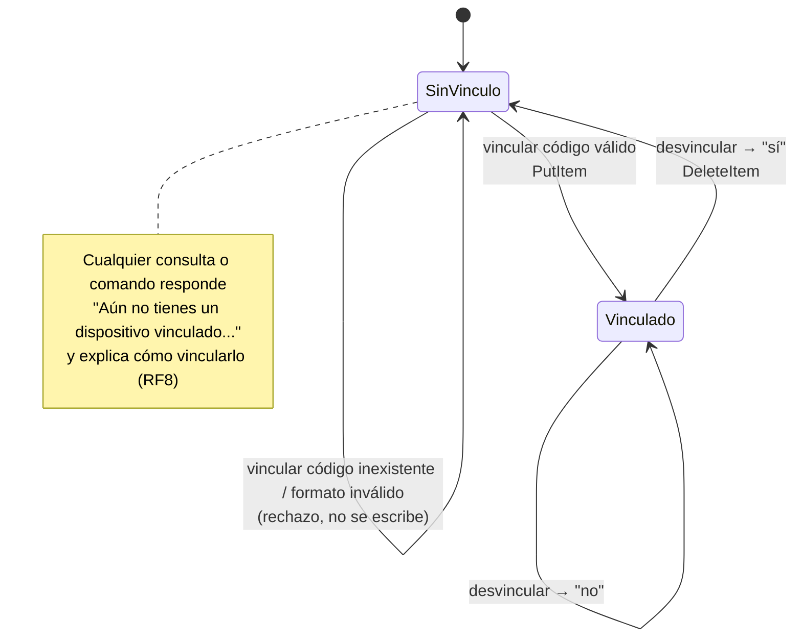

- **Varios usuarios, cada uno con su Thing.** La skill no está atada a un Thing fijo: el Thing se resuelve por `userId` en cada solicitud, y los datos del historial se distinguen por `thingName`.
- **Un Thing puede tener varios usuarios** (p. ej. los miembros de una familia). La práctica deja Account Linking (OAuth) fuera del alcance; la protección contra vincular un objeto ajeno es que el código no sea trivial de adivinar.
- **Sin escrituras parciales.** Solo se escribe en DynamoDB después de pasar todas las validaciones.

### Flujo de la conversación (actualizado)

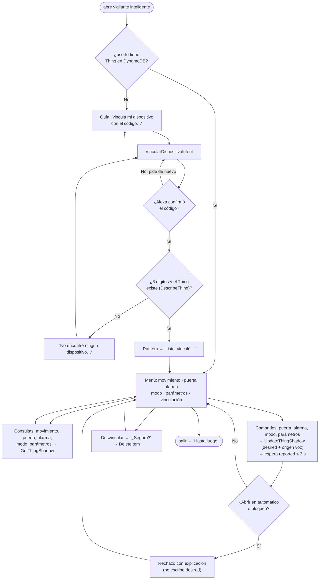

## 2.11 Diseño de reportes (mockups) — RF15

Los tres reportes se construyen **solo con consultas `Query` por clave** sobre `vigilante_historico` (clave de partición `thingName`, clave de ordenamiento `tipo_ts` = `<tipo>#<fecha ISO>`, §2.8). Cada fila de evento guarda el valor nuevo, el `anterior` y el `origen`; cada detección guarda el `modo` y la `puerta` de ese momento.

Cada reporte tiene su pantalla diseñada y la tabla de consultas. Las tres pantallas comparten la misma estructura: arriba el **estado actual** del objeto (conexión, modo, puerta, alarma, señal WiFi, tiempo encendido y último reporte, tomados de la última `lectura#`; desconectado si no reporta en 150 s), luego **una conclusión en una frase** que responde la pregunta del reporte, los indicadores clave y, debajo, el detalle. Los colores tienen el mismo significado en todas: uno por origen (voz azul, edge naranja, nube verde), otro por modo (manual violeta, automático verde, bloqueo rosa), y el rojo solo para la alarma sonando y la desconexión.

> Las pantallas usan **datos ilustrativos** generados con [`tools/mockups-rf15/generar-datos.js`](../tools/mockups-rf15/generar-datos.js) (semilla fija, 18 al 24 nov 2026), coherentes con las reglas de §2.6. No son mediciones y no se usan en §4 ni en §5. Cómo regenerarlas: [`tools/mockups-rf15/README.md`](../tools/mockups-rf15/README.md).

### Reporte 1 — Actividad del día

Para decidir: ¿hay más movimiento del normal?, ¿a qué hora?, ¿el modo automático está cerrando la puerta?

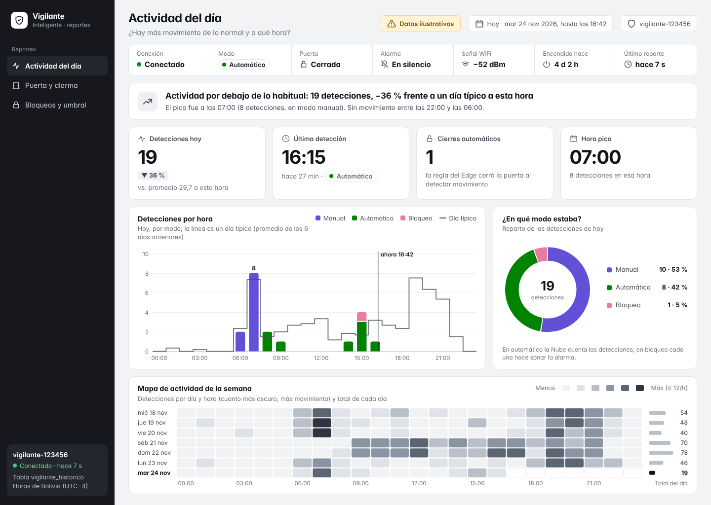

*Figura 2.11.1. Reporte 1, Actividad del día: conclusión frente a un día típico, detecciones del día, última detección, cierres automáticos y hora pico; detecciones por hora por modo, reparto por modo y mapa de actividad de la semana. Datos ilustrativos. Versión vectorial: [`mockup-actividad.svg`](anexos/p4/mockup-actividad.svg).*

| Elemento | Consulta en DynamoDB |
|---|---|
| Detecciones hoy y por hora | `Query thingName = :t AND tipo_ts BETWEEN 'deteccion#2026-11-24T00:00:00Z' AND 'deteccion#2026-11-24T23:59:59Z'`; se agrupa por hora con `fecha` |
| Última detección | La misma consulta con `ScanIndexForward = false, Limit = 1` |
| Modo actual | `Query thingName = :t AND begins_with(tipo_ts, 'lectura#')` con `ScanIndexForward = false, Limit = 1` → atributo `modo` |
| Automático / manual | Atributo `modo` de cada fila `deteccion#` del día |
| Cierres del Edge | `Query tipo_ts BETWEEN 'puerta#<hoy 00:00>' AND 'puerta#<hoy 23:59>'`, contando las filas con `puerta = cerrada` y `origen = edge` |

### Reporte 2 — Historial de la puerta y la alarma

Para decidir: ¿quién abrió o cerró?, ¿la alarma se activó sola o por voz?, ¿hay aperturas en horarios raros?

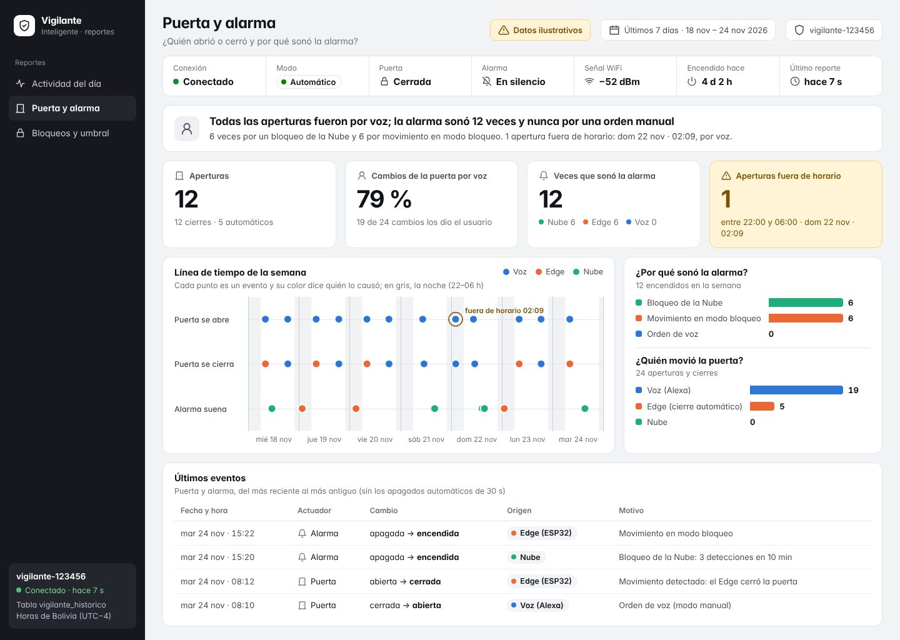

*Figura 2.11.2. Reporte 2, Puerta y alarma: quién movió la puerta y por qué sonó la alarma, aviso de aperturas fuera de horario (22:00–06:00), línea de tiempo de la semana coloreada por origen y últimos eventos con su motivo. Datos ilustrativos. Versión vectorial: [`mockup-puerta-alarma.svg`](anexos/p4/mockup-puerta-alarma.svg).*

| Elemento | Consulta en DynamoDB |
|---|---|
| Eventos de la puerta en el rango | `Query thingName = :t AND tipo_ts BETWEEN 'puerta#2026-11-18T00:00:00Z' AND 'puerta#2026-11-24T23:59:59Z'` → `fecha`, `anterior`, `puerta`, `origen` |
| Eventos de la alarma | La misma consulta con el prefijo `alarma#` → `anterior`, `alarma`, `origen` |
| Totales por origen | Conteo en el cliente sobre las filas devueltas |

### Reporte 3 — Bloqueos y configuración

Para decidir: ¿el umbral está bien elegido?, ¿cuántas veces se bloqueó?, ¿hace falta subir `max_detecciones` o acortar la ventana?

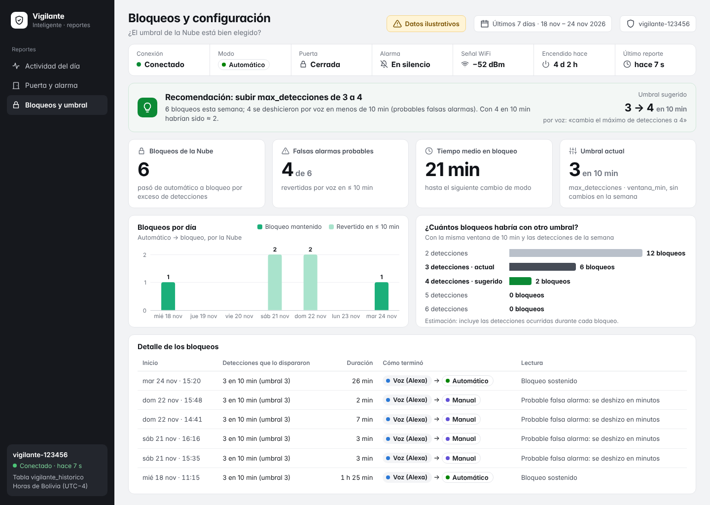

*Figura 2.11.3. Reporte 3, Bloqueos y configuración: recomendación sobre max_detecciones, bloqueos de la Nube, falsas alarmas probables, tiempo medio en bloqueo, bloqueos por día, bloqueos estimados con otros umbrales y detalle de cada bloqueo. Datos ilustrativos. Versión vectorial: [`mockup-bloqueos.svg`](anexos/p4/mockup-bloqueos.svg).*

| Elemento | Consulta en DynamoDB |
|---|---|
| Cambios de modo de la semana | `Query thingName = :t AND tipo_ts BETWEEN 'modo#2026-11-18T00:00:00Z' AND 'modo#2026-11-24T23:59:59Z'` → `anterior`, `modo`, `origen` |
| Bloqueos por la nube | Filas con `modo = bloqueo` y `origen = nube` de esa consulta |
| Tiempo medio en bloqueo | Diferencia entre cada `→ bloqueo` y el siguiente `bloqueo →` de la misma consulta |
| Configuración actual | Última `lectura#` (orden descendente, `Limit = 1`) → `max_detecciones`, `ventana_min` |

**Límites del modelo para estos reportes:** todos se resuelven por Thing, que es el patrón de acceso del caso de uso (un dueño mira su propio objeto). Un reporte que compare varios Things a la vez necesitaría un índice secundario global con `tipo` como clave, que hoy no se justifica. Las filas se borran a los 30 días por el TTL, así que los reportes cubren como máximo ese período.

---

# 3. Desarrollo e implementación

## 3.1 Estructura del código

El código está en el repositorio: firmware en [`src/`](../src/) e [`include/`](../include/), y una carpeta por función Lambda. Aquí se explican los módulos y los fragmentos clave con enlaces; el código completo no se copia en el informe.

### 3.1.1 Firmware del objeto inteligente

| Módulo | Función y fragmento clave |
|---|---|
| [`core/`](../src/core/) | Contratos `Sensor`, `Actuator`, `Setting`, `ControlRule` y `ShadowPort`. Permiten registrar componentes sin acoplar el coordinador al transporte. |
| [`PirSensor`](../src/sensors/PirSensor.cpp) | `update()` acepta un nivel estable durante 50 ms y `motionStarted()` identifica solo el flanco aceptado del ciclo. No cuenta durante el calentamiento de 60 s. |
| [`DoorLock`](../src/actuators/DoorLock.cpp) | `applyDesired()` valida abierta/cerrada; `moveTo()` ordena el ángulo. `close()` es idempotente y `loop()` retira PWM después de 700 ms, sin cortar alimentación. |
| [`Buzzer`](../src/actuators/Buzzer.cpp) | `turnOn()` conserva la hora inicial y no la reinicia si ya suena; `loop()` alterna pitido/silencio cada 500 ms sin `delay()`. `turnOff()` detiene la salida. |
| [`settings/`](../src/settings/) | `OperatingMode` y `IntSetting` validan enum y rangos. Los ajustes se incluyen tanto en el estado publicado como en el que leen las reglas. |
| [`AutoLockRule`](../src/rules/AutoLockRule.cpp) | Evalúa modo, flanco y estado de puerta; solicita limpieza de puerta/origen después de actuar. |
| [`AlarmRule`](../src/rules/AlarmRule.cpp) | Primero evalúa vencimiento con resta unsigned de `millis()`; después permite encender por flanco en bloqueo. Limpia alarma/origen. |
| [`SmartObject`](../src/app/SmartObject.cpp) | Registra componentes, actualiza actuadores/sensores, construye estado y evalúa reglas antes de comprobar red. Conserva `reportPending_` y `pendingDesired_` si falla publicar. |
| [`net/`](../src/net/) | WiFi y MQTT con reintentos; sincronización NTP; certificados TLS, tópicos del Shadow y recuperación por `get`. |
| [`main.cpp`](../src/main.cpp) | Compone PIR, puerta, buzzer, modo y parámetros; registra primero `AutoLockRule` y luego `AlarmRule`. Selecciona transporte local o AWS mediante el entorno de PlatformIO. |

**Orden de ejecución.** En `SmartObject::loop()` se actualizan los actuadores y los sensores, después las reglas, y finalmente se comprueba `shadow_.connected()`. Así, la falta de transporte impide publicar pero no evaluar la lógica local. La confirmación y las acciones Edge fuerzan un reporte prioritario; los eventos ordinarios respetan 500 ms de separación y el latido de 60 s.

**Recuperación.** La limpieza de `desired` se acumula entre reglas, de modo que cerrar puerta y activar alarma en el mismo ciclo conserva ambas claves. Si no hay red, se mantiene en RAM para la siguiente publicación. No hay cola persistente de todas las lecturas offline; un reinicio pierde las variables pendientes y el histórico puede no reconstruir transiciones que nunca se transmitieron.

**Configuración.** [`config.h`](../include/config.h) contiene pines y parámetros públicos; `secrets.h`, excluido de Git, contiene WiFi, endpoint y certificados. El búfer MQTT es de 3072 bytes y el de serialización del reporte es de 1024; si el documento no cabe, no se envía JSON truncado. La hora NTP permite fechar detecciones; un valor `ultima_deteccion=0` indica que aún no había una hora válida.

### 3.1.2 Funciones Lambda

| Ruta | Contenido |
|---|---|
| [`lambda/lambda_function.py`](../lambda/lambda_function.py) | Punto de entrada de `vigilante-skill` |
| [`lambda/vigilante/`](../lambda/vigilante/) | Paquete de la skill (§2.4.2) |
| [`lambda/events/`](../lambda/events/) | 17 eventos para la pestaña *Test* de la consola (del 01 al 09 de la Práctica 3; del 10 al 17, **P4**) |
| [`lambda/tests/`](../lambda/tests/) | 144 pruebas pytest: skill, modos, alarma, guion del simulador y contratos entre capas |
| [`lambda/build.sh`](../lambda/build.sh), [`build.ps1`](../lambda/build.ps1) | Arman `lambda/build/lambda_deployment.zip` con `ask-sdk-core` y `python-dateutil < 3` (sin `boto3`, que ya trae Lambda) |
| **(P4)** [`lambda-logica/lambda_function.py`](../lambda-logica/lambda_function.py) | `vigilante-logica`; solo biblioteca estándar y `boto3`, se despliega pegando el archivo en la consola |
| **(P4)** [`lambda-logica/events/`](../lambda-logica/events/) | Mensajes de ejemplo de la regla (modo automático y manual) |
| **(P4)** [`lambda-logica/tests/test_logica.py`](../lambda-logica/tests/test_logica.py) | 15 pruebas con DynamoDB e IoT Data simulados |
| **(P4)** [`lambda-almacenamiento/lambda_function.py`](../lambda-almacenamiento/lambda_function.py) | `vigilante-almacenamiento` (§2.4.3 y §2.9.3); solo biblioteca estándar y `boto3`, se despliega pegando el archivo en la consola |
| **(P4)** [`lambda-almacenamiento/events/`](../lambda-almacenamiento/events/) | Mensajes de ejemplo de las reglas: lectura válida, cambio de la alarma y lectura inválida |
| **(P4)** [`lambda-almacenamiento/tests/test_storage.py`](../lambda-almacenamiento/tests/test_storage.py) | 12 pruebas (y 18 subcasos) con DynamoDB simulado |

**Fragmentos clave (de la Práctica 3, con las líneas actuales):**

- [`LinkedThingInterceptor.process`](../lambda/vigilante/handlers.py): resuelve en cada solicitud el Thing del `userId` (RF8).
- [`LinkDeviceHandler.handle`](../lambda/vigilante/handlers.py): valida el código y la existencia del Thing antes de guardar (RF7, RF9).
- [`DoorCommandHandler.handle_linked`](../lambda/vigilante/handlers.py): escribe `desired`, espera la confirmación en `reported` y registra `latencia_ms` (RF5, RNF3).

**Fragmentos clave nuevos (P4):**

- [`DeviceGateway.request_desired`](../lambda/vigilante/device_gateway.py): toda escritura en `desired` lleva `"origen": "voz"`; así el ESP32 y el historial distinguen una orden de voz de una del Edge o de la Nube (RF12).
- [`DeviceGateway.wait_for`](../lambda/vigilante/device_gateway.py): espera hasta 3 s, consultando cada 250 ms, a que `reported[clave]` sea el valor pedido; sirve para la puerta, la alarma, el modo y los parámetros.
- [`SettingCommandHandler.handle_linked`](../lambda/vigilante/handlers.py): flujo común de los ajustes (validar → comparar con `reported` → escribir `desired` con sus extras → esperar → responder).
- [`ChangeModeHandler.extra_desired`](../lambda/vigilante/handlers.py): bloqueo agrega `puerta: cerrada`; manual agrega `alarma: apagada`.
- [`OpenDoorHandler.rejection`](../lambda/vigilante/handlers.py): rechaza abrir en `automatico` o `bloqueo` según `target_mode`.
- [`AlarmStatusHandler`](../lambda/vigilante/handlers.py): dice si la alarma suena y si la activó el Edge o la Nube.
- [`count_previous_detections`](../lambda-logica/lambda_function.py): `Query` con `Select: COUNT` y paginación por `LastEvaluatedKey`.
- [`lambda_handler`](../lambda-logica/lambda_function.py): descarta mensajes inválidos, ignora el modo manual, cuenta y escribe el bloqueo solo por `desired`.

## 3.2 Configuraciones en AWS

### 3.2.1 AWS IoT Core y Amazon DynamoDB

Todos los recursos están en **`us-east-2` (Ohio)**, igual que en la P3. Los JSON de [`aws/`](../aws/) usan `<ACCOUNT_ID>` en lugar del ID de la cuenta, y en las capturas se tapan el ID de cuenta, el endpoint y el Skill ID.

#### AWS IoT Core

| Recurso | Configuración | Cambio en la P4 |
|---|---|---|
| Thing `vigilante-123456` | Objeto real: Shadow clásico, certificado X.509 **Activo** con `vigilante-device-policy` | El firmware reporta ahora `alarma`, `modo`, `max_detecciones`, `ventana_min` y `origen` |
| Thing `vigilante-654321` | Thing de prueba **sin certificado**: se usa para probar las reglas editando su Sombra clásica desde la consola (P-A3) | — |
| Política `vigilante-device-policy` | [`aws/iot-policy.json`](../aws/iot-policy.json): `Connect` solo con el client ID igual al nombre del Thing; `Publish`, `Subscribe` y `Receive` solo en `$aws/things/<su-thing>/shadow/*` | **Sin cambios.** La limpieza de `desired` con `null` viaja por `shadow/update`, que la política ya permite |
| Endpoint | `xxxxxxxx-ats.iot.us-east-2.amazonaws.com` (tipo `iot:Data-ATS`) | — |
| Protocolo | MQTT sobre TLS 1.2 con certificado, puerto 8883 | — |
| Reglas | `vigilante_lecturas`, `vigilante_eventos` y `vigilante_deteccion` (§2.9.1), versión SQL 2016-03-23 | **Nuevas.** `vigilante_eventos` se actualizó con la condición de `alarma` |

**Pasos para crear una regla** (se repiten para las tres):

1. IoT Core → **Enrutamiento de mensajes → Reglas → Crear regla**. Nombre: `vigilante_lecturas`.
2. **Instrucción SQL:** se pega el contenido del `.sql` de [`aws/iot-rules/`](../aws/iot-rules/), con la versión `2016-03-23`.
3. **Acción:** *Lambda* → `vigilante-almacenamiento` (o `vigilante-logica` para `vigilante_deteccion`). La consola agrega el permiso de invocación a la Lambda.
4. **Crear.** La regla queda **Activa**. Para `vigilante_eventos`, en la P4 se usó **Editar** → se reemplazó el SQL por la versión con `alarma` → **Actualizar**.

#### Amazon DynamoDB

| Parámetro | `vigilante_vinculaciones` | `vigilante_historico` |
|---|---|---|
| Clave de partición | `userId` (S) | `thingName` (S) |
| Clave de ordenación | — | `tipo_ts` (S) |
| Capacidad | Bajo demanda (`PAY_PER_REQUEST`) | Bajo demanda (`PAY_PER_REQUEST`) |
| TTL | No | **Activado** en el atributo `expira` |
| Índices, *streams*, *backups* | Ninguno | Ninguno |
| Etiqueta | `proyecto = vigilante-inteligente` | `proyecto = vigilante-inteligente` |

Equivalencias con la CLI: `aws dynamodb create-table --cli-input-json file://aws/dynamodb-historico.json` y `aws dynamodb update-time-to-live --cli-input-json file://aws/dynamodb-historico-ttl.json`.

#### Permisos asignados

| Recurso | Permisos mínimos (versionados) | Qué se asignó en la cuenta del curso |
|---|---|---|
| Certificado del ESP32 | [`aws/iot-policy.json`](../aws/iot-policy.json): solo su Shadow | La misma política mínima |
| Reglas de IoT | Sin rol; `lambda:InvokeFunction` para `iot.amazonaws.com`, limitado al ARN de cada regla | Igual: lo agrega la consola |
| `vigilante-almacenamiento` | [`aws/almacenamiento-role-policy.json`](../aws/almacenamiento-role-policy.json): `dynamodb:PutItem` sobre `table/vigilante_historico` + logs | La política mínima de este archivo; si en la cuenta del curso se le asignó `PowerUserRole`, aplica la misma justificación que a `vigilante-logica` (§3.2.2) |
| `vigilante-logica` | [`lambda-logica/politica-rol.json`](../lambda-logica/politica-rol.json): `dynamodb:Query` + `iot:UpdateThingShadow` sobre `thing/vigilante-*` | `PowerUserRole`, porque la cuenta del curso no permite crear roles (§3.2.2) |

Ningún componente usa *access keys*: el ESP32 se autentica con su certificado y las Lambdas con las credenciales temporales de su rol.

#### Evidencias de la configuración

| Archivo (en `anexos/p4/`) | Muestra |
|---|---|
| `reglas-iot.png` | Las tres reglas **Activas** en Enrutamiento de mensajes |
| `regla-eventos-sql.png` | SQL de `vigilante_eventos` con la condición de `alarma` y su acción Lambda |
| `historico-tabla.png` | Tabla `vigilante_historico`: claves `thingName` / `tipo_ts`, bajo demanda |
| `historico-ttl.png` | TTL activado en el atributo `expira` |
| [`lu-historico-lecturas-real.png`](anexos/p4/lu-historico-lecturas-real.png), [`lu-historico-alarmas-real.png`](anexos/p4/lu-historico-alarmas-real.png) | **M:** lecturas y eventos de alarma del Thing real. Falta una captura conjunta o exportación de `deteccion#`, `puerta#` y `modo#`; no se infiere su ausencia a partir de esta consulta |
| `sombra-alarma.png` | Sombra clásica del Thing real con `alarma`, `modo` y `origen` en `reported` |

Las capturas anteriores acreditan ítems reales; la presencia de `expira` en una lectura no demuestra que TTL esté habilitado. Los SQL y JSON del repositorio son la configuración prevista: reglas activas, TTL habilitado, Shadow actual y correspondencia del código desplegado todavía requieren las comprobaciones del [anexo de verificación](anexos/p4/lu-estimaciones-y-verificacion.md#verificacion-del-despliegue).

### 3.2.2 Funciones Lambda

#### Rol IAM de la Lambda `vigilante-skill` (`vigilante-lambda-role`)

La Lambda **no contiene ninguna access key**. `boto3` obtiene credenciales temporales del rol de ejecución que AWS le asigna. El rol tiene exactamente dos políticas:

1. **`AWSLambdaBasicExecutionRole`** (administrada por AWS): solo permite escribir logs en CloudWatch.
2. **`vigilante-lambda-minimo`** (política en línea, [`aws/lambda-role-policy.json`](../aws/lambda-role-policy.json)):

| Permiso | Recurso | Para qué | Código que lo usa | RF |
|---|---|---|---|---|
| `iot:GetThingShadow` | `arn:aws:iot:us-east-2:<ACCOUNT_ID>:thing/vigilante-*` | Leer `reported` (movimiento, puerta, alarma, modo, parámetros, origen) y esperar la confirmación | `DeviceGateway.get_state`, `wait_for` | RF4, RF5, RF6, RF14 |
| `iot:UpdateThingShadow` | `…:thing/vigilante-*` | Escribir `desired` (puerta, alarma, modo, parámetros, siempre con `origen: voz`) | `DeviceGateway.request_desired` | RF5, RF14 |
| `iot:DescribeThing` | `…:thing/vigilante-*` | Validar que el Thing exista antes de vincular | `DeviceGateway.thing_exists` | RF9 |
| `dynamodb:GetItem` | `arn:aws:dynamodb:us-east-2:<ACCOUNT_ID>:table/vigilante_vinculaciones` | Resolver el Thing del usuario | `LinkRepository.get_thing` | RF8 |
| `dynamodb:PutItem` | ídem | Guardar o cambiar la vinculación | `LinkRepository.save` | RF7, RF9 |
| `dynamodb:DeleteItem` | ídem | Eliminar la vinculación | `LinkRepository.delete` | RF9 |
| `logs:CreateLogGroup`, `logs:CreateLogStream`, `logs:PutLogEvents` | grupo `/aws/lambda/vigilante-skill` | Depuración y evidencia de latencia (`latencia_ms`) | `logging` | — |

Son los permisos mínimos que pide el enunciado. Ninguna acción usa comodín y los recursos se restringen al prefijo `vigilante-*` y a una sola tabla. La Lambda no puede leer el Shadow de Things de otros proyectos de la cuenta ni tocar otras tablas, y no puede publicar en tópicos MQTT arbitrarios (no tiene `iot:Publish`). La prueba `test_rol_de_la_lambda_tiene_solo_los_permisos_minimos` hace que cualquier permiso agregado de más rompa la integración continua. **(P4) La ampliación (modo, parámetros y alarma) no necesitó permisos nuevos:** son atributos del mismo Shadow.

#### Función Lambda `vigilante-skill`

| Parámetro | Valor | Justificación |
|---|---|---|
| Runtime | Python 3.13 | Versión con la que se prueba el paquete. Las dependencias empaquetadas son Python puro, así que el `.zip` funciona en x86_64 y en arm64 |
| Handler | `lambda_function.lambda_handler` | Punto de entrada del paquete |
| Código | `lambda/build/lambda_deployment.zip` (≈ 2,4 MB), generado con [`build.ps1`](../lambda/build.ps1) / [`build.sh`](../lambda/build.sh) | Contiene `lambda_function.py` en la raíz, el paquete `vigilante/`, `ask-sdk-core==1.19.0` y `python-dateutil < 3` (**P4:** se fijó esa versión porque `botocore`, incluido en Lambda, no admite la 4). `boto3` **no** se empaqueta. El `.zip` está en `.gitignore` y se regenera desde el código |
| Rol de ejecución | `vigilante-lambda-role` | Ver arriba |
| Memoria | 256 MB | En Lambda la CPU es proporcional a la memoria: 256 MB acorta el arranque en frío del ASK SDK sin salir de la capa gratuita |
| Tiempo de espera | **10 s** | Peor caso de un comando: `GetItem` + `GetThingShadow` + `UpdateThingShadow` + hasta **3 s** esperando `reported` (sondeo cada 250 ms) ≈ 4–5 s. El valor por defecto (3 s) cortaría la espera. Alexa espera como máximo 8 s |
| Variables de entorno | `IOT_ENDPOINT` = endpoint ATS (obligatoria) · `LINKS_TABLE` = `vigilante_vinculaciones` | Opcionales con valor por defecto: `CONFIRM_TIMEOUT_S` = 3, `STALE_AFTER_S` = 150, `THING_PREFIX` = `vigilante-` |
| Desencadenador | **Alexa Skills Kit** con **verificación de Skill ID habilitada** | Solo la skill *Vigilante Inteligente* puede invocar la función |
| Logs | CloudWatch `/aws/lambda/vigilante-skill`, retención **1 semana** | Cada comando deja una línea JSON (`comando_puerta`, `comando_alarma` o `comando_ajuste`) con `confirmado` y `latencia_ms` |

**Contrato con el firmware.** Las claves del Shadow, los valores de la puerta y de la alarma, los modos, los rangos de los parámetros, los orígenes y el prefijo `vigilante-` están definidos dos veces: en [`lambda/vigilante/config.py`](../lambda/vigilante/config.py) y en [`include/config.h`](../include/config.h). Las pruebas de [`tests/test_contratos.py`](../lambda/tests/test_contratos.py) comparan ambos archivos y fallan si alguien cambia uno sin el otro.

#### (P4) Función Lambda `vigilante-logica`

| Parámetro | Valor |
|---|---|
| Runtime / handler | Python 3.13 · `lambda_function.lambda_handler` |
| Tiempo de espera | 10 s |
| Código | Archivo pegado en el editor de la consola y *Deploy* (no tiene dependencias fuera de `boto3`) |
| Disparador | Regla de AWS IoT `vigilante_deteccion` |
| Variables de entorno | `IOT_ENDPOINT` (el mismo endpoint de `vigilante-skill`, sin `https://`, obligatoria); opcionales `HISTORY_TABLE` (`vigilante_historico`) y `THING_PREFIX` (`vigilante-`) |
| Logs | CloudWatch `/aws/lambda/vigilante-logica`, retención 1 semana: `descartado`, `sin_accion` o `bloqueo_activado` |
| Rol | `PowerUserRole` (ver abajo) |

| Permiso mínimo | Recurso | Para qué |
|---|---|---|
| `dynamodb:Query` | `table/vigilante_historico` | Contar detecciones de la ventana |
| `iot:UpdateThingShadow` | `thing/vigilante-*` | Escribir el bloqueo en `desired` |

**Permisos reales en la cuenta del curso:** esa cuenta no permite crear roles IAM, por eso `vigilante-logica` usa el rol existente `PowerUserRole` (política administrada `PowerUserAccess`). Es más amplio de lo necesario; en producción se reemplazaría por un rol con solo la política de [`lambda-logica/politica-rol.json`](../lambda-logica/politica-rol.json) (dos acciones sobre dos recursos). El permiso para que AWS IoT invoque la Lambda (`lambda:InvokeFunction` para `iot.amazonaws.com`) lo agrega la consola como política basada en recursos al crear la acción de la regla.

#### (P4) Función Lambda `vigilante-almacenamiento`

| Parámetro | Valor |
|---|---|
| Runtime / handler | Python 3.13 · `lambda_function.lambda_handler` |
| Tiempo de espera | 10 s |
| Código | [`lambda-almacenamiento/lambda_function.py`](../lambda-almacenamiento/lambda_function.py) pegado en el editor de la consola y *Deploy* (no tiene dependencias fuera de `boto3`) |
| Disparadores | Reglas de AWS IoT `vigilante_lecturas` y `vigilante_eventos` |
| Variables de entorno | Todas opcionales: `HISTORY_TABLE` (`vigilante_historico`), `THING_PREFIX` (`vigilante-`) y `TTL_DAYS` (30) |
| Logs | CloudWatch `/aws/lambda/vigilante-almacenamiento`: una línea JSON `guardado` por registro o `descartado` con el motivo |
| Permiso mínimo | `dynamodb:PutItem` sobre `table/vigilante_historico` ([`aws/almacenamiento-role-policy.json`](../aws/almacenamiento-role-policy.json)) más los logs de `AWSLambdaBasicExecutionRole`. No lee la tabla ni toca el Shadow |

#### Evidencias de la configuración

| Captura | Muestra |
|---|---|
| 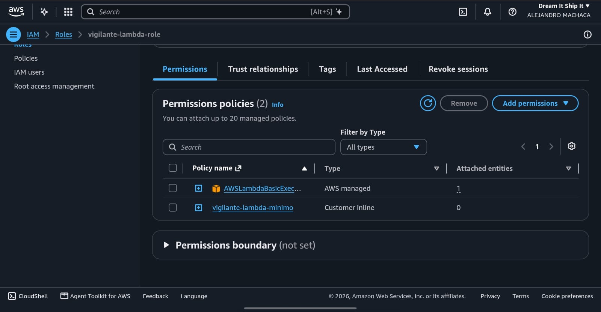 | Rol de `vigilante-skill` con `AWSLambdaBasicExecutionRole` + `vigilante-lambda-minimo` |
| 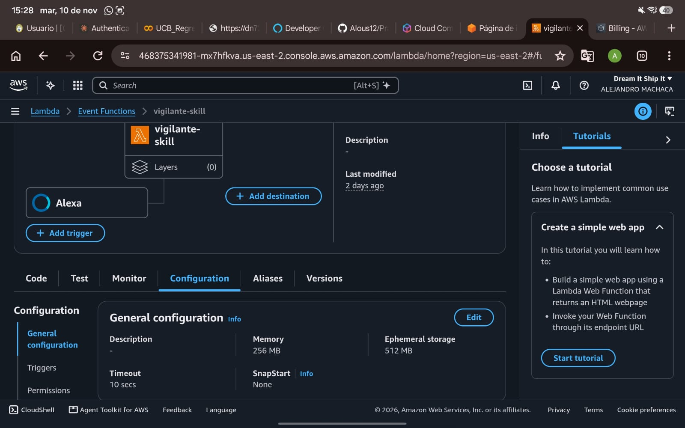 | Configuración general de `vigilante-skill`: Python 3.13, 256 MB, 10 s |
| 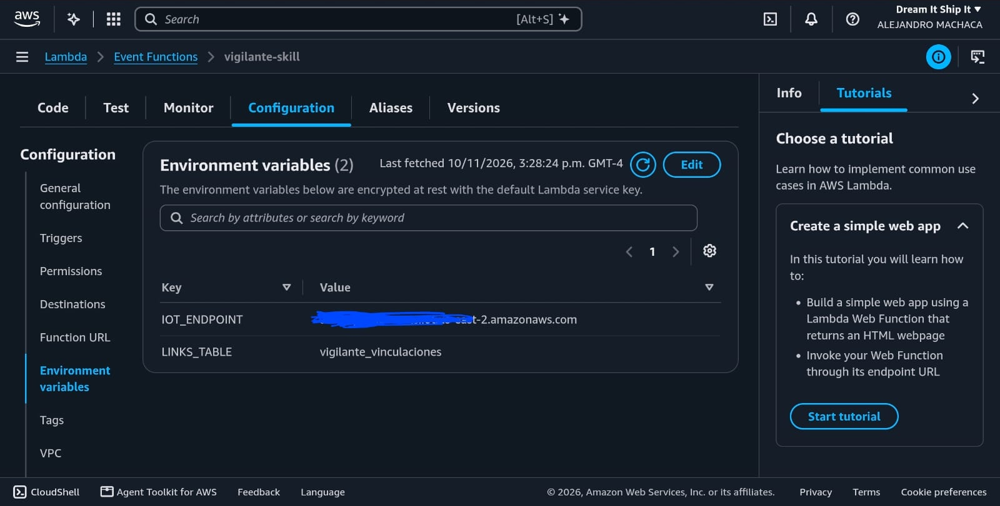 | Variables `IOT_ENDPOINT` (oculto) y `LINKS_TABLE` |
| 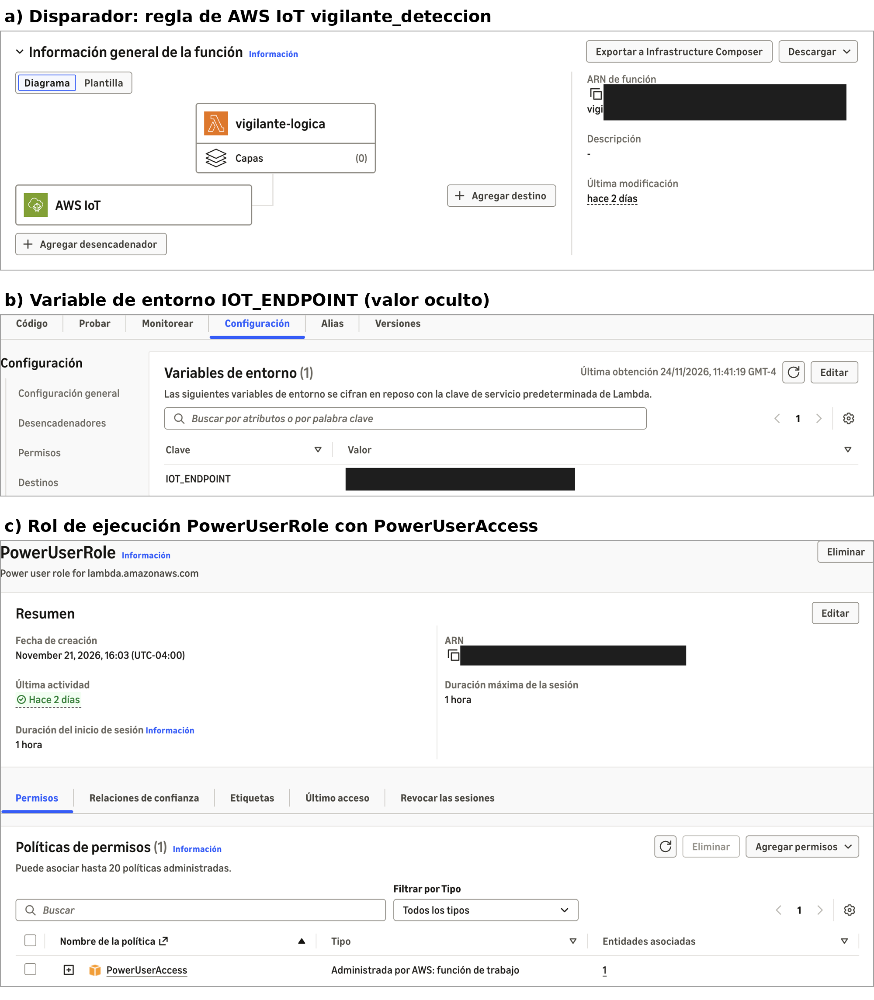 | **(P4)** `vigilante-logica`: a) disparador AWS IoT (regla `vigilante_deteccion`), b) variable `IOT_ENDPOINT` (valor oculto), c) rol `PowerUserRole` con `PowerUserAccess` |

### 3.2.3 Seguridad y permisos asignados

| Medida | Cómo se cumple | Dónde |
|---|---|---|
| Certificados, clave privada y WiFi fuera del repositorio | Solo en `include/secrets.h`, excluido por `.gitignore` junto con `*.pem`, `*.key`, `*.crt` y `*.zip`; plantilla sin valores en `secrets.example.h` | [`.gitignore`](../.gitignore), [`secrets.example.h`](../include/secrets.example.h) |
| Sin *access keys* | El ESP32 se autentica con su certificado X.509 (TLS mutuo); las tres Lambdas usan las credenciales temporales de su rol | Firmware y Lambdas |
| ID de cuenta oculto | Los JSON de `aws/` usan `<ACCOUNT_ID>`; las capturas tapan el ID de cuenta, el endpoint y el Skill ID | [`aws/`](../aws/), `anexos/` |
| Mínimo privilegio del objeto | La política del certificado limita cada dispositivo a su propio Shadow | [`aws/iot-policy.json`](../aws/iot-policy.json) |
| Mínimo privilegio de las Lambdas | Skill: 6 acciones sobre `vigilante-*` y una tabla. Almacenamiento: solo `PutItem` en el histórico. Lógica: `Query` + `UpdateThingShadow` | [`lambda-role-policy.json`](../aws/lambda-role-policy.json), [`almacenamiento-role-policy.json`](../aws/almacenamiento-role-policy.json), [`politica-rol.json`](../lambda-logica/politica-rol.json) |
| Reglas de IoT sin rol propio | Su única acción es invocar una Lambda; la consola agrega `lambda:InvokeFunction` para `iot.amazonaws.com`, limitado al ARN de cada regla | Política basada en recursos de cada Lambda |
| Solo la skill propia invoca `vigilante-skill` | Desencadenador Alexa Skills Kit con verificación de Skill ID | §3.3 |
| Verificación automática | Las pruebas fallan si se versiona un secreto, una access key `AKIA…`, un ID de cuenta real o un permiso de más en el rol de la skill | [`test_contratos.py`](../lambda/tests/test_contratos.py) |

**Permisos más amplios que se aceptaron, y por qué.** La cuenta del curso no permite crear roles IAM, así que `vigilante-logica` usa el rol existente `PowerUserRole` (política administrada `PowerUserAccess`). La práctica acepta permisos amplios siempre que se documenten. En producción ese rol se reemplazaría por uno con solo la política de [`lambda-logica/politica-rol.json`](../lambda-logica/politica-rol.json), y lo mismo aplica a `vigilante-almacenamiento` con [`aws/almacenamiento-role-policy.json`](../aws/almacenamiento-role-policy.json).

## 3.3 Configuración en Alexa

La skill se configuró en la **Alexa Developer Console** (developer.amazon.com) con una cuenta de Amazon de desarrollador, distinta de la cuenta de AWS.

### Pasos realizados

1. **Crear la skill.** *Create Skill* → nombre `Vigilante Inteligente` → idioma principal **Spanish (US)** → tipo de experiencia *Other* → modelo **Custom** → hosting **Provision your own** → plantilla *Start from Scratch*. Se usa hosting propio y no *Alexa-hosted* porque una skill Alexa-hosted corre en una cuenta de Amazon que no tiene acceso al IoT Core ni al DynamoDB del proyecto.
2. **Importar el modelo de interacción.** *Build → Interaction Model → JSON Editor* → se pegó [`alexa/interaction-model.es-US.json`](../alexa/interaction-model.es-US.json) → *Save*. Esto crea de una vez la invocación, los **20 intents** (12 de la Práctica 3 y 8 nuevos), los slots `codigo`, `modo`, `numero` y `minutos`, el tipo `TipoModo`, el modelo de diálogo y los prompts (§2.10). Si la skill tuviera más de un idioma, el mismo JSON debe pegarse en cada uno.
3. **Conectar con la Lambda (en este orden).** La Lambda solo acepta a su skill y la skill solo guarda un endpoint que ya la autoriza:
   1. *Endpoint* → **AWS Lambda ARN** → copiar **Your Skill ID** (`amzn1.ask.skill.…`).
   2. En AWS: `vigilante-skill` → *Agregar desencadenador* → **Alexa Skills Kit** → *Verificación de ID de habilidad: Habilitar* → pegar el Skill ID.
   3. De vuelta en Alexa: *Default Region* = `arn:aws:lambda:us-east-2:<ACCOUNT_ID>:function:vigilante-skill` → *Save Endpoints*.
4. **Compilar.** *Build skill* → esperar a *Last successful build* con la hora actual y *Errors and Warnings* en 0. Hay que recompilar cada vez que cambian intents o frases (no al cambiar el endpoint).
5. **(P4) Subir el código nuevo de la Lambda.** `bash lambda/build.sh` → `vigilante-skill` → *Code* → *Upload from .zip file*. Sin este paso, Alexa reconocería los intents nuevos pero la Lambda vieja no tendría sus manejadores.
6. **Habilitar pruebas.** Pestaña *Test* → *Skill testing is enabled in:* **Development**. Se marca **Skill I/O** para ver el *JSON Input* (lo que Alexa envía, con `context.System.user.userId`) y el *JSON Output* (la respuesta de la Lambda).
7. **Verificar el reconocimiento sin llamar a la Lambda.** *Build → Evaluate Model → Utterance Profiler* muestra qué intent y qué valor de slot resuelve Alexa para una frase. **(P4)** Sirve para comprobar que "modo automático" resuelve `TipoModo` = `automatico`.

### Segundo usuario de Alexa

El `userId` depende de la cuenta de Amazon que usa la skill. Para demostrar que cada usuario controla su propio Thing:

- **Opción A (simulador):** en la consola de Alexa, menú del perfil → *Settings → User Permissions → Invite*. Se invita a un compañero del grupo, que abre la pestaña *Test* con **su** cuenta y vincula `vigilante-654321`. En *JSON Input* aparece un `userId` distinto. La evidencia del segundo usuario es la prueba automática `test_guion_segundo_usuario_controla_solo_su_thing` y el evento [`lambda/events/09_vincular_segundo_usuario.json`](../lambda/events/09_vincular_segundo_usuario.json).
- **Opción B (consola de Lambda):** el evento [`lambda/events/09_vincular_segundo_usuario.json`](../lambda/events/09_vincular_segundo_usuario.json) envía a la Lambda real una vinculación con `userId = amzn1.ask.account.SEGUNDO_USUARIO` y el código 654321.

### Evidencias de la configuración

| Captura | Muestra |
|---|---|
| 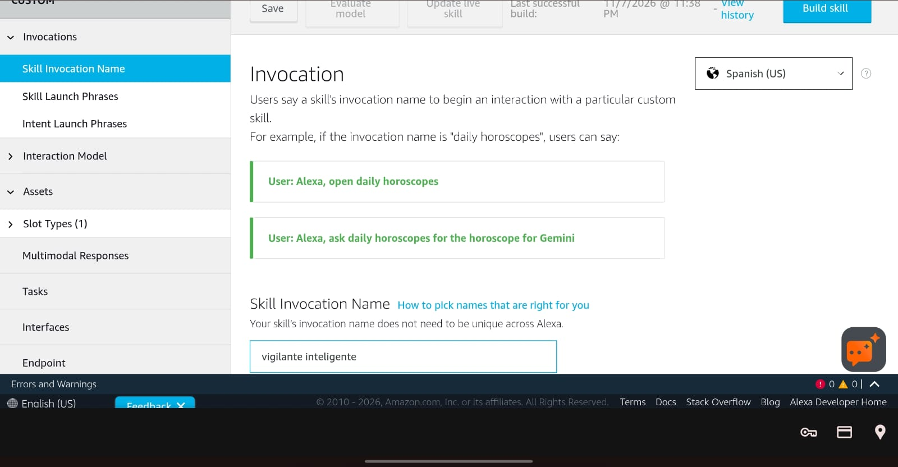 | *Invocations*: `vigilante inteligente` |
| 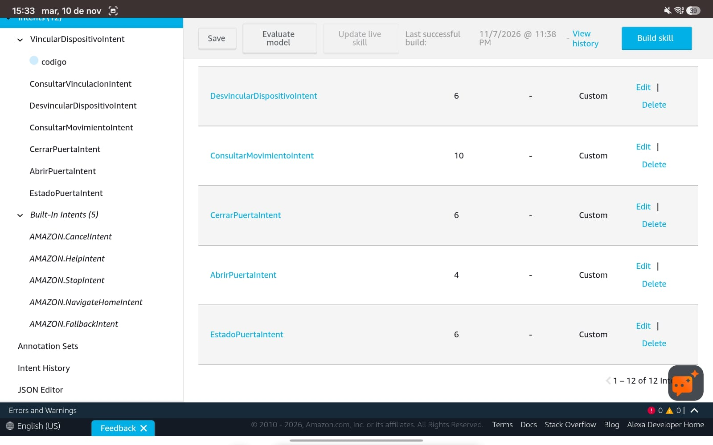 | Lista de intents y el slot `codigo` (Práctica 3) |
| 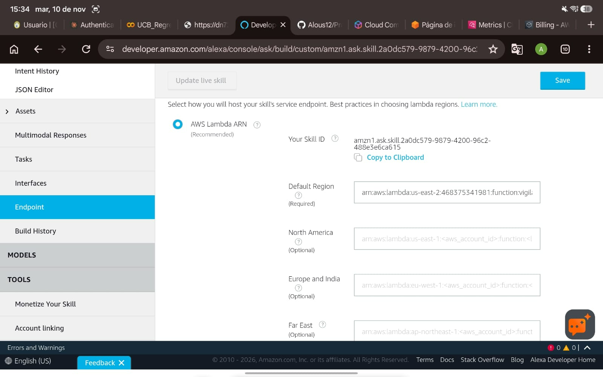 | Endpoint AWS Lambda ARN en *Default Region* (cuenta oculta) |
| 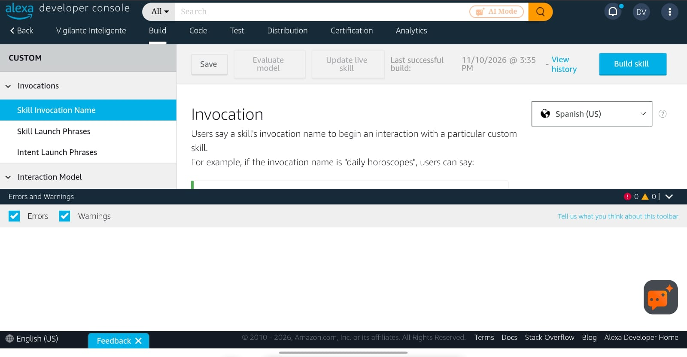 | *Last successful build*, 0 errores y 0 advertencias |
| 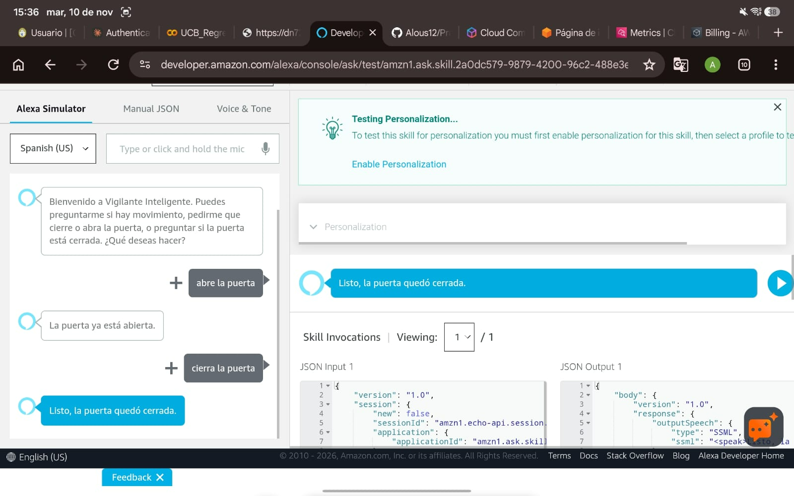 | Pestaña *Test*: simulador en Spanish (US) con *Skill I/O* |
| `ru-alexa-intents-p4.png` — por capturar | Modelo versionado con 20 intents; lista de la consola aún no verificada |
| `ru-alexa-build-p4.png` — por capturar | Compilación vigente sin errores: requiere evidencia real; no se deduce de las pruebas del JSON |

---

# 4. Pruebas y validaciones

## 4.1 Plan de pruebas

Una sola tabla reúne las pruebas de los tres integrantes. Cada fila verifica un requerimiento funcional (RF) o un valor declarado de los no funcionales (RNF, §1.3). **Estado:** ✅ cumple con evidencia · ⏳ pendiente de medir o capturar. Una prueba automática verifica la lógica con dobles de hardware y de AWS; no reemplaza la medición física.

| ID | Requerimiento | Prueba | Resultado esperado | Responsable | Estado |
|---|---|---|---|---|---|
| LU-09 | RF1–RF15 (lógica) | 171 pruebas Python y 4 ejecutables C++ sin AWS ni hardware (§4.2) | Todas pasan | Grupo | ✅ 171/171 y 4/4 |
| P-A2 | RF3, mantenibilidad | Compilación con `BUZZER_ACTIVE 1` y `0` (§4.2) | `SUCCESS` sin advertencias | Alejandro | ✅ |
| P-A1 | RNF1 | 30 min de seguimiento serie con WiFi y cambios de alarma (§4.3) | `uptime_s` creciente; 0 reinicios; apagado 30 ± 1 s | Alejandro; evidencia Lu | **M parcial:** 1800 s, 0 indicios de reinicio; 7 apagados lógicos Edge. Falta completar el guion físico |
| G-03 | RNF2 | 20 pasadas a 1, 2 y 3 m y 10 min con la sala vacía (§4.3) | ≥ 95 % hasta 3 m; 0 falsos positivos | Grupo | ⏳ (P3: 98,3 %) |
| G-01 | RNF4 | Reportes por evento y latidos (§4.3) | Evento ≤ 1 s; latido 60 ± 1 s | Grupo | **M parcial:** 19 intervalos de latido, 59,995–60,001 s; evento → recepción MQTT por medir |
| G-02 | RNF5 | 3 cortes de WiFi de 60 s con una orden dada durante el corte (§4.3) | Reconexión ≤ 30 s y `desired` pendiente aplicado | Grupo | ⏳ |
| LU-06 | RNF8, RF13 | 10 flancos por efecto en automático y bloqueo, video a 60 fps (§4.3) | Cierre y primer pitido ≤ 1 s | Luciana | ⏳ (lógica ✅) |
| LU-07 | RF13 | Alarma por voz, Nube y Edge; apagado a los 30 s (§4.3) | Se apaga sola; otro flanco no renueva el plazo | Luciana | **M parcial:** 7 apagados lógicos Edge, 29,996–29,998 s; orígenes voz/Nube y sonido por medir |
| LU-08 | RNF10, RNF5 | Modo bloqueo, hotspot apagado, flanco, reconexión (§4.3) | Cierre y alarma sin red; estado final con `origen: edge` | Luciana | ⏳ (lógica ✅) |
| LU-01 | RF11 | Lectura válida invocando la Lambda real (§4.4) | `guardados = 1` y fila `lectura#` | Luciana | ✅ |
| LU-02 | RF11 | `puerta = rota` y `alarma = rota` (§4.4) | Descartado, sin escrituras | Luciana | ✅ puerta · ⏳ captura de alarma |
| LU-03 | RF12 | Evento alarma apagada → encendida con detección 4 → 5 (§4.4) | `alarma#` y `deteccion#` con `anterior` y `origen` | Luciana | ✅ automatizada · ⏳ captura |
| LU-04 | RNF6 | 30 min con red: publicaciones frente a lecturas guardadas (§4.4) | ≥ 99 % guardados | Luciana | ✅ **M:** 132/132; 100 % en esta cohorte |
| LU-05 | RNF7, RF10–RF12 | Publicación → log posterior a escritura (§4.4) | Máximo ≤ 5 s | Luciana | **M parcial:** tramo AWS 17 muestras, media 160,824 ms y máximo 378 ms; extremo a extremo **E**, sin validar |
| P-A3 | RF10, RF12, RF13 | Las 3 reglas con el Thing de prueba (§4.5) | `lectura#`, `alarma#`, `deteccion#` y bloqueo en `desired` | Alejandro | ⏳ |
| S3-01 a S3-16 | RF4–RF9 | Guion de la Práctica 3 en el simulador (§4.6) | Las 16 respuestas esperadas | Rubén | ✅ (P3 y automatizado) |
| S-01 a S-07 | RF14 | Modos y parámetros por voz (§4.6) | Respuestas y Shadow correctos; rango validado | Rubén | ⏳ (automatizado ✅) |
| S-08 a S-10 | RF5, RF6 | Encender, consultar y apagar la alarma (§4.6) | Buzzer suena y se apaga | Rubén | ⏳ (automatizado ✅) |
| S-11 a S-13 | RF13, RF14 | Bloqueo por voz, alarma de la Nube y vuelta a manual (§4.6) | Puerta cerrada; origen `nube`; alarma apagada | Rubén | ⏳ (automatizado ✅) |
| V-01 | RNF3 | 10 órdenes de puerta y 10 de alarma (§4.6) | ≤ 3 s por orden | Rubén y grupo | ⏳ |
| N-01 | RNF9, RF13 | 5 bloqueos por la Nube, video a 60 fps (§4.7) | ≤ 5 s de la 3.ª detección al primer pitido | Rubén | ⏳ |
| N-02 | RF13 | 2 detecciones en la ventana (§4.7) | `sin_accion`, sin bloqueo | Rubén | ⏳ |
| P-A4 | RNF11 | Estimación mensual frente a la capa gratuita (§4.8) | < USD 1 al mes por objeto | Alejandro | ✅ ≈ USD 0,19 |

### Cómo se registran las mediciones

1. Anotar Thing, versión de firmware/Lambda, hora UTC de inicio y fin, red y modo. Esperar `sensor_listo=true` antes de medir PIR.
2. Para integridad, registrar cada publicación válida, consultar **DynamoDB → Explorar elementos → Consulta**, usar `thingName` y `tipo_ts BETWEEN lectura#inicio AND lectura#fin`, y exportar resultados. El conteo debe cubrir la misma cohorte; una fila no acredita por sí sola correspondencia uno a uno ante duplicados.
3. Para latencia, registrar un tiempo de emisión con reloj UTC sincronizado y el del log emitido tras `PutItem`. Si el firmware no expone el inicio UTC, instrumentar o documentar un registro externo comparable. No usar solo la fecha que la regla agrega, ni `latencia_ms` de la skill.
4. Para respuesta Edge, grabar a 60 fps y contar cuadros desde la condición observable hasta el inicio del efecto. Duración = cuadros/60. Registrar 10 muestras por efecto, promedio, máximo y fallos; no sustituir el máximo por el promedio.
5. Para offline, grabar el corte de red y los efectos físicos. Al reconectar, capturar Shadow y consultar la ventana del histórico, documentando las lecturas/eventos que nunca se transmitieron.
6. Guardar evidencia con prefijo `lu-`, ocultar ID de cuenta y Skill ID si aparecen, y eliminar únicamente filas identificadas como datos de prueba después de conservar su evidencia.

## 4.2 Pruebas automáticas (LU-09)

Las pruebas no necesitan cuenta de AWS ni hardware, así que se repiten en cada cambio. La integración continua de GitHub ([`.github/workflows/pruebas.yml`](../.github/workflows/pruebas.yml)) ejecuta en cada *push* las pruebas de las tres Lambdas, compila los dos entornos del firmware y el banco de pruebas del hardware, y corre los cuatro programas de prueba C++. El último *push* (`750a375`) terminó en verde.

| Suite | Pruebas | Qué cubre | Resultado (24/11/2026) | Evidencia |
|---|---|---|---|---|
| Skill `lambda/tests/` | 144 | RF4–RF9, modos, parámetros, alarma, guion del simulador y contratos entre capas | ✅ 144/144 | [`lu-regresion-skill.txt`](anexos/p4/lu-regresion-skill.txt) |
| Lógica `lambda-logica/tests/` | 15 | Ventana, borde, paginación, modo manual, mensajes inválidos | ✅ 15/15 | [`lu-regresion-logica.txt`](anexos/p4/lu-regresion-logica.txt) |
| Almacenamiento `lambda-almacenamiento/tests/` | 12 (+ 18 subcasos) | Validación, descarte, TTL, claves, eventos de puerta, modo y alarma | ✅ 12/12 | [`lu-pruebas-almacenamiento.txt`](anexos/p4/lu-pruebas-almacenamiento.txt) |
| Firmware C++ `test/` | 4 ejecutables | PIR, servo y reportes; cierre del Edge; `AlarmRule` con buzzer simulado | ✅ 4/4 | [`lu-pruebas-firmware.txt`](anexos/p4/lu-pruebas-firmware.txt) |
| **Total** | **171 Python + 4 C++** | | ✅ | |

### Skill y lógica de negocio (detalle)

Las pruebas no necesitan cuenta de AWS ni hardware, así que se repiten en cada cambio del código. La skill real (`build_skill`) se arma con dobles en memoria de DynamoDB, del registro de IoT y del Shadow (este último imita al ESP32 aplicando el `desired` y, como AWS, **borra las claves que llegan en `null`**) y con un reloj simulado.

| Archivo | Pruebas | Qué verifica |
|---|---|---|
| [`lambda/tests/test_skill.py`](../lambda/tests/test_skill.py) | 20 | Cada requerimiento de la Práctica 3 por separado: RF4 (movimiento, última detección, calibración, sin reportes, desconexión), RF5/RF6 (cerrar, abrir, ya en ese estado, orden pendiente, estado), RF7–RF9 (vincular, rechazar, cambiar, consultar, desvincular sí/no) y dos usuarios con Things distintos |
| [`lambda/tests/test_guion_alexa.py`](../lambda/tests/test_guion_alexa.py) | 5 | El guion completo del simulador de extremo a extremo; el segundo usuario aislado; la reconexión que aplica la orden pendiente; ayuda y salida; **(P4)** el guion de modos y parámetros |
| [`lambda/tests/test_modos.py`](../lambda/tests/test_modos.py) | 51 | **(P4)** Cambiar y consultar el modo, sinónimos de `TipoModo`, rangos de los parámetros (0, 1, 20, 21, "?"), rechazo de abrir en automático y bloqueo, bloqueo con cierre de puerta, cambios pendientes, origen `edge` / `inicio` |
| [`lambda/tests/test_alarma.py`](../lambda/tests/test_alarma.py) | 19 | **(P4)** Encender, apagar y consultar la alarma; "ya estaba así"; orden pendiente; origen voz / edge / nube; manual apaga la alarma |
| [`lambda/tests/test_contratos.py`](../lambda/tests/test_contratos.py) | 49 | **Integración entre capas**: modelo de Alexa ↔ manejadores en ambos sentidos; slots y diálogo; `TipoModo` ↔ modos; claves, modos, rangos y orígenes entre `config.h` y `config.py`; políticas mínimas; ningún secreto en Git |
| [`lambda-logica/tests/test_logica.py`](../lambda-logica/tests/test_logica.py) | 15 | **(P4)** `vigilante-logica`: ventana, borde de la ventana, detección del mismo segundo, otros Things, paginación, modo manual, mensajes inválidos, sin access keys |
| **Total** | **159** | ✅ 144/144 en `lambda/` y 15/15 en `lambda-logica/` |

**Errores de integración detectados y corregidos en la skill:**

| Hallazgo | Causa | Corrección |
|---|---|---|
| 16 de 20 pruebas de la skill fallaban al copiar el código al repositorio (P3) | Tomaban el código del Thing de `events/02_vincular.json`, que se edita para probar en la consola | El arnés fija siempre su propio código |
| `AMAZON.NavigateHomeIntent` sin manejador (P3) | Intent obligatorio del modelo no registrado | Se agregó a `CancelOrStopIntentHandler` |
| **(P4)** Los manejadores nuevos no pasaban la prueba de contrato | El modelo de Alexa aún no tenía los intents | Se agregaron al modelo con los nombres acordados por el equipo |
| **(P4)** El doble del Shadow copiaba a `reported` las claves que el Edge borra con `null` | El doble guardaba `null` en lugar de borrar, a diferencia de AWS | El doble borra la clave, como AWS IoT |
| **(P4)** El `.zip` incluía `python-dateutil 4.0` | `ask-sdk-core` arrastra la última versión; `botocore` exige < 3 | Versión fijada en `requirements.txt` |

### Compilación del firmware (P-A2)

Ejecutada el 23 y el 24 de noviembre de 2026 sobre el commit `1dfe514`.

| Verificación | Comando | Resultado |
|---|---|---|
| Firmware de la demo, buzzer activo | `pio run -e esp32dev-aws` con `BUZZER_ACTIVE 1` | ✅ SUCCESS, sin advertencias. RAM 14,3 % (46 900 B de 327 680 B), flash 72,0 % (943 869 B de 1 310 720 B) |
| Firmware local, buzzer activo | `pio run -e esp32dev` | ✅ SUCCESS |
| Firmware de la demo, buzzer pasivo | `pio run -e esp32dev-aws` con `BUZZER_ACTIVE 0` | ✅ SUCCESS (se volvió a dejar en 1) |
| Pruebas C++ del Edge con buzzer simulado | `test/luciana/run.ps1` | ✅ 4 grupos OK, incluido `AlarmRule`: bloqueo, flancos, 30 s, voz/nube, desborde de `millis()`, sin red y delta antiguo |
| Pruebas de la skill | `cd lambda && python -m pytest -q` | ✅ 144 pruebas pasan, incluidas las de alarma y las de contratos entre `config.h` y `config.py` |
| Modelo de Alexa | Validación del JSON | ✅ 20 intents, sin intents ni frases repetidas |

## 4.3 Objeto inteligente y lógica del Edge

Estas pruebas usan el firmware de la demo (`esp32dev-aws`) con el circuito de la Figura 2.3.2 y el Thing `vigilante-123456`. Antes de medir se esperan los 60 s de calentamiento del PIR (`sensor_listo: true`). El monitor serie se usa con marca de tiempo (`monitor_filters = time`) y los videos se graban a 60 fps; la latencia se calcula como cuadros / 60.

### P-A1 — Estabilidad con el buzzer (RNF1)

**Objetivo.** Verificar que agregar el buzzer, alimentado directo desde el GPIO 26, no provoque reinicios (*brownout*), bloqueos ni falsas detecciones del PIR, y que la alarma se apague sola a los 30 s.

**Montaje y condiciones.** Firmware `esp32dev-aws`, circuito completo de la Figura 2.3.2, pilas medidas antes de empezar, la misma red WiFi de la P3 y monitor serie con marca de tiempo (`monitor_filters = time` en `platformio.ini`).

**Procedimiento (30 min).**

| Minuto | Acción | Qué se registra |
|---|---|---|
| 0 | Encender el ESP32 y esperar los 60 s del PIR | `uptime_s`, `rssi` y la causa del reinicio (`rst:`) en el monitor serie |
| 2 | "Alexa, enciende la alarma" | Hora de `[Alarma] Encendida` y de `[Alarma] Apagada` (debe apagarse sola) |
| 5 | "Enciende la alarma" y, a los ~10 s, "apaga la alarma" | Que se apague por voz antes de los 30 s, con `origen: voz` |
| 10 | "Activa el modo bloqueo" y pasar frente al PIR | Alarma con `origen: edge`, puerta cerrada, apagado a los 30 s |
| 15, 20, 25 | Pasar frente al PIR (sigue en bloqueo) | Igual que en el minuto 10 |
| 28 | "Activa el modo manual" | Modo manual; si la alarma sonaba, se apaga |
| 30 | Fin | `uptime_s` final |

**Criterios de aceptación:** `uptime_s` creciente sin volver a 0; ninguna línea `rst:` ni `Brownout` después del arranque; cada alarma no apagada por voz dura entre 29 y 31 s; el servo responde en todas las órdenes; `detecciones` sube solo con las pasadas reales (el buzzer no induce disparos en el PIR).

**Resultados medidos de la sesión conservada (24/11/2026).** Se inició la captura con el ESP32 ya encendido y `sensor_listo: true`; no se registró el arranque. El objeto permaneció en modo `bloqueo`, con `max_detecciones: 2`, `ventana_min: 10` y `puerta: cerrada`. No se afirma que se haya ejecutado el guion propuesto minuto por minuto, medido las pilas o verificado visualmente el servo.

| Medida | Resultado M | Evidencia |
|---|---|---|
| Ventana completa | 18:20:41.968–18:50:41.968 UTC; 14:20:41.968–14:50:41.968 Bolivia | [Resumen de captura](anexos/p4/lu-sesion-20261124/lu-resumen-serial.json) |
| Tiempo observado | **1800 s (30 min)** | Registro continuo del puerto COM4 a 115200 |
| Reinicios / retrocesos de `uptime_s` | **0 indicios / 0 retrocesos** | [Monitor serie](anexos/p4/lu-sesion-20261124/lu-monitor-serie.txt) |
| Publicaciones con retorno exitoso de `publish()` | **132**, sin fallo de publicación registrado | [Publicaciones](anexos/p4/lu-sesion-20261124/lu-publicaciones.csv) |
| `uptime_s` del primer / último reporte | **386 / 2180 s** | [Cruce con DynamoDB](anexos/p4/lu-sesion-20261124/lu-cruce-publicaciones-historico.csv) |
| Detecciones acumuladas, inicio / final | **15 / 60**, incremento de 45 | Reportes del estado, sin pasadas controladas |
| Ciclos completos de alarma en el log | **19**: 7 con apagado Edge y 12 con origen de apagado `voz` | [Ciclos de alarma](anexos/p4/lu-sesion-20261124/lu-alarmas-serie.csv) |
| Apagados lógicos Edge | **7**, entre **29,996 y 29,998 s** | LU-07 |

La diferencia de los `uptime_s` extremos es 1794 s porque el último reporte llega unos 6 s antes del cierre de la ventana. No reduce la captura de 1800 s. Este registro apoya estabilidad durante la sesión; no verifica ausencia de bloqueos breves, falsos positivos, intensidad del sonido ni respuesta mecánica. Los orígenes `voz` de los reportes no sustituyen capturas del simulador.

### LU-06 — Respuesta de las reglas del Edge (RNF8)

**Procedimiento.** Con la puerta abierta y el modo `automatico` (cierre) o `bloqueo` (cierre + alarma), se pasa la mano frente al PIR 10 veces por efecto, esperando al menos 7 s entre pasadas. En el video se cuentan los cuadros desde que la mano entra al campo del PIR hasta que el brazo del servo empieza a moverse o suena el primer pitido. Plantilla de registro: [`lu-mediciones-edge.csv`](anexos/p4/lu-mediciones-edge.csv).

| Efecto | Muestras | Promedio (s) | Máximo (s) | Meta | ¿Cumple? |
|---|---|---|---|---|---|
| Cierre de la puerta (`AutoLockRule`) | 0 físicas; 10 previstas | **E:** respuesta lógica 0,05–0,5 s en operación sin bloqueo de red | **E:** sin máximo físico acreditado | ≤ 1 s | Por validar con video |
| Primer pitido en bloqueo (`AlarmRule`) | 0 físicas; 10 previstas | **E:** respuesta lógica 0,05–0,5 s en operación sin bloqueo de red | **E:** sin máximo acústico acreditado | ≤ 1 s | Por validar con video |

Los intervalos E son un escenario de funcionamiento normal, no mediciones de sensor a efecto. Las llamadas TLS/MQTT pueden bloquear el ciclo; no se usa esa estimación como cota máxima.

La lógica está verificada en [`test_edge.cpp`](../test/luciana/test_edge.cpp) y [`test_alarm.cpp`](../test/luciana/test_alarm.cpp): en `manual` el PIR no cierra ni enciende la alarma, en `automatico` cierra sin alarma, y en `bloqueo` cierra y enciende la alarma.

### LU-07 — Apagado de la alarma a los 30 s

**Procedimiento.** Se enciende la alarma por voz, por la Nube (N-01) y por el Edge (bloqueo + pasada). Se mantiene el PIR activo y se mide con el monitor serie el tiempo entre `[Alarma] Encendida` y `[Alarma] Apagada`.

| Origen del encendido | Duración medida (s) | Meta | ¿Un flanco nuevo renovó el plazo? |
|---|---|---|---|
| Voz | **E:** aproximadamente 30 s si no se apaga por orden | 30 ± 1 s | La lógica no renueva el plazo; sin ensayo de encendido por voz conservado |
| Nube | **E:** aproximadamente 30 s si no se apaga por orden | 30 ± 1 s | La lógica no renueva el plazo; sin ensayo de encendido por Nube conservado |
| Edge | **M:** 7 ciclos; media 29,997 s; mínimo 29,996 s; máximo 29,998 s | 30 ± 1 s | El log aporta duración lógica; renovación y sonido requieren ensayo controlado |

Se emparejaron todos los `[Alarma] Encendida`/`Apagada` de la sesión. Los 12 apagados con origen `voz` ocurrieron antes de 30 s y se informan aparte: no son fallos del temporizador. Para identificar apagado Edge se exige `reported.origen: edge`, alarma apagada y limpieza `desired.alarma: null`. No se incluyeron encendidos incompletos. [CSV completo](anexos/p4/lu-sesion-20261124/lu-alarmas-serie.csv).

### LU-08 — Operación sin conexión (RNF10, RNF5)

**Procedimiento.** En modo `bloqueo`, con la puerta abierta, se apaga el hotspot. Se pasa frente al PIR, se espera el apagado de la alarma y se vuelve a encender el hotspot. Se graba el video y se captura el monitor serie y la Sombra después de reconectar. Plantilla: [`lu-mediciones-offline.csv`](anexos/p4/lu-mediciones-offline.csv).

| Paso | Comportamiento esperado | Resultado |
|---|---|---|
| Sin red, pasada frente al PIR | La puerta se cierra y la alarma suena | **E, según código y pruebas con dobles:** cierre y alarma locales; ensayo físico sin red por realizar |
| Sin red, 30 s después | La alarma se apaga sola | **E:** alrededor de 30 s; el dato M de LU-07 corresponde a red disponible |
| Al volver la red | Reconexión ≤ 30 s; la Sombra muestra `puerta: cerrada`, `alarma: apagada`, `origen: edge` y ninguna orden vieja reactiva la alarma | **E:** escenario 5–30 s con hotspot disponible y señal estable; no hay corte real capturado ni máximo garantizado |

**Comportamiento declarado sin conexión.** Las dos reglas del Edge siguen funcionando, porque `SmartObject` las evalúa antes de comprobar la red. Las lecturas intermedias no se guardan en una cola: al reconectar se publica el estado actual completo, y el histórico registra ese estado final, no cada lectura que no llegó a enviarse (§2.9.3).

### G-01, G-02 y G-03 — Reporte, reconexión y detección

| ID | Procedimiento | Meta | Resultado |
|---|---|---|---|
| G-01 (RNF4) | Evento frente a recepción MQTT y latidos | Evento ≤ 1 s; latido 60 ± 1 s | **M:** 19 intervalos de latido sin eventos serie intermedios: 59,995–60,001 s. **E:** reporte de evento 0,05–1 s en red estable; falta recepción MQTT sincronizada |
| G-02 (RNF5) | 3 cortes de WiFi de 60 s; durante el corte, "cierra la puerta" por voz | Reconexión ≤ 30 s y la orden pendiente aplicada | **E:** 5–30 s tras restaurar red estable, según escenario del anexo; 0 cortes físicos medidos |
| G-03 (RNF2) | 20 pasadas a 1, 2 y 3 m con cinta métrica y 10 min con la sala vacía | ≥ 95 % y 0 falsos positivos | **E de referencia:** 98,3 % y 0 falsos positivos si se reproduce P3. Es antecedente, no resultado P4. El incremento real de 45 detecciones no permite calcular precisión sin pasadas controladas |

Los latidos se seleccionaron por estado sin cambios, `uptime_s` creciente y ausencia de eventos serie intermedios, sin filtrar por el tiempo obtenido. [19 intervalos completos](anexos/p4/lu-sesion-20261124/lu-latidos-serie.csv). No se usa el valor configurado en `config.h` como si fuera una medición.

## 4.4 Almacenamiento en DynamoDB (LU-01 a LU-05)

### LU-01 y LU-02 — Guardado y descarte con la Lambda real

Se invocó `vigilante-almacenamiento` desde la pestaña *Probar* de la consola con una lectura válida y con una lectura con `puerta: "rota"`.

| Prueba | Resultado obtenido | Evidencia |
|---|---|---|
| LU-01: lectura válida | `guardados: 1`, `descartado: false` y una fila `lectura#…` en `vigilante_historico` | Figuras 4.4.1 y 4.4.2 |
| LU-02: `puerta = "rota"` | `descartado: true`, motivo `puerta inválido`, sin escrituras | Figura 4.4.3 |
| LU-02: `alarma = "rota"` | Verificado en [`test_storage.py`](../lambda-almacenamiento/tests/test_storage.py) | Captura en consola _pendiente_ |

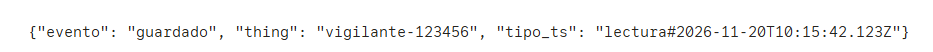

*Figura 4.4.1 — Log `guardado` de una lectura de prueba.*

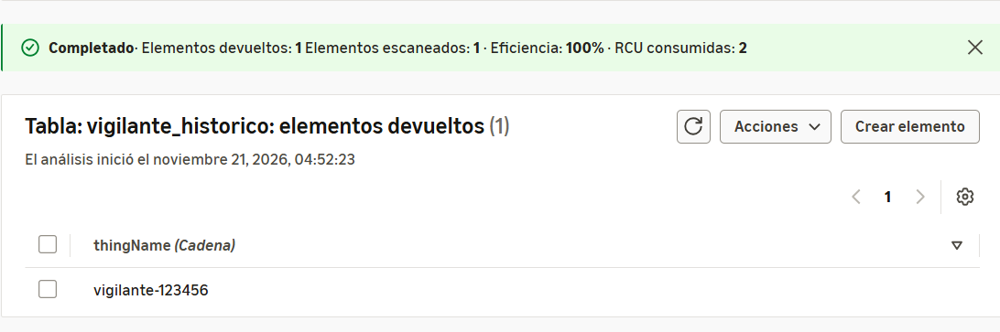

*Figura 4.4.2 — La fila `lectura#…` del Thing en la tabla. Es un dato de prueba, no una lectura del PIR.*

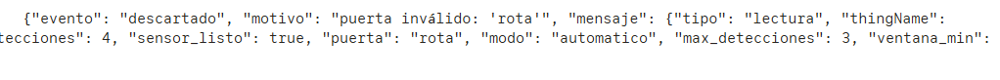

*Figura 4.4.3 — Lectura con `puerta: "rota"` descartada sin escribir en la tabla.*

### LU-03 — Evento de la alarma con su origen (RF12)

El evento de la guía (alarma `apagada → encendida` y detecciones `4 → 5`, `origen: edge`) produce dos registros, `alarma#2026-11-20T10:15:42Z` y `deteccion#2026-11-20T10:15:42Z`, con `anterior` y `origen` correctos. Está verificado en la prueba automática y se ensayó en la consola; falta adjuntar la captura del resultado.

### LU-04 — Integridad del almacenamiento (RNF6)

**M, sesión real con red.** Se conservaron el monitor serie completo y la exportación de `vigilante_historico`. La cohorte se define por las publicaciones recibidas por el PC durante 1800 s, después del calentamiento del sensor. Se cruzan las filas del mismo Thing por **12 atributos**: movimiento, detecciones, última detección, sensor listo, puerta, alarma, modo, máximo de detecciones, ventana, origen, uptime y RSSI. Se respeta la multiplicidad y no se reutilizan claves de DynamoDB.

| Ventana UTC de recepción serie en PC | Reportes con `publish()` exitoso | Lecturas emparejadas | Faltantes | Integridad | Meta |
|---|---:|---:|---:|---:|---|
| 24/11/2026, 18:20:41.968–18:50:41.968 | **132** | **132** | **0** | **100 %** | ≥ 99 %: cumple en esta cohorte |

El CSV exportado tiene **186 lecturas únicas**, de las cuales **54** quedan fuera de la cohorte. La primera página de 50 ítems ya está contenida en esa exportación y no se suma de nuevo. Dos publicaciones consecutivas tienen el mismo estado y se corresponden con dos claves diferentes: ambas se cuentan una vez. El retorno de `publish()` por sí solo no acredita entrega; la correspondencia posterior con DynamoDB aporta esa evidencia en esta sesión.

Evidencia: [exportación original, 186 filas](anexos/p4/lu-sesion-20261124/lu-historico-lecturas-exportado.csv), [132 lecturas de la sesión](anexos/p4/lu-sesion-20261124/lu-historico-lecturas-sesion.csv), [cruce uno a uno](anexos/p4/lu-sesion-20261124/lu-cruce-publicaciones-historico.csv), [resultado calculado](anexos/p4/lu-sesion-20261124/lu-resultado-integridad.json).

### LU-05 — Latencia de almacenamiento (RNF7)

**M, tramo disponible dentro de AWS.** Se cruzaron todas las lecturas únicas del texto de CloudWatch con las claves de la cohorte. El inicio es `timestamp()` de la regla IoT, incluido en `tipo_ts`, y el final es el log `guardado` posterior a `PutItem`. Se eliminaron 17 repeticiones de copia. Se excluyen los registros `alarma#` y `deteccion#`, cuya clave tiene resolución de segundos; no se seleccionaron únicamente los tiempos más rápidos.

| Alcance | Muestras | Promedio | Mediana | Mínimo | Máximo | Interpretación |
|---|---:|---:|---:|---:|---:|---|
| Regla IoT → log posterior a escritura | **17** | **160,824 ms** | **144 ms** | **111 ms** | **378 ms** | Tramo AWS medido |
| ESP32 → almacenamiento completo | **0** con inicio acreditado | **E:** escenario 0,2–1,9 s | No calculada | No medido | No medido | RNF7 aún sin validar |

Ejemplo real: `lectura#2026-11-24T18:32:39.295Z` → log `2026-11-24T18:32:39.439Z`: **144 ms**. El tramo incluye la espera y procesamiento entre los dos puntos; no equivale a la duración aislada de DynamoDB. [17 muestras con Request ID](anexos/p4/lu-sesion-20261124/lu-cloudwatch-tramo-almacenamiento.csv), [texto original](anexos/p4/lu-sesion-20261124/lu-cloudwatch-texto-original.txt), [resumen](anexos/p4/lu-sesion-20261124/lu-cloudwatch-resultado.json).

El firmware imprime `reported ->` después de intentar la publicación, y el registro añade la hora de recepción del PC, no un sello UTC de emisión del MCU. Los tiempos de la regla AWS resultan anteriores a varias recepciones serie del PC. Por ello **no se restan esos dos relojes como latencia** ni se sustituyen diferencias negativas por cero. Para cerrar RNF7 hay que registrar 10 emisiones UTC con sincronización comprobada y su log posterior a escritura. La estimación E añade al tramo medido un presupuesto supuesto de red de 0,1–1,5 s; no es una cota ni un resultado del prototipo.

## 4.5 Reglas de AWS IoT con el Thing de prueba (P-A3)

**Procedimiento.** IoT Core → Thing `vigilante-654321` → **Sombra clásica → Editar** → se pega cada documento → **Actualizar**. Después se revisa la tabla `vigilante_historico` y los logs de las Lambdas.

| Paso | Documento (`state.reported`) | Resultado esperado | Resultado obtenido |
|---|---|---|---|
| 1 | `{"movimiento":false,"detecciones":10,"puerta":"cerrada","modo":"bloqueo","alarma":"apagada","origen":"voz"}` | Un registro `lectura#…` | **Código:** resultado esperado, ensayo P-A3 sin captura |
| 2 | `{"movimiento":true,"detecciones":11,"alarma":"encendida","origen":"edge"}` | `lectura#…`, `alarma#…` (encendida, anterior apagada, origen edge) y `deteccion#…` | **Código:** resultado esperado, ensayo P-A3 sin captura |
| 3 | `{"movimiento":false,"alarma":"apagada","origen":"voz"}` | `lectura#…` y `alarma#…` (apagada, origen voz) | **Código:** resultado esperado, ensayo P-A3 sin captura |
| 4 | `{"modo":"automatico","alarma":"apagada","detecciones":12}`, luego `{"detecciones":13}` y `{"detecciones":14}` dentro de 10 min | Al llegar a 3 detecciones, la Sombra muestra `desired` con `modo: bloqueo`, `puerta: cerrada`, `alarma: encendida`, `origen: nube` | **Código:** resultado esperado, ensayo P-A3 sin captura |
| 5 | `{"alarma":"rota"}` | `descartado` en los logs de `vigilante-almacenamiento`; ninguna fila nueva | **Código:** resultado esperado, ensayo P-A3 sin captura |

Al final: **Editar** → `{"state":{"desired":null}}` → **Actualizar**, y se borran de la tabla las filas de prueba.

## 4.6 Skill de Alexa en el simulador

### Guion de la Práctica 3 (regresión de RF4–RF9)

Condiciones: ESP32 encendido y conectado (`vigilante-123456`), sesión de prueba en *Development* y *Skill I/O* marcado. Las mismas frases están automatizadas en `test_guion_alexa.py`.

| # | Se escribe en el simulador | Respuesta obtenida | RF | ✔ |
|---|---|---|---|---|
| 1 | `abre vigilante inteligente` | "…Aún no tienes un dispositivo vinculado. Di: vincula mi dispositivo con el código…" | RF8 | ✔ |
| 2 | `cierra la puerta` | "Aún no tienes un dispositivo vinculado…" (no se toca ningún Shadow) | RF8 | ✔ |
| 3 | `vincula mi dispositivo con el código 111111` → `sí` | "No encontré ningún dispositivo con el código 1 1 1 1 1 1…" | RF9 | ✔ |
| 4 | `vincula mi dispositivo con el código 654321` → `sí` | "Listo, vinculé tu dispositivo 6 5 4 3 2 1…" | RF7 | ✔ |
| 5 | `cierra la puerta` | "Envié la orden de cerrar la puerta, pero el dispositivo aún no la confirmó…" (Thing sin hardware) | RF5 | ✔ |
| 6 | `cambia mi dispositivo al código 123456` → `sí` | "Listo, cambié tu vinculación del dispositivo 6 5 4 3 2 1 al dispositivo 1 2 3 4 5 6." | RF9 | ✔ |
| 7 | `qué dispositivo tengo vinculado` | "Tienes vinculado el dispositivo 1 2 3 4 5 6." | RF8 | ✔ |
| 8 | `hay movimiento` (nadie frente al PIR) | "No se detecta movimiento en este momento… Detecciones desde que se encendió: N." | RF4 | ✔ |
| 9 | (pasar la mano frente al PIR) `hay movimiento` | "¡Atención! Se está detectando movimiento en este momento…" | RF4 | ✔ |
| 10 | `cierra la puerta` | "Listo, la puerta quedó cerrada." y el servo se mueve | RF5 | ✔ |
| 11 | `la puerta está cerrada` | "La puerta está cerrada." | RF6 | ✔ |
| 12 | `abre la puerta` | "Listo, la puerta quedó abierta." | RF5 | ✔ |
| 13 | **Segundo usuario** vincula `654321` | "Listo, vinculé tu dispositivo 6 5 4 3 2 1…" con otro `userId` | RF7, RF8 | ✔ |
| 14 | `desvincula mi dispositivo` → `no` | "De acuerdo, tu dispositivo sigue vinculado." | RF9 | ✔ |
| 15 | `desvincula mi dispositivo` → `sí` | "Listo, desvinculé tu dispositivo…" y la fila desaparece de DynamoDB | RF9 | ✔ |
| 16 | `salir` | "Hasta luego." | — | ✔ |

### Guion de la Práctica 4: modos, parámetros y alarma (S-01 a S-13)

Mismas condiciones, con el Thing vinculado y en modo `manual`. Cada paso se captura con *JSON Input* y *JSON Output* (tapando el Skill ID). Las mismas frases están automatizadas en `test_guion_modos_y_parametros`.

**Condiciones de cada paso:** los pasos se dicen en orden y en la misma sesión del simulador. S-01 parte en modo `manual`; de S-02 a S-10 el dispositivo queda en `automatico`. S-09 se dice dentro de los 30 s siguientes a S-08, porque el ESP32 apaga la alarma a los 30 s. Antes de S-11 se hace un paso previo (vuelve a `manual` y abre la puerta, sin pasar frente al PIR) para que S-11 parta con la puerta abierta. S-11 es un bloqueo **por voz** (`origen: voz`), así que S-12 no se dice a continuación: se dice dentro de los 30 s posteriores a un ensayo de bloqueo de la Nube (§4.7, `origen: nube`), y S-13 justo después, con la alarma aún sonando.

| # | Frase | Respuesta esperada | RF | Resultado | Captura |
|---|---|---|---|---|---|
| S-01 | `en qué modo está` | "El dispositivo está en modo manual: la puerta solo se abre o se cierra cuando tú lo pides." | RF14 | **E:** 0,3–2 s | `ru-sim-01-modo.png` — por capturar |
| S-02 | `cambia el modo a automático` | "Listo, cambié al modo automático: la puerta se cierra sola cuando el sensor detecta movimiento." | RF14 | **E:** 0,8–4 s | `ru-sim-02-automatico.png` — por capturar |
| S-03 | `abre la puerta` (en automático) | "No puedo abrir la puerta porque el dispositivo está en modo automático: … Si quieres abrirla, primero di: cambia el modo a manual." | RF14, §3.1 | **E:** 0,8–4 s | `ru-sim-03-rechazo.png` — por capturar |
| S-04 | `cambia el máximo de detecciones a 3` | "Listo, el máximo de detecciones ahora es 3." | RF14 | **E:** 0,8–4 s | `ru-sim-04-max.png` — por capturar |
| S-05 | `cambia el máximo de detecciones a 25` | "El máximo de detecciones debe ser un número entre 1 y 20." (sin escribir el Shadow) | RF14 | **E:** 0,3–2 s | `ru-sim-05-rango.png` — por capturar |
| S-06 | `cambia la ventana a 10 minutos` | "Listo, la ventana de detecciones ahora es de 10 minutos." | RF14 | **E:** 0,8–4 s | `ru-sim-06-ventana.png` — por capturar |
| S-07 | `cuáles son los parámetros` | "Modo automático. Máximo de detecciones: 3. Ventana: 10 minutos." | RF14 | **E:** 0,3–2 s | `ru-sim-07-parametros.png` — por capturar |
| S-08 | `enciende la alarma` | "Listo, la alarma quedó encendida." y el buzzer suena | RF5 | **E:** 0,8–4 s | `ru-sim-08-alarma-on.png` — por capturar |
| S-09 | `está sonando la alarma` (dentro de los 30 s siguientes a S-08: el ESP32 apaga la alarma a los 30 s) | "La alarma está sonando." | RF6 | **E:** 0,3–2 s | `ru-sim-09-alarma-estado.png` — por capturar |
| S-10 | `apaga la alarma` | "Listo, la alarma quedó apagada." | RF5 | **E:** 0,8–4 s | `ru-sim-10-alarma-off.png` — por capturar |
| Previo a S-11 | `cambia el modo a manual` → `abre la puerta` (sin pasar frente al PIR) | "Listo, cambié al modo manual: …" → "Listo, la puerta quedó abierta." | RF14, RF5 | — | — |
| S-11 | `cambia el modo a bloqueo` (puerta abierta) | "Listo, cambié al modo bloqueo: … También envié la orden de cerrar la puerta." y el servo cierra | RF14 | **E:** 0,8–4 s | `ru-sim-11-bloqueo.png` — por capturar |
| S-12 | `está sonando la alarma` (dentro de los 30 s posteriores a un ensayo de bloqueo de la Nube (§4.7); S-11 fue un bloqueo por voz con `origen: voz`) | "La alarma está sonando. La activó la nube al superar el máximo de detecciones dentro de la ventana configurada." | RF13 | **E:** 0,3–2 s | `ru-sim-12-alarma-nube.png` — por capturar |
| S-13 | `cambia el modo a manual` (alarma sonando) | "Listo, cambié al modo manual: … También envié la orden de apagar la alarma." | RF14 | **E:** 0,8–4 s | `ru-sim-13-manual.png` — por capturar |

Los tiempos E de S-01 a S-13 son escenarios de consulta/validación (0,3–2 s) o modificación/confirmación (0,8–4 s); **no se ejecutaron 13 mediciones nuevas**. Las respuestas de la tabla son las esperadas según código y pruebas automáticas. Las capturas listadas siguen por adjuntar.

### V-01 — Tiempo de respuesta a la voz (RNF3)

**Procedimiento.** Con el ESP32 conectado, se dan 10 órdenes de puerta ("cierra/abre la puerta", en modo manual) y 10 de alarma ("enciende/apaga la alarma"). Se graba a 60 fps la pantalla del simulador y el actuador, y se mide desde el envío de la frase en el simulador (o desde el final de la orden hablada, registrando cuál referencia se usó) hasta que el servo se mueve o el buzzer suena. Empezar a contar después de que aparezca la respuesta omitiría el procesamiento previo. Aparte se anota `latencia_ms` de los logs `comando_puerta` y `comando_alarma` de CloudWatch, que mide el bucle de espera de confirmación iniciado después de solicitar `desired`; no incluye todo el procesamiento de voz ni la llamada previa de escritura.

| Actuador | Órdenes | Promedio (s) | Máximo (s) | `latencia_ms` máx. (CloudWatch) | Meta | ¿Cumple? |
|---|---|---|---|---|---|---|
| Puerta | 0 medidas; 10 previstas | **E:** escenario 0,8–4 s, no media medida | No medido | Por obtener del log real | ≤ 3 s | Sin validar; el escenario puede superar la meta |
| Alarma | 0 medidas; 10 previstas | **E:** escenario 0,8–4 s, no media medida | No medido | Por obtener del log real | ≤ 3 s | Sin validar; el escenario puede superar la meta |

## 4.7 Tiempo de respuesta de la regla de la Nube (N-01, N-02)

**Valor declarado:** ≤ 5 s desde la detección que completa `max_detecciones` hasta que suena el buzzer (el Shadow pasa a `modo: bloqueo`, `alarma: encendida`, `origen: nube`).

**Por qué el buzzer y no el servo:** en modo `automatico` la regla del Edge (`AutoLockRule`) ya cierra la puerta en la misma detección, sin esperar a la Nube. El buzzer, en cambio, solo lo enciende la Nube en este escenario (en `automatico` el Edge nunca activa la alarma), así que su inicio marca la respuesta de `vigilante-logica`.

**Procedimiento:**

1. Por voz: `max_detecciones = 3` y `ventana_min = 1` (ventana corta para que cada ensayo no arrastre las detecciones del anterior).
2. Por voz: modo `manual` (apaga la alarma) y luego `automatico`. Esperar 70 s para que las detecciones previas salgan de la ventana.
3. Grabar a 60 fps el ESP32 con el buzzer y la pantalla del monitor serie en el mismo cuadro.
4. Provocar 3 detecciones, esperando ≥ 7 s entre pasadas (jumper del PIR en L).
5. Δt = cuadros desde que el monitor serie muestra la 3.ª detección hasta el primer cuadro con pitido, dividido entre 60.
6. En CloudWatch de `vigilante-logica`: la línea `bloqueo_activado` con `detecciones_en_ventana = 3`.
7. Repetir 5 veces. Al terminar, volver a `ventana_min = 10` y modo `manual`.

| Ensayo | Δt detección → buzzer (s) | `detecciones_en_ventana` | `accion` | ¿≤ 5 s? |
| --- | --- | --- | --- | --- |
| 1 | **E:** escenario 0,4–5,5 s, sin ensayo | **Código:** 3 esperadas; sin log real | **Código:** bloqueo esperado; sin ensayo | Sin validar |
| 2 | **E:** escenario 0,4–5,5 s, sin ensayo | **Código:** 3 esperadas; sin log real | **Código:** bloqueo esperado; sin ensayo | Sin validar |
| 3 | **E:** escenario 0,4–5,5 s, sin ensayo | **Código:** 3 esperadas; sin log real | **Código:** bloqueo esperado; sin ensayo | Sin validar |
| 4 | **E:** escenario 0,4–5,5 s, sin ensayo | **Código:** 3 esperadas; sin log real | **Código:** bloqueo esperado; sin ensayo | Sin validar |
| 5 | **E:** escenario 0,4–5,5 s, sin ensayo | **Código:** 3 esperadas; sin log real | **Código:** bloqueo esperado; sin ensayo | Sin validar |
| **Promedio / máximo** | **0 ensayos reales** | No calculados | No calculados; E no sustituye promedio/máximo | RNF9 sin validar |

**Prueba negativa:** en modo `automatico`, con solo 2 detecciones en la ventana, no hay bloqueo: CloudWatch registra `sin_accion` con `detecciones_en_ventana = 2` y el buzzer no suena. Resultado **esperado por código y prueba automatizada:** `sin_accion`; el ensayo N-02 en AWS no está capturado. **E:** 0,3–2 s para decidir, sin medición integrada · Evidencia por adjuntar: `ru-cw-sin-accion.png`. (En modo `manual` la regla `vigilante_deteccion` ni siquiera invoca a la Lambda.)

**Evidencias por capturar:** video del bloqueo, `ru-cw-bloqueo.png` (CloudWatch de `vigilante-logica`) y `ru-shadow-bloqueo.png` (Shadow con `origen: nube`). Los logs reales de almacenamiento de LU-05 pertenecen a otra Lambda y no prueban N-01/N-02. El escenario E de 0,4–5,5 s reserva tiempo para red, ejecución/consulta y delta, pero no garantiza RNF9; véase el [anexo de estimaciones](anexos/p4/lu-estimaciones-y-verificacion.md).

## 4.8 Costo mensual frente a la capa gratuita (P-A4)

**Supuestos (un objeto encendido todo el mes).** Latido cada 60 s = 43 200 reportes. 100 detecciones por día; cada una genera 2 reportes (`movimiento` true y false) = 6 000 reportes. 20 cambios de puerta, modo o alarma por día = 600. En total, **≈ 50 000 reportes/mes**. Además, 20 comandos de voz por día = 600/mes; cada uno hace hasta 14 operaciones de Shadow (una lectura, una escritura y hasta 12 sondeos de 250 ms mientras espera la confirmación). Peor caso para la Nube: todas las detecciones ocurren en modo automático.

| Servicio | Concepto | Uso al mes | Precio de lista (`us-east-2`) | Costo |
|---|---|---|---|---|
| IoT Core | Mensajes (reportes del ESP32 + deltas que recibe) | ≈ 50 600 | USD 1,00 / millón | USD 0,051 |
| IoT Core | Operaciones de Shadow (ESP32 + skill + Nube) | ≈ 58 500 | USD 1,25 / millón | USD 0,073 |
| IoT Core | Minutos de conexión | 43 200 | USD 0,08 / millón de minutos | USD 0,003 |
| IoT Core | Reglas evaluadas (3 reglas × ~51 000 documentos) | ≈ 153 000 | USD 0,15 / millón | USD 0,023 |
| IoT Core | Acciones ejecutadas (50 000 + 3 600 + 3 000) | ≈ 56 600 | USD 0,15 / millón | USD 0,008 |
| Lambda | Invocaciones (almacenamiento 53 600 + lógica ≤ 3 000 + skill ~600) | ≈ 57 200 | 1 millón gratis al mes | USD 0,00 |
| Lambda | Cómputo (128 MB × ~100 ms por invocación de almacenamiento) | ≈ 700 GB-s | 400 000 GB-s gratis al mes | USD 0,00 |
| DynamoDB | Escrituras (lecturas + eventos, ítems < 1 KB) | ≈ 53 600 WRU | USD 0,625 / millón | USD 0,034 |
| DynamoDB | Lecturas (`Query` de la Nube + `GetItem` de la skill) | ≈ 2 100 RRU | USD 0,125 / millón | < USD 0,001 |
| DynamoDB | Almacenamiento con TTL de 30 días (~53 600 ítems × ~350 B) | ≈ 20 MB | 25 GB gratis | USD 0,00 |
| CloudWatch Logs | Ingesta (~0,6 KB por invocación) | ≈ 35 MB | 5 GB gratis | USD 0,00 |
| **Total** | | | | **≈ USD 0,19 / mes** |

**Comparación con la capa gratuita de AWS IoT Core** (límites mensuales de la capa gratuita clásica de 12 meses):

| Recurso | Uso del objeto | Límite gratuito | % del límite |
|---|---|---|---|
| Minutos de conexión | 43 200 | 2 250 000 | 1,9 % |
| Mensajes | 50 600 | 500 000 | 10,1 % |
| Operaciones de Shadow y registro | 58 500 | 225 000 | 26,0 % |
| Reglas evaluadas | 153 000 | 250 000 | 61,2 % |
| Acciones ejecutadas | 56 600 | 250 000 | 22,6 % |

**Análisis.**

- **Un objeto cabe en la capa gratuita.** El recurso más ajustado son las **reglas evaluadas** (61 %): cada documento del Shadow se evalúa en las tres reglas, aunque solo una pequeña parte cumple su `WHERE`. Con dos objetos se superaría ese límite; el costo excedente sería de centavos.
- **La cuenta del curso** está en el plan gratuito con USD 120 de créditos (P3, §3.2): USD 0,19/mes son el 0,16 % de los créditos, y seis meses de operación cuestan ≈ USD 1,14.
- **El latido domina el costo.** El 86 % de los reportes son latidos, y cada uno cuesta un mensaje, una operación de Shadow, tres evaluaciones de regla, una invocación de Lambda y una escritura en DynamoDB. Un latido cada 10 s, como el ejemplo de clase, multiplicaría el total por ~5 (≈ USD 0,94/mes) y dejaría las reglas evaluadas en ~800 000, más del triple del límite gratuito, sin mejorar la respuesta a los eventos, que ya se publican al instante.
- **Escalado.** El costo es lineal en el número de objetos: 100 objetos costarían ≈ USD 19/mes. La optimización más rentable sería que `vigilante_lecturas` guarde solo un latido cada 5 minutos (por ejemplo, agregando `AND uptime_s % 300 < 60` al SQL): las escrituras en DynamoDB y las invocaciones de almacenamiento bajarían ~65 %, y ningún cambio de estado se perdería, porque `vigilante_eventos` los sigue guardando todos.

Precios de lista de AWS para `us-east-2` (los mismos usados en la P3); los límites gratuitos de Lambda (1 millón de invocaciones y 400 000 GB-s), del almacenamiento de DynamoDB (25 GB) y de CloudWatch Logs (5 GB) son de la capa siempre gratuita.

---

# 5. Resultados

## 5.1 Requerimientos no funcionales: valor declarado frente a obtenido

Los resultados físicos del informe de la P3 se citan como antecedente, pero no se cuentan como mediciones de la P4, porque el montaje ahora incluye el buzzer, dos Lambdas nuevas y el histórico. Las cifras de los mockups (§2.11) son de diseño, no datos medidos.

| RNF | Valor declarado | Obtenido en la P4 | Estado | Prueba |
|---|---|---|---|---|
| RNF1 Estabilidad | ≥ 30 min sin reinicios | **M:** 1800 s, 0 indicios de reinicio y 0 retrocesos de uptime | Parcial: falta guion físico completo | P-A1 |
| RNF2 Detección | ≥ 95 % hasta 3 m; 0 falsos positivos en 10 min | **E de referencia:** 98,3 % y 0 si se reproduce P3; precisión P4 no medida | Sin validar P4 | G-03 |
| RNF3 Respuesta a la voz | ≤ 3 s por orden | **E:** escenario 0,8–4 s; sin muestras físicas | Sin validar | V-01 |
| RNF4 Frecuencia de reporte | Evento ≤ 1 s; latido 60 ± 1 s | **M:** 19 latidos entre 59,995 y 60,001 s; evento → MQTT por medir | Parcial: latidos dentro de meta | G-01 |
| RNF5 Reconexión | ≤ 30 s y `desired` pendiente aplicado | **E:** escenario 5–30 s tras restituir red estable; lógica probada con dobles | Sin validar en montaje | G-02, LU-08 |
| RNF6 Integridad del almacenamiento | ≥ 99 % de reportes válidos guardados; inválidos descartados | **M:** 132/132 (100 %) con red; descarte de inválidos en LU-02 y pruebas | ✅ cohorte de válidos; captura de alarma inválida aún por adjuntar | LU-04, LU-02 |
| RNF7 Latencia de almacenamiento | ≤ 5 s desde publicación | **M parcial:** AWS media 160,824 ms, máximo 378 ms (17); completo **E:** 0,2–1,9 s | Extremo a extremo sin validar | LU-05 |
| RNF8 Respuesta del Edge | ≤ 1 s al cierre y al primer pitido | **E:** reacción lógica 0,05–0,5 s sin bloqueo; movimiento/sonido sin medir | Sin validar físicamente | LU-06 |
| RNF9 Respuesta de la Nube | ≤ 5 s de la detección al bloqueo | **E:** escenario 0,4–5,5 s; lógica comprobada por 15 pruebas | Sin validar físicamente | N-01 |
| RNF10 Operación sin conexión | Cierre, alarma, apagado 30 s y estado al reconectar | **E:** cierre/alarma locales y apagado alrededor de 30 s; lógica con dobles | Sin corte físico conservado | LU-08 |
| RNF11 Costo | < USD 1 al mes por objeto | **≈ USD 0,19 al mes** (estimación, §4.8) | ✅ | P-A4 |

## 5.2 Resultados de implementación

| Componente | Resultado | Evidencia |
|---|---|---|
| Firmware | Compila en `esp32dev-aws` con el buzzer activo y pasivo, sin advertencias: RAM 14,3 % y flash 72,0 % | P-A2 (§4.2) |
| Reglas del Edge | 4 ejecutables C++ correctos: cierre en automático y bloqueo, alarma en bloqueo, apagado a los 30 s, funcionamiento sin red y limpieza de `desired` | §4.2 |
| Skill de Alexa | 144 pruebas correctas: 20 intents, modos, parámetros, alarma, rechazo de abrir en automático y contratos con el firmware | §4.2 |
| Lógica de la Nube | 15 pruebas correctas: ventana, borde, paginación, modo manual y mensajes inválidos | §4.2 |
| Almacenamiento | 12 pruebas correctas; sesión real con 132/132 lecturas guardadas y 17 intervalos del tramo AWS calculados | §4.2, §4.4; CSV y logs de Lu |
| Modelo de datos | Los 6 patrones de acceso y los 3 reportes se resuelven con `Query` por clave, sin `Scan` ni índices | §2.8, §2.11 |
| Costo | ≈ USD 0,19 al mes por objeto; el recurso más cercano al límite gratuito son las reglas evaluadas (61 %) | §4.8 |

## 5.3 Datos almacenados en DynamoDB

**M.** La exportación original de la sesión contiene 186 filas de tipo `lectura` de `vigilante-123456`; 132 corresponden a la cohorte LU-04. Es una consulta de lecturas, no un volcado completo de todos los tipos de eventos. Por eso no se presentan como ceros los conteos de eventos no exportados.

| Indicador | Fuente / consulta | Resultado disponible y alcance |
|---|---|---|
| Lecturas guardadas de LU-04 | Cruce de publicaciones con `lectura#` | **132** emparejadas, **100 %** de los 132 reportes |
| Detecciones de la sesión | Contador acumulado en primera y última lectura | **15 → 60**, incremento **45**. No equivale al total del día ni a un conteo auditado de `deteccion#` |
| Cambios de puerta por origen | Requiere exportar `puerta#` | La puerta figura `cerrada` en las 132 lecturas; no se observan transiciones en la cohorte. Falta el conteo de eventos por origen |
| Encendidos de alarma por origen | Monitor serie; para el reporte completo consultar `alarma#` | **19 encendidos lógicos Edge** en el log; no se suman lecturas repetidas como encendidos. La captura muestra eventos `alarma#`, pero no es su exportación completa |
| Bloqueos activados por la Nube | Requiere consultar `modo#`, modo bloqueo y origen nube | Modo `bloqueo` en las 132 lecturas, sin transición observada. No se deduce el conteo de bloqueos de la Nube a partir de ese estado constante |
| Retención declarada en los ítems | `expira - epoch` | **2 592 000 s (30 días)** en las 186 lecturas. La activación de TTL en la tabla sigue por verificar |

**Muestras reales** (UTC; el CSV conserva todos los atributos y claves completas):

| Fecha de la lectura | Detecciones | Movimiento | Alarma | Origen | Uptime (s) |
|---|---:|---|---|---|---:|
| 2026-11-24T18:20:41.568Z | 15 | false | apagada | voz | 386 |
| 2026-11-24T18:20:45.952Z | 16 | true | encendida | edge | 390 |
| 2026-11-24T18:26:55.245Z | 42 | true | encendida | edge | 760 |
| 2026-11-24T18:50:35.951Z | 60 | false | apagada | edge | 2180 |

[Cuatro muestras con todos sus campos](anexos/p4/lu-sesion-20261124/lu-muestras-dynamodb.csv) · [exportación original](anexos/p4/lu-sesion-20261124/lu-historico-lecturas-exportado.csv).

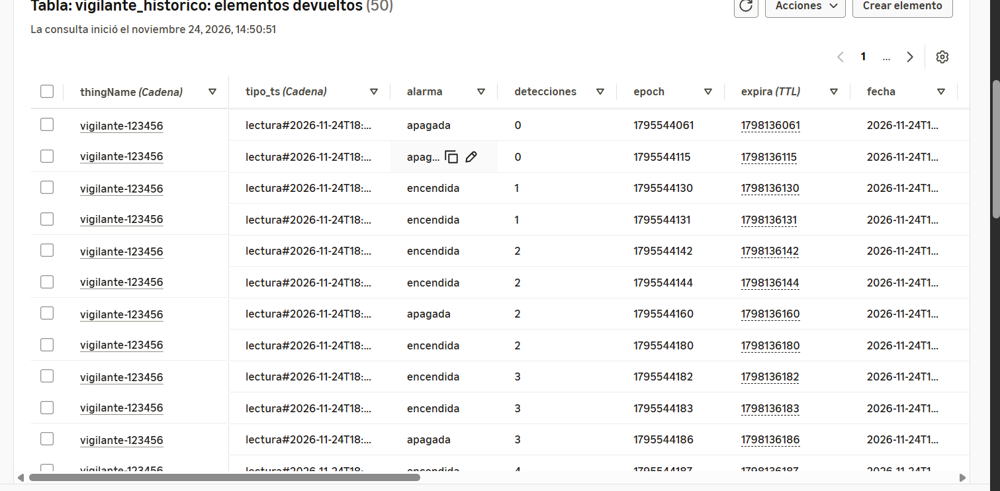

*Figura 5.3.1 — Lecturas del Thing real; aparecen detecciones, alarma, epoch y expira. La pantalla muestra una página de 50 resultados, no el total de la exportación.*

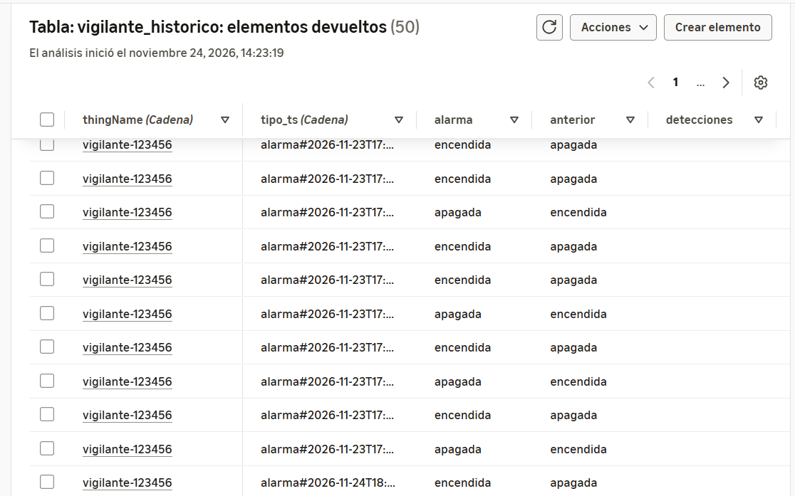

*Figura 5.3.2 — Eventos de alarma con valor nuevo y anterior. Es evidencia de ítems; no acredita por sí sola el conteo por origen de toda la sesión.*

Para los reportes por día/hora se deben agrupar eventos `deteccion#` y no sumar el acumulado de `detecciones`. Los eventos de puerta, modo y alarma requieren sus consultas por prefijo; las lecturas no sustituyen esa auditoría. El tiempo en bloqueo requiere emparejar transiciones de modo. Las estimaciones de tiempos se mantienen separadas de estos datos reales.

## 5.4 Análisis: Edge frente a Nube

| Criterio | Reglas del Edge (cierre y alarma) | Regla de la Nube (bloqueo por exceso) |
|---|---|---|
| Latencia | Sin viaje de red: la meta es ≤ 1 s | Incluye MQTT, dos reglas, una Lambda, una consulta y el `delta`: la meta es ≤ 5 s |
| Sin conexión | Siguen funcionando: el objeto se protege aunque caiga Internet | No funciona: depende de que el reporte llegue a AWS |
| Datos que necesita | Solo el estado local (modo y flanco del PIR) | El histórico de detecciones de una ventana, que el ESP32 no guarda y pierde al reiniciar |
| Costo | Cero mensajes adicionales | Solo se invoca con detecciones en automático: ≤ 3 000 invocaciones al mes |
| Mantenimiento | Cambiarla exige reprogramar el objeto | Umbral y ventana se cambian por voz, y la regla se actualiza desplegando la Lambda |

La división es coherente con el caso de uso: lo que debe pasar **ya** y aunque no haya red (cerrar la puerta y hacer sonar la alarma ante un intruso) corre en el Edge; lo que depende de la historia (demasiadas detecciones en poco tiempo) corre en la Nube. El buzzer permite medir la Nube por separado: en modo automático el Edge cierra la puerta en la misma detección, pero solo la Nube enciende la alarma.

**Límites conocidos.** `reported.puerta` es la posición ordenada al servo, no una medición: el SG90 no tiene realimentación. `alarma: encendida` es el estado lógico; el sonido es intermitente dentro de ese estado. El origen es un atributo único del último cambio, no uno por actuador. Sin conexión, el objeto no guarda una cola de lecturas: el histórico recibe el estado final al reconectar.

---

# 6. Conclusiones

La Práctica 4 convirtió un objeto que solo obedecía a la voz en un sistema distribuido que decide en dos lugares y guarda su historia. Todo pasa por el Device Shadow: Alexa y la Lambda de lógica escriben `desired`, el ESP32 escribe `reported`, y ninguna parte de la Nube habla directamente con el objeto. Cada integrante resume su parte.

**Objeto inteligente, circuito y AWS IoT (Alejandro).** El buzzer confirmó la decisión de arquitectura de la P3: entró al firmware como un `Actuator` más y la alarma como una `ControlRule` más, sin modificar `SmartObject` ni la capa de red. Darle al buzzer un estado en el Shadow (`encendida`/`apagada`) con apagado automático a los 30 s lo volvió un actuador sincronizable como la puerta: el Shadow siempre muestra si suena, aunque se haya encendido sin conexión. En la Nube, separar la lógica en tres reglas con SQL selectivo hizo que la Lambda de lógica se ejecute solo con detecciones en automático y que cada función tenga únicamente los permisos que necesita. El modelo de datos con la clave `tipo#fecha` responde todos los reportes con `Query`, sin `Scan` ni índices, y el TTL de 30 días mantiene la tabla en unos 20 MB por objeto. El costo estimado, ≈ USD 0,19 al mes por objeto, entra en la capa gratuita; el recurso más cercano a su límite es la evaluación de reglas, que depende sobre todo del latido de 60 s.

**Alexa, skill y lógica de la Nube (Rubén).** Organizar la Lambda de la skill en un repositorio de vinculaciones, un gateway hacia IoT Core y manejadores con dependencias inyectadas permitió probar toda la skill sin una cuenta de AWS, y en la Práctica 4 confirmó lo previsto: el buzzer, los modos y los parámetros se agregaron con subclases nuevas, sin tocar los módulos existentes. Separar la skill de la lógica de negocio en dos funciones Lambda dio a cada una una sola responsabilidad y los permisos justos: la skill solo traduce voz a `desired` y lee `reported`, y `vigilante-logica` solo cuenta detecciones y escribe el bloqueo. Poner esa regla en la Nube fue necesario porque depende del historial, que el ESP32 no conserva, y permite cambiar el umbral y la ventana por voz sin reprogramar el objeto. La clave `thingName` + `tipo_ts` del historial resolvió tanto el conteo de la regla como los tres reportes con `Query`, sin `Scan`. Para que la voz y la lógica automática no se contradigan, la skill rechaza con una explicación las órdenes que la regla del Edge desharía y acompaña cada cambio de modo con el estado coherente del actuador.

**Requerimientos, Edge y almacenamiento (Luciana).** La sesión real de 30 minutos conservó 132 de 132 publicaciones en DynamoDB (100 % de integridad observada) y no mostró indicios de reinicio ni retrocesos de uptime. Diecisiete lecturas permitieron medir el tramo regla IoT → log posterior a escritura, con media de 160,824 ms y máximo de 378 ms. El monitor serie mostró siete apagados automáticos Edge de 29,996–29,998 s y 19 intervalos de latido de 59,995–60,001 s. La validación previa a `PutItem` y las pruebas automatizadas complementan esa evidencia. Las estimaciones del borrador no acreditan latencia extremo a extremo, efecto físico ni funcionamiento offline; esos ensayos y las capturas de Alexa/Nube siguen por validar.

---

# 7. Recomendaciones

## Objeto inteligente y AWS IoT (Alejandro)

- **Manejar el buzzer con un transistor.** Hoy el buzzer toma su corriente directo del GPIO 26, cerca del límite del pin. Para un uso real conviene un transistor NPN (por ejemplo S8050) con una resistencia de base de 1 kΩ, o al menos la resistencia de 220 Ω en serie. Eso permitiría además usar una **sirena de 12 V**, audible en toda una vivienda, sin pasar de la baja tensión que exige la práctica.
- **Guardar menos latidos.** Almacenar un latido cada 5 minutos y todos los eventos reduciría ~65 % las escrituras en DynamoDB y las invocaciones de almacenamiento. Una regla de la Nube programada con EventBridge podría además avisar si un objeto deja de reportar, algo que el objeto no puede informar por sí mismo.
- **Extensión a un uso real: aviso al celular.** Agregar a `vigilante_eventos` una acción de Amazon SNS cuando `alarma` pasa a `encendida` enviaría una notificación push o un SMS al dueño, que hoy solo se entera si pregunta a Alexa.

## Skill, lógica de la Nube y reportes (Rubén)

- **Códigos de vinculación aleatorios.** Reemplazar los códigos de demostración por códigos generados al azar y, a futuro, que el ESP32 publique su código en el Shadow para que la Lambda verifique que el usuario lo está leyendo del dispositivo físico.
- **Account Linking (OAuth)** para asociar el dispositivo a una cuenta real del fabricante, y un índice secundario sobre `thingName` para saber y limitar quién tiene vinculado cada Thing.
- **(P4) Alerta programada:** una Lambda disparada por Amazon EventBridge cada 15 min que revise la última `lectura#` de cada Thing y registre una alerta si no reportó, porque el objeto no puede avisar su propia desconexión.
- **Notificaciones proactivas** (Alexa Proactive Events o Amazon SNS) cuando el PIR detecte movimiento o la Nube active un bloqueo, en vez de esperar a que el usuario pregunte.
- **(P4) Implementar los reportes** como una página que llame a una Lambda de solo lectura (`dynamodb:Query`) con las consultas de §2.11.
- **Infraestructura como código** (AWS SAM o CloudFormation) para crear las tablas, los roles, las reglas y las Lambdas con un solo comando a partir de los JSON y SQL del repositorio, y despliegue automático de los `.zip` con GitHub Actions después de que pasen las pruebas.
- **Esperar la confirmación sin sondeo.** Hoy la skill consulta el Shadow cada 250 ms durante hasta 3 s. Con respuestas progresivas de Alexa se reducirían las operaciones de Shadow por comando.

## Edge y almacenamiento (Luciana)

- Incorporar identificador único de evento y mayor resolución temporal, con una estrategia de idempotencia, para distinguir reintentos y evitar reemplazos de eventos del mismo tipo en un segundo.
- Para uso permanente, agregar una cola persistente acotada de eventos offline y documentar reenvío, límites, expiración y recuperación tras reinicio; conservar solo el estado final es insuficiente para una auditoría de intrusiones.
- Medir el montaje completo e incorporar realimentación física de puerta y un origen por evento/actuador. En una instalación real, un estado lógico reportado no basta para garantizar que un pestillo se movió ni para atribuir cambios simultáneos con precisión.

## Hacia un uso real

Para instalar el Vigilante en una vivienda, las tres mejoras de mayor impacto son: un pestillo con realimentación de posición (un sensor magnético en la puerta) para que `reported.puerta` sea una medición; una sirena de 12 V manejada por un transistor; y notificaciones al celular con Amazon SNS cuando la alarma se enciende, para que el dueño se entere sin preguntar a Alexa.

---

# 8. Anexos

Antes de guardar una captura se tapan el ID de cuenta (12 dígitos), el endpoint de IoT y el Skill ID. Nunca se capturan los certificados ni `secrets.h`.

## 8.1 Diagramas, fotos y evidencias

| Archivo | Responsable | Contenido | Sección |
|---|---|---|---|
| [`p4/circuito.png`](anexos/p4/circuito.png), [`p4/circuito.svg`](anexos/p4/circuito.svg) | Alejandro | Diagrama de conexiones con el buzzer en el GPIO 26 | §2.3 |
| [`p4/circuito-3d.svg`](anexos/p4/circuito-3d.svg), [`p4/circuito-3d.png`](anexos/p4/circuito-3d.png), [`p4/circuito-3d-oscuro.png`](anexos/p4/circuito-3d-oscuro.png) | Alejandro | Montaje isométrico con el buzzer (tema claro y oscuro) | §2.3 |
| [`p4/montaje-buzzer.jpg`](anexos/p4/montaje-buzzer.jpg) | Alejandro | Foto del prototipo de la P4 | §2.3 |
| [`dashboards/mockup-actividad.png`](dashboards/mockup-actividad.png), [`dashboards/mockup-puerta-alarma.png`](dashboards/mockup-puerta-alarma.png), [`dashboards/mockup-bloqueos.png`](dashboards/mockup-bloqueos.png) (versiones `.svg` en [`anexos/p4/`](anexos/p4/)) | Rubén | Mockups de los tres reportes (RF15), con datos ilustrativos | §2.11 |
| [`../tools/mockups-rf15/`](../tools/mockups-rf15/) | Rubén | Fuente de los mockups: generador de los datos ilustrativos (semilla fija) y exportación a PNG y SVG | §2.11 |
| [`p4/ru-lambda-logica-config.png`](anexos/p4/ru-lambda-logica-config.png) | Rubén | `vigilante-logica`: disparador, variable `IOT_ENDPOINT` y rol | §3.2.2 |
| [`p4/lu-almacenamiento-guardado.png`](anexos/p4/lu-almacenamiento-guardado.png), [`p4/lu-tabla-lectura-prueba.png`](anexos/p4/lu-tabla-lectura-prueba.png), [`p4/lu-almacenamiento-descartado.png`](anexos/p4/lu-almacenamiento-descartado.png) | Luciana | Guardado y descarte en la Lambda real | §4.4 |
| [`p4/lu-regresion-skill.txt`](anexos/p4/lu-regresion-skill.txt), [`p4/lu-regresion-logica.txt`](anexos/p4/lu-regresion-logica.txt), [`p4/lu-pruebas-almacenamiento.txt`](anexos/p4/lu-pruebas-almacenamiento.txt), [`p4/lu-pruebas-firmware.txt`](anexos/p4/lu-pruebas-firmware.txt) | Luciana | Salidas de las pruebas automáticas del 24/11/2026 | §4.2 |
| [`p4/lu-mediciones-edge.csv`](anexos/p4/lu-mediciones-edge.csv), [`p4/lu-mediciones-offline.csv`](anexos/p4/lu-mediciones-offline.csv), [`p4/lu-mediciones-almacenamiento.csv`](anexos/p4/lu-mediciones-almacenamiento.csv) | Luciana | Plantillas para lo aún no medido; los resultados reales están en `lu-sesion-20261124/` | §4.3, §4.4 |
| [`p4/lu-pendientes-y-mediciones.md`](anexos/p4/lu-pendientes-y-mediciones.md), [`p4/lu-revision-referencias.md`](anexos/p4/lu-revision-referencias.md) | Luciana | Procedimiento de reproducción y revisión de la integración | §4 |
| [`p4/lu-sesion-20261124/README.md`](anexos/p4/lu-sesion-20261124/README.md) | Luciana | Monitor serie de 30 min, exportación DynamoDB, cruce 132/132, CloudWatch y cálculos reproducibles | P-A1, LU-04/LU-05/LU-07, G-01, §5.3 |
| [`p4/lu-historico-lecturas-real.png`](anexos/p4/lu-historico-lecturas-real.png), [`p4/lu-historico-alarmas-real.png`](anexos/p4/lu-historico-alarmas-real.png) | Luciana | Capturas reales de ítems del 24/11/2026 | §3.2.1, §5.3 |
| [`p4/lu-estimaciones-y-verificacion.md`](anexos/p4/lu-estimaciones-y-verificacion.md) | Luciana | Supuestos E, límites y pasos para verificar despliegue/capturas | §4, §5 |
| Capturas de la P3 (`aws-*`, `alexa-*`) en [`anexos/`](anexos/) | Grupo | Configuración de IoT Core, DynamoDB, IAM, Lambda y Alexa que se mantiene | §3.2, §3.3 |

## 8.2 Configuraciones exportadas

| Archivo | Contenido |
|---|---|
| [`alexa/interaction-model.es-US.json`](../alexa/interaction-model.es-US.json) | Modelo de interacción de la skill (20 intents, `TipoModo`) |
| [`aws/iot-policy.json`](../aws/iot-policy.json) | Política de AWS IoT del objeto |
| [`aws/iot-rules/`](../aws/iot-rules/) | SQL y acciones de las tres reglas |
| [`aws/lambda-role-policy.json`](../aws/lambda-role-policy.json), [`aws/almacenamiento-role-policy.json`](../aws/almacenamiento-role-policy.json), [`lambda-logica/politica-rol.json`](../lambda-logica/politica-rol.json) | Permisos mínimos de las tres Lambdas |
| [`aws/dynamodb-table.json`](../aws/dynamodb-table.json), [`aws/dynamodb-historico.json`](../aws/dynamodb-historico.json), [`aws/dynamodb-historico-ttl.json`](../aws/dynamodb-historico-ttl.json) | Definición de las tablas y del TTL |
| [`include/secrets.example.h`](../include/secrets.example.h) | Plantilla de configuración del objeto, sin certificados ni credenciales |

## 8.3 Evidencias por adjuntar

Estas evidencias corresponden a las pruebas marcadas ⏳ en §4.1. Se guardan en [`anexos/p4/`](anexos/p4/) con estos nombres:

| Evidencia | Prueba |
|---|---|
| Reglas activas, SQL con alarma, claves/capacidad, TTL activo y Shadow; las capturas de lecturas y alarma ya están adjuntas, faltan otros tipos de evento | §3.2.1, P-A3 |
| Video y guion físico completo; el [log de 30 min ya está adjunto](anexos/p4/lu-sesion-20261124/lu-monitor-serie.txt) | P-A1 |
| `ru-sim-01-modo.png` … `ru-sim-13-manual.png`, `ru-alexa-intents-p4.png`, `ru-alexa-build-p4.png` | S-01 a S-13, §3.3 |
| `ru-cw-bloqueo.png`, `ru-cw-sin-accion.png`, `ru-shadow-bloqueo.png` y video del bloqueo | N-01, N-02 |
| Videos Edge/corte de red y emisión UTC comparable para LU-05; el [CSV real ya está adjunto](anexos/p4/lu-sesion-20261124/lu-historico-lecturas-exportado.csv) | LU-05 a LU-08 |
