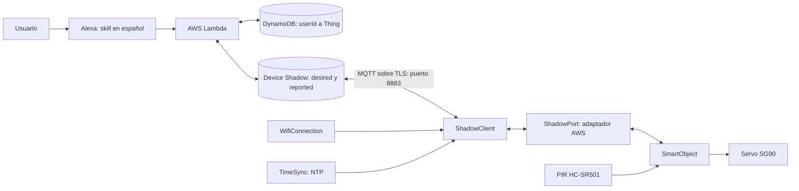
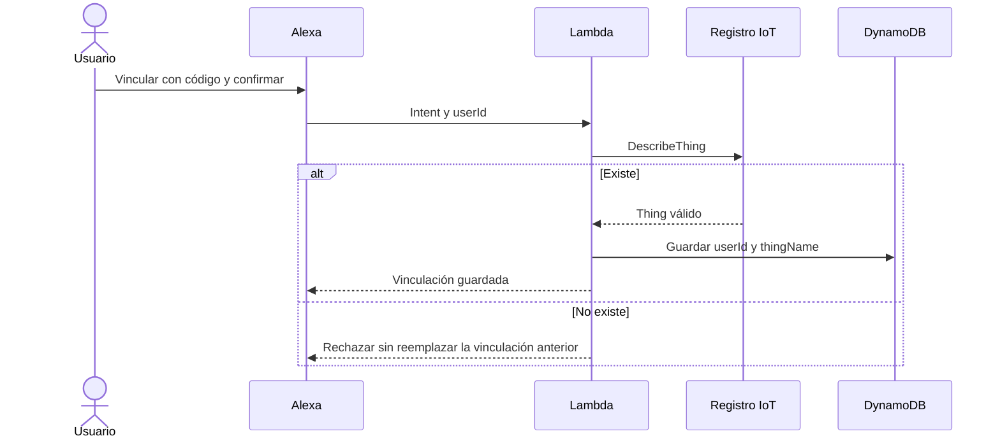
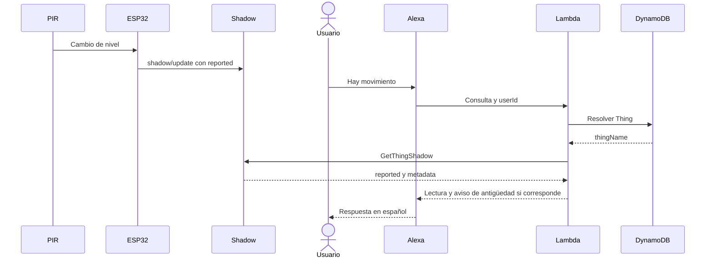

# Informe técnico — Aporte de Luciana

## 1.1 Caso de uso

El Vigilante Inteligente permite consultar la detección de movimiento junto a
un objeto protegido y controlar por voz el pestillo de una puerta de maqueta.
Un ESP32 lee el PIR HC-SR501 y acciona un servo SG90. Alexa recibe las consultas
y órdenes; Lambda resuelve el Thing asociado al usuario y lee o modifica su
Device Shadow. El ESP32 intercambia datos con AWS IoT Core por MQTT sobre TLS.
El PIR no ordena cerrar la puerta automáticamente: el actuador responde al
estado deseado recibido desde el Shadow.

El diseño separa sensores, actuadores, coordinación y comunicación para permitir
agregar otros componentes manteniendo el contrato del Shadow. La posición de
la puerta es estimada por la orden al servo; no existe realimentación física
del pestillo y su correspondencia se debe verificar durante las pruebas.

## 1.3 Requerimientos funcionales

| RF | Comportamiento | Módulo |
|---|---|---|
| RF1 | Capturar movimiento con el PIR | `PirSensor::update` |
| RF2 | Reportar sensor y actuador por evento y periódicamente | `SmartObject`, `ShadowClient::publishReported` |
| RF3 | Aplicar delta al actuador y confirmar en reported | `ShadowClient::handleMessage`, `SmartObject`, `DoorLock` |
| RF4 | Consultar el movimiento en español desde reported | `MotionQueryHandler` |
| RF5 | Ordenar abrir/cerrar escribiendo desired | `CloseDoorHandler`, `OpenDoorHandler` |
| RF6 | Consultar el estado reportado de la puerta | `DoorStatusHandler` |
| RF7 | Vincular usuario y Thing de forma persistente | `LinkDeviceHandler`, DynamoDB |
| RF8 | Resolver el Thing por userId o guiar al usuario sin vinculación | `LinkedThingInterceptor` |
| RF9 | Validar existencia, cambiar y eliminar vinculación | Manejadores de vinculación y `DescribeThing` |

Se mantiene el contrato con la capa de nube; esta tabla describe el conjunto
del sistema y no atribuye a Luciana la implementación de los manejadores.

## 1.4 Requerimientos no funcionales

Los valores siguientes son objetivos declarados, no resultados medidos.

| Atributo | Criterio | Verificación / responsable |
|---|---|---|
| RNF1 Estabilidad | ≥30 min sin reinicios ni bloqueos | Hardware y uptime; Ruben |
| RNF2 Detección | ≥95% hasta 3 m y 0 falsos positivos en 10 min | Ensayo del PIR; Ruben |
| RNF3 Respuesta | ≤3 s desde el comando hasta el movimiento | Video 60 fps y CloudWatch; Luciana |
| RNF4 Reporte | Evento ≤1 s, latido 60 s ±1 s con red estable | Marcas de tiempo; Luciana |
| RNF5 Reconexión | ≤30 s tras volver la red y aplicación de desired pendiente | Corte de red y sincronización; Luciana |
| RNF6 Seguridad | Sin secretos versionados; MQTT/TLS y permisos documentados | Revisión del repositorio y configuración AWS |

Los cambios del sensor generan reportes con separación mínima de 500 ms;
los comandos del actuador y la reconexión tienen prioridad. Un latido cada
60 s limita tráfico cuando no hay cambios, mientras la Lambda advierte
antigüedad a partir de 150 s. Debe verificarse la frecuencia bajo las condiciones
reales: una reconexión TLS o una red degradada puede retrasar el loop.

## 2.1 Arquitectura del sistema



El firmware seleccionado para la demo está en la raíz: `src/`, `include/`
y `platformio.ini`. Esta base también conserva el aporte de hardware bajo
`firmware/`; su consolidación en la raíz y la adaptación de las interfaces
corresponden a Ruben y siguen pendientes. No se compila esa carpeta para la demo.
El entorno de demo es `esp32dev-aws`, seleccionado por defecto. `esp32dev`
es diagnóstico local por USB, sin comunicación con AWS, y debe elegirse
explícitamente. Alexa nunca habla directamente con el ESP32.

## 2.5 Diagramas de secuencia

### Vinculación



### Consulta del sensor



### Comando y reconexión

```mermaid
sequenceDiagram
  actor U as Usuario
  participant A as Alexa
  participant L as Lambda
  participant D as DynamoDB
  participant S as Shadow
  participant E as ESP32
  participant V as Servo
  U->>A: Abre la puerta
  A->>L: Intent y userId
  L->>D: Resolver Thing
  D-->>L: thingName
  L->>S: UpdateThingShadow desired.puerta=abierta
  alt ESP32 conectado
    S->>E: shadow/update/delta
  else ESP32 desconectado
    L-->>A: Orden enviada, sin confirmación
    E->>E: Recuperar WiFi y MQTT
    E->>S: Suscribir delta y get/accepted; publicar shadow/get
    S-->>E: Documento con state.delta pendiente
  end
  E->>V: Aplicar posición abierta
  E->>S: reported.puerta=abierta
  Note over L,S: Si aún espera, Lambda consulta reported para confirmar
```

## 2.6 Documento Shadow

```json
{
  "state": {
    "desired": {"puerta": "abierta"},
    "reported": {
      "puerta": "cerrada", "movimiento": false, "detecciones": 0,
      "ultima_deteccion": 0, "sensor_listo": false,
      "uptime_s": 0, "rssi": -60
    }
  }
}
```

Este ejemplo es ilustrativo y no representa una medición. Lambda escribe
`desired.puerta`; el ESP32 escribe `reported`. AWS genera `delta` cuando difieren.

| Clave | Tipo / valores | Sección |
|---|---|---|
| puerta | texto: abierta o cerrada | desired y reported |
| movimiento | booleano | reported |
| detecciones | entero sin signo, flancos desde inicio | reported |
| ultima_deteccion | epoch UTC en segundos; 0 sin hora válida | reported |
| sensor_listo | booleano; false durante calentamiento | reported |
| uptime_s | entero de segundos desde encendido | reported |
| rssi | entero en dBm con WiFi conectado | reported |

En `$aws/things/<thing>/shadow/`, el dispositivo publica `update` y `get`, y
se suscribe a `update/delta` y `get/accepted`. El primero entrega `state` como
delta; el segundo, `state.delta`. El nombre del Thing también se utiliza como
client ID MQTT para corresponder con la política del certificado.

## 3.1 Estructura e implementación

| Ruta | Responsabilidad |
|---|---|
| `src/main.cpp` | Construcción de objetos, selección local/AWS e integración |
| `src/core/` | Interfaces Sensor, Actuator y ShadowPort |
| `src/sensors/` | Lectura PIR |
| `src/actuators/` | Servo y validación de órdenes |
| `src/app/` | Eventos, latido y distribución de deltas |
| `src/net/WifiConnection.*` | Estado WiFi, transición conectado y reintentos |
| `src/net/ShadowClient.*` | Certificados TLS, sesión MQTT, tópicos y JSON |
| `src/net/TimeSync.*` | Configuración NTP y lectura de epoch válido |
| `include/config.h` | Pines, tiempos, claves y estados sin secretos |
| `include/secrets.example.h` | Plantilla; valores reales solo en secrets.h local |

[`WifiConnection::ensure`](../src/net/WifiConnection.cpp) evita esperas activas
al reconectar WiFi, emite `justConnected` y programa reintentos. La integración
inicia NTP al recuperar red y llama `retryNow()` para intentar MQTT de inmediato.
La conexión MQTT/TLS puede ocupar tiempo de ejecución; no se declara como un
sistema totalmente asíncrono.

[`ShadowClient`](../src/net/ShadowClient.cpp) configura CA, certificado y clave
privada, usa el puerto 8883 y solicita el documento tras cada conexión. Así
recupera un delta que pudo quedar pendiente durante el corte. El adaptador de
[`main.cpp`](../src/main.cpp) implementa `ShadowPort` y conserva las interfaces
que utiliza `SmartObject`, sin acoplarlo a un sensor o actuador específico.

[`TimeSync`](../src/net/TimeSync.cpp) usa NTP; antes de sincronizar, la hora de
una detección se informa como 0. No se confunde epoch con millis. El bucle toma
una nueva marca millis tras atender red y comandos para que el temporizador del
servo no reciba una hora anterior al inicio del movimiento.

Las configuraciones de nube y los manejadores están descritos en el aporte de
Alejandro. El hardware, el circuito y las clases del objeto corresponden a Ruben
en el reparto revisado. No se modifica su implementación en esta corrección.

## 5. Resultados

La compilación verifica compatibilidad y generación del programa, pero no
demuestra movimiento, conexión real ni los tiempos declarados. Las pruebas
físicas de comunicación siguen el procedimiento en
[`PRUEBAS_FISICAS_LUCIANA.md`](PRUEBAS_FISICAS_LUCIANA.md).

| Métrica | Objetivo | Resultado real | Evidencia |
|---|---|---|---|
| RNF3: latencia máxima | ≤3 s extremo a extremo | Pendiente de medición | Video y CloudWatch pendientes |
| RNF4: evento | ≤1 s | Pendiente de medición | Marcas MQTT pendientes |
| RNF4: latido | 60 s ±1 s sin eventos | Pendiente de medición | Intervalos pendientes |
| RNF5: reconexión | ≤30 s y aplicar orden pendiente | Pendiente de medición | Video y Shadow pendientes |

Tras los ensayos, registrar promedio, máximo, condiciones de WiFi y cualquier
incumplimiento con su causa. Los resultados de estabilidad y exactitud del PIR
se incorporan desde el aporte de Ruben; no se deducen de las simulaciones.
