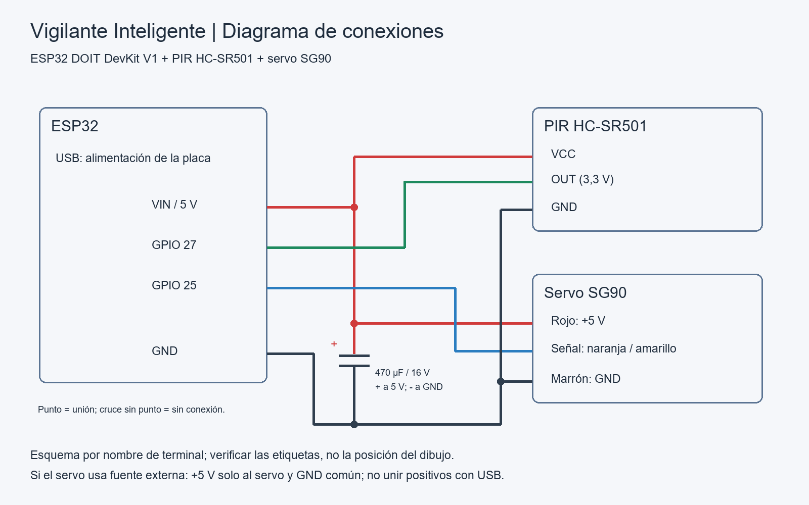
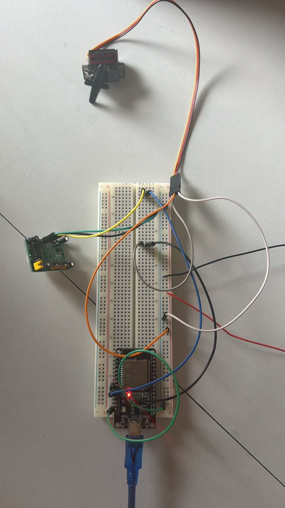
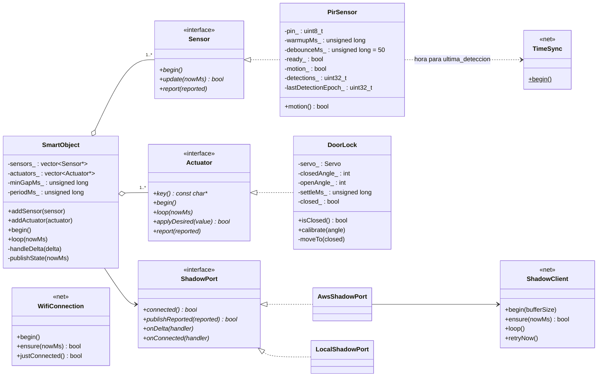

# Informe técnico — Vigilante Inteligente · Aporte de Ruben (hardware)

**Asignatura:** SIS-234 · **Práctica 3:** Integración de un objeto inteligente con Alexa mediante MQTT y AWS IoT Core
**Responsable de estas secciones:** Ruben Cordero (GitHub: [COMPLETAR: usuario])
**Capa a cargo:** circuito y maqueta, sensor PIR ([`src/sensors/`](../src/sensors/)), cerradura con servo ([`src/actuators/`](../src/actuators/)), pines y ángulos de [`include/config.h`](../include/config.h), banco de pruebas [`tools/prueba_hardware`](../tools/prueba_hardware/src/main.cpp), pruebas RNF1 y RNF2.

> Este documento contiene las secciones **§1.2, §2.2 y §2.3** del informe del grupo, para integrarlas en `docs/INFORME.md`. §2.2 incorpora el texto de `SECCION_2_2_LUCIANA.md`. Las imágenes se guardan en [`docs/anexos/`](anexos/). Los valores marcados con [COMPLETAR] se llenan después de las mediciones.

---

## 1.2 Objeto inteligente: sensor y actuador

El objeto inteligente vigila un objeto valioso. Tiene un sensor y un actuador:

| Elemento | Componente | Función en el caso de uso | RF |
|---|---|---|---|
| Sensor | PIR HC-SR501 | Detecta presencia de personas junto al objeto. Permite responder a "¿hay movimiento?". | RF1 |
| Actuador | Servo SG90 | Hace de cerradura: su brazo funciona como pestillo de la puerta (abierta / cerrada). Ejecuta "cierra la puerta". | RF3 |
| Controlador | ESP32 DOIT DevKit V1 | Lee el PIR, mueve el servo y sincroniza el estado con el Device Shadow de AWS IoT Core por MQTT/TLS. | RF2 |

El PIR es un sensor pasivo de infrarrojos. Detecta el cambio de radiación térmica cuando una persona cruza su campo de visión. Su salida es digital: alto (3,3 V) mientras hay movimiento y bajo cuando no lo hay. No mide distancia ni identifica a la persona. El firmware cuenta flancos de subida, no personas.

El servo SG90 gira entre 0° y 180° según el ancho del pulso PWM (50 Hz). Se usan dos posiciones fijas: **90° = cerrada** (el brazo traba la puerta) y **0° = abierta** (el brazo la libera). Los ángulos finales se calibraron sobre la maqueta: cerrada = [COMPLETAR: °], abierta = [COMPLETAR: °].

Sensor y actuador son independientes: el PIR **no** cierra la puerta por sí solo. El servo solo obedece órdenes que llegan por el Shadow (RF3). El estado de ambos se publica en `reported`: `movimiento`, `detecciones`, `ultima_deteccion` y `sensor_listo` para el PIR, y `puerta` para el servo. Alexa nunca se comunica directamente con el ESP32.

---

## 2.2 Diagrama de circuito, conexiones y montaje

### Lista de componentes

| Cantidad | Componente | Especificación relevante |
|---|---|---|
| 1 | ESP32 DOIT DevKit V1 | 3,3 V lógicos; VIN entrega el 5 V del USB |
| 1 | Sensor PIR HC-SR501 | Alimentación 4,5–20 V; salida digital de 3,3 V; alcance ajustable hasta ~7 m; ángulo ~110° |
| 1 | Servo SG90 | 4,8–6 V; picos de corriente de varios cientos de mA al arrancar |
| 1 | Condensador electrolítico 470 µF / 16 V | Desacople de la alimentación del servo |
| 1 | Protoboard y cables dupont | — |
| 1 | Maqueta de puerta | [COMPLETAR: cartón / MDF], medidas [COMPLETAR] |

### Conexiones

| Componente | Terminal | Conexión en el ESP32 |
|---|---|---|
| PIR HC-SR501 | VCC | VIN (5 V del USB) |
| PIR HC-SR501 | OUT | GPIO 27 |
| PIR HC-SR501 | GND | GND común |
| Servo SG90 | Rojo (V+) | VIN (5 V) |
| Servo SG90 | Naranja/amarillo (señal) | GPIO 13 |
| Servo SG90 | Marrón (GND) | GND común |
| Condensador 470 µF / 16 V | Positivo / negativo | VIN / GND, junto al servo |

Los pines y ángulos están en [`include/config.h`](../include/config.h): `PIR_PIN = 27`, `SERVO_PIN = 13`, `SERVO_ANGLE_CLOSED = 90`, `SERVO_ANGLE_OPEN = 0`.

*Figura 2.2.1 — Diagrama de conexiones. Es un esquema por nombre de terminal: no representa la posición física de los pines. Se verifican las etiquetas del módulo utilizado.*

*Figura 2.2.2 — El mismo circuito en Wokwi ([`anexos/wokwi/diagram.json`](anexos/wokwi/diagram.json)). Wokwi no incluye el condensador; está solo en el montaje físico.* [COMPLETAR: exportar la imagen]

### Justificación de las conexiones

- **OUT del PIR directo al GPIO, sin divisor.** El HC-SR501 tiene un regulador interno de 3,3 V y su salida no supera ese valor, que es el nivel lógico del ESP32. Nunca se llevan 5 V a un GPIO.
- **PIR y servo en VIN.** Ambos necesitan 5 V. El pin de 3,3 V del ESP32 no alcanza para el servo ni cumple el mínimo de 4,5 V del PIR.
- **GPIO 27 y GPIO 13.** No son pines de arranque (0, 2, 12, 15) ni de la memoria flash (6–11). El GPIO 13 admite PWM para el servo. El GPIO 27 se configura con *pull-down* interno, que evita lecturas falsas si el cable de OUT se suelta.
- **Condensador de 470 µF.** Al arrancar, el servo pide picos de corriente que hacen caer la tensión del USB. Sin el condensador, esa caída puede reiniciar el ESP32 (*Brownout detector was triggered*). Se coloca respetando la polaridad.
- **Si persisten los reinicios,** el servo se alimenta con una fuente regulada independiente de 5 V. El positivo de esa fuente va solo al servo, sin unirlo al VIN alimentado por USB, y se unen únicamente las tierras. En las pruebas [COMPLETAR: no fue necesario / fue necesario].
- **Seguridad.** Todo el montaje trabaja a baja tensión. La alimentación se desconecta antes de modificar el cableado.

### Ajustes del PIR

| Ajuste | Valor | Motivo |
|---|---|---|
| Jumper de disparo | **H** (repetible) | OUT se mantiene en alto mientras la persona siga moviéndose |
| Potenciómetro Tx (tiempo) | Mínimo (~3 s) | `movimiento` vuelve a `false` rápido y las pasadas se cuentan por separado |
| Potenciómetro Sx (sensibilidad) | Medio | Alcance suficiente para 3 m sin falsos positivos lejanos. Posición final: [COMPLETAR] |
| Estabilización | 60 s (`PIR_WARMUP_MS`) | Tras encenderse, el HC-SR501 da pulsos falsos. El firmware reporta `sensor_listo: false` y no cuenta detecciones durante ese tiempo |

Entre ensayos independientes se espera a que OUT vuelva a bajo (unos 3 s); si no, dos pasadas seguidas cuentan como una sola detección.

### Servo como cerradura

Los ángulos iniciales son 90° cerrada y 0° abierta. El servo recibe PWM durante 700 ms (`SERVO_SETTLE_MS`) y luego se suelta, para evitar vibraciones y reducir el consumo. Soltar el PWM no corta la alimentación. Por eso el mecanismo debe mantener la posición del pestillo sin fuerza del servo. Resultado en la maqueta: [COMPLETAR: el pestillo se mantiene / se tuvo que agregar un tope].

El SG90 no tiene realimentación de posición: `reported.puerta` indica la posición **ordenada** por software, no una medición. Su correspondencia con el pestillo se verificó visualmente en la demo.

### Montaje de la maqueta

[COMPLETAR: descripción breve con medidas reales.] Propuesta:

- La puerta es una hoja de [COMPLETAR: cartón / MDF] unida al marco con [COMPLETAR: bisagras / cinta].
- El servo se fija al marco, junto al borde de apertura. Su brazo actúa como pestillo: a 90° se interpone delante de la hoja y la traba; a 0° queda paralelo al marco y la libera.
- El PIR se monta sobre el marco, a [COMPLETAR] cm de altura, orientado hacia la zona del objeto vigilado.
- La protoboard y el ESP32 quedan detrás del marco; el cable USB sale por [COMPLETAR].

*Figura 2.2.3 — Maqueta completa.* [COMPLETAR: foto]

*Figura 2.2.4 — Pestillo en posición cerrada.* [COMPLETAR: foto]

*Figura 2.2.5 — Pestillo en posición abierta.* [COMPLETAR: foto]

*Figura 2.2.6 — Conexiones en la protoboard.* [COMPLETAR: foto]

---

## 2.3 Diagrama de clases del objeto inteligente

El firmware ([`src/`](../src/)) está organizado en capas. La capa de hardware no conoce la red y la de comunicación no conoce sensores ni actuadores concretos: las une `SmartObject` mediante interfaces.

| Archivo | Clase | Responsabilidad | Capa | RF |
|---|---|---|---|---|
| [`core/Sensor.h`](../src/core/Sensor.h) | `Sensor` (interfaz) | `begin()`, `update(nowMs)` (true si hay un cambio que reportar), `report(reported)` | núcleo | RF1, RF2 |
| [`core/Actuator.h`](../src/core/Actuator.h) | `Actuator` (interfaz) | `key()` (atributo del Shadow que controla), `begin()`, `loop(nowMs)`, `applyDesired(valor)`, `report(reported)` | núcleo | RF2, RF3 |
| [`core/ShadowPort.h`](../src/core/ShadowPort.h) | `ShadowPort` (interfaz) | Transporte del Shadow: `connected()`, `publishReported()`, `onDelta()`, `onConnected()` | núcleo | RF2, RF3 |
| [`sensors/PirSensor.*`](../src/sensors/PirSensor.h) | `PirSensor` | Lee el HC-SR501 con *pull-down* y filtro de 50 ms, gestiona el calentamiento y cuenta detecciones con hora NTP | hardware | RF1 |
| [`actuators/DoorLock.*`](../src/actuators/DoorLock.h) | `DoorLock` | Dueño de la clave `puerta`: valida `"abierta"`/`"cerrada"`, mueve el servo y lo suelta tras 700 ms | hardware | RF3 |
| [`app/SmartObject.*`](../src/app/SmartObject.h) | `SmartObject` | Orquestador: reporte por evento (≥ 500 ms entre reportes) y latido cada 60 s; reparte cada delta al actuador dueño de la clave y confirma en `reported` | aplicación | RF2, RF3 |
| [`main.cpp`](../src/main.cpp) | `AwsShadowPort`, `LocalShadowPort` | Adaptadores de `ShadowPort`: AWS (demo, entorno `esp32dev-aws`) o monitor serie (diagnóstico, entorno `esp32dev`) | composición | — |
| `net/WifiConnection.*` | `WifiConnection` | Conexión y reconexión WiFi | red | RNF5 |
| `net/ShadowClient.*` | `ShadowClient` | MQTT/TLS con AWS IoT Core y tópicos del Shadow | red | RF2, RF3, RNF5 |
| `net/TimeSync.*` | `TimeSync` | Hora NTP para `ultima_deteccion` | red | RF2 |

Las clases de `net/` las documenta la capa de comunicación (Luciana); aquí se muestran con la API que usa `main.cpp`.

### Funcionamiento de la capa de hardware

**`PirSensor` (RF1).** `SmartObject` llama a `update(nowMs)` en cada vuelta de `loop()`. El método no bloquea.

1. Durante los primeros 60 s no lee el pin y devuelve `false`: no se reportan los falsos positivos del calentamiento. Al terminar devuelve `true` una vez, para publicar `sensor_listo: true`.
2. Un nivel nuevo del pin se acepta solo si se mantiene estable 50 ms. Así se descartan pulsos cortos de ruido, por ejemplo los que induce el servo.
3. Un flanco de subida suma una detección y guarda la hora UTC (`time()`, sincronizada por NTP). Si todavía no hay hora, guarda 0.
4. `update()` devuelve `true` en cada cambio, y `SmartObject` publica por evento.

**`DoorLock` (RF3).** Al iniciar, el servo va a la posición **cerrada** (estado seguro). Cuando llega un delta con la clave `puerta`, `applyDesired()` acepta solo `"abierta"` o `"cerrada"`; cualquier otro valor se ignora y se registra en el monitor serie. El movimiento no usa `delay()`: `loop(nowMs)` suelta el servo tras 700 ms. La confirmación en `reported.puerta` sale en la misma vuelta, muy por debajo de los 3 s que espera la Lambda. `calibrate(ángulo)` solo se usa en el banco de pruebas.

### Decisiones de diseño

- **Interfaces comunes (principio abierto/cerrado).** El láser KY-008 con LDR será otro `Sensor` y el buzzer otro `Actuator`, con su propia clave del Shadow. Se registran con `addSensor()` / `addActuator()` sin modificar `SmartObject` ni la capa de red.
- **Inversión de dependencias en el transporte.** `SmartObject` depende de `ShadowPort`, no de MQTT. Por eso el mismo firmware corre en modo local (`LocalShadowPort`, por el monitor serie) y con AWS (`AwsShadowPort`).
- **Hardware probado sin red.** Las clases de hardware se prueban en la PC con dobles de Arduino ([`test/ruben/`](../test/ruben/test_hardware.cpp), [`test/luciana/`](../test/luciana/test_firmware.cpp)) y en la placa con [`tools/prueba_hardware`](../tools/prueba_hardware/src/main.cpp), sin WiFi ni AWS.
- **Configuración centralizada.** Pines, ángulos y tiempos están en `config.h`. Recalibrar el pestillo no requiere tocar las clases.

---

## Recomendaciones de mi capa (para §7)

- [COMPLETAR: un párrafo propio.] Ideas: alimentar el servo con una fuente dedicada en una versión final; usar un sensor de puerta (*reed switch*) para confirmar que la puerta realmente quedó cerrada, ya que hoy `reported.puerta` es la posición ordenada; carcasa que proteja el PIR de corrientes de aire caliente.
