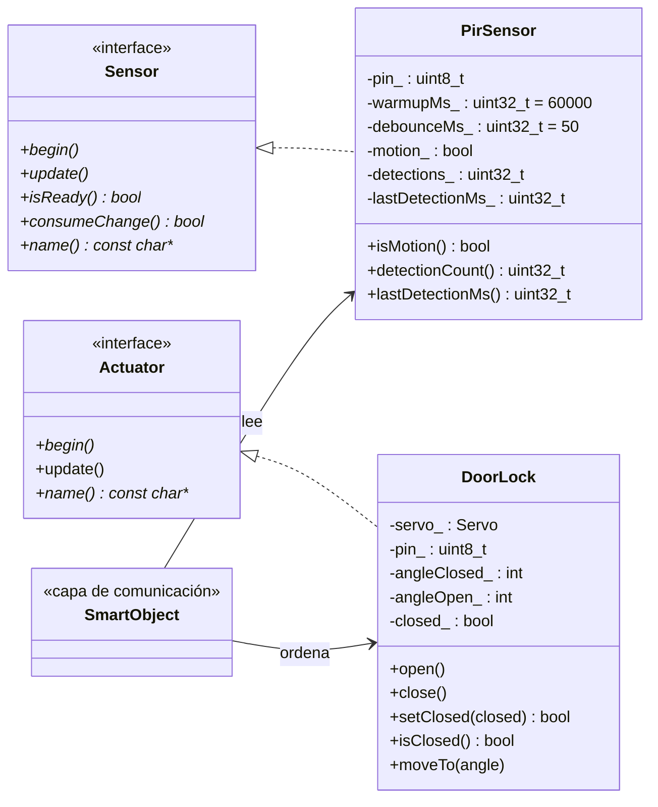

# Informe técnico — Vigilante Inteligente · Aporte de Ruben (hardware)

**Asignatura:** SIS-234 · **Práctica 3:** Integración de un objeto inteligente con Alexa mediante MQTT y AWS IoT Core
**Responsable de estas secciones:** Ruben Cordero (GitHub: [COMPLETAR: usuario])
**Capa a cargo:** circuito y maqueta, sensor PIR (`firmware/src/sensors/`), cerradura con servo (`firmware/src/actuators/`), interfaces `core/Sensor.h` y `core/Actuator.h`, pines y ángulos de `firmware/include/config.h`, pruebas RNF1 y RNF2.

> Este documento contiene las secciones **§1.2, §2.2 y §2.3** del informe del grupo, para integrarlas en `docs/INFORME.md`. Los títulos de las secciones deben verificarse con la guía de la práctica. Las imágenes se guardan en [`docs/anexos/`](anexos/) con el nombre indicado. Los valores marcados con [COMPLETAR] se llenan después de las mediciones.

---

## 1.2 Objeto inteligente: sensor y actuador

El objeto inteligente vigila un objeto valioso. Tiene un sensor y un actuador:

| Elemento | Componente | Función en el caso de uso | RF |
|---|---|---|---|
| Sensor | PIR HC-SR501 | Detecta presencia de personas junto al objeto. Permite responder a "¿hay movimiento?". | RF1 |
| Actuador | Servo SG90 | Hace de cerradura: su brazo funciona como pestillo de la puerta (abierta / cerrada). Ejecuta "cierra la puerta". | RF3 |
| Controlador | ESP32 DOIT DevKit V1 | Lee el PIR, mueve el servo y sincroniza el estado con el Device Shadow de AWS IoT Core por MQTT/TLS. | — |

El PIR es un sensor pasivo de infrarrojos. Detecta el cambio de radiación térmica cuando una persona cruza su campo de visión. Su salida es digital: alto (3,3 V) mientras hay movimiento y bajo cuando no lo hay. No mide distancia ni identifica a la persona.

El servo SG90 gira entre 0° y 180° según el ancho del pulso PWM (50 Hz). Se usan dos posiciones fijas: **90° = cerrada** (el brazo traba la puerta) y **0° = abierta** (el brazo la libera). Los ángulos finales se calibraron sobre la maqueta: cerrada = [COMPLETAR: °], abierta = [COMPLETAR: °].

El estado de ambos elementos se publica en `reported` del Shadow: `movimiento`, `detecciones`, `ultima_deteccion` y `sensor_listo` para el PIR, y `puerta` para el servo. Alexa nunca se comunica directamente con el ESP32.

---

## 2.2 Hardware: componentes, conexiones y montaje

### Lista de componentes

| Cantidad | Componente | Especificación relevante |
|---|---|---|
| 1 | ESP32 DOIT DevKit V1 | 3,3 V lógicos; VIN entrega el 5 V del USB |
| 1 | Sensor PIR HC-SR501 | Alimentación 4,5–20 V; salida digital de 3,3 V; alcance ajustable hasta ~7 m; ángulo ~110° |
| 1 | Servo SG90 | 4,8–6 V; picos de corriente de varios cientos de mA al arrancar |
| 1 | Condensador electrolítico 470 µF / 16 V | Desacople de la alimentación del servo |
| 1 | Protoboard y cables dupont | — |
| 1 | Maqueta de puerta | [COMPLETAR: cartón / MDF], medidas [COMPLETAR] |

### Conexiones

| Componente | Pin del componente | Pin del ESP32 |
|---|---|---|
| PIR HC-SR501 | VCC | VIN (5 V del USB) |
| PIR HC-SR501 | OUT | GPIO 27 |
| PIR HC-SR501 | GND | GND |
| Servo SG90 | Rojo (V+) | VIN (5 V) |
| Servo SG90 | Naranja (señal) | GPIO 13 |
| Servo SG90 | Marrón (GND) | GND |
| Condensador 470 µF | + / − | VIN / GND, junto al servo |

Los pines están definidos en [`firmware/include/config.h`](../firmware/include/config.h) (`PIN_PIR = 27`, `PIN_SERVO = 13`).

*Figura 2.2.1 — Circuito en Wokwi ([`anexos/wokwi/diagram.json`](anexos/wokwi/diagram.json)). El condensador no figura porque Wokwi no lo incluye; está en el montaje físico.*

### Justificación de las conexiones

- **OUT del PIR directo al GPIO, sin divisor.** El HC-SR501 tiene un regulador interno de 3,3 V y su salida no supera ese valor, que es el nivel lógico del ESP32.
- **PIR y servo en VIN.** Ambos necesitan 5 V. El pin de 3,3 V del ESP32 no alcanza para el servo ni cumple el mínimo de 4,5 V del PIR.
- **GPIO 27 y GPIO 13.** No son pines de arranque (0, 2, 12, 15) ni de la memoria flash (6–11). El GPIO 13 admite PWM para el servo. El GPIO 27 admite entrada con resistencia de *pull-down* interna, que evita lecturas falsas si el cable de OUT se suelta.
- **Condensador de 470 µF.** Al arrancar, el servo pide picos de corriente que hacen caer la tensión del USB. Sin el condensador, esa caída puede reiniciar el ESP32 (*Brownout detector was triggered*). El condensador entrega esa corriente momentánea.
- **Si persisten los reinicios,** el servo se alimenta con una fuente de 5 V aparte y se unen las tierras (GND común), para que la señal PWM tenga la misma referencia. En las pruebas [COMPLETAR: no fue necesario / fue necesario].

### Ajustes del PIR

| Ajuste | Valor | Motivo |
|---|---|---|
| Jumper de disparo | **H** (repetible) | OUT se mantiene en alto mientras la persona siga moviéndose; no se corta a la mitad |
| Potenciómetro Tx (tiempo) | Mínimo (~3 s) | El estado `movimiento` vuelve a `false` rápido y cada pasada se cuenta por separado |
| Potenciómetro Sx (sensibilidad) | Medio | Alcance suficiente para 3 m sin falsos positivos lejanos. Posición final: [COMPLETAR] |
| Estabilización | ~60 s | Tras encenderse, el HC-SR501 da pulsos falsos. El firmware reporta `sensor_listo: false` y no cuenta detecciones durante ese tiempo |

### Montaje de la maqueta

[COMPLETAR: descripción breve con medidas reales.] Propuesta:

- La puerta es una hoja de [COMPLETAR: cartón / MDF] unida al marco con [COMPLETAR: bisagras / cinta].
- El servo se fija al marco, junto al borde de apertura. Su brazo actúa como pestillo: a 90° se interpone delante de la hoja y la traba; a 0° queda paralelo al marco y la libera.
- El PIR se monta sobre el marco, a [COMPLETAR] cm de altura, orientado hacia la zona del objeto vigilado.
- La protoboard y el ESP32 quedan detrás del marco; el cable USB sale por [COMPLETAR].

*Figura 2.2.2 — Maqueta completa.* [COMPLETAR: foto]

*Figura 2.2.3 — Pestillo en posición cerrada.* [COMPLETAR: foto]

*Figura 2.2.4 — Pestillo en posición abierta.* [COMPLETAR: foto]

*Figura 2.2.5 — Conexiones en la protoboard.* [COMPLETAR: foto]

---

## 2.3 Diseño del firmware: sensores y actuadores

El firmware está organizado en clases. La capa de hardware define dos interfaces en `firmware/src/core/` y una clase concreta por componente. `SmartObject` (capa de comunicación) usa estas clases y no accede a los pines directamente.

| Archivo | Clase | Responsabilidad | RF |
|---|---|---|---|
| [`core/Sensor.h`](../firmware/src/core/Sensor.h) | `Sensor` (interfaz) | Contrato común de los sensores: `begin()`, `update()`, `isReady()`, `consumeChange()`, `name()` | — |
| [`core/Actuator.h`](../firmware/src/core/Actuator.h) | `Actuator` (interfaz) | Contrato común de los actuadores: `begin()`, `update()`, `name()` | — |
| [`sensors/PirSensor.*`](../firmware/src/sensors/PirSensor.h) | `PirSensor` | Lee el HC-SR501, filtra pulsos espurios, gestiona la estabilización y cuenta detecciones | RF1 |
| [`actuators/DoorLock.*`](../firmware/src/actuators/DoorLock.h) | `DoorLock` | Mueve el servo entre cerrada y abierta y recuerda el estado | RF3 |

### Diagrama de clases

### Funcionamiento

**`PirSensor` (RF1).** `update()` se llama en cada vuelta de `loop()` y no bloquea.

1. Durante los primeros 60 s, `isReady()` devuelve `false` y el estado se mantiene en "sin movimiento". Así no se reportan los falsos positivos del calentamiento.
2. Cada lectura del pin debe mantenerse estable 50 ms para aceptarse (*debounce*). Esto descarta el ruido eléctrico del servo.
3. Un flanco de subida (sin movimiento → movimiento) suma una detección y guarda el instante.
4. Cada cambio deja una marca que `consumeChange()` devuelve una sola vez. `SmartObject` la usa para reportar **por evento** al Shadow, en lugar de publicar en cada vuelta.

**`DoorLock` (RF3).** Al iniciar, el servo va a la posición **cerrada** (estado seguro). Si el Shadow pide otra cosa, el delta llega al conectarse y se corrige. `setClosed()` mueve el servo solo si el estado cambia y no usa `delay()`. El SG90 tarda ~0,15 s en girar 60°, de modo que la confirmación en `reported.puerta` llega muy por debajo de los 3 s que espera la Lambda.

### Decisiones de diseño

- **Interfaces comunes (principio abierto/cerrado).** El láser KY-008 con LDR será otro `Sensor` y el buzzer otro `Actuator`. Se agregan sin modificar `PirSensor`, `DoorLock` ni las interfaces.
- **Sin dependencia de la red.** Las clases de hardware no conocen MQTT ni el Shadow. Los textos `"abierta"`/`"cerrada"` y el reloj (`ultima_deteccion` en epoch) los resuelve `SmartObject`. Por eso el hardware se prueba solo con [`firmware/tools/prueba_hardware`](../firmware/tools/prueba_hardware/src/main.cpp), sin WiFi ni AWS.
- **Configuración centralizada.** Pines y ángulos están en `config.h`. Recalibrar el pestillo no requiere tocar las clases.
- **Código no bloqueante.** Ningún método usa `delay()`, para no retrasar la atención de MQTT ni la respuesta a Alexa.

---

## Recomendaciones de mi capa (para §7)

- [COMPLETAR: un párrafo propio.] Ideas: alimentar el servo con una fuente dedicada en una versión final; usar un sensor de puerta (*reed switch*) para confirmar que la puerta realmente quedó cerrada, y no solo que el servo se movió; carcasa que proteja el PIR de corrientes de aire caliente.
