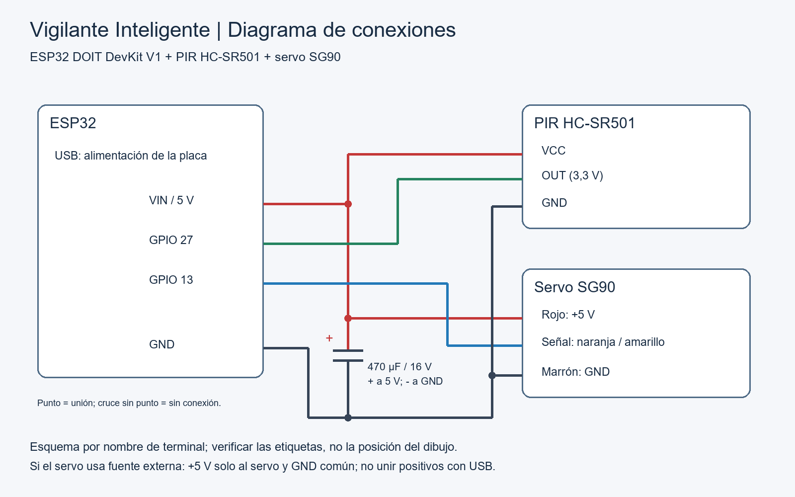

### 2.2 Diagrama de circuito

El objeto utiliza un ESP32 DOIT DevKit V1, un PIR HC-SR501 y un servo SG90 como
pestillo de una puerta de maqueta. El PIR informa movimiento (RF1); no provoca
el cierre automático. El servo recibe órdenes mediante el Shadow (RF3), y el
orquestador publica lecturas y estado en `reported` (RF2).

| Componente | Terminal | Conexión |
|---|---|---|
| PIR HC-SR501 | VCC | VIN / 5 V del USB |
| PIR HC-SR501 | OUT | GPIO 27 |
| PIR HC-SR501 | GND | GND común |
| Servo SG90 | Rojo (V+) | 5 V |
| Servo SG90 | Naranja/amarillo (señal) | GPIO 13 |
| Servo SG90 | Marrón (GND) | GND común |
| Condensador 470 µF / 16 V | Positivo / negativo | 5 V / GND, próximo al servo |

El diagrama es un esquema de conexiones por nombre de terminal; no representa
la posición física de los pines. Verificar las etiquetas del módulo utilizado.
La guía establece salida digital de 3,3 V del PIR hacia el ESP32. No llevar 5 V
a los GPIO. Todo el montaje trabaja a baja tensión; no se emplean LEDs como
actuadores ni cargas de red eléctrica.

Configurar el PIR en modo repetible (jumper H), tiempo Tx al mínimo y
sensibilidad Sx inicialmente al medio. `PirSensor` espera 60 s desde `begin()`
antes de declarar `sensor_listo=true`. Cuenta flancos de subida de la salida,
no personas: esperar a que OUT vuelva a LOW entre ensayos independientes.

Los ángulos iniciales son 90° cerrado y 0° abierto, con 700 ms antes de retirar
la señal PWM. Se ajustan en `include/config.h` al recorrido del montaje,
sin forzar el servo. Retirar PWM no desconecta físicamente la alimentación.
El SG90 no tiene realimentación externa: `reported.puerta` representa la posición
ordenada por software; su correspondencia con el pestillo debe verificarse
visualmente. El mecanismo debe mantener la posición al retirar PWM.

Colocar el condensador respetando la polaridad. Si el pico de consumo reinicia
el ESP32, alimentar el servo con una fuente regulada independiente de 5 V y
unir únicamente sus tierras con la del ESP32; el positivo de esa fuente va al
servo, sin unirlo al VIN alimentado por USB. Desconectar la alimentación para
modificar el cableado.

El estado se reporta por cambio, con separación mínima de 500 ms, y mediante
un latido cada 60 s. Las confirmaciones del actuador y el primer reporte tras
reconectar tienen prioridad. La capa `net/`, de Alejandro, entrega el delta
pendiente tras reconectar; esta capa lo distribuye a los actuadores registrados.

**Estado de verificación:** diagrama y firmware preparados. Montaje, calibración,
carga, detección, estabilidad y reconexión requieren pruebas físicas; no se
presentan mediciones ni fotografías como realizadas.

**Integración de esta base:** `esp32dev` es diagnóstico LOCAL por USB.
No demuestra RF2/RF3 en AWS. `esp32dev-aws` requiere integrar la capa net/ de
Alejandro y sus secretos locales. `ShadowPort` desacopla la capa del objeto de
ese transporte. Los reportes locales incluyen rssi sin asociación WiFi y hora
de detección 0 si NTP aún no se sincronizó; no son métricas de red válidas.
