# Informe técnico — Práctica 4 · Aporte de Rubén (Alexa, skill, lógica en la Nube y reportes)

**Asignatura:** SIS-234 · **Práctica 4:** Procesamiento, almacenamiento y lógica de negocio de objetos inteligentes con AWS y Alexa
**Responsable de estas secciones:** Rubén Cordero
**Capa a cargo:** Lambda de la skill `vigilante-skill` ([`lambda/`](../lambda/)), Lambda de lógica de negocio `vigilante-logica` ([`lambda-logica/`](../lambda-logica/)), modelo de interacción de Alexa ([`alexa/`](../alexa/interaction-model.es-US.json)) y mockups de reportes.

> Este archivo contiene las secciones **§2.4b, §2.5a, §2.9b, §2.10, §2.11, §3.1a, §3.2b, §3.3**, las pruebas a mi cargo (§4) y mis aportes a §6, §7 y §8, para integrarlas en el informe de la Práctica 4.
>
> **Base:** cada sección parte de lo que ya estaba en el informe de la Práctica 3 ([`docs/INFORME.md`](../docs/INFORME.md): §2.4, §2.5, §2.7, §2.8, §3.1, §3.2, §3.3, §4.2 y §4.4), actualizado al código actual y ampliado con la Práctica 4. Lo nuevo se marca con **(P4)**.
>
> El modelo de datos de DynamoDB (§2.8) y las reglas de AWS IoT (§2.9a) son de Alejandro; el almacenamiento (§2.9c), el Edge y los requerimientos (§1.2, §1.3) son de Luciana. Los valores marcados con `[COMPLETAR]` se llenan con las mediciones en vivo.

---

## 2.4b Diagrama de clases de las funciones Lambda

El sistema tiene tres funciones Lambda con responsabilidades separadas. Aquí se describen las dos a mi cargo: `vigilante-skill` (backend de Alexa) y `vigilante-logica` (lógica de negocio en la Nube, **P4**). La de almacenamiento está en §2.4c.

### `vigilante-skill`

La función es el *backend* de la skill. Está escrita en Python 3.13 con el **ASK SDK for Python** (`ask-sdk-core`) y organizada en el paquete [`lambda/vigilante/`](../lambda/vigilante/), con **una responsabilidad por módulo**:

| Módulo | Clases / funciones | Responsabilidad | RF |
|---|---|---|---|
| [`lambda_function.py`](../lambda/lambda_function.py) | `lambda_handler` | Punto de entrada configurado en Lambda (`lambda_function.lambda_handler`). Crea los clientes `boto3` **una sola vez por contenedor** (se reutilizan entre invocaciones) y arma la skill. | — |
| [`vigilante/config.py`](../lambda/vigilante/config.py) | `Settings`, constantes `KEY_*`, `DOOR_*`, `ALARM_*`, `MODE_*`, `ORIGIN_*`, rangos | Lee las variables de entorno y define las **claves del Shadow**, los modos, los rangos de los parámetros y los orígenes, que forman el contrato con el firmware (`include/config.h`). **P4:** modo, `max_detecciones`, `ventana_min`, `origen` y `alarma`. | — |
| [`vigilante/link_repository.py`](../lambda/vigilante/link_repository.py) | `LinkRepository` | Acceso a DynamoDB: `get_thing`, `save` y `delete` de la vinculación `userId → thingName`. | RF7, RF8, RF9 |
| [`vigilante/device_gateway.py`](../lambda/vigilante/device_gateway.py) | `DeviceGateway` | Acceso a AWS IoT Core: valida que el Thing exista (`DescribeThing`), lee y escribe el Shadow (`GetThingShadow` / `UpdateThingShadow`) y espera la confirmación. **P4:** `request_desired` agrega siempre `"origen": "voz"` y `wait_for` confirma cualquier atributo, no solo la puerta. | RF4, RF5, RF6, RF9, RF14 |
| [`vigilante/device_state.py`](../lambda/vigilante/device_state.py) | `DeviceState` | Vista de solo lectura del documento Shadow: `reported`, `desired`, órdenes pendientes y antigüedad del último reporte. **P4:** modo, modo pedido (`target_mode`), parámetros, alarma y origen. | RF4, RF6, RF14 |
| [`vigilante/handlers.py`](../lambda/vigilante/handlers.py) | Interceptor + un manejador por intent | Lógica de voz: resuelve el Thing del usuario en cada solicitud y responde cada intent. **P4:** 8 manejadores nuevos (modo, parámetros, alarma). | RF4 – RF9, RF14 |
| [`vigilante/speech.py`](../lambda/vigilante/speech.py) | Frases y `digits()`, `elapsed()`, `stale_warning()` | Textos en español y SSML (el código se lee dígito por dígito). **P4:** frases de modo, parámetros, alarma, rechazo y origen. | RF4 – RF6, RF14 |
| [`vigilante/skill.py`](../lambda/vigilante/skill.py) | `build_skill()` | Registra el interceptor, los 20 manejadores y el manejador de excepciones, **inyectando las dependencias**. | — |

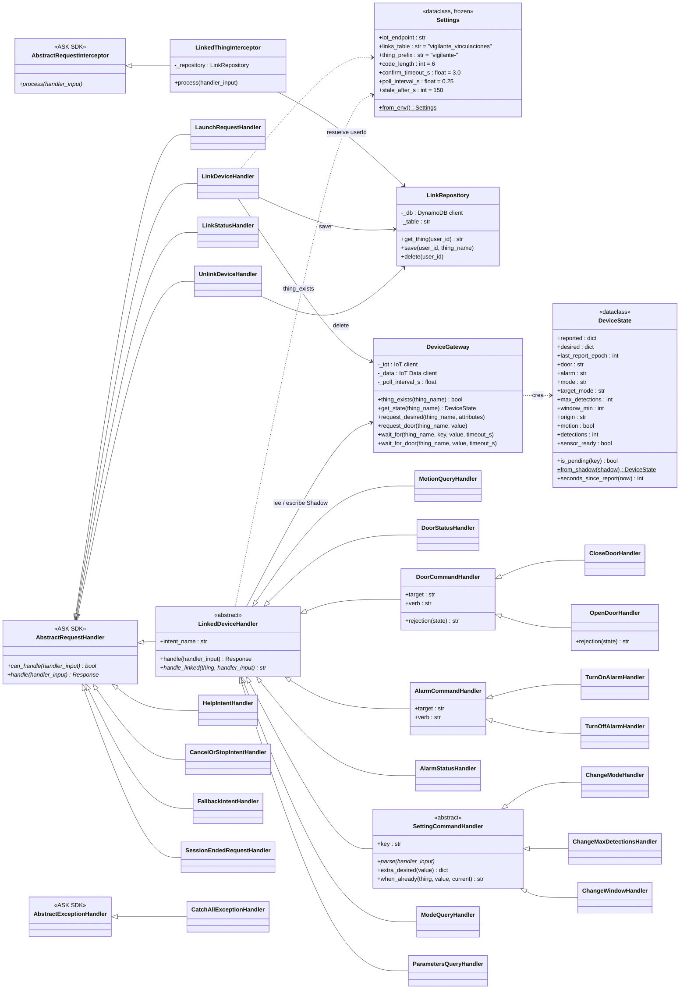

Los manejadores nuevos de la Práctica 4 son `AlarmCommandHandler` (y sus dos subclases), `AlarmStatusHandler`, `SettingCommandHandler` (y sus tres subclases), `ModeQueryHandler` y `ParametersQueryHandler`.

#### Dependencias entre módulos

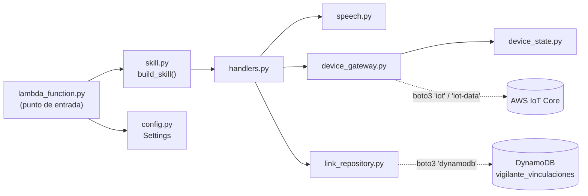

#### Decisiones de diseño

- **Inyección de dependencias.** `build_skill(repository, gateway, settings, now)` ([`build_skill`](../lambda/vigilante/skill.py)) recibe los objetos que hablan con AWS en vez de crearlos. En producción se pasan los clientes `boto3` reales ([`lambda_handler`](../lambda/lambda_function.py)) y en las pruebas, dobles en memoria ([`tests/fakes.py`](../lambda/tests/fakes.py)). Por eso toda la lógica se prueba **sin cuenta de AWS ni red** (§4).
- **Repositorio y gateway** (patrones *Repository* y *Gateway*). Los manejadores no conocen `boto3`: piden "el Thing de este usuario" a `LinkRepository` y "el estado del Thing" a `DeviceGateway`. Si mañana la vinculación pasara a otra base de datos, solo cambiaría `link_repository.py`.
- **Método plantilla** en [`LinkedDeviceHandler`](../lambda/vigilante/handlers.py). `handle()` resuelve el Thing vinculado, responde "aún no tienes un dispositivo vinculado" si no lo hay y traduce los errores de AWS. Cada subclase implementa solo `handle_linked()`. Así ningún intent de dispositivo puede olvidarse del RF8.
- **Interceptor global** ([`LinkedThingInterceptor`](../lambda/vigilante/handlers.py)). Antes de cualquier `LaunchRequest` o `IntentRequest` lee `context.System.user.userId` y busca en DynamoDB el Thing del usuario (RF8). El resultado queda en los atributos de la solicitud y lo usan todos los manejadores.
- **Herencia para los actuadores.** `CloseDoorHandler` y `OpenDoorHandler` solo fijan `target` y `verb`; la lógica de escribir `desired`, esperar la confirmación y medir la latencia está una sola vez en [`DoorCommandHandler`](../lambda/vigilante/handlers.py). **P4:** el buzzer siguió el mismo patrón ([`AlarmCommandHandler`](../lambda/vigilante/handlers.py)), y los ajustes también ([`SettingCommandHandler`](../lambda/vigilante/handlers.py)): validar el slot → comparar con `reported` → escribir `desired` con `origen: voz` → esperar hasta 3 s → responder.
- **Extensible sin rediseño (comprobado en P4).** En la Práctica 3 se anticipó que agregar el buzzer requeriría solo una constante, una propiedad en `DeviceState` y un manejador nuevo. Así fue: la alarma se agregó con `KEY_ALARM`, `DeviceState.alarm` y tres manejadores, sin cambiar los módulos existentes.
- **(P4) Ganchos para convivir con la lógica automática** (§2.10): `OpenDoorHandler.rejection()` rechaza abrir en `automatico` o `bloqueo`; `ChangeModeHandler.extra_desired()` agrega `puerta: cerrada` al pasar a bloqueo y `alarma: apagada` al pasar a manual; `when_already()` apaga la alarma si se pide manual estando ya en manual.

### `vigilante-logica` (P4, [`lambda-logica/lambda_function.py`](../lambda-logica/lambda_function.py))

Es una función **funcional y sin estado**: cada invocación decide solo con el mensaje de la regla y una consulta al historial. Los clientes `boto3` se crean una vez por contenedor.

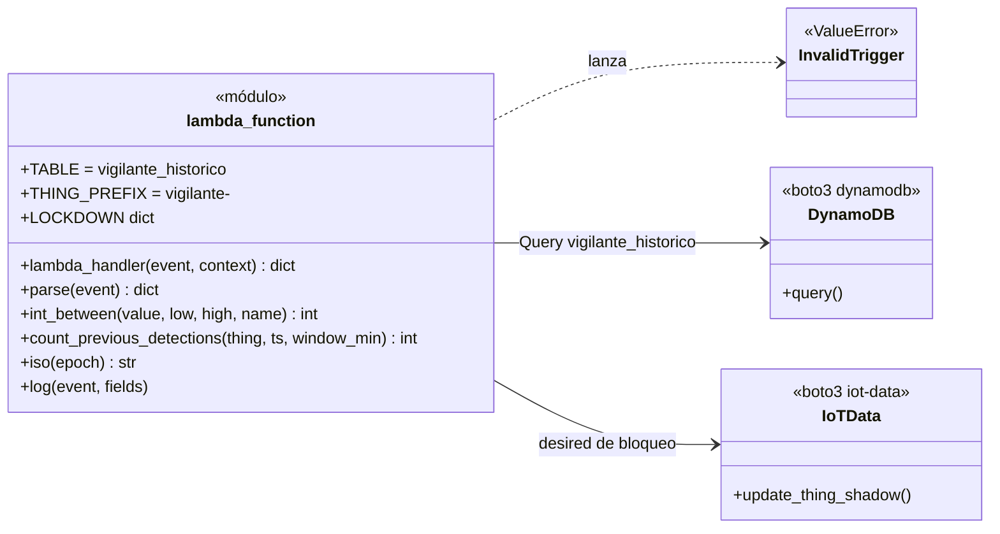

| Función | Entrada | Salida | Qué hace |
|---|---|---|---|
| `lambda_handler(event, context)` | Mensaje de la regla `vigilante_deteccion` | `{accion, detecciones_en_ventana, …}` | Orquesta: valida, cuenta y, si corresponde, bloquea |
| `parse(event)` | `thingName`, `ts`, `modo`, `max_detecciones`, `ventana_min` | dict validado o `InvalidTrigger` | `thingName` = `vigilante-` + 6 dígitos; rangos 1–20 y 1–120 |
| `count_previous_detections(thing, ts, window_min)` | Thing, instante, ventana | entero | `Query` con `Select: COUNT` entre `deteccion#<ts − ventana>` y `deteccion#<ts − 1>`, filtrando `modo = automatico`; sigue `LastEvaluatedKey` |
| `iso(epoch)` | epoch en segundos | `AAAA-MM-DDTHH:MM:SSZ` | Mismo formato que la clave `tipo_ts` que escribe el almacenamiento |

---

## 2.5a Diagramas de secuencia (vinculación, consulta, comandos y regla de la Nube)

Las secuencias recorren el sistema desde el usuario hasta el objeto inteligente. Las tres primeras vienen de la Práctica 3; las dos últimas son nuevas.

### Vinculación de un Thing (vincular, rechazar, cambiar y desvincular)

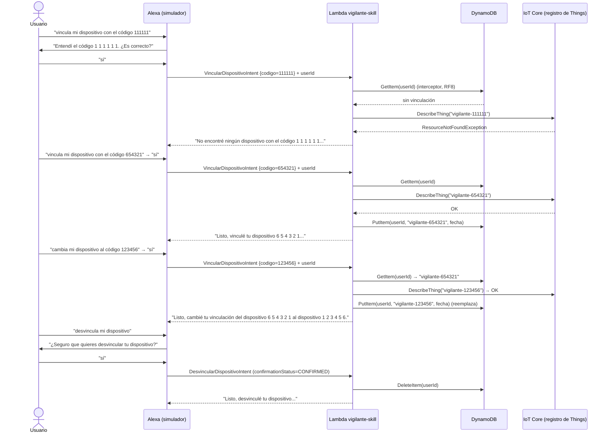

### Consulta del sensor: "¿hay movimiento?"

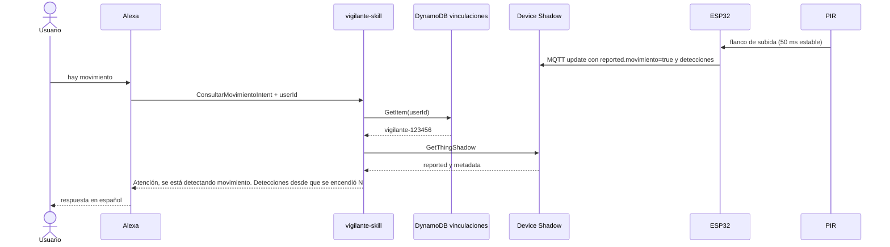

Si el último reporte tiene más de 150 s, la respuesta agrega "puede estar desconectado"; si el PIR está en su minuto de calentamiento, responde "el sensor se está calibrando".

### Comando y reconexión: "abre la puerta"

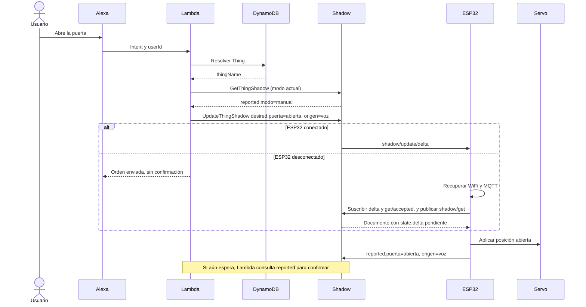

**(P4)** Si `reported.modo` (o el modo pedido y aún pendiente) es `automatico` o `bloqueo`, la Lambda rechaza la orden después de leer el Shadow y no escribe `desired` (§2.10).

### (P4) Comando de modo: "cambia el modo a bloqueo"

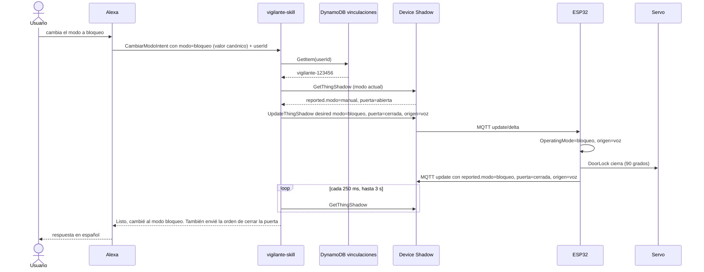

### (P4) Regla de la Nube: bloqueo por exceso de detecciones (RF13)

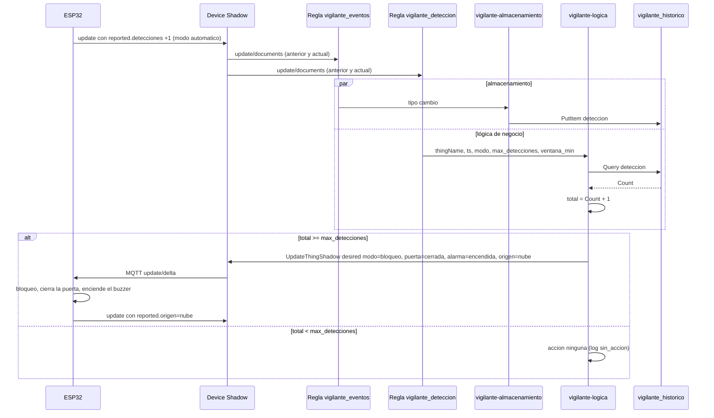

La consulta termina en `ts − 1` porque `vigilante-almacenamiento` guarda la detección actual **al mismo tiempo** (bloque `par`): según qué termine primero, esa fila puede estar o no en la tabla. Contando solo las anteriores y sumando 1 por la actual, el resultado es el mismo en los dos casos.

---

## 2.9b (P4) Diseño de la Lambda de lógica de negocio `vigilante-logica`

| Aspecto | Diseño |
|---|---|
| **Responsabilidad** | Única: decidir si el Thing pasa a bloqueo por exceso de detecciones en la ventana. No guarda datos ni responde a Alexa |
| **Disparador** | Regla de AWS IoT `vigilante_deteccion` (SQL en [`aws/iot-rules/vigilante_deteccion.sql`](../aws/iot-rules/vigilante_deteccion.sql), §2.9a): solo cuando sube `detecciones` y el modo reportado es `automatico` |
| **Entrada** | `{thingName, ts, detecciones, modo, max_detecciones, ventana_min}` (ejemplo: [`events/01_deteccion_automatico.json`](../lambda-logica/events/01_deteccion_automatico.json)) |
| **Recursos** | Lee `vigilante_historico` con `dynamodb:Query`; escribe `desired` con `iot:UpdateThingShadow` |
| **Salida sobre el objeto** | Solo `desired = {modo: bloqueo, puerta: cerrada, alarma: encendida, origen: nube}` (RF13: actúa únicamente por `desired`) |
| **Permisos mínimos** | [`politica-rol.json`](../lambda-logica/politica-rol.json): `dynamodb:Query` sobre la tabla del historial e `iot:UpdateThingShadow` sobre `thing/vigilante-*` |

**Por qué la lógica está en la Nube y en una Lambda aparte:**

- **Depende del historial.** Contar detecciones de los últimos N minutos necesita datos que el ESP32 no guarda (pierde el conteo al reiniciar) y que sí están en `vigilante_historico`.
- **Se cambia sin reprogramar el objeto.** El umbral y la ventana se ajustan por voz (`max_detecciones`, `ventana_min`), y la regla misma se actualiza desplegando la Lambda, sin tocar el firmware.
- **Responsabilidad única y mínimo privilegio.** Separada del almacenamiento, esta función no necesita `PutItem` y la de almacenamiento no necesita tocar el Shadow. Cada una tiene solo sus dos o una acciones.
- **Frecuencia y costo.** La regla SQL filtra antes de invocar: la Lambda corre solo en detecciones en modo automático, no en cada latido de 60 s.
- **`Query` y no `Scan`.** La clave `thingName` + `tipo_ts` permite leer solo las detecciones del Thing en la ventana; el costo no crece con el tamaño de la tabla.
- **Idempotente.** Si llegan más detecciones antes de que el ESP32 pase a bloqueo, la Lambda vuelve a escribir el mismo `desired`; no hay efecto acumulado. Una vez en bloqueo, la regla ya no la invoca (filtra `modo = automatico`).

---

## 2.10 Diseño de la skill de Alexa (actualizado)

| Parámetro | Valor |
|---|---|
| Nombre de la skill | Vigilante Inteligente |
| Nombre de invocación | `vigilante inteligente` |
| Idioma | Spanish (US) — `es-US` |
| Modelo | Custom, *Provision your own* (backend propio en AWS Lambda) |
| Endpoint | ARN de `vigilante-skill` en `us-east-2` |
| Archivo exportado | [`alexa/interaction-model.es-US.json`](../alexa/interaction-model.es-US.json): 20 intents (15 propios y 5 de Amazon) y el tipo propio `TipoModo` **(P4)** |

### Intents, slots y frases de ejemplo

| Intent | Slot | Frases de ejemplo (todas las del modelo) | Manejador | RF |
|---|---|---|---|---|
| `VincularDispositivoIntent` | `codigo` · `AMAZON.NUMBER` · obligatorio y con confirmación | "vincula mi dispositivo con el código {codigo}", "vincula mi dispositivo", "vincular mi dispositivo", "vincula el dispositivo {codigo}", "vincular con el código {codigo}", "mi código es {codigo}", "el código de mi dispositivo es {codigo}", "registra mi dispositivo con el código {codigo}", "cambia mi dispositivo al código {codigo}", "cambia la vinculación al código {codigo}", "cambiar de dispositivo" | `LinkDeviceHandler` | RF7, RF9 |
| `ConsultarVinculacionIntent` | — | "qué dispositivo tengo vinculado", "cuál es mi dispositivo", "qué código tiene mi dispositivo", "tengo un dispositivo vinculado" | `LinkStatusHandler` | RF8 |
| `DesvincularDispositivoIntent` | — (confirmación del intent) | "desvincula mi dispositivo", "desvincular mi dispositivo", "elimina la vinculación", "borra mi dispositivo", "olvida mi dispositivo", "quita mi dispositivo" | `UnlinkDeviceHandler` | RF9 |
| `ConsultarMovimientoIntent` | — | "hay movimiento", "se detecta movimiento", "detectó algo el sensor", "hay alguien cerca", "hay algún intruso", "hubo movimiento", "qué dice el sensor", "estado del sensor", "cuántas detecciones hubo", "alguien se acercó al objeto" | `MotionQueryHandler` | RF4 |
| `CerrarPuertaIntent` | — | "cierra la puerta", "cerrar la puerta", "bloquea la puerta", "asegura la puerta", "pon el seguro", "cierra con llave" | `CloseDoorHandler` | RF5 |
| `AbrirPuertaIntent` | — | "abre la puerta", "abrir la puerta", "desbloquea la puerta", "quita el seguro" | `OpenDoorHandler` | RF5 |
| `EstadoPuertaIntent` | — | "la puerta está cerrada", "la puerta está abierta", "cómo está la puerta", "estado de la puerta", "está cerrada la puerta", "está abierta la puerta" | `DoorStatusHandler` | RF6 |
| **`CambiarModoIntent` (P4)** | `modo` · `TipoModo` · se pide si falta | "cambia el modo a {modo}", "cambia a modo {modo}", "pon el modo {modo}", "pon el modo en {modo}", "activa el modo {modo}", "pasa a modo {modo}", "modo {modo}", "cambia el modo", "cambiar el modo de operación" | `ChangeModeHandler` | RF14 |
| **`ConsultarModoIntent` (P4)** | — | "en qué modo está", "en qué modo está el dispositivo", "qué modo tiene", "cuál es el modo", "cuál es el modo actual", "modo actual" | `ModeQueryHandler` | RF14 |
| **`CambiarMaxDeteccionesIntent` (P4)** | `numero` · `AMAZON.NUMBER` (1–20) · se pide si falta | "cambia el máximo de detecciones a {numero}", "pon el máximo de detecciones en {numero}", "máximo de detecciones {numero}", "el máximo de detecciones es {numero}", "permite {numero} detecciones", "cambia el límite de detecciones a {numero}", "cambia el máximo de detecciones" | `ChangeMaxDetectionsHandler` | RF14 |
| **`CambiarVentanaIntent` (P4)** | `minutos` · `AMAZON.NUMBER` (1–120) · se pide si falta | "cambia la ventana a {minutos} minutos", "cambia la ventana a {minutos}", "pon la ventana en {minutos} minutos", "ventana de {minutos} minutos", "la ventana es de {minutos} minutos", "cuenta las detecciones en {minutos} minutos", "cambia la ventana" | `ChangeWindowHandler` | RF14 |
| **`ConsultarParametrosIntent` (P4)** | — | "cuáles son los parámetros", "qué parámetros tiene", "cómo está configurado", "consulta la configuración", "cuál es el máximo de detecciones", "cuál es la ventana", "dime la configuración" | `ParametersQueryHandler` | RF14 |
| **`EncenderAlarmaIntent` (P4)** | — | "enciende la alarma", "activa la alarma", "haz sonar la alarma", "suena la alarma", "prende la alarma", "enciende el buzzer", "activa la sirena" | `TurnOnAlarmHandler` | RF5 |
| **`ApagarAlarmaIntent` (P4)** | — | "apaga la alarma", "desactiva la alarma", "silencia la alarma", "calla la alarma", "detén la alarma", "apaga el buzzer", "apaga la sirena", "ya basta de alarma" | `TurnOffAlarmHandler` | RF5 |
| **`EstadoAlarmaIntent` (P4)** | — | "está sonando la alarma", "la alarma está encendida", "cómo está la alarma", "estado de la alarma", "está activa la alarma", "la alarma está sonando" | `AlarmStatusHandler` | RF6 |
| `AMAZON.HelpIntent` | — | integrada ("ayuda") | `HelpIntentHandler` | — |
| `AMAZON.CancelIntent`, `AMAZON.StopIntent`, `AMAZON.NavigateHomeIntent` | — | integradas ("salir", "cancela", "para") | `CancelOrStopIntentHandler` | — |
| `AMAZON.FallbackIntent` | — | integrada (frases que no coinciden con ningún intent) | `FallbackIntentHandler` | — |

La correspondencia **intent ↔ manejador** se verifica automáticamente en las dos direcciones (`test_cada_intent_del_modelo_tiene_manejador_en_la_lambda` y `test_cada_manejador_corresponde_a_un_intent_del_modelo`). En la Práctica 3 esa prueba encontró que `AMAZON.NavigateHomeIntent`, obligatorio en todo modelo, no tenía manejador; se corrigió agregándolo a `CancelOrStopIntentHandler`. En la Práctica 4 la misma prueba exigió agregar al modelo los intents nuevos antes de registrar sus manejadores.

**(P4) Tipo propio `TipoModo`:**

| Valor canónico (el que se guarda en el Shadow) | Sinónimos que entiende Alexa |
|---|---|
| `manual` | "normal", "por voz", "modo manual" |
| `automatico` | "automático", "automática", "auto", "modo automático" |
| `bloqueo` | "bloqueado", "bloqueada", "máxima seguridad", "modo bloqueo" |

La Lambda lee el **valor canónico** que resuelve Alexa en `resolutions` ([`_resolved_slot`](../lambda/vigilante/handlers.py)), no el texto dicho: así "automático" con tilde llega como `automatico`, el valor que acepta el firmware. Una prueba de contrato verifica que los valores de `TipoModo` sean exactamente los modos de `config.py` y `config.h`.

**(P4) Validación de los números:** si `numero` o `minutos` llegan vacíos, como "?" o fuera de rango (por ejemplo 25 detecciones), la skill responde el rango válido y **no escribe el Shadow** ([`_int_in_range`](../lambda/vigilante/handlers.py)).

### Modelo de diálogo (delegación automática)

`delegationStrategy: ALWAYS`: Alexa resuelve el diálogo antes de llamar a la Lambda, así que la Lambda recibe siempre el intent completo (`dialogState: COMPLETED`).

| Intent | Configuración | Prompt | Por qué |
|---|---|---|---|
| `VincularDispositivoIntent` | slot `codigo` con *elicitation* | `Elicit.Slot.Vincular.codigo`: "¿Cuál es el código de seis dígitos que muestra tu dispositivo?" | Si el usuario dice solo "vincula mi dispositivo", Alexa pide el código. |
| `VincularDispositivoIntent` | slot `codigo` con *confirmation* | `Confirm.Slot.Vincular.codigo` (SSML): "Entendí el código `<say-as interpret-as="digits">`{codigo}`</say-as>`. ¿Es correcto?" | El reconocimiento de números largos por voz puede fallar; repetirlo dígito por dígito evita vincular un Thing equivocado. |
| `DesvincularDispositivoIntent` | confirmación del intent | `Confirm.Intent.Desvincular`: "¿Seguro que quieres desvincular tu dispositivo?" | Es una operación destructiva. Si el usuario dice "no", la Lambda recibe `confirmationStatus=DENIED` y conserva la vinculación. |
| **`CambiarModoIntent` (P4)** | slot `modo` con *elicitation* | `Elicit.Slot.CambiarModo.modo`: "¿Qué modo quieres? Puedes decir manual, automático o bloqueo." | "Cambia el modo" sin decir cuál no debe escribir nada. Sin confirmación: es reversible. |
| **`CambiarMaxDeteccionesIntent` (P4)** | slot `numero` con *elicitation* | `Elicit.Slot.CambiarMaxDetecciones.numero`: "¿Cuál debe ser el máximo de detecciones? Di un número entre uno y veinte." | Indica el rango antes de que el usuario responda. |
| **`CambiarVentanaIntent` (P4)** | slot `minutos` con *elicitation* | `Elicit.Slot.CambiarVentana.minutos`: "¿De cuántos minutos debe ser la ventana? Di un número entre uno y ciento veinte." | Ídem. |

### Respuestas y manejo de la sesión

- Todas las respuestas, salvo "salir"/"cancelar", **mantienen la sesión abierta** con un *reprompt* ("¿Algo más?"), de modo que en el simulador se encadena todo el guion sin repetir "abre vigilante inteligente".
- Los códigos se leen con SSML `<say-as interpret-as="digits">` ("uno dos tres cuatro cinco seis", no "ciento veintitrés mil…").
- **(P4)** En el Shadow los modos van sin tilde; Alexa los dice con la ortografía correcta ("automático").

| Situación | Respuesta de la skill |
|---|---|
| Abrir sin vínculo | "Bienvenido a Vigilante Inteligente. Aún no tienes un dispositivo vinculado. Di: vincula mi dispositivo con el código, seguido de los seis dígitos que muestra tu dispositivo." |
| Abrir con vínculo | "Bienvenido a Vigilante Inteligente. Puedes preguntarme si hay movimiento, pedirme que cierre o abra la puerta, encender o apagar la alarma, o cambiar el modo de operación. ¿Qué deseas hacer?" |
| Consulta o comando sin vínculo (RF8) | "Aún no tienes un dispositivo vinculado. Di: vincula mi dispositivo con el código…" |
| Movimiento (RF4) | "¡Atención! Se está detectando movimiento en este momento." / "No se detecta movimiento en este momento. La última detección fue hace 10 minutos. Detecciones desde que se encendió: 3." |
| Sensor calentando (primer minuto del PIR) | "El sensor de movimiento se está calibrando, espera un minuto." |
| Comando confirmado (RF5) | "Listo, la puerta quedó cerrada." |
| Comando sin confirmar en 3 s | "Envié la orden de cerrar la puerta, pero el dispositivo aún no la confirmó. Se aplicará en cuanto se conecte." |
| Estado de la puerta (RF6) | "La puerta está cerrada." (+ "Hay una orden pendiente para dejarla abierta." si `desired ≠ reported`) |
| **(P4)** Puerta cerrada por el Edge | "La puerta está cerrada. La cerró el sistema automáticamente al detectar movimiento." |
| **(P4)** Cambio de modo | "Listo, cambié al modo automático: la puerta se cierra sola cuando el sensor detecta movimiento." |
| **(P4)** Consultar modo | "El dispositivo está en modo manual: la puerta solo se abre o se cierra cuando tú lo pides." |
| **(P4)** Parámetros | "Listo, el máximo de detecciones ahora es 3." / "Modo automático. Máximo de detecciones: 3. Ventana: 10 minutos." |
| **(P4)** Número fuera de rango | "El máximo de detecciones debe ser un número entre 1 y 20." (no se escribe el Shadow) |
| **(P4)** Alarma | "Listo, la alarma quedó encendida." / "La alarma está sonando. La activó la nube al superar el máximo de detecciones dentro de la ventana configurada." |
| Sin reporte en 150 s | Se agrega: "Ojo: el dispositivo no se comunica desde hace 3 minutos, puede estar desconectado." |
| Dispositivo que nunca reportó | "Tu dispositivo todavía no ha enviado datos. Verifica que esté encendido y conectado." |

### (P4) Cómo conviven los comandos de voz con la lógica automática

| Situación | Comportamiento | Por qué |
|---|---|---|
| "abre la puerta" en `automatico` o `bloqueo` | Se **rechaza** con una explicación: "No puedo abrir la puerta porque el dispositivo está en modo automático: la puerta se cierra sola cuando el sensor detecta movimiento. Si quieres abrirla, primero di: cambia el modo a manual." No se escribe `desired` | La regla del Edge volvería a cerrarla con el siguiente movimiento: abrir sería un conflicto sobre el mismo actuador |
| "cierra la puerta", "enciende / apaga la alarma" en cualquier modo | Se ejecutan | Van en el mismo sentido que la protección o la desactivan explícitamente |
| "cambia el modo a bloqueo" | `desired = {modo: bloqueo, puerta: cerrada, origen: voz}` en una sola escritura | Bloqueo implica puerta cerrada, igual que cuando lo activa la Nube |
| "cambia el modo a manual" | `desired = {modo: manual, alarma: apagada, origen: voz}`; si ya estaba en manual y la alarma suena, la apaga igual | Volver a manual es retomar el control: no debe quedar sonando |
| Cambio de modo pendiente (ESP32 sin conexión) | `target_mode` usa el modo pedido: si el usuario pidió `automatico`, "abre la puerta" ya se rechaza | Se respeta la última decisión del usuario aunque el ESP32 aún no la aplicó |
| La puerta la cerró el Edge o la alarma la activó la Nube | Las consultas de estado dicen quién actuó (leen `reported.origen`) | El usuario entiende por qué el objeto cambió sin que él lo pidiera |

### Mecanismo de vinculación (de la Práctica 3, sin cambios)

**Identificador.** Cada objeto inteligente se registra en AWS IoT Core como un Thing llamado **`vigilante-` + código de 6 dígitos** que no empieza con 0 (p. ej. `vigilante-123456`). El usuario vincula su dispositivo diciendo solo el **código de vinculación** (`123456`), y la Lambda reconstruye el nombre del Thing anteponiendo el prefijo `THING_PREFIX = "vigilante-"`.

- El ESP32 muestra el código al arrancar (`Código de vinculación: 123456` en el monitor serie) y va impreso en una etiqueta sobre el dispositivo, como el número de serie de un electrodoméstico.
- Se dicta como número (*slot* `AMAZON.NUMBER`), que Alexa reconoce mejor que un nombre con guiones como `vigilante-123456`, y Alexa lo repite dígito por dígito para confirmarlo.
- El prefijo fijo cumple dos funciones: evita que un usuario vincule cualquier Thing de la cuenta y permite que el rol IAM de la Lambda dé permisos solo sobre `thing/vigilante-*` (§3.2b).
- Hay **900 000** códigos posibles (100000–999999). Los dos códigos de esta demo (123456 y 654321) son fáciles de dictar, pero también de adivinar; en un despliegue real se reemplazarían por códigos aleatorios (§7).

La tabla `vigilante_vinculaciones` (clave `userId`) se describe en el modelo de datos (§2.8).

| Operación (frase) | Validaciones, en orden | Efecto en DynamoDB | RF |
|---|---|---|---|
| **Resolver** (cualquier solicitud) | Lee `userId` del request | `GetItem(userId)` con lectura **fuertemente consistente** (`ConsistentRead=True`), para ver de inmediato una vinculación recién hecha | RF8 |
| **Vincular** ("vincula mi dispositivo con el código 123456") | 1. Alexa repite el código y pide confirmación (modelo de diálogo). 2. El código tiene exactamente 6 dígitos. 3. El Thing `vigilante-<código>` **existe** en IoT Core (`DescribeThing`). 4. No es el mismo Thing ya vinculado. | `PutItem(userId, thingName, fechaVinculacion)` | RF7, RF9 |
| **Cambiar** ("cambia mi dispositivo al código 654321") | Las mismas validaciones que vincular | `PutItem` **reemplaza** la fila del usuario (no se duplica) | RF9 |
| **Consultar** ("qué dispositivo tengo vinculado") | — | Usa el resultado del interceptor | RF8 |
| **Desvincular** ("desvincula mi dispositivo") | 1. El usuario tiene un Thing. 2. Alexa pide confirmación del intent; si dice "no", no se borra nada. | `DeleteItem(userId)` | RF9 |

Código: validación en [`LinkDeviceHandler`](../lambda/vigilante/handlers.py), existencia del Thing en [`DeviceGateway.thing_exists`](../lambda/vigilante/device_gateway.py) y persistencia en [`link_repository.py`](../lambda/vigilante/link_repository.py).

**Por qué se valida con `DescribeThing` y no leyendo el Shadow:** el Thing de prueba `vigilante-654321` (y cualquier dispositivo recién fabricado que aún no se conectó) **no tiene Shadow** hasta su primer reporte. El registro de Things de IoT Core es la fuente de verdad sobre qué dispositivos existen.

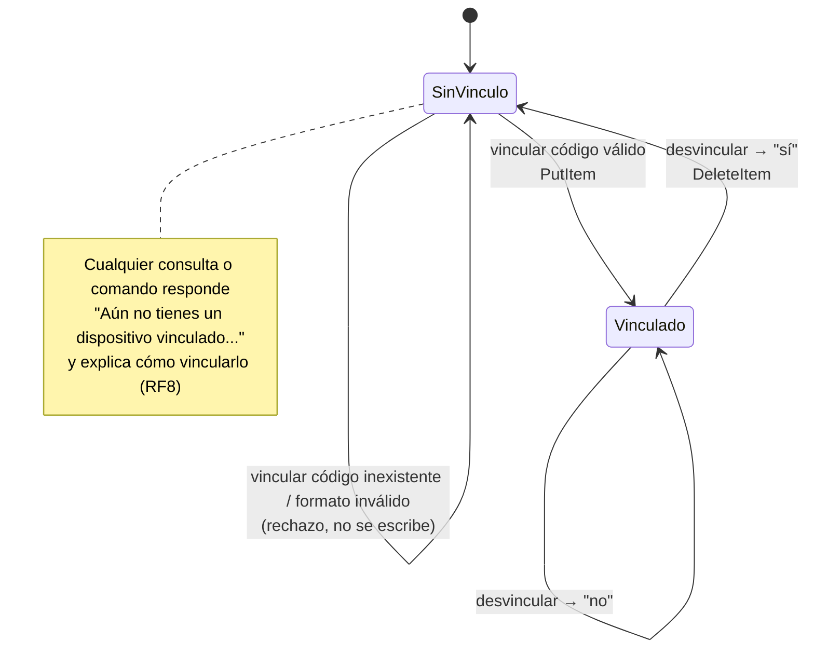

- **Varios usuarios, cada uno con su Thing.** La skill no está atada a un Thing fijo: el Thing se resuelve por `userId` en cada solicitud, y los datos del historial se distinguen por `thingName`.
- **Un Thing puede tener varios usuarios** (p. ej. los miembros de una familia). La práctica deja Account Linking (OAuth) fuera del alcance; la protección contra vincular un objeto ajeno es que el código no sea trivial de adivinar.
- **Sin escrituras parciales.** Solo se escribe en DynamoDB después de pasar todas las validaciones.

### Flujo de la conversación (actualizado)

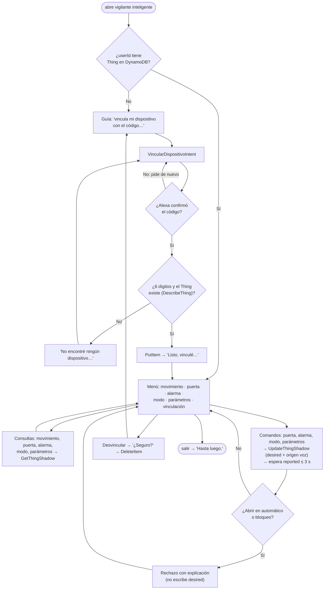

---

## 2.11 (P4) Diseño de reportes (mockups) — RF15

Los tres reportes se construyen **solo con consultas `Query` por clave** sobre `vigilante_historico` (clave de partición `thingName`, clave de ordenamiento `tipo_ts` = `<tipo>#<fecha ISO>`, §2.8). Cada fila de evento guarda el valor nuevo, el `anterior` y el `origen`; cada detección guarda el `modo` y la `puerta` de ese momento.

### Reporte 1 — Actividad del día

Para decidir: ¿hay más movimiento del normal?, ¿a qué hora?, ¿el modo automático está cerrando la puerta?

```text
┌──────────────────────────────────────────────────────────────────────┐
│  Vigilante Inteligente · vigilante-123456          Hoy, 24 nov 2026   │
├──────────────────────────────────────────────────────────────────────┤
│  Detecciones hoy        Última detección        Modo actual           │
│      [ 14 ]             hace 12 min (15:31)     AUTOMÁTICO            │
├──────────────────────────────────────────────────────────────────────┤
│  Detecciones por hora                                                 │
│  08h ▇▇                                                               │
│  09h ▇▇▇▇▇                                                            │
│  10h ▇                                                                │
│  …                                                                    │
│  15h ▇▇▇▇▇▇                                                           │
├──────────────────────────────────────────────────────────────────────┤
│  En modo automático: 11   ·   En manual: 3   ·   Cierres del Edge: 4  │
└──────────────────────────────────────────────────────────────────────┘
```

 [COMPLETAR]

| Elemento | Consulta en DynamoDB |
|---|---|
| Detecciones hoy y por hora | `Query thingName = :t AND tipo_ts BETWEEN 'deteccion#2026-11-24T00:00:00Z' AND 'deteccion#2026-11-24T23:59:59Z'`; se agrupa por hora con `fecha` |
| Última detección | La misma consulta con `ScanIndexForward = false, Limit = 1` |
| Modo actual | `Query thingName = :t AND begins_with(tipo_ts, 'lectura#')` con `ScanIndexForward = false, Limit = 1` → atributo `modo` |
| Automático / manual | Atributo `modo` de cada fila `deteccion#` del día |
| Cierres del Edge | `Query tipo_ts BETWEEN 'puerta#<hoy 00:00>' AND 'puerta#<hoy 23:59>'`, contando las filas con `puerta = cerrada` y `origen = edge` |

### Reporte 2 — Historial de la puerta y la alarma

Para decidir: ¿quién abrió o cerró?, ¿la alarma se activó sola o por voz?, ¿hay aperturas en horarios raros?

```text
┌──────────────────────────────────────────────────────────────────────┐
│  Eventos de actuadores · vigilante-123456     Del 18 al 24 nov 2026   │
│  Filtro: [Puerta ▾] [Alarma ▾]   Origen: [Todos ▾]                    │
├──────────────────┬──────────┬───────────────────────┬────────────────┤
│ Fecha y hora     │ Actuador │ Cambio                │ Origen         │
├──────────────────┼──────────┼───────────────────────┼────────────────┤
│ 24 nov 15:31:07  │ Puerta   │ abierta → cerrada     │ edge (auto)    │
│ 24 nov 15:20:44  │ Alarma   │ apagada → encendida   │ nube (bloqueo) │
│ 24 nov 15:20:44  │ Puerta   │ abierta → cerrada     │ nube (bloqueo) │
│ 24 nov 09:02:13  │ Puerta   │ cerrada → abierta     │ voz            │
│ …                │          │                       │                │
├──────────────────┴──────────┴───────────────────────┴────────────────┤
│  Totales: puerta 18 (voz 9 · edge 6 · nube 3) · alarma 5              │
└──────────────────────────────────────────────────────────────────────┘
```

 [COMPLETAR]

| Elemento | Consulta en DynamoDB |
|---|---|
| Eventos de la puerta en el rango | `Query thingName = :t AND tipo_ts BETWEEN 'puerta#2026-11-18T00:00:00Z' AND 'puerta#2026-11-24T23:59:59Z'` → `fecha`, `anterior`, `puerta`, `origen` |
| Eventos de la alarma | La misma consulta con el prefijo `alarma#` → `anterior`, `alarma`, `origen` |
| Totales por origen | Conteo en el cliente sobre las filas devueltas |

### Reporte 3 — Bloqueos y configuración

Para decidir: ¿el umbral está bien elegido?, ¿cuántas veces se bloqueó?, ¿hace falta subir `max_detecciones` o acortar la ventana?

```text
┌──────────────────────────────────────────────────────────────────────┐
│  Bloqueos · vigilante-123456                  Últimos 7 días         │
├──────────────────────────────────────────────────────────────────────┤
│  Bloqueos por la nube: [ 3 ]    Configuración actual: 3 en 10 min     │
├──────────────────┬───────────────────────┬───────────────────────────┤
│ Fecha y hora     │ Cambio de modo        │ Origen                    │
├──────────────────┼───────────────────────┼───────────────────────────┤
│ 24 nov 15:20:44  │ automatico → bloqueo  │ nube (exceso)             │
│ 24 nov 15:45:10  │ bloqueo → manual      │ voz                       │
│ 22 nov 21:07:31  │ automatico → bloqueo  │ nube (exceso)             │
│ …                │                       │                           │
├──────────────────┴───────────────────────┴───────────────────────────┤
│  Tiempo medio en bloqueo antes de volver a manual: 24 min             │
└──────────────────────────────────────────────────────────────────────┘
```

 [COMPLETAR]

| Elemento | Consulta en DynamoDB |
|---|---|
| Cambios de modo de la semana | `Query thingName = :t AND tipo_ts BETWEEN 'modo#2026-11-18T00:00:00Z' AND 'modo#2026-11-24T23:59:59Z'` → `anterior`, `modo`, `origen` |
| Bloqueos por la nube | Filas con `modo = bloqueo` y `origen = nube` de esa consulta |
| Tiempo medio en bloqueo | Diferencia entre cada `→ bloqueo` y el siguiente `bloqueo →` de la misma consulta |
| Configuración actual | Última `lectura#` (orden descendente, `Limit = 1`) → `max_detecciones`, `ventana_min` |

**Límites del modelo para estos reportes:** todos se resuelven por Thing, que es el patrón de acceso del caso de uso (un dueño mira su propio objeto). Un reporte que compare varios Things a la vez necesitaría un índice secundario global con `tipo` como clave, que hoy no se justifica. Las filas se borran a los 30 días por el TTL, así que los reportes cubren como máximo ese período.

---

## 3.1a Estructura del código de las funciones Lambda

| Ruta | Contenido |
|---|---|
| [`lambda/lambda_function.py`](../lambda/lambda_function.py) | Punto de entrada de `vigilante-skill` |
| [`lambda/vigilante/`](../lambda/vigilante/) | Paquete de la skill (§2.4b) |
| [`lambda/events/`](../lambda/events/) | 17 eventos para la pestaña *Test* de la consola (del 01 al 09 de la Práctica 3; del 10 al 17, **P4**) |
| [`lambda/tests/`](../lambda/tests/) | 144 pruebas pytest: skill, modos, alarma, guion del simulador y contratos entre capas |
| [`lambda/build.sh`](../lambda/build.sh), [`build.ps1`](../lambda/build.ps1) | Arman `lambda/build/lambda_deployment.zip` con `ask-sdk-core` y `python-dateutil < 3` (sin `boto3`, que ya trae Lambda) |
| **(P4)** [`lambda-logica/lambda_function.py`](../lambda-logica/lambda_function.py) | `vigilante-logica`; solo biblioteca estándar y `boto3`, se despliega pegando el archivo en la consola |
| **(P4)** [`lambda-logica/events/`](../lambda-logica/events/) | Mensajes de ejemplo de la regla (modo automático y manual) |
| **(P4)** [`lambda-logica/tests/test_logica.py`](../lambda-logica/tests/test_logica.py) | 15 pruebas con DynamoDB e IoT Data simulados |

**Fragmentos clave (de la Práctica 3, con las líneas actuales):**

- [`LinkedThingInterceptor.process`](../lambda/vigilante/handlers.py): resuelve en cada solicitud el Thing del `userId` (RF8).
- [`LinkDeviceHandler.handle`](../lambda/vigilante/handlers.py): valida el código y la existencia del Thing antes de guardar (RF7, RF9).
- [`DoorCommandHandler.handle_linked`](../lambda/vigilante/handlers.py): escribe `desired`, espera la confirmación en `reported` y registra `latencia_ms` (RF5, RNF3).

**Fragmentos clave nuevos (P4):**

- [`DeviceGateway.request_desired`](../lambda/vigilante/device_gateway.py): toda escritura en `desired` lleva `"origen": "voz"`; así el ESP32 y el historial distinguen una orden de voz de una del Edge o de la Nube (RF12).
- [`DeviceGateway.wait_for`](../lambda/vigilante/device_gateway.py): espera hasta 3 s, consultando cada 250 ms, a que `reported[clave]` sea el valor pedido; sirve para la puerta, la alarma, el modo y los parámetros.
- [`SettingCommandHandler.handle_linked`](../lambda/vigilante/handlers.py): flujo común de los ajustes (validar → comparar con `reported` → escribir `desired` con sus extras → esperar → responder).
- [`ChangeModeHandler.extra_desired`](../lambda/vigilante/handlers.py): bloqueo agrega `puerta: cerrada`; manual agrega `alarma: apagada`.
- [`OpenDoorHandler.rejection`](../lambda/vigilante/handlers.py): rechaza abrir en `automatico` o `bloqueo` según `target_mode`.
- [`AlarmStatusHandler`](../lambda/vigilante/handlers.py): dice si la alarma suena y si la activó el Edge o la Nube.
- [`count_previous_detections`](../lambda-logica/lambda_function.py): `Query` con `Select: COUNT` y paginación por `LastEvaluatedKey`.
- [`lambda_handler`](../lambda-logica/lambda_function.py): descarta mensajes inválidos, ignora el modo manual, cuenta y escribe el bloqueo solo por `desired`.

---

## 3.2b Configuración de las funciones Lambda a mi cargo

### Rol IAM de la Lambda `vigilante-skill` (`vigilante-lambda-role`)

La Lambda **no contiene ninguna access key**. `boto3` obtiene credenciales temporales del rol de ejecución que AWS le asigna. El rol tiene exactamente dos políticas:

1. **`AWSLambdaBasicExecutionRole`** (administrada por AWS): solo permite escribir logs en CloudWatch.
2. **`vigilante-lambda-minimo`** (política en línea, [`aws/lambda-role-policy.json`](../aws/lambda-role-policy.json)):

| Permiso | Recurso | Para qué | Código que lo usa | RF |
|---|---|---|---|---|
| `iot:GetThingShadow` | `arn:aws:iot:us-east-2:<ACCOUNT_ID>:thing/vigilante-*` | Leer `reported` (movimiento, puerta, alarma, modo, parámetros, origen) y esperar la confirmación | `DeviceGateway.get_state`, `wait_for` | RF4, RF5, RF6, RF14 |
| `iot:UpdateThingShadow` | `…:thing/vigilante-*` | Escribir `desired` (puerta, alarma, modo, parámetros, siempre con `origen: voz`) | `DeviceGateway.request_desired` | RF5, RF14 |
| `iot:DescribeThing` | `…:thing/vigilante-*` | Validar que el Thing exista antes de vincular | `DeviceGateway.thing_exists` | RF9 |
| `dynamodb:GetItem` | `arn:aws:dynamodb:us-east-2:<ACCOUNT_ID>:table/vigilante_vinculaciones` | Resolver el Thing del usuario | `LinkRepository.get_thing` | RF8 |
| `dynamodb:PutItem` | ídem | Guardar o cambiar la vinculación | `LinkRepository.save` | RF7, RF9 |
| `dynamodb:DeleteItem` | ídem | Eliminar la vinculación | `LinkRepository.delete` | RF9 |
| `logs:CreateLogGroup`, `logs:CreateLogStream`, `logs:PutLogEvents` | grupo `/aws/lambda/vigilante-skill` | Depuración y evidencia de latencia (`latencia_ms`) | `logging` | — |

Son los permisos mínimos que pide el enunciado. Ninguna acción usa comodín y los recursos se restringen al prefijo `vigilante-*` y a una sola tabla. La Lambda no puede leer el Shadow de Things de otros proyectos de la cuenta ni tocar otras tablas, y no puede publicar en tópicos MQTT arbitrarios (no tiene `iot:Publish`). La prueba `test_rol_de_la_lambda_tiene_solo_los_permisos_minimos` hace que cualquier permiso agregado de más rompa la integración continua. **(P4) La ampliación (modo, parámetros y alarma) no necesitó permisos nuevos:** son atributos del mismo Shadow.

### Función Lambda `vigilante-skill`

| Parámetro | Valor | Justificación |
|---|---|---|
| Runtime | Python 3.13, arquitectura arm64 | Versión con la que se prueba el paquete |
| Handler | `lambda_function.lambda_handler` | Punto de entrada del paquete |
| Código | `lambda/build/lambda_deployment.zip` (≈ 2,4 MB), generado con [`build.ps1`](../lambda/build.ps1) / [`build.sh`](../lambda/build.sh) | Contiene `lambda_function.py` en la raíz, el paquete `vigilante/`, `ask-sdk-core==1.19.0` y `python-dateutil < 3` (**P4:** se fijó esa versión porque `botocore`, incluido en Lambda, no admite la 4). `boto3` **no** se empaqueta. El `.zip` está en `.gitignore` y se regenera desde el código |
| Rol de ejecución | `vigilante-lambda-role` | Ver arriba |
| Memoria | 256 MB | En Lambda la CPU es proporcional a la memoria: 256 MB acorta el arranque en frío del ASK SDK sin salir de la capa gratuita |
| Tiempo de espera | **10 s** | Peor caso de un comando: `GetItem` + `GetThingShadow` + `UpdateThingShadow` + hasta **3 s** esperando `reported` (sondeo cada 250 ms) ≈ 4–5 s. El valor por defecto (3 s) cortaría la espera. Alexa espera como máximo 8 s |
| Variables de entorno | `IOT_ENDPOINT` = endpoint ATS (obligatoria) · `LINKS_TABLE` = `vigilante_vinculaciones` | Opcionales con valor por defecto: `CONFIRM_TIMEOUT_S` = 3, `STALE_AFTER_S` = 150, `THING_PREFIX` = `vigilante-` |
| Desencadenador | **Alexa Skills Kit** con **verificación de Skill ID habilitada** | Solo la skill *Vigilante Inteligente* puede invocar la función |
| Logs | CloudWatch `/aws/lambda/vigilante-skill`, retención **1 semana** | Cada comando deja una línea JSON (`comando_puerta`, `comando_alarma` o `comando_ajuste`) con `confirmado` y `latencia_ms` |

**Contrato con el firmware.** Las claves del Shadow, los valores de la puerta y de la alarma, los modos, los rangos de los parámetros, los orígenes y el prefijo `vigilante-` están definidos dos veces: en [`lambda/vigilante/config.py`](../lambda/vigilante/config.py) y en [`include/config.h`](../include/config.h). Las pruebas de [`tests/test_contratos.py`](../lambda/tests/test_contratos.py) comparan ambos archivos y fallan si alguien cambia uno sin el otro.

### (P4) Función Lambda `vigilante-logica`

| Parámetro | Valor |
|---|---|
| Runtime / handler | Python 3.13 · `lambda_function.lambda_handler` |
| Tiempo de espera | 10 s |
| Código | Archivo pegado en el editor de la consola y *Deploy* (no tiene dependencias fuera de `boto3`) |
| Disparador | Regla de AWS IoT `vigilante_deteccion` |
| Variables de entorno | `IOT_ENDPOINT` (el mismo endpoint de `vigilante-skill`, sin `https://`, obligatoria); opcionales `HISTORY_TABLE` (`vigilante_historico`) y `THING_PREFIX` (`vigilante-`) |
| Logs | CloudWatch `/aws/lambda/vigilante-logica`, retención 1 semana: `descartado`, `sin_accion` o `bloqueo_activado` |
| Rol | `PowerUserRole` (ver abajo) |

| Permiso mínimo | Recurso | Para qué |
|---|---|---|
| `dynamodb:Query` | `table/vigilante_historico` | Contar detecciones de la ventana |
| `iot:UpdateThingShadow` | `thing/vigilante-*` | Escribir el bloqueo en `desired` |

**Permisos reales en la cuenta del curso:** esa cuenta no permite crear roles IAM, por eso `vigilante-logica` usa el rol existente `PowerUserRole` (política administrada `PowerUserAccess`). Es más amplio de lo necesario; en producción se reemplazaría por un rol con solo la política de [`lambda-logica/politica-rol.json`](../lambda-logica/politica-rol.json) (dos acciones sobre dos recursos). El permiso para que AWS IoT invoque la Lambda (`lambda:InvokeFunction` para `iot.amazonaws.com`) lo agrega la consola como política basada en recursos al crear la acción de la regla.

### Evidencias de la configuración

| Captura | Muestra |
|---|---|
| 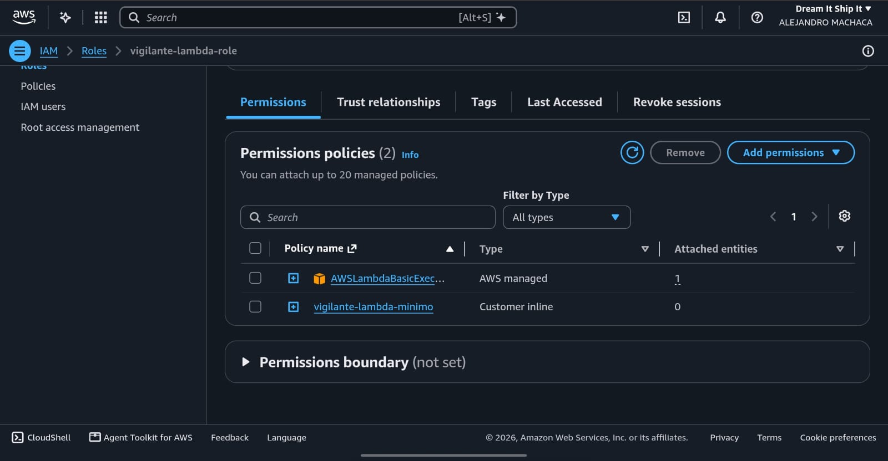 | Rol de `vigilante-skill` con `AWSLambdaBasicExecutionRole` + `vigilante-lambda-minimo` |
| 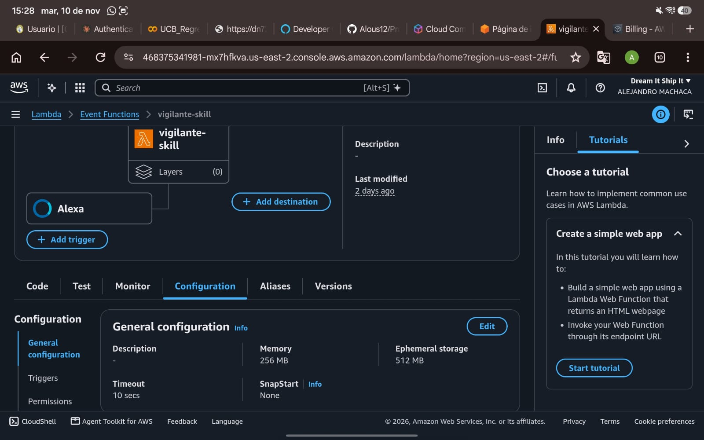 | Configuración general de `vigilante-skill`: Python 3.13, 256 MB, 10 s |
| 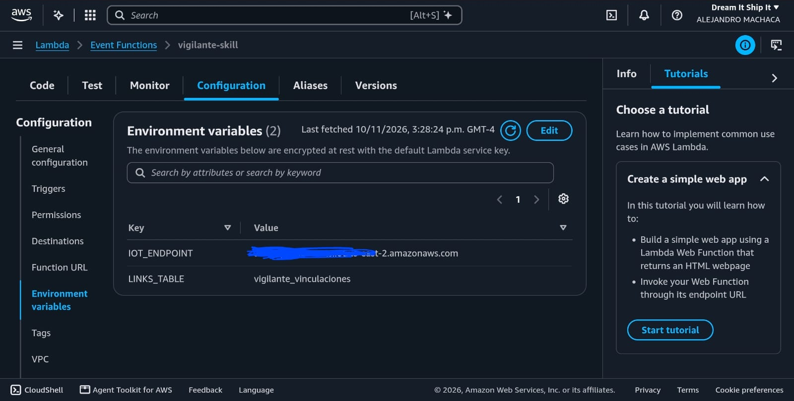 | Variables `IOT_ENDPOINT` (oculto) y `LINKS_TABLE` |
| 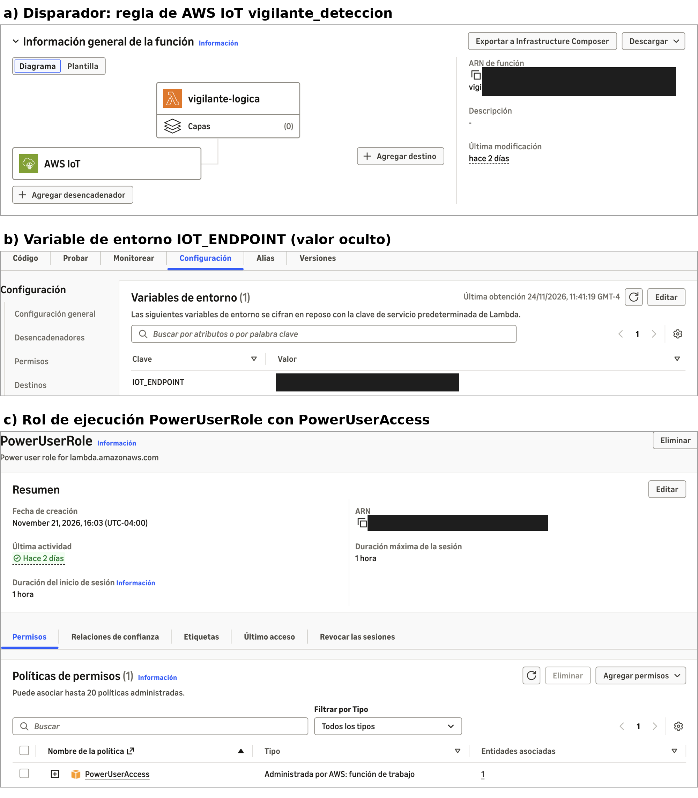 | **(P4)** `vigilante-logica`: a) disparador AWS IoT (regla `vigilante_deteccion`), b) variable `IOT_ENDPOINT` (valor oculto), c) rol `PowerUserRole` con `PowerUserAccess` |

---

## 3.3 Configuración en Alexa (actualizada)

La skill se configuró en la **Alexa Developer Console** (developer.amazon.com) con una cuenta de Amazon de desarrollador, distinta de la cuenta de AWS.

### Pasos realizados

1. **Crear la skill.** *Create Skill* → nombre `Vigilante Inteligente` → idioma principal **Spanish (US)** → tipo de experiencia *Other* → modelo **Custom** → hosting **Provision your own** → plantilla *Start from Scratch*. Se usa hosting propio y no *Alexa-hosted* porque una skill Alexa-hosted corre en una cuenta de Amazon que no tiene acceso al IoT Core ni al DynamoDB del proyecto.
2. **Importar el modelo de interacción.** *Build → Interaction Model → JSON Editor* → se pegó [`alexa/interaction-model.es-US.json`](../alexa/interaction-model.es-US.json) → *Save*. Esto crea de una vez la invocación, los **20 intents** (12 de la Práctica 3 y 8 nuevos), los slots `codigo`, `modo`, `numero` y `minutos`, el tipo `TipoModo`, el modelo de diálogo y los prompts (§2.10). Si la skill tuviera más de un idioma, el mismo JSON debe pegarse en cada uno.
3. **Conectar con la Lambda (en este orden).** La Lambda solo acepta a su skill y la skill solo guarda un endpoint que ya la autoriza:
   1. *Endpoint* → **AWS Lambda ARN** → copiar **Your Skill ID** (`amzn1.ask.skill.…`).
   2. En AWS: `vigilante-skill` → *Agregar desencadenador* → **Alexa Skills Kit** → *Verificación de ID de habilidad: Habilitar* → pegar el Skill ID.
   3. De vuelta en Alexa: *Default Region* = `arn:aws:lambda:us-east-2:<ACCOUNT_ID>:function:vigilante-skill` → *Save Endpoints*.
4. **Compilar.** *Build skill* → esperar a *Last successful build* con la hora actual y *Errors and Warnings* en 0. Hay que recompilar cada vez que cambian intents o frases (no al cambiar el endpoint).
5. **(P4) Subir el código nuevo de la Lambda.** `bash lambda/build.sh` → `vigilante-skill` → *Code* → *Upload from .zip file*. Sin este paso, Alexa reconocería los intents nuevos pero la Lambda vieja no tendría sus manejadores.
6. **Habilitar pruebas.** Pestaña *Test* → *Skill testing is enabled in:* **Development**. Se marca **Skill I/O** para ver el *JSON Input* (lo que Alexa envía, con `context.System.user.userId`) y el *JSON Output* (la respuesta de la Lambda).
7. **Verificar el reconocimiento sin llamar a la Lambda.** *Build → Evaluate Model → Utterance Profiler* muestra qué intent y qué valor de slot resuelve Alexa para una frase. **(P4)** Sirve para comprobar que "modo automático" resuelve `TipoModo` = `automatico`.

### Segundo usuario de Alexa

El `userId` depende de la cuenta de Amazon que usa la skill. Para demostrar que cada usuario controla su propio Thing:

- **Opción A (simulador):** en la consola de Alexa, menú del perfil → *Settings → User Permissions → Invite*. Se invita a un compañero del grupo, que abre la pestaña *Test* con **su** cuenta y vincula `vigilante-654321`. En *JSON Input* aparece un `userId` distinto. La evidencia del segundo usuario es la prueba automática `test_guion_segundo_usuario_controla_solo_su_thing` y el evento [`lambda/events/09_vincular_segundo_usuario.json`](../lambda/events/09_vincular_segundo_usuario.json).
- **Opción B (consola de Lambda):** el evento [`lambda/events/09_vincular_segundo_usuario.json`](../lambda/events/09_vincular_segundo_usuario.json) envía a la Lambda real una vinculación con `userId = amzn1.ask.account.SEGUNDO_USUARIO` y el código 654321.

### Evidencias de la configuración

| Captura | Muestra |
|---|---|
| 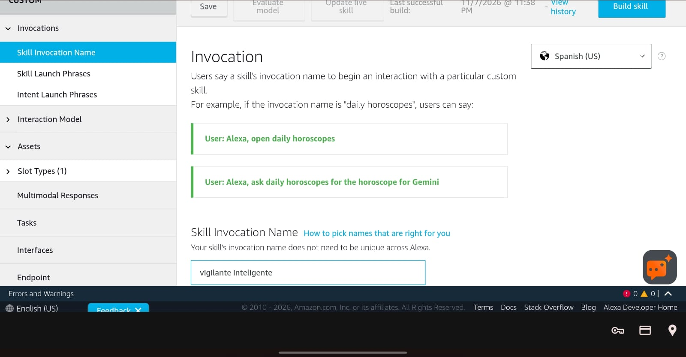 | *Invocations*: `vigilante inteligente` |
| 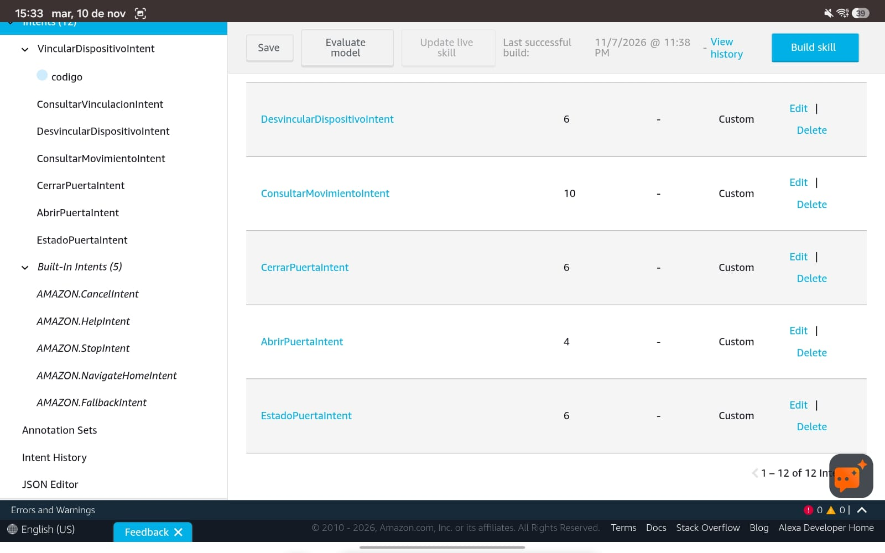 | Lista de intents y el slot `codigo` (Práctica 3) |
| 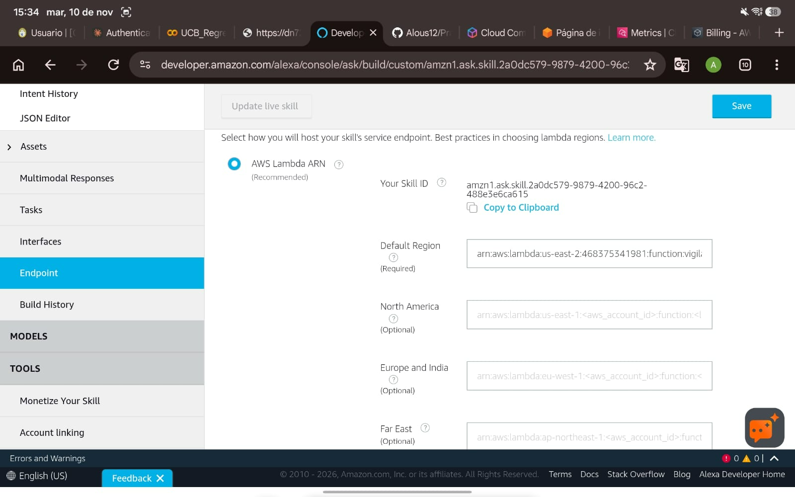 | Endpoint AWS Lambda ARN en *Default Region* (cuenta oculta) |
| 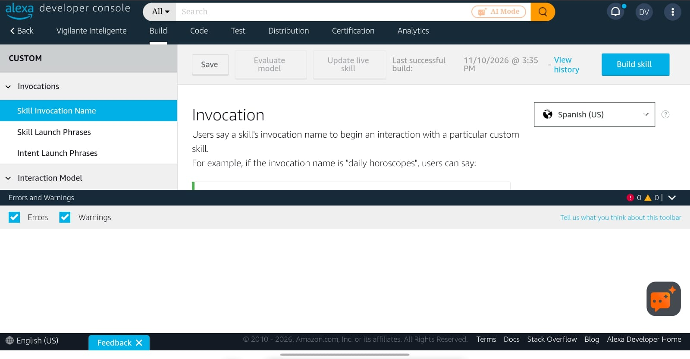 | *Last successful build*, 0 errores y 0 advertencias |
| 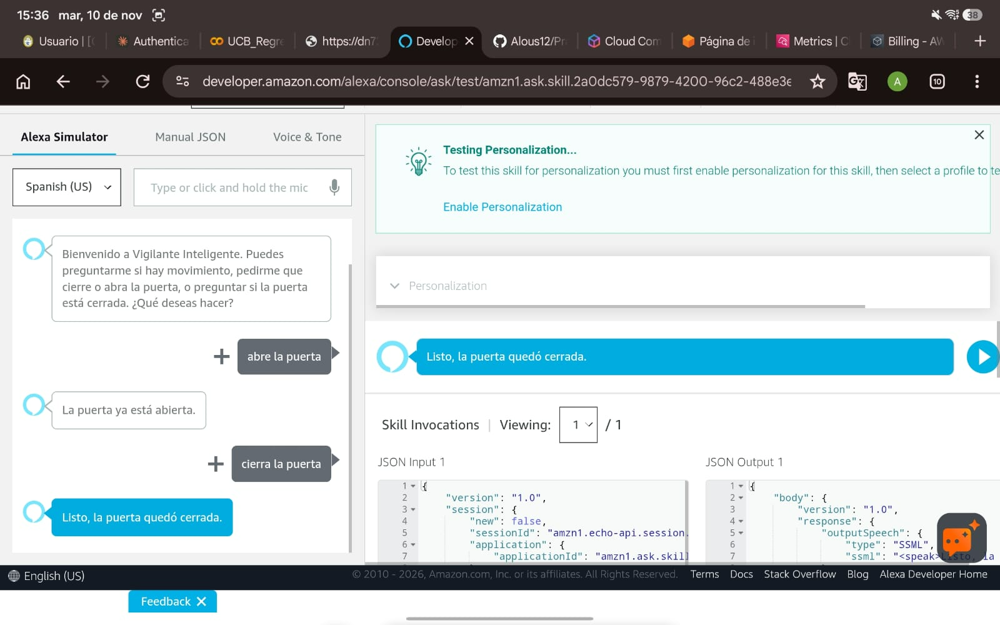 | Pestaña *Test*: simulador en Spanish (US) con *Skill I/O* |
| [`ru-alexa-intents-p4.png`](../docs/anexos/anexosP4/ru-alexa-intents-p4.png) | **(P4)** Lista con los 20 intents y el tipo `TipoModo` [COMPLETAR] |
| [`ru-alexa-build-p4.png`](../docs/anexos/anexosP4/ru-alexa-build-p4.png) | **(P4)** Compilación del modelo nuevo sin errores [COMPLETAR] |

---

## 4. Pruebas a mi cargo

### Pruebas automáticas

Las pruebas no necesitan cuenta de AWS ni hardware, así que se repiten en cada cambio del código. La skill real (`build_skill`) se arma con dobles en memoria de DynamoDB, del registro de IoT y del Shadow (este último imita al ESP32 aplicando el `desired` y, como AWS, **borra las claves que llegan en `null`**) y con un reloj simulado.

| Archivo | Pruebas | Qué verifica |
|---|---|---|
| [`lambda/tests/test_skill.py`](../lambda/tests/test_skill.py) | 20 | Cada requerimiento de la Práctica 3 por separado: RF4 (movimiento, última detección, calibración, sin reportes, desconexión), RF5/RF6 (cerrar, abrir, ya en ese estado, orden pendiente, estado), RF7–RF9 (vincular, rechazar, cambiar, consultar, desvincular sí/no) y dos usuarios con Things distintos |
| [`lambda/tests/test_guion_alexa.py`](../lambda/tests/test_guion_alexa.py) | 5 | El guion completo del simulador de extremo a extremo; el segundo usuario aislado; la reconexión que aplica la orden pendiente; ayuda y salida; **(P4)** el guion de modos y parámetros |
| [`lambda/tests/test_modos.py`](../lambda/tests/test_modos.py) | 51 | **(P4)** Cambiar y consultar el modo, sinónimos de `TipoModo`, rangos de los parámetros (0, 1, 20, 21, "?"), rechazo de abrir en automático y bloqueo, bloqueo con cierre de puerta, cambios pendientes, origen `edge` / `inicio` |
| [`lambda/tests/test_alarma.py`](../lambda/tests/test_alarma.py) | 19 | **(P4)** Encender, apagar y consultar la alarma; "ya estaba así"; orden pendiente; origen voz / edge / nube; manual apaga la alarma |
| [`lambda/tests/test_contratos.py`](../lambda/tests/test_contratos.py) | 49 | **Integración entre capas**: modelo de Alexa ↔ manejadores en ambos sentidos; slots y diálogo; `TipoModo` ↔ modos; claves, modos, rangos y orígenes entre `config.h` y `config.py`; políticas mínimas; ningún secreto en Git |
| [`lambda-logica/tests/test_logica.py`](../lambda-logica/tests/test_logica.py) | 15 | **(P4)** `vigilante-logica`: ventana, borde de la ventana, detección del mismo segundo, otros Things, paginación, modo manual, mensajes inválidos, sin access keys |
| **Total** | **159** | ✅ 144/144 en `lambda/` y 15/15 en `lambda-logica/` |

**Errores de integración detectados y corregidos en mi capa:**

| Hallazgo | Causa | Corrección |
|---|---|---|
| 16 de 20 pruebas de la skill fallaban al copiar el código al repositorio (P3) | Tomaban el código del Thing de `events/02_vincular.json`, que se edita para probar en la consola | El arnés fija siempre su propio código |
| `AMAZON.NavigateHomeIntent` sin manejador (P3) | Intent obligatorio del modelo no registrado | Se agregó a `CancelOrStopIntentHandler` |
| **(P4)** Los manejadores nuevos no pasaban la prueba de contrato | El modelo de Alexa aún no tenía los intents | Se agregaron al modelo con los nombres acordados por el equipo |
| **(P4)** El doble del Shadow copiaba a `reported` las claves que el Edge borra con `null` | El doble guardaba `null` en lugar de borrar, a diferencia de AWS | El doble borra la clave, como AWS IoT |
| **(P4)** El `.zip` incluía `python-dateutil 4.0` | `ask-sdk-core` arrastra la última versión; `botocore` exige < 3 | Versión fijada en `requirements.txt` |

### Guion del simulador de Alexa — Práctica 3 (RF4–RF9)

Condiciones: ESP32 encendido y conectado (`vigilante-123456`), sesión de prueba en *Development* y *Skill I/O* marcado. Las mismas frases están automatizadas en `test_guion_alexa.py`.

| # | Se escribe en el simulador | Respuesta obtenida | RF | ✔ |
|---|---|---|---|---|
| 1 | `abre vigilante inteligente` | "…Aún no tienes un dispositivo vinculado. Di: vincula mi dispositivo con el código…" | RF8 | ✔ |
| 2 | `cierra la puerta` | "Aún no tienes un dispositivo vinculado…" (no se toca ningún Shadow) | RF8 | ✔ |
| 3 | `vincula mi dispositivo con el código 111111` → `sí` | "No encontré ningún dispositivo con el código 1 1 1 1 1 1…" | RF9 | ✔ |
| 4 | `vincula mi dispositivo con el código 654321` → `sí` | "Listo, vinculé tu dispositivo 6 5 4 3 2 1…" | RF7 | ✔ |
| 5 | `cierra la puerta` | "Envié la orden de cerrar la puerta, pero el dispositivo aún no la confirmó…" (Thing sin hardware) | RF5 | ✔ |
| 6 | `cambia mi dispositivo al código 123456` → `sí` | "Listo, cambié tu vinculación del dispositivo 6 5 4 3 2 1 al dispositivo 1 2 3 4 5 6." | RF9 | ✔ |
| 7 | `qué dispositivo tengo vinculado` | "Tienes vinculado el dispositivo 1 2 3 4 5 6." | RF8 | ✔ |
| 8 | `hay movimiento` (nadie frente al PIR) | "No se detecta movimiento en este momento… Detecciones desde que se encendió: N." | RF4 | ✔ |
| 9 | (pasar la mano frente al PIR) `hay movimiento` | "¡Atención! Se está detectando movimiento en este momento…" | RF4 | ✔ |
| 10 | `cierra la puerta` | "Listo, la puerta quedó cerrada." y el servo se mueve | RF5 | ✔ |
| 11 | `la puerta está cerrada` | "La puerta está cerrada." | RF6 | ✔ |
| 12 | `abre la puerta` | "Listo, la puerta quedó abierta." | RF5 | ✔ |
| 13 | **Segundo usuario** vincula `654321` | "Listo, vinculé tu dispositivo 6 5 4 3 2 1…" con otro `userId` | RF7, RF8 | ✔ |
| 14 | `desvincula mi dispositivo` → `no` | "De acuerdo, tu dispositivo sigue vinculado." | RF9 | ✔ |
| 15 | `desvincula mi dispositivo` → `sí` | "Listo, desvinculé tu dispositivo…" y la fila desaparece de DynamoDB | RF9 | ✔ |
| 16 | `salir` | "Hasta luego." | — | ✔ |

### (P4) Guion del simulador de Alexa — modos, parámetros y alarma

Mismas condiciones, con el Thing vinculado y en modo `manual`. Cada paso se captura con *JSON Input* y *JSON Output* (tapando el Skill ID). Las mismas frases están automatizadas en `test_guion_modos_y_parametros`.

**Condiciones de cada paso:** los pasos se dicen en orden y en la misma sesión del simulador. S-01 parte en modo `manual`; de S-02 a S-10 el dispositivo queda en `automatico`. S-09 se dice dentro de los 30 s siguientes a S-08, porque el ESP32 apaga la alarma a los 30 s. Antes de S-11 se hace un paso previo (vuelve a `manual` y abre la puerta, sin pasar frente al PIR) para que S-11 parta con la puerta abierta. S-11 es un bloqueo **por voz** (`origen: voz`), así que S-12 no se dice a continuación: se dice dentro de los 30 s posteriores a un ensayo de bloqueo de la Nube (sección siguiente, `origen: nube`), y S-13 justo después, con la alarma aún sonando.

| # | Frase | Respuesta esperada | RF | Resultado | Captura |
|---|---|---|---|---|---|
| S-01 | `en qué modo está` | "El dispositivo está en modo manual: la puerta solo se abre o se cierra cuando tú lo pides." | RF14 | [COMPLETAR] | [`ru-sim-01-modo.png`](../docs/anexos/anexosP4/ru-sim-01-modo.png) |
| S-02 | `cambia el modo a automático` | "Listo, cambié al modo automático: la puerta se cierra sola cuando el sensor detecta movimiento." | RF14 | [COMPLETAR] | [`ru-sim-02-automatico.png`](../docs/anexos/anexosP4/ru-sim-02-automatico.png) |
| S-03 | `abre la puerta` (en automático) | "No puedo abrir la puerta porque el dispositivo está en modo automático: … Si quieres abrirla, primero di: cambia el modo a manual." | RF14, §3.1 | [COMPLETAR] | [`ru-sim-03-rechazo.png`](../docs/anexos/anexosP4/ru-sim-03-rechazo.png) |
| S-04 | `cambia el máximo de detecciones a 3` | "Listo, el máximo de detecciones ahora es 3." | RF14 | [COMPLETAR] | [`ru-sim-04-max.png`](../docs/anexos/anexosP4/ru-sim-04-max.png) |
| S-05 | `cambia el máximo de detecciones a 25` | "El máximo de detecciones debe ser un número entre 1 y 20." (sin escribir el Shadow) | RF14 | [COMPLETAR] | [`ru-sim-05-rango.png`](../docs/anexos/anexosP4/ru-sim-05-rango.png) |
| S-06 | `cambia la ventana a 10 minutos` | "Listo, la ventana de detecciones ahora es de 10 minutos." | RF14 | [COMPLETAR] | [`ru-sim-06-ventana.png`](../docs/anexos/anexosP4/ru-sim-06-ventana.png) |
| S-07 | `cuáles son los parámetros` | "Modo automático. Máximo de detecciones: 3. Ventana: 10 minutos." | RF14 | [COMPLETAR] | [`ru-sim-07-parametros.png`](../docs/anexos/anexosP4/ru-sim-07-parametros.png) |
| S-08 | `enciende la alarma` | "Listo, la alarma quedó encendida." y el buzzer suena | RF5 | [COMPLETAR] | [`ru-sim-08-alarma-on.png`](../docs/anexos/anexosP4/ru-sim-08-alarma-on.png) |
| S-09 | `está sonando la alarma` (dentro de los 30 s siguientes a S-08: el ESP32 apaga la alarma a los 30 s) | "La alarma está sonando." | RF6 | [COMPLETAR] | [`ru-sim-09-alarma-estado.png`](../docs/anexos/anexosP4/ru-sim-09-alarma-estado.png) |
| S-10 | `apaga la alarma` | "Listo, la alarma quedó apagada." | RF5 | [COMPLETAR] | [`ru-sim-10-alarma-off.png`](../docs/anexos/anexosP4/ru-sim-10-alarma-off.png) |
| Previo a S-11 | `cambia el modo a manual` → `abre la puerta` (sin pasar frente al PIR) | "Listo, cambié al modo manual: …" → "Listo, la puerta quedó abierta." | RF14, RF5 | — | — |
| S-11 | `cambia el modo a bloqueo` (puerta abierta) | "Listo, cambié al modo bloqueo: … También envié la orden de cerrar la puerta." y el servo cierra | RF14 | [COMPLETAR] | [`ru-sim-11-bloqueo.png`](../docs/anexos/anexosP4/ru-sim-11-bloqueo.png) |
| S-12 | `está sonando la alarma` (dentro de los 30 s posteriores a un ensayo de bloqueo de la Nube de la sección siguiente; S-11 fue un bloqueo por voz con `origen: voz`) | "La alarma está sonando. La activó la nube al superar el máximo de detecciones dentro de la ventana configurada." | RF13 | [COMPLETAR] | [`ru-sim-12-alarma-nube.png`](../docs/anexos/anexosP4/ru-sim-12-alarma-nube.png) |
| S-13 | `cambia el modo a manual` (alarma sonando) | "Listo, cambié al modo manual: … También envié la orden de apagar la alarma." | RF14 | [COMPLETAR] | [`ru-sim-13-manual.png`](../docs/anexos/anexosP4/ru-sim-13-manual.png) |

### (P4) Tiempo de respuesta de la regla de la Nube

**Valor declarado:** ≤ 5 s desde la detección que completa `max_detecciones` hasta que suena el buzzer (el Shadow pasa a `modo: bloqueo`, `alarma: encendida`, `origen: nube`).

**Por qué el buzzer y no el servo:** en modo `automatico` la regla del Edge (`AutoLockRule`) ya cierra la puerta en la misma detección, sin esperar a la Nube. El buzzer, en cambio, solo lo enciende la Nube en este escenario (en `automatico` el Edge nunca activa la alarma), así que su inicio marca la respuesta de `vigilante-logica`.

**Procedimiento:**

1. Por voz: `max_detecciones = 3` y `ventana_min = 1` (ventana corta para que cada ensayo no arrastre las detecciones del anterior).
2. Por voz: modo `manual` (apaga la alarma) y luego `automatico`. Esperar 70 s para que las detecciones previas salgan de la ventana.
3. Grabar a 60 fps el ESP32 con el buzzer y la pantalla del monitor serie en el mismo cuadro.
4. Provocar 3 detecciones, esperando ≥ 7 s entre pasadas (jumper del PIR en L).
5. Δt = cuadros desde que el monitor serie muestra la 3.ª detección hasta el primer cuadro con pitido, dividido entre 60.
6. En CloudWatch de `vigilante-logica`: la línea `bloqueo_activado` con `detecciones_en_ventana = 3`.
7. Repetir 5 veces. Al terminar, volver a `ventana_min = 10` y modo `manual`.

| Ensayo | Δt detección → buzzer (s) | `detecciones_en_ventana` | `accion` | ¿≤ 5 s? |
| --- | --- | --- | --- | --- |
| 1 | [COMPLETAR] | [COMPLETAR] | [COMPLETAR] | [COMPLETAR] |
| 2 | [COMPLETAR] | [COMPLETAR] | [COMPLETAR] | [COMPLETAR] |
| 3 | [COMPLETAR] | [COMPLETAR] | [COMPLETAR] | [COMPLETAR] |
| 4 | [COMPLETAR] | [COMPLETAR] | [COMPLETAR] | [COMPLETAR] |
| 5 | [COMPLETAR] | [COMPLETAR] | [COMPLETAR] | [COMPLETAR] |
| **Promedio / máximo** | [COMPLETAR] | | | |

**Prueba negativa:** en modo `automatico`, con solo 2 detecciones en la ventana, no hay bloqueo: CloudWatch registra `sin_accion` con `detecciones_en_ventana = 2` y el buzzer no suena. Resultado: [COMPLETAR] · Evidencia: [`ru-cw-sin-accion.png`](../docs/anexos/anexosP4/ru-cw-sin-accion.png). (En modo `manual` la regla `vigilante_deteccion` ni siquiera invoca a la Lambda.)

**Evidencias:** `ru-video-bloqueo-nube` (enlace), [`ru-cw-bloqueo.png`](../docs/anexos/anexosP4/ru-cw-bloqueo.png) (CloudWatch de `vigilante-logica`), [`ru-shadow-bloqueo.png`](../docs/anexos/anexosP4/ru-shadow-bloqueo.png) (Shadow con `origen: nube`).

---

## 6. Conclusión de mi parte

Organizar la Lambda de la skill en un repositorio de vinculaciones, un gateway hacia IoT Core y manejadores con dependencias inyectadas permitió probar toda la skill sin una cuenta de AWS, y en la Práctica 4 confirmó lo previsto: el buzzer, los modos y los parámetros se agregaron con subclases nuevas, sin tocar los módulos existentes. Separar la skill de la lógica de negocio en dos funciones Lambda dio a cada una una sola responsabilidad y los permisos justos: la skill solo traduce voz a `desired` y lee `reported`, y `vigilante-logica` solo cuenta detecciones y escribe el bloqueo. Poner esa regla en la Nube fue necesario porque depende del historial, que el ESP32 no conserva, y permite cambiar el umbral y la ventana por voz sin reprogramar el objeto. La clave `thingName` + `tipo_ts` del historial resolvió tanto el conteo de la regla como los tres reportes con `Query`, sin `Scan`. Para que la voz y la lógica automática no se contradigan, la skill rechaza con una explicación las órdenes que la regla del Edge desharía y acompaña cada cambio de modo con el estado coherente del actuador.

## 7. Recomendaciones de mi parte

- **Códigos de vinculación aleatorios.** Reemplazar los códigos de demostración por códigos generados al azar y, a futuro, que el ESP32 publique su código en el Shadow para que la Lambda verifique que el usuario lo está leyendo del dispositivo físico.
- **Account Linking (OAuth)** para asociar el dispositivo a una cuenta real del fabricante, y un índice secundario sobre `thingName` para saber y limitar quién tiene vinculado cada Thing.
- **(P4) Alerta programada:** una Lambda disparada por Amazon EventBridge cada 15 min que revise la última `lectura#` de cada Thing y registre una alerta si no reportó, porque el objeto no puede avisar su propia desconexión.
- **Notificaciones proactivas** (Alexa Proactive Events o Amazon SNS) cuando el PIR detecte movimiento o la Nube active un bloqueo, en vez de esperar a que el usuario pregunte.
- **(P4) Implementar los reportes** como una página que llame a una Lambda de solo lectura (`dynamodb:Query`) con las consultas de §2.11.
- **Infraestructura como código** (AWS SAM o CloudFormation) para crear las tablas, los roles, las reglas y las Lambdas con un solo comando a partir de los JSON y SQL del repositorio, y despliegue automático de los `.zip` con GitHub Actions después de que pasen las pruebas.
- **Esperar la confirmación sin sondeo.** Hoy la skill consulta el Shadow cada 250 ms durante hasta 3 s. Con respuestas progresivas de Alexa se reducirían las operaciones de Shadow por comando.

## 8. Anexos de mi parte

| Anexo | Archivos | Contenido |
|---|---|---|
| Carpeta de evidencias (P4) | [`docs/anexos/anexosP4/`](../docs/anexos/anexosP4/) | Todas las evidencias nuevas `ru-*` (capturas, mockups, salidas de pytest); el video del bloqueo por la Nube va como enlace |
| Mockups de reportes | [`ru-mockup-1.png`](../docs/anexos/anexosP4/ru-mockup-1.png), [`ru-mockup-2.png`](../docs/anexos/anexosP4/ru-mockup-2.png), [`ru-mockup-3.png`](../docs/anexos/anexosP4/ru-mockup-3.png) | Reportes 1 a 3 de §2.11 |
| Pruebas automáticas | [`ru-pytest-skill.txt`](../docs/anexos/anexosP4/ru-pytest-skill.txt), [`ru-pytest-logica.txt`](../docs/anexos/anexosP4/ru-pytest-logica.txt) | Salida de `pytest -v` de `lambda/` (144) y de `lambda-logica/` (15) |
| Simulador de Alexa (P3) | [`alexa-05-test-development.png`](../docs/anexos/alexa-05-test-development.png) | Simulador con *Skill I/O* |
| Simulador de Alexa (P4) | [`ru-sim-01-modo.png`](../docs/anexos/anexosP4/ru-sim-01-modo.png) … [`ru-sim-13-manual.png`](../docs/anexos/anexosP4/ru-sim-13-manual.png) | Guion S-01 a S-13 con *Skill I/O* |
| Regla de la Nube | [`ru-cw-bloqueo.png`](../docs/anexos/anexosP4/ru-cw-bloqueo.png), [`ru-cw-sin-accion.png`](../docs/anexos/anexosP4/ru-cw-sin-accion.png), [`ru-shadow-bloqueo.png`](../docs/anexos/anexosP4/ru-shadow-bloqueo.png), video (enlace) | Bloqueo por exceso de detecciones y prueba negativa |
| Configuración | [`ru-lambda-logica-config.png`](../docs/anexos/anexosP4/ru-lambda-logica-config.png), [`ru-alexa-intents-p4.png`](../docs/anexos/anexosP4/ru-alexa-intents-p4.png), [`ru-alexa-build-p4.png`](../docs/anexos/anexosP4/ru-alexa-build-p4.png) | `vigilante-logica` y modelo de Alexa de la Práctica 4 |
| Configuraciones exportadas | [`alexa/interaction-model.es-US.json`](../alexa/interaction-model.es-US.json), [`aws/lambda-role-policy.json`](../aws/lambda-role-policy.json), [`lambda-logica/politica-rol.json`](../lambda-logica/politica-rol.json) | Modelo de la skill y políticas de las dos Lambdas |
