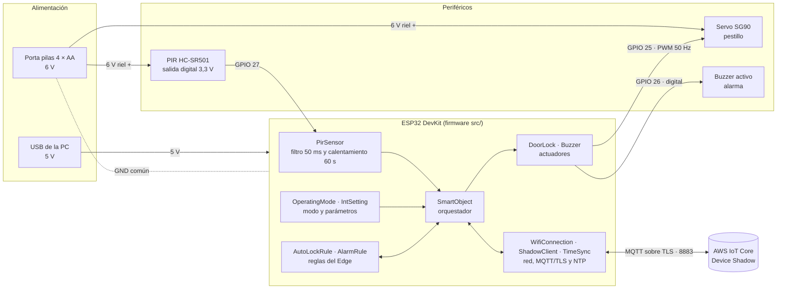
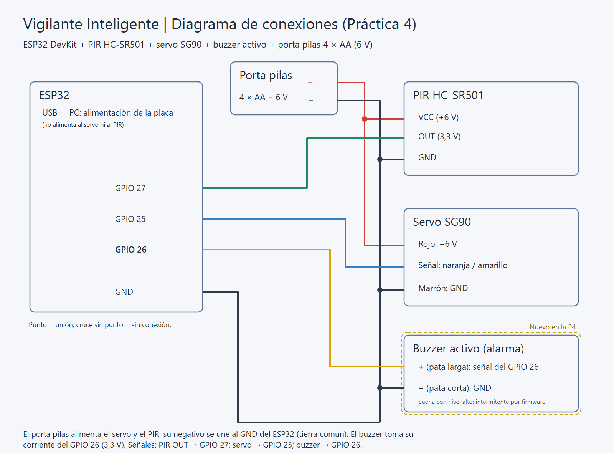
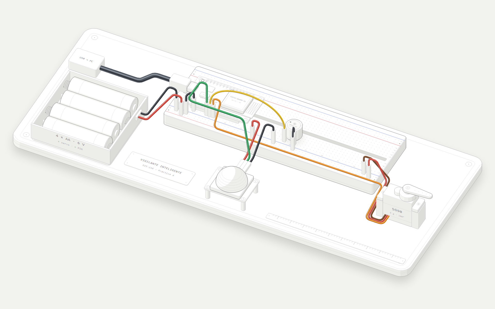
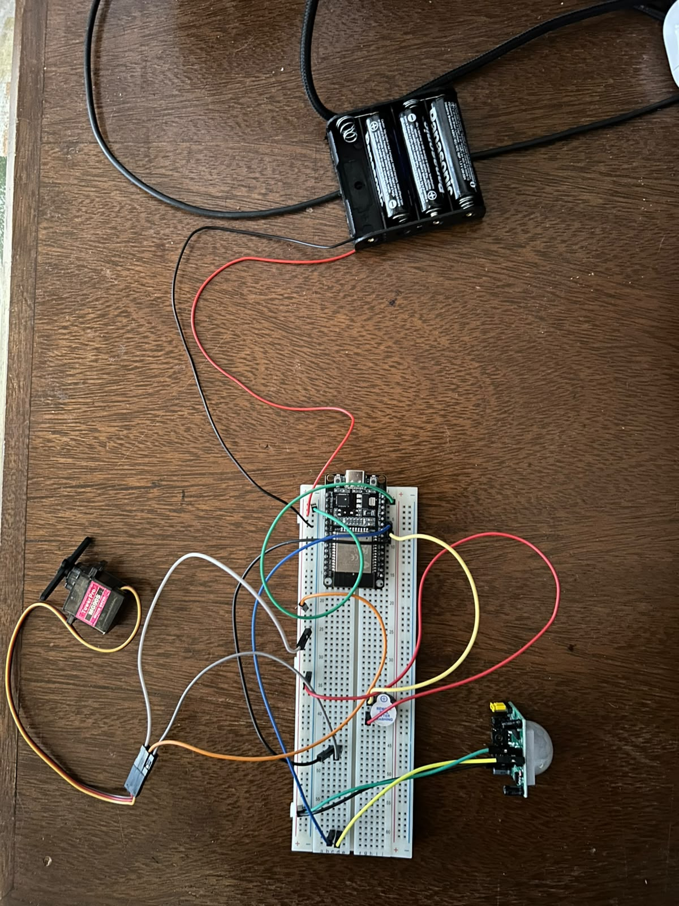
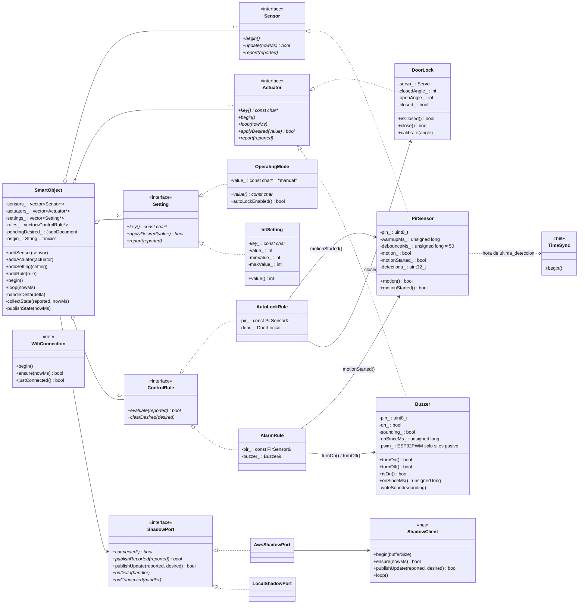
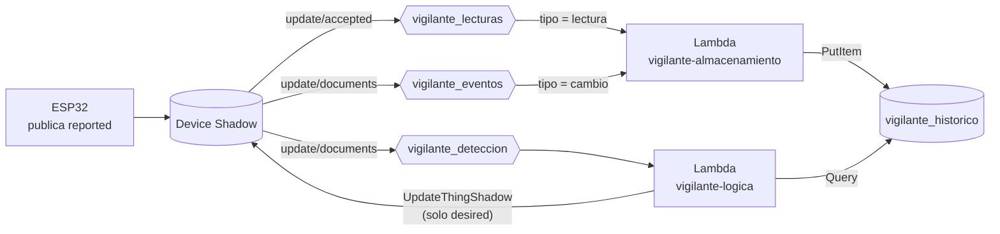

# Informe técnico — Práctica 4: secciones de Alejandro

<!--
PENDIENTE ANTES DE ENTREGAR (borrar este comentario al integrar en INFORME_P4.md):
1. §4.2 P-A1: correr la prueba de estabilidad de 30 min y llenar la tabla (valores "por medir").
2. §4.2 P-A3: probar las 3 reglas con el Thing de prueba y guardar las capturas.
3. §3.2a: subir las 6 capturas a docs/anexos/p4/ con los nombres de la tabla (tapando el ID de cuenta).
-->

**Proyecto:** Vigilante Inteligente · **Asignatura:** SIS-234 · **Responsable de estas secciones:** Alejandro Machaca (`alous12`)

Este documento contiene las secciones del informe de la Práctica 4 que le corresponden a Alejandro según la división del trabajo: el objeto inteligente, su circuito y la configuración de AWS IoT. Se integran en `docs/INFORME_P4.md` con la misma numeración. Los diagramas de circuito están en [`anexos/`](anexos/) y las demás evidencias de la P4 en [`anexos/p4/`](anexos/p4/).

| Sección | Contenido |
|---|---|
| [1.1](#11-caso-de-uso-ampliado) | Caso de uso ampliado y justificación de sensores y actuadores |
| [2.1](#21-diagrama-de-bloques-del-objeto-inteligente) | Diagrama de bloques del objeto inteligente |
| [2.3](#23-diagrama-de-circuito) | Diagrama de circuito, modelo 3D y foto del montaje con el buzzer |
| [2.4a](#24a-diagrama-de-clases-del-objeto-inteligente) | Diagrama de clases del firmware |
| [2.7](#27-especificación-del-documento-shadow) | Especificación del documento Shadow |
| [2.8](#28-modelo-de-datos-de-dynamodb) | Modelo de datos de DynamoDB y patrones de acceso |
| [2.9a](#29a-reglas-de-aws-iot) | Reglas de AWS IoT |
| [3.2a](#32a-configuración-de-aws-iot-core-y-dynamodb) | Configuración de IoT Core y DynamoDB |
| [4](#4-pruebas-y-validaciones-alejandro) | Pruebas: estabilidad con el buzzer y costo mensual |
| [6–8](#aportes-a-las-secciones-compartidas) | Conclusión, recomendaciones y anexos de Alejandro |

---

## 1.1 Caso de uso ampliado

### De la Práctica 3 a la Práctica 4

En la Práctica 3, el Vigilante Inteligente detectaba personas junto a un objeto valioso con un **PIR** y movía el **pestillo de una puerta** con un **servo**. El servo obedecía **solo a la voz**: Alexa escribía `desired.puerta` y el ESP32 la aplicaba. El PIR solo se consultaba.

En la Práctica 4 el objeto **decide por sí mismo** y **guarda su historia**:

| Qué se agregó | Para qué | Dónde corre |
|---|---|---|
| **Modo de operación** `manual` / `automatico` / `bloqueo` y parámetros `max_detecciones` y `ventana_min` | El dueño elige cuánta autonomía tiene el objeto y lo ajusta por voz (RF14) | Shadow (`desired`/`reported`), firmware y skill |
| **Cierre automático** al detectar un movimiento nuevo en `automatico` o `bloqueo` | La puerta se cierra al instante, aunque no haya Internet | Edge (`AutoLockRule`) |
| **Buzzer como alarma** (segundo actuador) | Avisa de una intrusión con sonido: en `bloqueo`, cada movimiento nuevo hace sonar la alarma | Edge (`AlarmRule`), voz y Nube |
| **Bloqueo por exceso de detecciones** | Si en automático hay `max_detecciones` detecciones dentro de `ventana_min` minutos, pasa a `bloqueo`, cierra la puerta y enciende la alarma | Nube (`vigilante-logica`), porque depende del histórico |
| **Histórico** de lecturas y eventos con su origen (`voz`, `edge`, `nube`) | Responder quién abrió, cuándo sonó la alarma y cuántas detecciones hubo, y alimentar los reportes (RF15) | IoT Rules + `vigilante-almacenamiento` + DynamoDB |

El caso de uso se amplía hacia el objetivo original del proyecto: un vigilante **avisa** cuando alguien se acerca, no solo cierra. Por eso el segundo actuador es una alarma sonora.

### Sensores y actuadores: cuántos y por qué

| Elemento | Componente | Función en el caso de uso | Atributo del Shadow | Alimentación |
|---|---|---|---|---|
| Sensor | PIR HC-SR501 | Detecta la presencia de una persona junto al objeto | `movimiento`, `detecciones`, `ultima_deteccion`, `sensor_listo` | 6 V (porta pilas) |
| Actuador 1 | Servo SG90 | Pestillo de la puerta: `abierta` / `cerrada` | `puerta` | 6 V (porta pilas) |
| Actuador 2 | **Buzzer activo** (12 mm, 2 patas) | Alarma sonora intermitente: `encendida` / `apagada` | `alarma` | 3,3 V desde el GPIO 26 |
| Controlador | ESP32 DevKit | Lee el PIR, mueve el servo, hace sonar el buzzer, ejecuta las reglas del Edge y se sincroniza con el Shadow por MQTT/TLS | — | 5 V por USB |

- **Un solo sensor alcanza.** El caso de uso necesita saber **si hay alguien cerca**: el PIR lo responde sin alinear nada, a varios metros y en un cono de ~110°. Su exactitud se midió en la P3: 98,3 % de detecciones hasta 3 m y 0 falsos positivos en 10 min.
- **Dos actuadores, porque hacen cosas distintas.** El servo **impide** el acceso: es una barrera con dos estados estables. El buzzer **avisa**: disuade al intruso y alerta a quien esté cerca. Ninguno sustituye al otro. En `bloqueo` trabajan juntos: la puerta ya está cerrada y cada movimiento nuevo hace sonar la alarma.
- **Por qué el buzzer ahora y no en la P3.** En la P3 se descartó porque "un buzzer no tiene un estado estable que reflejar en el Shadow". En la P4 se le dio uno: `alarma` vale `encendida` o `apagada`, el ESP32 lo reporta siempre, y la alarma se apaga sola a los 30 s (`ALARM_MAX_MS`). Así el Shadow refleja el estado real aunque nadie la apague, y la alarma no suena sin fin si se pierde la red.

### Restricciones de la práctica

| Restricción | Cómo se cumple |
|---|---|
| Al menos un actuador que no sea LED | Hay dos, servo y buzzer, y ninguno es LED. El objeto no usa LEDs como actuador |
| Ultrasónico solo si el caso lo requiere | No se usa: no se mide ninguna distancia ni nivel |
| Actuadores a baja tensión (≤ 12 V DC), sin 220 V AC | Servo y PIR a 6 V (4 × AA), buzzer a 3,3 V, ESP32 a 5 V por USB. Nada se conecta a la red eléctrica |
| Extensible sin rediseñar | El buzzer entró como un `Actuator` más y la alarma como una `ControlRule` más, **sin modificar** `SmartObject` ni la capa de red (§2.4a) |

### Alternativas consideradas para la alarma

| Alternativa | Por qué no se eligió |
|---|---|
| Buzzer **pasivo** | Necesita generar un tono PWM de ~2 kHz y ocupa un canal LEDC más. El firmware lo soporta (`BUZZER_ACTIVE 0`), pero el buzzer disponible es activo y suena con solo poner el pin en alto |
| Sirena piezoeléctrica de 12 V | Más volumen, pero exige otra fuente y un transistor o relé. Queda como extensión para un uso real (§7) |
| Módulo de buzzer con transistor (KY-012) | Equivalente en función. Se usó el buzzer suelto porque es el que estaba disponible; el módulo es la mejora recomendada (§2.3) |
| LED de aviso | La práctica no permite el LED como único actuador y no disuade a nadie |

---

## 2.1 Diagrama de bloques del objeto inteligente



*Figura 2.1.1 — Bloques del objeto inteligente: alimentación, periféricos y firmware.*

| Bloque | Componentes | Responsabilidad |
|---|---|---|
| Alimentación | USB de la PC (5 V), porta pilas 4 × AA (6 V) | Dos fuentes que solo comparten la tierra. El USB alimenta la lógica; las pilas, el servo y el PIR, para que los picos del servo no reinicien el ESP32 |
| Sensado | PIR → `PirSensor` | Convierte la salida del PIR en `movimiento` y `detecciones`, sin reportar los falsos positivos del calentamiento |
| Actuación | `DoorLock` → servo, `Buzzer` → buzzer | Cada actuador es dueño de una clave del Shadow (`puerta`, `alarma`), valida el valor deseado y reporta su estado |
| Configuración | `OperatingMode`, `IntSetting` × 2 | Guardan `modo`, `max_detecciones` y `ventana_min`, validados con los mismos rangos que la skill |
| Lógica del Edge | `AutoLockRule`, `AlarmRule` | Cierran la puerta y hacen sonar o apagan la alarma **sin depender de la red** |
| Orquestación | `SmartObject` | En cada vuelta: actuadores → sensores → reglas → publicación por evento o por latido de 60 s |
| Comunicación | `WifiConnection`, `ShadowClient`, `TimeSync` | Reconexión WiFi y MQTT, tópicos del Shadow y hora NTP para `ultima_deteccion` |

---

## 2.3 Diagrama de circuito

### Componentes

| Cant. | Componente | Especificación relevante |
|---|---|---|
| 1 | ESP32 DevKit (30 pines) | Lógica de 3,3 V; alimentado por USB desde la computadora |
| 1 | Sensor PIR HC-SR501 | Alimentación de 4,5 a 20 V; salida digital de 3,3 V; jumper L; Tx al mínimo |
| 1 | Servo SG90 | De 4,8 a 6 V; picos de varios cientos de mA al arrancar |
| 1 | **Buzzer activo de 12 mm** | Oscilador interno: suena con un nivel alto continuo; sellado por debajo |
| 1 | Porta pilas 4 × AA | 6 V para el servo y el PIR por el riel + de la protoboard |
| 1 | Protoboard de 830 puntos y cables dupont | — |

### Conexiones

| Componente | Terminal | Conexión |
|---|---|---|
| Porta pilas | Rojo (+6 V) / Negro (−) | Riel + / Riel − (GND común) |
| ESP32 | GND | Riel − (une la tierra del ESP32 con la de las pilas) |
| ESP32 | USB | Computadora (alimentación y monitor serie) |
| PIR HC-SR501 | VCC / OUT / GND | Riel + (6 V) / **GPIO 27** / Riel − |
| Servo SG90 | Rojo / Naranja (señal) / Marrón | Riel + (6 V) / **GPIO 25** / Riel − |
| **Buzzer activo** | **Pata larga (+)** | **GPIO 26**, directo |
| **Buzzer activo** | **Pata corta (−)** | **Riel − (GND común)** |

El PIR y el servo no cambian respecto de la P3. Lo nuevo son las dos conexiones del buzzer. Los pines están en [`include/config.h`](../include/config.h): `PIR_PIN 27`, `SERVO_PIN 25` y `BUZZER_PIN 26`, con `BUZZER_ACTIVE 1`.



*Figura 2.3.1 — Diagrama de conexiones de la P4. Es un esquema por terminal: no representa la posición física de los pines. Lo nuevo respecto de la P3 es el buzzer en el GPIO 26.*



*Figura 2.3.2 — El circuito montado en la protoboard, en vista isométrica ([versión vectorial](anexos/circuito-3d.svg)). El buzzer está en la mitad derecha de la protoboard. El cable amarillo lleva su señal desde el GPIO 26 y el negro une su pata − al riel −. El resto del montaje es el de la P3: verde = PIR OUT → GPIO 27, naranja = señal del servo → GPIO 25, rojo = +6 V, negro y marrón = GND.*



*Figura 2.3.3 — Prototipo real de la P4. Arriba, el porta pilas; al centro, el ESP32 en la protoboard; abajo a la derecha, el buzzer (con la etiqueta "REMOVE SEAL AFTER WASHING" de los buzzers activos sellados) y el PIR; a la izquierda, el servo.*

### Justificación de las conexiones del buzzer

- **GPIO 26.** No es un pin de arranque (0, 2, 5, 12, 15), no pertenece a la memoria flash (6 a 11) y no es de solo entrada (34 a 39). Admite salida digital y PWM (LEDC), así que sirve tanto para el buzzer activo como para uno pasivo. No comparte nada con el PIR (27) ni con el servo (25).
- **Buzzer activo, alimentado por el propio GPIO.** Tiene un oscilador interno: con 3,3 V continuos pita solo, y el firmware lo enciende con `digitalWrite(HIGH)`. La alarma es **intermitente** (500 ms sí, 500 ms no, `ALARM_BEEP_MS`): esa cadencia la genera el firmware con `millis()`, sin `delay()`. Se alimenta del GPIO y no de las pilas porque así funciona con la lógica de 3,3 V sin agregar componentes, y porque su consumo no pasa por el riel del servo.
- **Sin resistencia en serie (montaje actual).** El buzzer suelto va directo al GPIO 26. El ESP32 limita la corriente de cada GPIO con su *drive strength*: unos 20 mA en la configuración por defecto, con un máximo absoluto de 40 mA. Un buzzer activo de 3,3 V suele consumir unos 20 a 30 mA, así que funciona, aunque cerca del límite del pin. La guía recomendaba una resistencia de 220 Ω en serie, que limita la corriente a 3,3 V / 220 Ω ≈ 15 mA a costa de un poco de volumen. Para un uso prolongado conviene agregarla o, mejor, mover el buzzer a un transistor NPN (§7).
- **Tierra común.** La pata − va al riel −, el mismo GND del ESP32, de las pilas, del PIR y del servo. Sin esa unión, el nivel alto del GPIO 26 no tendría referencia.
- **Canal PWM separado (si fuera pasivo).** Con `BUZZER_ACTIVE 0`, el firmware genera el tono de 2 kHz con `ESP32PWM`, la misma biblioteca que mueve el servo. La biblioteca asigna un canal y un timer LEDC distintos según la frecuencia (50 Hz el servo, 2 kHz el buzzer), así que el tono no altera el pulso del servo.
- **Seguridad.** Todo el montaje trabaja a 6 V como máximo. La alimentación se desconecta antes de tocar el cableado.

### Prueba rápida del buzzer sin firmware

Antes de cargar el firmware se identificó el tipo de buzzer: con su pata + tocando un instante el pin **3V3** y la − en el riel −, **pita**. Eso lo identifica como **activo**; uno pasivo solo haría "clic". Por eso `config.h` queda con `BUZZER_ACTIVE 1`.

### Correspondencia entre el modelo y el montaje

El modelo 3D reproduce la **topología** del montaje: qué terminal va a qué pin o riel. No reproduce la posición exacta de cada cable, que en la foto está pensada para que los cables no se crucen sobre el ESP32. Las dos coinciden en lo que importa: el buzzer en la protoboard, su señal en el GPIO 26 y su tierra en el riel −.

---

## 2.4a Diagrama de clases del objeto inteligente

El firmware ([`src/`](../src/)) se organiza en capas. Las interfaces del núcleo (`core/`) separan el hardware, la lógica y la red, y `SmartObject` las une sin conocer ninguna clase concreta. En la P4 se agregaron dos interfaces nuevas: `Setting`, para el modo y los parámetros, y `ControlRule`, para las reglas del Edge.



*Figura 2.4a.1 — Clases del firmware de la P4. `SmartObject` depende solo de las cinco interfaces.*

| Archivo | Clase | Responsabilidad | Capa | RF |
|---|---|---|---|---|
| [`core/Actuator.h`](../src/core/Actuator.h) | `Actuator` | Interfaz de un actuador dueño de una clave del Shadow | núcleo | RF3 |
| [`core/Setting.h`](../src/core/Setting.h) | `Setting` | Interfaz de un parámetro de la lógica: valida el `desired` y lo reporta | núcleo | RF14 |
| [`core/ControlRule.h`](../src/core/ControlRule.h) | `ControlRule` | Interfaz de una regla del Edge: `evaluate()` actúa y devuelve `true` si cambió un actuador; `clearDesired()` indica qué claves de `desired` limpiar | núcleo | RF13 |
| [`actuators/Buzzer.*`](../src/actuators/Buzzer.h) | `Buzzer` | Dueño de la clave `alarma`: acepta `encendida`/`apagada`, pita de forma intermitente sin bloquear y expone desde cuándo suena | hardware | RF3, RF13 |
| [`actuators/DoorLock.*`](../src/actuators/DoorLock.h) | `DoorLock` | Dueño de `puerta`; `close()` es idempotente para que la regla no repita el PWM | hardware | RF3, RF13 |
| [`sensors/PirSensor.*`](../src/sensors/PirSensor.h) | `PirSensor` | Detecciones filtradas; `motionStarted()` marca el flanco nuevo del ciclo actual | hardware | RF1 |
| [`settings/OperatingMode.*`](../src/settings/OperatingMode.h) | `OperatingMode` | `modo` ∈ {manual, automatico, bloqueo}; arranca en `manual` | lógica | RF14 |
| [`settings/IntSetting.*`](../src/settings/IntSetting.h) | `IntSetting` | Entero con rango: `max_detecciones` (1–20, 3 por defecto) y `ventana_min` (1–120, 10 por defecto) | lógica | RF14 |
| [`rules/AutoLockRule.*`](../src/rules/AutoLockRule.h) | `AutoLockRule` | En `automatico` o `bloqueo`, un flanco nuevo del PIR cierra la puerta | Edge | RF13 |
| [`rules/AlarmRule.*`](../src/rules/AlarmRule.h) | `AlarmRule` | En `bloqueo`, un flanco nuevo enciende la alarma; en cualquier modo, la apaga a los 30 s | Edge | RF13 |
| [`app/SmartObject.*`](../src/app/SmartObject.h) | `SmartObject` | Orquestador: reparte los deltas, evalúa las reglas **antes** de comprobar la red, unifica el `origen` y publica `reported` junto con la limpieza de `desired` | aplicación | RF2, RF3, RF12 |
| [`main.cpp`](../src/main.cpp) | `AwsShadowPort`, `LocalShadowPort` | Composición: crea las instancias, las registra y elige el transporte (AWS o monitor serie) | composición | — |

### El buzzer en detalle

- **Estado lógico y estado físico.** `on_` es lo que se reporta (`alarma: encendida`). `sounding_` es la fase del pitido. `loop(nowMs)` calcula la fase con `((nowMs − onSinceMs_) / ALARM_BEEP_MS) % 2` y solo escribe el pin cuando la fase cambia.
- **`turnOn()` y `turnOff()` devuelven `true` solo si hubo cambio.** Así, una alarma que ya suena no reinicia su cuenta de 30 s, y `AlarmRule` sabe si debe marcar el origen como `edge`.
- **`onSinceMs()`** permite que `AlarmRule` apague la alarma a los 30 s **la haya encendido quien la haya encendido** (Edge, voz o Nube). La resta `millis() − onSinceMs()` es *unsigned* y funciona aunque `millis()` se desborde a los 49 días.
- **Activo o pasivo, decidido al compilar.** `Buzzer.h` incluye `config.h` antes de declarar la clase, y el miembro `ESP32PWM pwm_` existe solo con `BUZZER_ACTIVE 0`. Así la clase tiene el mismo tamaño en todos los archivos que la incluyen (regla de una definición, ODR). Las dos variantes compilan (§4.2, P-A2).

### Decisiones de diseño

- **Principio abierto/cerrado comprobado.** El buzzer se agregó con una clase nueva y una línea en `main.cpp` (`addActuator(&buzzer)`). `SmartObject`, `ShadowClient` y las demás clases no se modificaron. La P3 lo había anticipado (§2.3 de la P3) y la P4 lo confirmó.
- **Reglas desacopladas.** `AutoLockRule` y `AlarmRule` se registran por separado y en ese orden. Una regla nueva, por ejemplo "cerrar si la alarma suena", se agrega sin tocar las existentes.
- **Las reglas leen el estado completo.** `SmartObject` arma una sola foto del estado (`collectState`) con sensores, actuadores y ajustes, y se la pasa a cada regla. Si una regla actúa, se rehace la foto antes de evaluar la siguiente.
- **Una sola fuente de `origen`.** `SmartObject` guarda el origen del último cambio: `inicio` al arrancar, `edge` cuando actúa una regla, y `voz` o `nube` cuando llega un delta con ese origen.

---

## 2.7 Especificación del documento Shadow

Se usa el **Shadow clásico** de cada Thing `vigilante-<código>`. Ejemplo durante una intrusión en modo bloqueo, con una orden de voz pendiente para apagar la alarma:

```json
{
  "state": {
    "desired": {
      "modo": "bloqueo", "max_detecciones": 3, "ventana_min": 10,
      "alarma": "apagada", "origen": "voz"
    },
    "reported": {
      "movimiento": true, "detecciones": 7, "ultima_deteccion": 1795169742, "sensor_listo": true,
      "puerta": "cerrada", "alarma": "encendida",
      "modo": "bloqueo", "max_detecciones": 3, "ventana_min": 10,
      "origen": "edge", "uptime_s": 812, "rssi": -58
    },
    "delta": { "alarma": "apagada", "origen": "voz" }
  }
}
```

### Atributos

| Atributo | Sección | Tipo | Valores válidos | Escribe | Lee |
|---|---|---|---|---|---|
| `puerta` | desired | string | `abierta`, `cerrada`, `null` | Skill (RF5), `vigilante-logica` (`cerrada`), ESP32 (`null`) | ESP32 vía `delta` |
| `puerta` | reported | string | `abierta`, `cerrada` | ESP32 | Skill, reglas, almacenamiento |
| `alarma` | desired | string | `encendida`, `apagada`, `null` | Skill (encender, apagar, pasar a manual), `vigilante-logica` (`encendida`), ESP32 (`null`) | ESP32 vía `delta` |
| `alarma` | reported | string | `encendida`, `apagada`; `apagada` al encender | ESP32 | Skill, regla `vigilante_eventos`, almacenamiento |
| `modo` | desired / reported | string | `manual`, `automatico`, `bloqueo`; `manual` al encender | Skill y `vigilante-logica` / ESP32 | ESP32, skill, reglas |
| `max_detecciones` | desired / reported | entero | 1 a 20; 3 por defecto | Skill / ESP32 | ESP32, `vigilante_deteccion` |
| `ventana_min` | desired / reported | entero | 1 a 120 minutos; 10 por defecto | Skill / ESP32 | ESP32, `vigilante_deteccion` |
| `origen` | desired | string | `voz`, `nube`, `null` | Skill (`voz`), `vigilante-logica` (`nube`), ESP32 (`null`) | ESP32 vía `delta` |
| `origen` | reported | string | `inicio`, `voz`, `edge`, `nube` | ESP32 | Skill (dice quién activó la alarma), almacenamiento (RF12) |
| `movimiento` | reported | bool | `true` / `false` | ESP32 | Skill (RF4) |
| `detecciones` | reported | entero ≥ 0 | flancos de subida desde el encendido (vuelve a 0 al reiniciar) | ESP32 | Skill, reglas |
| `ultima_deteccion` | reported | entero | epoch UTC en segundos; `0` = sin hora NTP | ESP32 | Skill |
| `sensor_listo` | reported | bool | `false` durante los 60 s de calentamiento | ESP32 | Skill |
| `uptime_s` | reported | entero | segundos desde el encendido | ESP32 | Prueba de estabilidad (§4.2) |
| `rssi` | reported | entero | dBm, negativo | ESP32 | Diagnóstico |

Los valores válidos son los mismos en los cuatro lugares que los usan: [`include/config.h`](../include/config.h) (firmware), [`lambda/vigilante/config.py`](../lambda/vigilante/config.py) (skill), [`lambda-logica`](../lambda-logica/lambda_function.py) y [`lambda-almacenamiento`](../lambda-almacenamiento/lambda_function.py), que descarta cualquier otro valor (por ejemplo `alarma: "rota"`).

### Uso de `desired`, `reported`, `delta` y `null`

- **`desired` es una orden.** La escriben la skill (siempre con `origen: "voz"`) y `vigilante-logica` (siempre con `origen: "nube"`). Una sola escritura puede llevar varios atributos que deben aplicarse juntos: el bloqueo de la Nube escribe `modo`, `puerta`, `alarma` y `origen` en el mismo `desired`, y "activa el modo manual" lleva también `alarma: "apagada"`.
- **`reported` es el estado real.** Solo lo escribe el ESP32: por evento, en cuanto algo cambia (con 500 ms mínimo entre publicaciones), y en un latido completo cada 60 s.
- **`delta` lo calcula AWS IoT** cuando `desired ≠ reported`. El ESP32 lo recibe en `shadow/update/delta` y, al reconectarse, en `shadow/get/accepted`. Así aplica las órdenes dadas mientras estaba desconectado.
- **`null` borra una clave de `desired`.** Cuando una regla del Edge actúa (cierra la puerta, enciende o apaga la alarma), el ESP32 publica en **un mismo mensaje** el nuevo `reported` y `"desired": {"puerta": null, "alarma": null, "origen": null}` (solo las claves de la regla que actuó). Sin esa limpieza, un `desired` viejo, por ejemplo `alarma: encendida` de la Nube, generaría un `delta` que volvería a encender la alarma recién apagada por el Edge. El ESP32 **nunca** escribe un valor en `desired`: solo borra claves.

### Tópicos que usa cada componente

| Tópico (`$aws/things/<thing>/shadow/…`) | Quién | Para qué |
|---|---|---|
| `update` | ESP32 publica | `reported` (eventos y latido) y la limpieza de `desired` |
| `get` | ESP32 publica | Pedir el documento completo al conectarse |
| `update/delta` | ESP32 se suscribe | Recibir las órdenes nuevas |
| `get/accepted` | ESP32 se suscribe | Recibir el documento con el `delta` pendiente al reconectarse |
| `update/accepted` | Regla `vigilante_lecturas` | Guardar cada `reported` aceptado como lectura (§2.9a) |
| `update/documents` | Reglas `vigilante_eventos` y `vigilante_deteccion` | Comparar el estado anterior con el actual (§2.9a) |

La política del dispositivo no cambió respecto de la P3: el ESP32 sigue publicando y suscribiéndose solo en `shadow/*` de **su propio** Thing.

---

## 2.8 Modelo de datos de DynamoDB

El sistema usa dos tablas con responsabilidades distintas: una pequeña, que se lee en cada pedido a Alexa, y otra que crece con el tiempo y se consulta por rangos de fecha.

| Tabla | Para qué | Claves | Capacidad | TTL |
|---|---|---|---|---|
| `vigilante_vinculaciones` (P3) | `userId` de Alexa → Thing del usuario | Partición `userId` (S) | Bajo demanda | No |
| `vigilante_historico` (P4) | Lecturas y eventos de cada objeto | Partición `thingName` (S) · ordenación `tipo_ts` (S) | Bajo demanda | Sí, atributo `expira` (30 días) |

Las definiciones exportadas son [`aws/dynamodb-table.json`](../aws/dynamodb-table.json), [`aws/dynamodb-historico.json`](../aws/dynamodb-historico.json) y [`aws/dynamodb-historico-ttl.json`](../aws/dynamodb-historico-ttl.json).

### `vigilante_vinculaciones`

No cambia respecto de la P3: `userId` (clave de partición), `thingName` y `fechaVinculacion`. La única pregunta que se le hace es *"¿qué Thing tiene este usuario?"*, un `GetItem` directo en cada solicitud a la skill.

### `vigilante_historico`

**Clave de ordenación compuesta: `tipo_ts = <tipo>#<fecha ISO UTC>`.** El prefijo separa los tipos de registro y la fecha los ordena en el tiempo. Como las fechas ISO se ordenan igual como texto que como tiempo, un `Query` con `BETWEEN` o `begins_with` responde cualquier pregunta "registros de tipo X de este Thing entre dos fechas" sin `Scan` ni índices secundarios.

| Tipo (`tipo`) | Ejemplo de `tipo_ts` | Atributos propios | Lo origina |
|---|---|---|---|
| `lectura` | `lectura#2026-11-20T10:15:42.318Z` | Todo el `reported` validado: `movimiento`, `detecciones`, `puerta`, `alarma`, `modo`, `max_detecciones`, `ventana_min`, `origen`, `uptime_s`, `rssi`, … | Regla `vigilante_lecturas` (cada reporte aceptado) |
| `deteccion` | `deteccion#2026-11-20T10:15:42Z` | `detecciones`, `puerta`, `modo` | Regla `vigilante_eventos` (sube `detecciones`) |
| `puerta` | `puerta#2026-11-20T10:15:42Z` | `puerta`, `anterior`, `origen` | `vigilante_eventos` (cambia `puerta`) |
| `modo` | `modo#2026-11-20T10:16:05Z` | `modo`, `anterior`, `origen` | `vigilante_eventos` (cambia `modo`) |
| `alarma` | `alarma#2026-11-20T10:15:42Z` | `alarma`, `anterior`, `origen` | `vigilante_eventos` (cambia `alarma`) |

**Atributos comunes a todos los registros:**

| Atributo | Tipo | Ejemplo | Para qué |
|---|---|---|---|
| `thingName` | S (partición) | `vigilante-123456` | Separa los datos de cada objeto: la skill es multiusuario |
| `tipo_ts` | S (ordenación) | `alarma#2026-11-20T10:15:42Z` | Tipo + instante; hace única cada fila |
| `tipo` | S | `alarma` | Filtrar o exportar por tipo sin partir la clave |
| `fecha` | S | `2026-11-20T10:15:42Z` | Fecha legible para los reportes |
| `epoch` | N | `1795169742` | Instante numérico para calcular duraciones |
| `expira` | N | `1797761742` | `epoch + 30 días`: DynamoDB borra la fila al vencer (TTL) |

Ejemplo de un evento de alarma tal como queda guardado:

```json
{
  "thingName": "vigilante-123456",
  "tipo_ts": "alarma#2026-11-20T10:15:42Z",
  "tipo": "alarma", "fecha": "2026-11-20T10:15:42Z",
  "epoch": 1795169742, "expira": 1797761742,
  "alarma": "encendida", "anterior": "apagada", "origen": "edge"
}
```

### Patrones de acceso

Todas las consultas son `Query` sobre la clave primaria, con `thingName = :t`:

| # | Pregunta | Condición de clave (además de `thingName = :t`) | Filtro | Quién la usa |
|---|---|---|---|---|
| PA1 | Lecturas de un Thing entre dos fechas | `tipo_ts BETWEEN 'lectura#<desde>' AND 'lectura#<hasta>'` | — | Reporte de actividad y señal WiFi (mockups, RF15) |
| PA2 | Detecciones en automático de la última ventana | `tipo_ts BETWEEN 'deteccion#<ts − ventana>' AND 'deteccion#<ts − 1 s>'` | `modo = automatico` | `vigilante-logica` (RF13) |
| PA3 | Aperturas y cierres de un día, con su origen | `begins_with(tipo_ts, 'puerta#2026-11-20')` | — | Reporte "quién abrió" (voz, edge o nube) |
| PA4 | **Historial de alarmas** | `begins_with(tipo_ts, 'alarma#')` o `BETWEEN 'alarma#<desde>' AND 'alarma#<hasta>'` | — | Reporte "Historial de alarmas" (RF15) |
| PA5 | Cambios de modo | `begins_with(tipo_ts, 'modo#')` | — | Reporte de modos y bloqueos de la Nube |
| PA6 | Detecciones por día | `begins_with(tipo_ts, 'deteccion#2026-11-20')` con `Select: COUNT` | — | Gráfica de detecciones por día |

### Decisiones de diseño

- **Por qué `thingName` como partición.** Toda pregunta del sistema es sobre **un** objeto, y la partición separa los datos de cada usuario. Un objeto genera ~1 escritura por minuto, muy lejos del límite de 1 000 escrituras por segundo de una partición, así que no hay riesgo de "partición caliente".
- **Por qué no una clave de ordenación solo con la fecha.** Con `ts` solo, pedir "las alarmas de hoy" exigiría leer **todas** las filas del día (más de 1 400 lecturas) y descartar el resto con un filtro, pagando cada lectura. Con el prefijo de tipo, DynamoDB lee solo las filas `alarma#…`.
- **Por qué no hay índices secundarios.** Todos los patrones parten de un Thing conocido y un tipo, que la clave primaria ya resuelve. Un GSI duplicaría cada escritura y su costo sin responder ninguna pregunta nueva.
- **Unicidad de la clave.** Las lecturas llevan milisegundos (`.318Z`), porque el ESP32 puede publicar dos reportes en el mismo segundo (separación mínima de 500 ms). Los eventos usan segundos: dos eventos del mismo tipo no ocurren en el mismo segundo (el PIR tarda ~6,5 s entre detecciones), y eventos de tipos distintos tienen prefijos distintos.
- **TTL de 30 días.** Las lecturas de un mes alcanzan para los reportes (tendencias diarias y semanales). El TTL mantiene el tamaño de la tabla en ~20 MB por objeto (§4.3), no cobra los borrados y limita cuánto tiempo se guarda la actividad de una vivienda, que es un dato sensible. Se cambia con la variable `TTL_DAYS` de `vigilante-almacenamiento`, sin tocar la tabla.
- **Bajo demanda.** El tráfico es bajo e irregular (ráfagas cuando hay movimiento). Con capacidad provisionada se pagaría capacidad ociosa casi todo el tiempo.

---

## 2.9a Reglas de AWS IoT

Las tres reglas están en **AWS IoT Core → Enrutamiento de mensajes → Reglas** (`us-east-2`). El SQL exacto está versionado en [`aws/iot-rules/`](../aws/iot-rules/).



*Figura 2.9a.1 — Tres reglas sobre el mismo Shadow: dos alimentan el almacenamiento y una la lógica de la Nube.*

| Regla | Tópico | Condición | Acción | Frecuencia estimada |
|---|---|---|---|---|
| `vigilante_lecturas` | `$aws/things/+/shadow/update/accepted` | Thing `vigilante-*` y el mensaje trae `state.reported` | Lambda `vigilante-almacenamiento` con `tipo = lectura` | Cada reporte: ~1 por minuto más los eventos (~50 000/mes) |
| `vigilante_eventos` | `$aws/things/+/shadow/update/documents` | Cambió `puerta`, `modo` o `alarma`, o subió `detecciones` | Lambda `vigilante-almacenamiento` con `tipo = cambio` | Solo en cambios (~3 600/mes) |
| `vigilante_deteccion` | `$aws/things/+/shadow/update/documents` | Subió `detecciones` **y** `modo = automatico` | Lambda `vigilante-logica` | Solo detecciones en automático (≤ 3 000/mes) |

### `vigilante_lecturas` — almacenar cada reporte

```sql
SELECT 'lectura' AS tipo, topic(3) AS thingName, timestamp() AS ts, state.reported AS reported
FROM '$aws/things/+/shadow/update/accepted'
WHERE startswith(topic(3), 'vigilante-') AND NOT isUndefined(state.reported)
```

- `update/accepted` publica el contenido de cada actualización aceptada por el Shadow. Es justo lo que el ESP32 reportó.
- `topic(3)` es el tercer segmento del tópico, es decir, el nombre del Thing. `startswith(…, 'vigilante-')` ignora otros Things de la cuenta.
- `NOT isUndefined(state.reported)` descarta las actualizaciones que solo traen `desired` (las órdenes de la skill y de la Nube): no son lecturas del objeto.
- `timestamp()` es la hora de la regla en milisegundos. La Lambda la usa como marca de tiempo de la lectura (enriquecimiento, RF11).

### `vigilante_eventos` — almacenar los cambios de estado con su origen

```sql
SELECT 'cambio' AS tipo, topic(3) AS thingName,
       current.metadata.reported.detecciones.timestamp AS ts,
       previous.state.reported AS anterior, current.state.reported AS actual
FROM '$aws/things/+/shadow/update/documents'
WHERE startswith(topic(3), 'vigilante-')
  AND (current.state.reported.puerta <> previous.state.reported.puerta
       OR current.state.reported.modo <> previous.state.reported.modo
       OR current.state.reported.alarma <> previous.state.reported.alarma
       OR current.state.reported.detecciones > previous.state.reported.detecciones)
```

- `update/documents` trae el documento **anterior** (`previous`) y el **actual** (`current`) completos. Es el único tópico que permite detectar un **cambio** dentro del SQL, comparando atributo por atributo. `update/accepted` no sirve para esto: solo trae lo que se acaba de escribir.
- La condición de `alarma` se agregó en la P4. Cuando el buzzer se enciende o se apaga, la regla dispara y `vigilante-almacenamiento` guarda un registro `alarma#…` con el valor nuevo, el `anterior` y el `origen` (RF12).
- `current.metadata.reported.detecciones.timestamp` es el instante, en segundos, en que el Shadow recibió esa actualización. El ESP32 incluye `detecciones` en todos sus reportes, así que esa marca de tiempo siempre corresponde al reporte que provocó el cambio.
- `detecciones >` (y no `<>`) evita registrar una "detección" falsa cuando el contador vuelve a 0 al reiniciar el ESP32.

### `vigilante_deteccion` — disparar la regla de la Nube

```sql
SELECT topic(3) AS thingName,
       current.metadata.reported.detecciones.timestamp AS ts,
       current.state.reported.detecciones AS detecciones,
       current.state.reported.modo AS modo,
       current.state.reported.max_detecciones AS max_detecciones,
       current.state.reported.ventana_min AS ventana_min
FROM '$aws/things/+/shadow/update/documents'
WHERE startswith(topic(3), 'vigilante-')
  AND current.state.reported.modo = 'automatico'
  AND current.state.reported.detecciones > previous.state.reported.detecciones
```

- Filtra **en el SQL** las únicas situaciones en que la Nube debe decidir: una detección nueva en modo `automatico`. En `manual` y `bloqueo` la Lambda ni se invoca.
- Le entrega a `vigilante-logica` los parámetros **reportados** por el ESP32 (`max_detecciones`, `ventana_min`), no los deseados: decide con la configuración que el objeto tiene aplicada.

### Por qué son tres reglas y no una

| Criterio | Justificación |
|---|---|
| Responsabilidad única | Almacenar lecturas, almacenar eventos y decidir el bloqueo son tres trabajos distintos. Cada regla entrega a su Lambda un mensaje con una forma fija (`lectura`, `cambio`, disparo de la Nube) |
| Tópicos distintos | Las lecturas salen de `update/accepted` (lo reportado). Los eventos necesitan `update/documents` (anterior y actual) |
| Frecuencia de invocación | El SQL filtra antes de invocar: `vigilante-logica` se ejecuta solo con detecciones en automático (≤ 6 % de los mensajes), no con cada latido |
| Permisos | `vigilante-almacenamiento` solo puede hacer `PutItem` en el histórico. `vigilante-logica` puede hacer `Query` y escribir `desired`, pero no escribe en la tabla. Si fueran una sola Lambda, tendría la suma de los permisos |
| Costo | Una regla que no cumple su `WHERE` no invoca la Lambda. El costo de evaluar las reglas es de centavos al mes (§4.3) |

**Acción y permisos de las reglas.** La acción de las tres es "Enviar un mensaje a una función Lambda". Ninguna necesita un rol IAM propio. Al crear la acción, la consola agrega a cada Lambda una **política basada en recursos** que da `lambda:InvokeFunction` solo a la entidad `iot.amazonaws.com` y solo para el ARN de esa regla. Es el permiso mínimo que pide la práctica.

---

## 3.2a Configuración de AWS IoT Core y DynamoDB

Todos los recursos están en **`us-east-2` (Ohio)**, igual que en la P3. Los JSON de [`aws/`](../aws/) usan `<ACCOUNT_ID>` en lugar del ID de la cuenta, y en las capturas se tapan el ID de cuenta, el endpoint y el Skill ID.

### AWS IoT Core

| Recurso | Configuración | Cambio en la P4 |
|---|---|---|
| Thing `vigilante-123456` | Objeto real: Shadow clásico, certificado X.509 **Activo** con `vigilante-device-policy` | El firmware reporta ahora `alarma`, `modo`, `max_detecciones`, `ventana_min` y `origen` |
| Thing `vigilante-654321` | Thing de prueba **sin certificado**: se usa para probar las reglas editando su Sombra clásica desde la consola (P-A3) | — |
| Política `vigilante-device-policy` | [`aws/iot-policy.json`](../aws/iot-policy.json): `Connect` solo con el client ID igual al nombre del Thing; `Publish`, `Subscribe` y `Receive` solo en `$aws/things/<su-thing>/shadow/*` | **Sin cambios.** La limpieza de `desired` con `null` viaja por `shadow/update`, que la política ya permite |
| Endpoint | `xxxxxxxx-ats.iot.us-east-2.amazonaws.com` (tipo `iot:Data-ATS`) | — |
| Protocolo | MQTT sobre TLS 1.2 con certificado, puerto 8883 | — |
| Reglas | `vigilante_lecturas`, `vigilante_eventos` y `vigilante_deteccion` (§2.9a), versión SQL 2016-03-23 | **Nuevas.** `vigilante_eventos` se actualizó con la condición de `alarma` |

**Pasos para crear una regla** (se repiten para las tres):

1. IoT Core → **Enrutamiento de mensajes → Reglas → Crear regla**. Nombre: `vigilante_lecturas`.
2. **Instrucción SQL:** se pega el contenido del `.sql` de [`aws/iot-rules/`](../aws/iot-rules/), con la versión `2016-03-23`.
3. **Acción:** *Lambda* → `vigilante-almacenamiento` (o `vigilante-logica` para `vigilante_deteccion`). La consola agrega el permiso de invocación a la Lambda.
4. **Crear.** La regla queda **Activa**. Para `vigilante_eventos`, en la P4 se usó **Editar** → se reemplazó el SQL por la versión con `alarma` → **Actualizar**.

### Amazon DynamoDB

| Parámetro | `vigilante_vinculaciones` | `vigilante_historico` |
|---|---|---|
| Clave de partición | `userId` (S) | `thingName` (S) |
| Clave de ordenación | — | `tipo_ts` (S) |
| Capacidad | Bajo demanda (`PAY_PER_REQUEST`) | Bajo demanda (`PAY_PER_REQUEST`) |
| TTL | No | **Activado** en el atributo `expira` |
| Índices, *streams*, *backups* | Ninguno | Ninguno |
| Etiqueta | `proyecto = vigilante-inteligente` | `proyecto = vigilante-inteligente` |

Equivalencias con la CLI: `aws dynamodb create-table --cli-input-json file://aws/dynamodb-historico.json` y `aws dynamodb update-time-to-live --cli-input-json file://aws/dynamodb-historico-ttl.json`.

### Permisos asignados

| Recurso | Permisos mínimos (versionados) | Qué se asignó en la cuenta del curso |
|---|---|---|
| Certificado del ESP32 | [`aws/iot-policy.json`](../aws/iot-policy.json): solo su Shadow | La misma política mínima |
| Reglas de IoT | Sin rol; `lambda:InvokeFunction` para `iot.amazonaws.com`, limitado al ARN de cada regla | Igual: lo agrega la consola |
| `vigilante-almacenamiento` | [`aws/almacenamiento-role-policy.json`](../aws/almacenamiento-role-policy.json): `dynamodb:PutItem` sobre `table/vigilante_historico` + logs | Si se usó el rol `PowerUserRole` del curso, se documenta en §3.2b; la política mínima es la de este archivo |
| `vigilante-logica` | [`lambda-logica/politica-rol.json`](../lambda-logica/politica-rol.json): `dynamodb:Query` + `iot:UpdateThingShadow` sobre `thing/vigilante-*` | `PowerUserRole`, porque la cuenta del curso no permite crear roles (§3.2b) |

Ningún componente usa *access keys*: el ESP32 se autentica con su certificado y las Lambdas con las credenciales temporales de su rol.

### Evidencias de la configuración

| Archivo (en `anexos/p4/`) | Muestra |
|---|---|
| `reglas-iot.png` | Las tres reglas **Activas** en Enrutamiento de mensajes |
| `regla-eventos-sql.png` | SQL de `vigilante_eventos` con la condición de `alarma` y su acción Lambda |
| `historico-tabla.png` | Tabla `vigilante_historico`: claves `thingName` / `tipo_ts`, bajo demanda |
| `historico-ttl.png` | TTL activado en el atributo `expira` |
| `historico-items.png` | Ítems `lectura#…`, `deteccion#…`, `puerta#…`, `modo#…` y `alarma#…` de un mismo Thing |
| `sombra-alarma.png` | Sombra clásica del Thing real con `alarma`, `modo` y `origen` en `reported` |

---

## 4. Pruebas y validaciones (Alejandro)

### 4.1 Filas de Alejandro en el plan de pruebas

| ID | Requerimiento | Prueba | Resultado esperado | Estado |
|---|---|---|---|---|
| P-A1 | RNF1 (estabilidad) con el buzzer | 30 min de operación continua con ciclos de alarma por voz y por el Edge | `uptime_s` crece sin volver a 0, 0 reinicios y cada alarma dura 30 ± 1 s | Por medir |
| P-A2 | Mantenibilidad / RF3 | Compilación con `BUZZER_ACTIVE 1` y `0`, y pruebas C++ y Python | Todo compila y pasa | ✅ Cumple |
| P-A3 | RF10, RF12 | Las 3 reglas con el Thing de prueba `vigilante-654321` | Registros `lectura#`, `alarma#` y `deteccion#` correctos; `desired` de bloqueo con `alarma: encendida` | Por capturar |
| P-A4 | RNF de costo | Estimación mensual frente a la capa gratuita | Dentro de la capa gratuita y de los créditos | ✅ Cumple (§4.3) |

### 4.2 Procedimientos y resultados

#### P-A1 — Estabilidad con el buzzer

**Objetivo.** Verificar que agregar el buzzer, alimentado directo desde el GPIO 26, no provoque reinicios (*brownout*), bloqueos ni falsas detecciones del PIR, y que la alarma se apague sola a los 30 s.

**Montaje y condiciones.** Firmware `esp32dev-aws`, circuito completo de la Figura 2.3.2, pilas medidas antes de empezar, la misma red WiFi de la P3 y monitor serie con marca de tiempo (`monitor_filters = time` en `platformio.ini`).

**Procedimiento (30 min).**

| Minuto | Acción | Qué se registra |
|---|---|---|
| 0 | Encender el ESP32 y esperar los 60 s del PIR | `uptime_s`, `rssi` y la causa del reinicio (`rst:`) en el monitor serie |
| 2 | "Alexa, enciende la alarma" | Hora de `[Alarma] Encendida` y de `[Alarma] Apagada` (debe apagarse sola) |
| 5 | "Enciende la alarma" y, a los ~10 s, "apaga la alarma" | Que se apague por voz antes de los 30 s, con `origen: voz` |
| 10 | "Activa el modo bloqueo" y pasar frente al PIR | Alarma con `origen: edge`, puerta cerrada, apagado a los 30 s |
| 15, 20, 25 | Pasar frente al PIR (sigue en bloqueo) | Igual que en el minuto 10 |
| 28 | "Activa el modo manual" | Modo manual; si la alarma sonaba, se apaga |
| 30 | Fin | `uptime_s` final |

**Criterios de aceptación:** `uptime_s` creciente sin volver a 0; ninguna línea `rst:` ni `Brownout` después del arranque; cada alarma no apagada por voz dura entre 29 y 31 s; el servo responde en todas las órdenes; `detecciones` sube solo con las pasadas reales (el buzzer no induce disparos en el PIR).

**Resultados.**

| Minuto | Hora | `uptime_s` | `rssi` (dBm) | Evento | Duración de la alarma (s) | ¿Reinicio? |
|---|---|---|---|---|---|---|
| 0 | _por medir_ | | | Arranque | — | |
| 2 | | | | Alarma por voz | | |
| 5 | | | | Alarma por voz, apagada por voz | | |
| 10 | | | | Bloqueo + pasada | | |
| 15 | | | | Pasada en bloqueo | | |
| 20 | | | | Pasada en bloqueo | | |
| 25 | | | | Pasada en bloqueo | | |
| 28 | | | | Modo manual | — | |
| 30 | | | | Fin | — | |

#### P-A2 — Compilación de las dos variantes y pruebas automáticas

Ejecutada el 23 y el 24 de noviembre de 2026 sobre el commit `1dfe514`.

| Verificación | Comando | Resultado |
|---|---|---|
| Firmware de la demo, buzzer activo | `pio run -e esp32dev-aws` con `BUZZER_ACTIVE 1` | ✅ SUCCESS, sin advertencias. RAM 14,3 % (46 900 B de 327 680 B), flash 72,0 % (943 869 B de 1 310 720 B) |
| Firmware local, buzzer activo | `pio run -e esp32dev` | ✅ SUCCESS |
| Firmware de la demo, buzzer pasivo | `pio run -e esp32dev-aws` con `BUZZER_ACTIVE 0` | ✅ SUCCESS (se volvió a dejar en 1) |
| Pruebas C++ del Edge con buzzer simulado | `test/luciana/run.ps1` | ✅ 4 grupos OK, incluido `AlarmRule`: bloqueo, flancos, 30 s, voz/nube, desborde de `millis()`, sin red y delta antiguo |
| Pruebas de la skill | `cd lambda && python -m pytest -q` | ✅ 144 pruebas pasan, incluidas las de alarma y las de contratos entre `config.h` y `config.py` |
| Modelo de Alexa | Validación del JSON | ✅ 20 intents, sin intents ni frases repetidas |

#### P-A3 — Reglas de IoT con el Thing de prueba

**Procedimiento.** IoT Core → Thing `vigilante-654321` → **Sombra clásica → Editar** → se pega cada documento → **Actualizar**. Después se revisa la tabla `vigilante_historico` y los logs de las Lambdas.

| Paso | Documento (`state.reported`) | Resultado esperado | Resultado obtenido |
|---|---|---|---|
| 1 | `{"movimiento":false,"detecciones":10,"puerta":"cerrada","modo":"bloqueo","alarma":"apagada","origen":"voz"}` | Un registro `lectura#…` | _por capturar_ |
| 2 | `{"movimiento":true,"detecciones":11,"alarma":"encendida","origen":"edge"}` | `lectura#…`, `alarma#…` (encendida, anterior apagada, origen edge) y `deteccion#…` | |
| 3 | `{"movimiento":false,"alarma":"apagada","origen":"voz"}` | `lectura#…` y `alarma#…` (apagada, origen voz) | |
| 4 | `{"modo":"automatico","alarma":"apagada","detecciones":12}`, luego `{"detecciones":13}` y `{"detecciones":14}` dentro de 10 min | Al llegar a 3 detecciones, la Sombra muestra `desired` con `modo: bloqueo`, `puerta: cerrada`, `alarma: encendida`, `origen: nube` | |
| 5 | `{"alarma":"rota"}` | `descartado` en los logs de `vigilante-almacenamiento`; ninguna fila nueva | |

Al final: **Editar** → `{"state":{"desired":null}}` → **Actualizar**, y se borran de la tabla las filas de prueba.

### 4.3 Costo mensual frente a la capa gratuita

**Supuestos (un objeto encendido todo el mes).** Latido cada 60 s = 43 200 reportes. 100 detecciones por día; cada una genera 2 reportes (`movimiento` true y false) = 6 000 reportes. 20 cambios de puerta, modo o alarma por día = 600. En total, **≈ 50 000 reportes/mes**. Además, 20 comandos de voz por día = 600/mes; cada uno hace hasta 14 operaciones de Shadow (una lectura, una escritura y hasta 12 sondeos de 250 ms mientras espera la confirmación). Peor caso para la Nube: todas las detecciones ocurren en modo automático.

| Servicio | Concepto | Uso al mes | Precio de lista (`us-east-2`) | Costo |
|---|---|---|---|---|
| IoT Core | Mensajes (reportes del ESP32 + deltas que recibe) | ≈ 50 600 | USD 1,00 / millón | USD 0,051 |
| IoT Core | Operaciones de Shadow (ESP32 + skill + Nube) | ≈ 58 500 | USD 1,25 / millón | USD 0,073 |
| IoT Core | Minutos de conexión | 43 200 | USD 0,08 / millón de minutos | USD 0,003 |
| IoT Core | Reglas evaluadas (3 reglas × ~51 000 documentos) | ≈ 153 000 | USD 0,15 / millón | USD 0,023 |
| IoT Core | Acciones ejecutadas (50 000 + 3 600 + 3 000) | ≈ 56 600 | USD 0,15 / millón | USD 0,008 |
| Lambda | Invocaciones (almacenamiento 53 600 + lógica ≤ 3 000 + skill ~600) | ≈ 57 200 | 1 millón gratis al mes | USD 0,00 |
| Lambda | Cómputo (128 MB × ~100 ms por invocación de almacenamiento) | ≈ 700 GB-s | 400 000 GB-s gratis al mes | USD 0,00 |
| DynamoDB | Escrituras (lecturas + eventos, ítems < 1 KB) | ≈ 53 600 WRU | USD 0,625 / millón | USD 0,034 |
| DynamoDB | Lecturas (`Query` de la Nube + `GetItem` de la skill) | ≈ 2 100 RRU | USD 0,125 / millón | < USD 0,001 |
| DynamoDB | Almacenamiento con TTL de 30 días (~53 600 ítems × ~350 B) | ≈ 20 MB | 25 GB gratis | USD 0,00 |
| CloudWatch Logs | Ingesta (~0,6 KB por invocación) | ≈ 35 MB | 5 GB gratis | USD 0,00 |
| **Total** | | | | **≈ USD 0,19 / mes** |

**Comparación con la capa gratuita de AWS IoT Core** (límites mensuales de la capa gratuita clásica de 12 meses):

| Recurso | Uso del objeto | Límite gratuito | % del límite |
|---|---|---|---|
| Minutos de conexión | 43 200 | 2 250 000 | 1,9 % |
| Mensajes | 50 600 | 500 000 | 10,1 % |
| Operaciones de Shadow y registro | 58 500 | 225 000 | 26,0 % |
| Reglas evaluadas | 153 000 | 250 000 | 61,2 % |
| Acciones ejecutadas | 56 600 | 250 000 | 22,6 % |

**Análisis.**

- **Un objeto cabe en la capa gratuita.** El recurso más ajustado son las **reglas evaluadas** (61 %): cada documento del Shadow se evalúa en las tres reglas, aunque solo una pequeña parte cumple su `WHERE`. Con dos objetos se superaría ese límite; el costo excedente sería de centavos.
- **La cuenta del curso** está en el plan gratuito con USD 120 de créditos (P3, §3.2): USD 0,19/mes son el 0,16 % de los créditos, y seis meses de operación cuestan ≈ USD 1,14.
- **El latido domina el costo.** El 86 % de los reportes son latidos, y cada uno cuesta un mensaje, una operación de Shadow, tres evaluaciones de regla, una invocación de Lambda y una escritura en DynamoDB. Un latido cada 10 s, como el ejemplo de clase, multiplicaría el total por ~5 (≈ USD 0,94/mes) y dejaría las reglas evaluadas en ~800 000, más del triple del límite gratuito, sin mejorar la respuesta a los eventos, que ya se publican al instante.
- **Escalado.** El costo es lineal en el número de objetos: 100 objetos costarían ≈ USD 19/mes. La optimización más rentable sería que `vigilante_lecturas` guarde solo un latido cada 5 minutos (por ejemplo, agregando `AND uptime_s % 300 < 60` al SQL): las escrituras en DynamoDB y las invocaciones de almacenamiento bajarían ~65 %, y ningún cambio de estado se perdería, porque `vigilante_eventos` los sigue guardando todos.

Precios de lista de AWS para `us-east-2` (los mismos usados en la P3); los límites gratuitos de Lambda (1 millón de invocaciones y 400 000 GB-s), del almacenamiento de DynamoDB (25 GB) y de CloudWatch Logs (5 GB) son de la capa siempre gratuita.

---

## Aportes a las secciones compartidas

### 6. Conclusión (Alejandro)

El buzzer confirmó la decisión de arquitectura de la P3: entró al firmware como un `Actuator` más y la alarma como una `ControlRule` más, sin modificar `SmartObject` ni la capa de red. Darle al buzzer un estado en el Shadow (`encendida`/`apagada`) con apagado automático a los 30 s lo volvió un actuador sincronizable como la puerta: el Shadow siempre muestra si suena, aunque se haya encendido sin conexión. En la Nube, separar la lógica en tres reglas con SQL selectivo hizo que la Lambda de lógica se ejecute solo con detecciones en automático y que cada función tenga únicamente los permisos que necesita. El modelo de datos con la clave `tipo#fecha` responde todos los reportes con `Query`, sin `Scan` ni índices, y el TTL de 30 días mantiene la tabla en unos 20 MB por objeto. El costo estimado, ≈ USD 0,19 al mes por objeto, entra en la capa gratuita; el recurso más cercano a su límite es la evaluación de reglas, que depende sobre todo del latido de 60 s.

### 7. Recomendaciones (Alejandro)

- **Manejar el buzzer con un transistor.** Hoy el buzzer toma su corriente directo del GPIO 26, cerca del límite del pin. Para un uso real conviene un transistor NPN (por ejemplo S8050) con una resistencia de base de 1 kΩ, o al menos la resistencia de 220 Ω en serie. Eso permitiría además usar una **sirena de 12 V**, audible en toda una vivienda, sin pasar de la baja tensión que exige la práctica.
- **Guardar menos latidos.** Almacenar un latido cada 5 minutos y todos los eventos reduciría ~65 % las escrituras en DynamoDB y las invocaciones de almacenamiento. Una regla de la Nube programada con EventBridge podría además avisar si un objeto deja de reportar, algo que el objeto no puede informar por sí mismo.
- **Extensión a un uso real: aviso al celular.** Agregar a `vigilante_eventos` una acción de Amazon SNS cuando `alarma` pasa a `encendida` enviaría una notificación push o un SMS al dueño, que hoy solo se entera si pregunta a Alexa.

### 8. Anexos (filas de Alejandro)

| Archivo | Responsable | Contenido | Sección |
|---|---|---|---|
| [`p4/montaje-buzzer.jpg`](anexos/p4/montaje-buzzer.jpg) | Alejandro | Foto del prototipo de la P4 con el buzzer | §2.3 |
| [`circuito.png`](anexos/circuito.png), [`circuito.svg`](anexos/circuito.svg) | Alejandro | Diagrama de conexiones de la P4, con el buzzer en el GPIO 26 | §2.3 |
| [`circuito-3d.svg`](anexos/circuito-3d.svg), [`circuito-3d.png`](anexos/circuito-3d.png), [`circuito-3d-oscuro.png`](anexos/circuito-3d-oscuro.png) | Alejandro | Montaje isométrico de la P4 con el buzzer (tema claro y oscuro), construido sobre el modelo de la P3 con la misma cámara | §2.3 |
| `p4/reglas-iot.png`, `p4/regla-eventos-sql.png`, `p4/historico-tabla.png`, `p4/historico-ttl.png`, `p4/historico-items.png`, `p4/sombra-alarma.png` | Alejandro | Reglas de IoT, tabla `vigilante_historico`, TTL, ítems y Sombra con la alarma | §3.2a |
| [`../aws/iot-rules/`](../aws/iot-rules/) | Alejandro | SQL de las tres reglas | §2.9a |
| [`../aws/dynamodb-historico.json`](../aws/dynamodb-historico.json), [`../aws/dynamodb-historico-ttl.json`](../aws/dynamodb-historico-ttl.json) | Alejandro | Definición de la tabla de histórico y su TTL | §2.8 |
